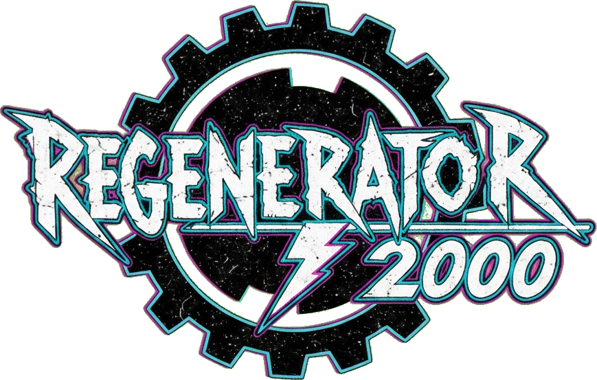
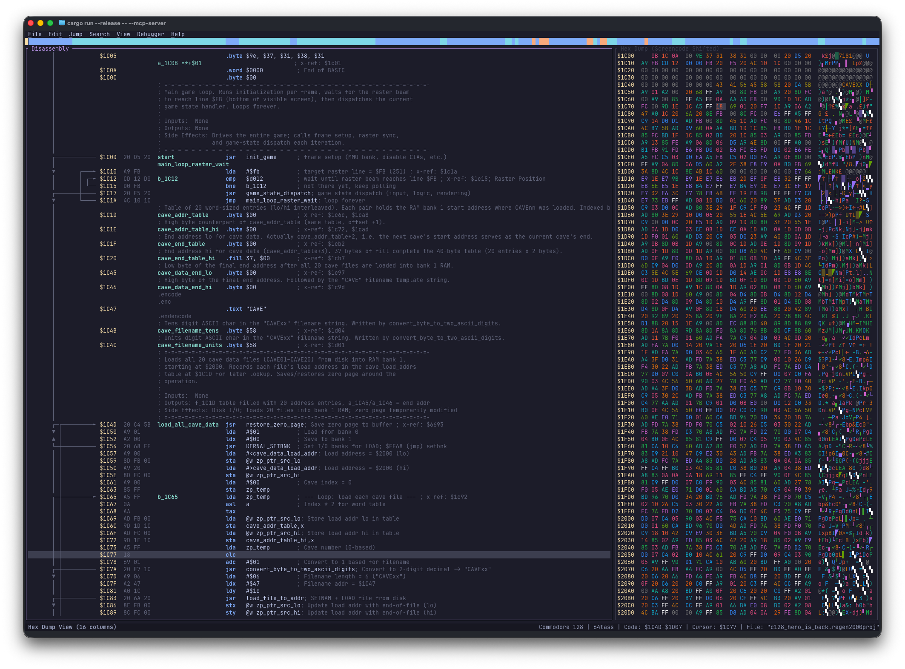
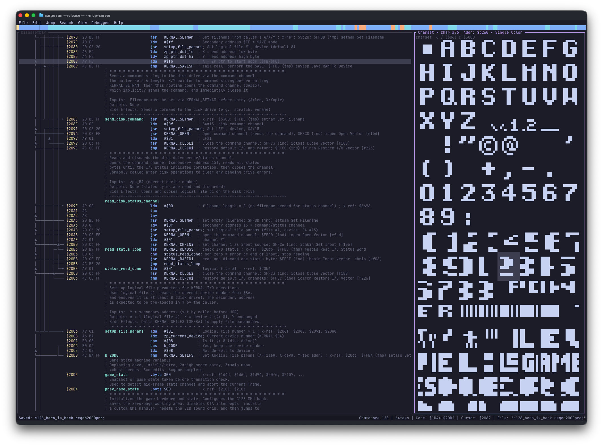
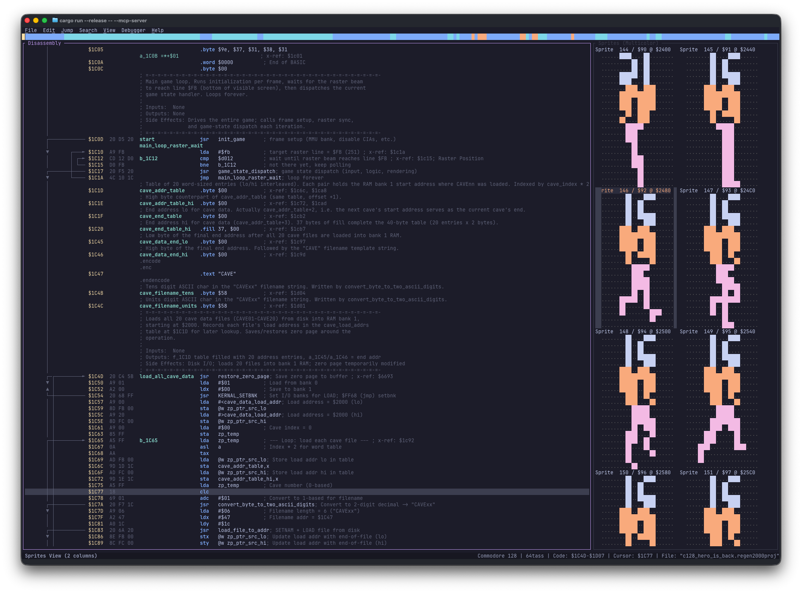
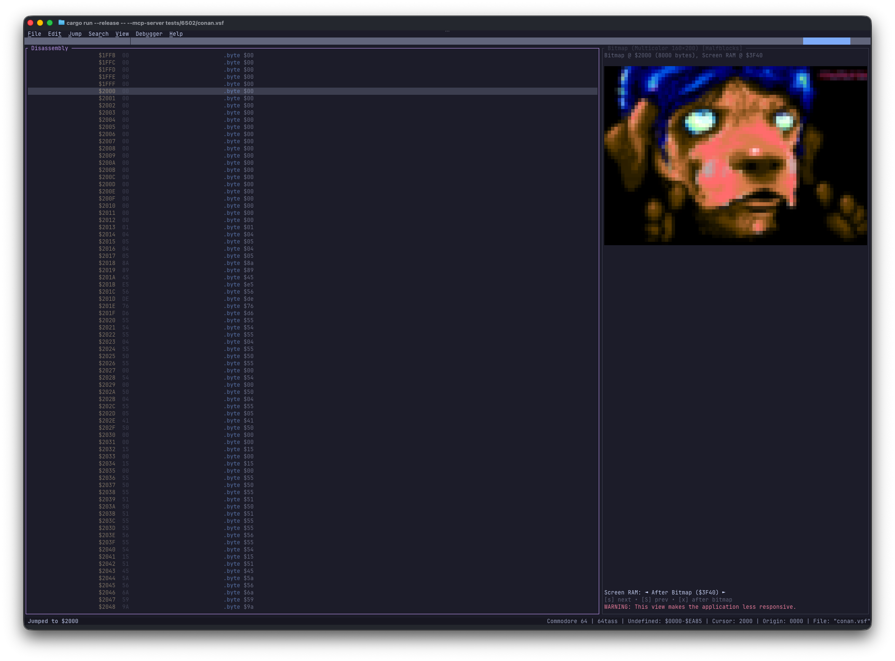
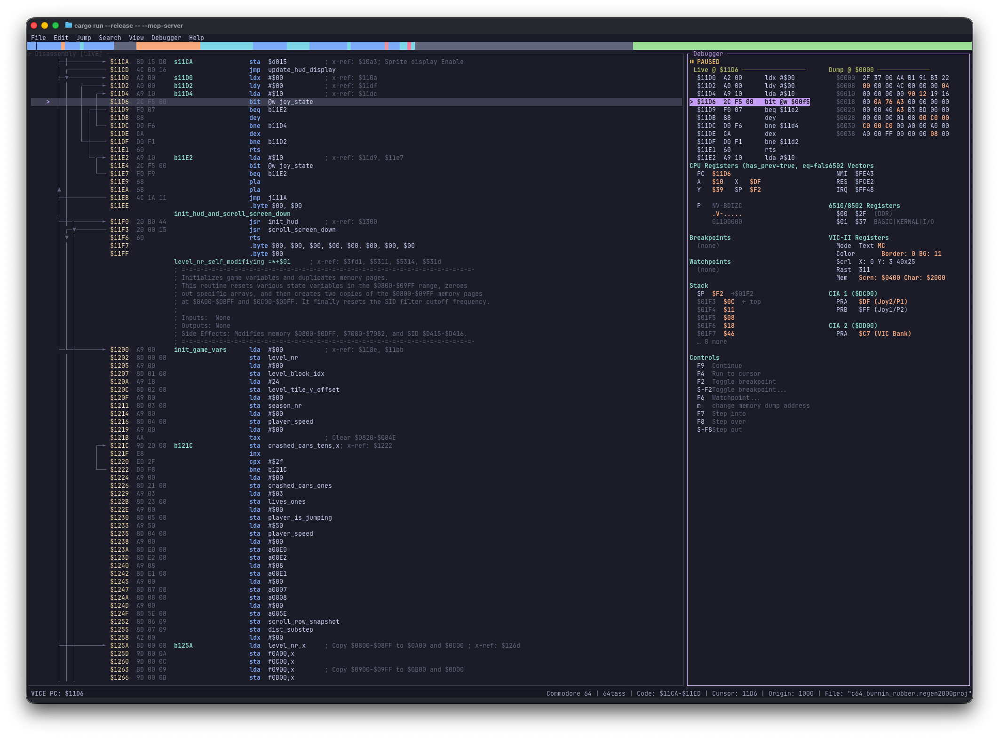

# Regenerator 2000


[](https://crates.io/crates/regenerator2000)
[](https://discord.gg/r5aMn6Cw5q)



Regenerator 2000 is an interactive 6502 disassembler for Commodore 8-bit machines. It builds on the original [Regenerator][regenerator].

- **🕹️ Manual Analysis** — Use the keyboard-centric TUI to navigate code, define data, label subroutines, add comments, and refine your disassembly.
- **🤖 Automated Analysis** — Use the built-in MCP Server and analysis skills so AI assistants classify blocks, trace routines, and name symbols.

Use either workflow independently, or combine them. Run an initial pass with the AI, and then refine the results interactively.

See the [Examples](https://regenerator2000.readthedocs.io/en/latest/examples/) page to inspect pre-disassembled games for different Commodore platforms.

[regenerator]: https://csdb.dk/release/?id=247992

## Features

Regenerator 2000 provides the following features for 6502 disassembly:

- **Disassembly**: Supports the full 6502 instruction set and undocumented opcodes.
- **Hex Dump**:
    - Displays a side-by-side view with the disassembly.
    - Supports synchronized or independent navigation.
    - Supports unshifted PETSCII, shifted PETSCII, and screencode character sets.
- **Sprites**:
    - Displays a side-by-side view with the disassembly.
    - Supports multicolor and single-color modes.
- **Bitmap**:
    - Displays a side-by-side view with the disassembly.
    - Supports high-resolution (320x200) and multicolor (160x200) modes.
    - Uses quadrant-block rendering for full resolution in the TUI.
- **Charset**:
    - Displays a side-by-side view with the disassembly.
    - Supports multicolor and single-color modes.
- **Blocks**:
    - Displays a side-by-side view with the disassembly.
- **Debugger**: Connects to VICE for live disassembly, breakpoints, and step controls (F2–F9) in the right pane.
- **Mini map**: Shows a mini map of the analyzed file.
- **Systems**: Supports Commodore 8-bit machines: C64, C128, VIC-20, Plus/4, PET 4.0, PET 2.0, and 1541.
- **Import**: Loads the following file formats:
    - PRG: Standard Commodore program files.
    - CRT: Cartridge images with bank selection support.
    - D64: 35-track, 40-track, and 42-track disk images.
    - D71: 70-track and 80-track double-sided disk images.
    - D81: 80-track disk images.
    - T64: Tape images.
    - VSF: VICE snapshot files.
    - RAW / BIN: Raw binary files.
    - DIS65: 6502bench project files.
    - REGEN2000PROJ: Regenerator 2000 project files.
- **Binary Unpacker**: Emulates a cycle-accurate 6502 sandbox to decompress packed programs automatically.
- **Export**: Exports projects to `.asm` or HTML for the following assemblers:
    - **64tass**
    - **ACME**
    - **Kick Assembler**
    - **ca65**
- **Project Management**: Saves and loads project state.
- **Analysis**: Runs auto-analysis to identify code and data regions.
- **Editing**:
    - **Labels**: Adds, edits, and removes local and global labels.
    - **Enums**: Defines and applies System, Global, and Project value-to-name mappings to replace numeric literals with semantic names.
    - **Comments**: Adds side comments and line comments.
    - **Origin**: Changes the load address (origin) of the binary.
    - **Data Types**: Converts regions to Code, Byte, Word, Address, Lo/Hi Address, Hi/Lo Address, Lo/Hi Word, Hi/Lo Word, PETSCII Text, Screencode Text, External File, or Undefined.
    - **Undo/Redo**: Tracks full history for all actions.
- **Navigation**:
    - **Jump**: Jumps to specific addresses, line numbers, or operand targets.
    - **X-Ref**: Inspects cross-references for labels and addresses.
    - **History**: Navigates back to previous locations.
- **Customization**:
    - Configures document settings (maximum x-refs, target system, and target assembler).
    - Customizes display options (such as label visibility).
- **TUI**:
    - Provides a keyboard-driven terminal user interface.
    - **Visual Mode**: Supports Vim-style selection for batch operations.
- **MCP Server**:
    - Provides Model Context Protocol (MCP) server support for programmatic access.
    - Supports HTTP and stdio transport modes.
    - Exposes tools for disassembly manipulation, memory search, and block operations.
    - Exposes resources to access binary data and views.
    - Includes analysis skills that automate block classification, routine tracing, and symbol naming.







## Requirements

### Recommended Terminals

Use a modern terminal to ensure full support for keyboard shortcuts and rendering.

| Platform    | Recommended Terminals                              |
| :---------- | :------------------------------------------------- |
| **Windows** | Windows Terminal, Alacritty, WezTerm               |
| **macOS**   | iTerm2, Ghostty, Alacritty, kitty, WezTerm         |
| **Linux**   | Ghostty, Alacritty, kitty, WezTerm, GNOME Terminal |

## Installation

### From Crates.io

```bash
cargo install regenerator2000
```

### From Source

```bash
git clone https://github.com/ricardoquesada/regenerator2000.git
cd regenerator2000
cargo install --path .
```

### Quick Start with AI Agents

Use the [regenerator2000-template](https://github.com/ricardoquesada/regenerator2000-template) repository to analyze binaries with an AI agent (such as Antigravity or Claude Code). This template includes the required skills and agent permissions so you can analyze binaries immediately.

## Usage

Start the application with an optional file path:

```bash
regenerator2000 [OPTIONS] [path/to/file.prg]
```

## CLI Options

- `--help`: Print the help message.
- `--version`: Print version information.
- `--import_lbl <PATH>`: Import VICE labels from the specified file.
- `--export_lbl <PATH>`: Export labels to the specified file after analysis or import.
- `--export_asm <PATH>`: Export assembly code to the specified file after analysis or import.
- `--export_html <PATH>`: Export HTML to the specified file after analysis or import.
- `--assembler <NAME>`: Override the assembler format for export (`64tass`, `acme`, `ca65`, or `kick`).
- `--headless`: Run in headless mode without the TUI for batch processing.
- `--verify`: Verify export roundtrip (export, assemble, and compare) for all assemblers. This flag implies `--headless`.
- `--mcp-server`: Run the MCP server over HTTP on port 3000.
- `--mcp-server-stdio`: Run the MCP server over stdio.
- `--vice <HOST:PORT>`: Connect to the VICE binary monitor at startup (for example, `--vice localhost:6502`).
- `--dump-system-config-files <PATH>`: Write all built-in system configuration files (`system-*.toml`) to the specified directory and exit.
- `--dump-theme-files <PATH>`: Write all built-in theme files (`theme-*.toml`) to the specified directory and exit. Place modified files in the [config directory](https://regenerator2000.readthedocs.io/en/latest/install/) to create custom themes.
- `--dump-enum-files <PATH>`: Write all built-in enum files (`enum-*.toml`) to the specified directory and exit. Place modified files in the [config directory](https://regenerator2000.readthedocs.io/en/latest/install/) to create custom enums.

Supported file formats: `.prg`, `.crt`, `.d64`, `.d71`, `.d81`, `.t64`, `.vsf`, 6502bench (`.dis65`), `.bin`, `.raw`, and `.regen2000proj`.

## Keyboard Shortcuts

See the [Keyboard Shortcuts](https://regenerator2000.readthedocs.io/en/latest/keyboard_shortcuts/) page for the complete list of shortcuts.

## Support and Documentation

- [Documentation](http://regenerator2000.readthedocs.io/)
- [Examples](https://regenerator2000.readthedocs.io/en/latest/examples/): View disassembled Commodore games and software across supported platforms.
- [Support in Discord][discord]: Join the `#regenerator2000` channel under **"Misc Projects"**.

[discord]: https://discord.gg/r5aMn6Cw5q

## Contributing

Submit a Pull Request to contribute changes.

## Acknowledgements

- [Regenerator][regenerator]: The original 6502 disassembler for Windows.
- [unp64][unp64]: The C64 binary unpacker by iAN CooG that forms the basis of the unpacker module.
- [64tass][64tass], [ACME][ACME], [Kick Assembler][Kick Assembler], [ca65][ca65]: Supported assemblers.

[unp64]: https://csdb.dk/release/?id=260619
[64tass]: https://tass64.sourceforge.net/
[ACME]: https://sourceforge.net/projects/acme-crossass/
[Kick Assembler]: http://www.theweb.dk/KickAssembler/
[ca65]: https://cc65.github.io/

## License

Dual license: MIT and Apache 2.
