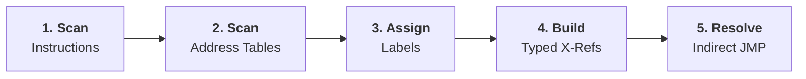

# Analysis

Regenerator 2000 runs an **auto-analyzer** over your binary to name targets by addressing mode and build typed cross-references (`X-Ref`).

## Triggering the Analyzer

- **On Load:** Runs automatically when auto-analysis is active in [Settings](settings.md).
- **On Demand (++ctrl+a++):** Reruns after you reclassify blocks, add address tables, or change system definitions.

User-defined labels and comments are never overwritten—renaming any address locks it from future auto-generation.

---

## How It Works

The analyzer scans the binary in five deterministic passes:

### 1. Instruction Scanning

Every operand in a **Code** block is classified by its 6502 addressing mode:

| Addressing Mode | Example Instruction | Label Type Generated |
| :--- | :--- | :--- |
| Absolute | `JSR $C000` | **Subroutine** (`s_`) |
| Absolute | `JMP $C000` | **Jump** (`j_`) |
| Absolute | `LDA $C000` | **Absolute Address** (`a_`) |
| Absolute,X / Y | `LDA $C000,X` | **Field** (`f_`) |
| Indirect | `JMP ($0300)` | **Pointer** (`p_`) |
| Zero Page | `LDA $A0` | **ZP Absolute Address** (`zpa_`) |
| Zero Page,X / Y | `LDA $A0,X` | **ZP Field** (`zpf_`) |
| (Indirect,X) / (Indirect),Y | `LDA ($FB,X)` / `LDA ($FB),Y` | **ZP Pointer** (`zpp_`) |
| Relative | `BNE $C010` | **Branch** (`b_`) |

*(Implied, Accumulator, and unlinked Immediate instructions do not create labels. Any `JSR`, `JMP`, or branch landing directly on `RTS` `$60` or `RTI` `$40` gets a **Return** `r_` label, matching IDA Pro's `locret_` convention.)*

### 2. Data Block Scanning

- **Address (`Address`) blocks:** Reads 16-bit little-endian pairs and creates `a_` labels at each target.
- **Lo/Hi & Hi/Lo Address tables:** Splits the block in half and pairs corresponding low/high bytes into target labels. *(Insert [splitters](tutorial.md#splitters) with ++pipe++ between adjacent tables so they don't auto-merge.)*
- **Lo/Hi & Hi/Lo Word tables:** Skipped during label generation because they hold raw numeric constants rather than addresses.
- **Fill Run Detection:** Groups runs of identical bytes inside **Byte** blocks once they meet **Fill run threshold** in [Document Settings](settings.md).

### 3. Label Generation

1. **Preserve user labels:** Keeps any `LabelKind::User` name untouched.
2. **Assign internal labels:** Targets inside the binary receive a label matching the first reference encountered.
3. **Assign external labels:** Control-flow targets (`JSR`, `JMP`, branches) outside the binary receive **External Jump** (`e_`) labels; data targets keep their normal prefix.

### 4. Cross-Reference Building

Each reference records a typed `XRef` classified into one of six badges:

| Badge | Kind | Source Instructions and Blocks |
| :--- | :--- | :--- |
| `[R]` | Read | Load, bitwise, arithmetic, and compare (`LDA`, `LDX`, `LDY`, `CMP`, `BIT`, `LAX`) |
| `[W]` | Write | Store instructions (`STA`, `STX`, `STY`, `SAX`) |
| `[R/W]` | Read-Modify-Write | In-place shifts, rotates, increments/decrements (`INC`, `DEC`, `ASL`, `LSR`, `ROL`, `ROR`, `ISC`) |
| `[C]` | Call | Subroutine calls (`JSR`) |
| `[J]` | Jump | Unconditional jumps (`JMP`) and relative branches (`BNE`, `BEQ`, `BCC`, `BCS`) |
| `[O]` | Offset | Immediate `#<label` / `#>label` operands and `Address` / `Lo/Hi Address` / `Hi/Lo Address` tables |

The Disassembly View summarizes sources inline (`; x-ref: $xxxx, $yyyy`). Press ++ctrl+x++ (**Find References**) to view full typed badges and jump to any caller with ++enter++.

### 5. Indirect Jump Resolution

In the final pass, `JMP ($xxxx)` instructions pointing at an internal **Address** block resolve their 16-bit vector and record a `[J]` jump cross-reference at the indirect destination.

---

## Label Prefixes

### Code-Flow Labels

| Prefix | Full Name | Generated When | Example |
| :--- | :--- | :--- | :--- |
| `s_` | Subroutine | Target of `JSR` | `s_C000` |
| `j_` | Jump | Target of `JMP` | `j_C100` |
| `b_` | Branch | Target of relative branch (`BNE`, `BEQ`, …) | `b_C010` |
| `r_` | Return | `JSR`/`JMP`/branch landing directly on `RTS` or `RTI` | `r_AACC` |
| `e_` | External Jump | `JSR`/`JMP`/branch targeting outside the binary | `e_FFD2` |

### Data-Access Labels

| Prefix | Full Name | Generated When | Example |
| :--- | :--- | :--- | :--- |
| `a_` | Absolute Address | `LDA $XXXX`, `STA $XXXX` (absolute) | `a_D020` |
| `f_` | Field | `LDA $XXXX,X`, `STA $XXXX,Y` (absolute indexed) | `f_0400` |
| `p_` | Pointer | `JMP ($XXXX)` (indirect) | `p_0300` |
| `zpa_` | ZP Absolute Address | `LDA $XX`, `STA $XX` (zero page) | `zpa_A0` |
| `zpf_` | ZP Field | `LDA $XX,X`, `STA $XX,Y` (zero page indexed) | `zpf_30` |
| `zpp_` | ZP Pointer | `LDA ($XX),Y`, `LDA ($XX,X)` (indirect zero page) | `zpp_FB` |

### User-Defined Labels

| Prefix | Full Name | Description |
| :--- | :--- | :--- |
| `L_` | User-Defined | Default prefix when creating a manual label (++l++) |
| `scope_` | LocalUserDefined | Prefix for labels inside a scope (`.proc` / `.block`) |

---

## Address Formatting

| Address Range | Hex Digits | Example |
| :--- | :---: | :--- |
| Zero page (`$00–$FF`) with ZP type | 2 | `zpa_A0`, `zpf_30`, `zpp_FB` |
| Zero page (`$00–$FF`) with absolute type | 4 | `a_00A0`, `f_0030`, `p_00FB` |
| Above zero page (`$0100+`) | 4 | `s_C000`, `j_1005`, `a_D020` |

---

## Excluded Addresses & System Labels

### Excluding Noisy Addresses

- **System-Level:** Enable **Exclude well-known addresses from symbolic analysis** in [Document Settings](settings.md) to suppress noisy system ranges from the active [Target System](systems.md).
- **Per-Project:** Put the cursor on any **external label** and press ++delete++ to add it to the project's user-excluded list (press ++u++ to undo).

Excluded addresses generate no labels or cross-references during analysis.

### System-Specific Labels

Selecting a target machine loads predefined `LabelKind::System` symbols for hardware registers, ROM routines, and OS variables—taking precedence over auto-generated prefixes (for example, C64 `$D020` → `BORDER`, `$D021` → `BGCOL0`, `$FFD2` → `CHROUT`, `$FFE4` → `GETIN`).

Rerun the analyzer anytime with ++ctrl+a++ after reclassifying blocks, defining tables, or loading updated system configs.
