# Architecture of Regenerator 2000

Regenerator 2000 is an interactive disassembler and reverse-engineering suite in Rust for 8-bit MOS 6502/6510 Commodore computers (C64, C128, VIC-20, Plus/4, C16, PET 2001, PET 4000/8000, and 1541/1571/1581 drives).

The system enforces a **unidirectional data flow** and separates the headless core engine from the user interfaces. User input, automated analysis passes, external debuggers, and Model Context Protocol (MCP) AI agents all communicate through a single deterministic action-dispatch pipeline.

---

## 1. High-Level Overview

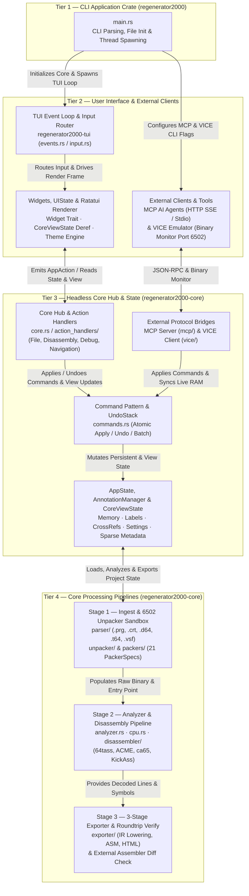

---

## 2. Workspace & Crate Structure

The Cargo workspace splits Regenerator 2000 into three crates with strict unidirectional dependencies:

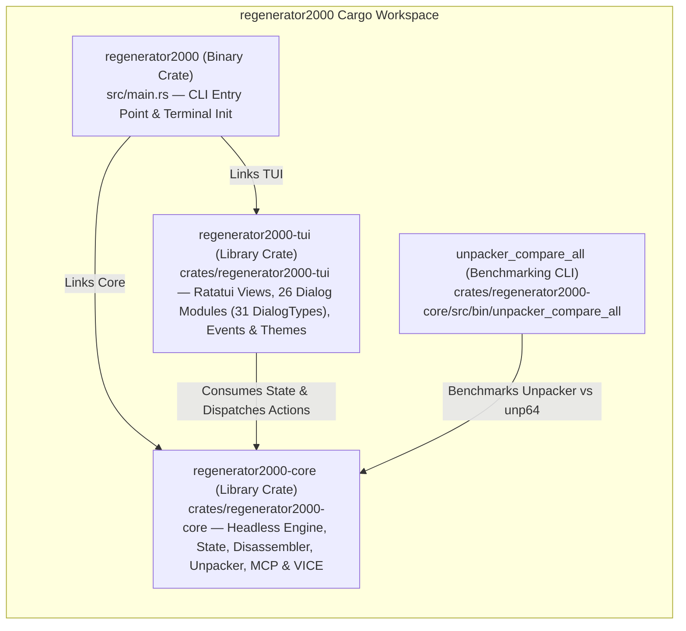

### `regenerator2000-core` Modules (`crates/regenerator2000-core/src/`)

| Module / Path | Responsibility |
| :--- | :--- |
| `core.rs` | Engine central hub (`Core`) combining `AppState` and `CoreViewState`. |
| `action_handlers/` | Modular domain action dispatchers (`file_handler`, `disassembly_handler`, `debug_handler`, `navigation_handler`) and `DisassemblyViewAnchor`. |
| `state/` | Domain models (`AppState`, `Addr`, `BlockType`, `TargetSystem`, `SymbolicOffset`, `XRef`, `XRefKind`), sparse `AnnotationManager`, and `.regen2000proj` persistence. |
| `disassembler/` | Disassembly pipeline, 5-tier symbol and symbolic-offset resolution, data block formatters, and 4 assembler backends (`64tass`, `ACME`, `ca65`, `KickAss`). |
| `cpu.rs` | MOS 6502/6510 256-opcode table, cycle counts, `AddressingMode` (`is_zero_page()`), `Opcode::xref_kind()`, and undocumented opcodes. |
| `commands.rs` | Reversible `Command` enum and `UndoStack` for atomic undo/redo and batch execution. |
| `analyzer.rs` | Recursive control-flow tracer, symbolic-offset target redirection, typed cross-reference (`XRef` / `XRefKind`) builder, fill-run detector, and auto-label generator. |
| `parser/` | Container and symbol parsers (`.prg`, BASIC `SYS`, `.crt`, `.d64`/`.d71`/`.d81`, `.t64`, `.dis65`, `.lbl`, `.vsf`). |
| `exporter/` | 3-stage Exporter IR pipeline (`ir.rs`), pure ASM/HTML backends (`asm.rs`, `html.rs`), and roundtrip assembler verification (`verify.rs`). |
| `unpacker/` | 2-phase 6502 emulation sandbox (`bus.rs`, `cia.rs`, `machine.rs`, `engine.rs`, `detector.rs`). |
| `packers/` | Declarative `PackerSpec` definitions (`spec.rs`) and priority-ordered `REGISTRY` (`registry.rs`) covering 21 packer families. |
| `mcp/` | Model Context Protocol server over HTTP SSE (`http.rs`) and Stdio (`stdio.rs`), request router (`handler.rs`), and tool submodules (`tools/`). |
| `vice/` | Live VICE binary monitor TCP client (`client.rs`), packet codec (`protocol.rs`), state (`state.rs`), and CIA I/O decoder (`c64_hardware.rs`). |
| `assets.rs` / `config.rs` | Embedded ROM labels, platform `system-*.toml` configs, `enum-*.toml` definitions, and user `config.toml` persistence. |
| `error.rs` / `event.rs` | Typed `thiserror` error hierarchy (`CoreError`) and frontend-agnostic `CoreEvent` / `DialogType` vocabularies. |
| `navigation.rs` / `view_state.rs` | Address jump/bookmark helpers and frontend-agnostic `CoreViewState` cursor/pane tracking. |
| `bin/unpacker_compare_all/` | Corpus oracle comparison and CI drift CLI (`main.rs`, `cli.rs`, `check.rs`, `update.rs`, `record.rs`, `observation.rs`, `markdown.rs`, `unp64/`, and `corpus/`). |

### `regenerator2000-tui` Modules (`crates/regenerator2000-tui/src/`)

| Module / Path | Responsibility |
| :--- | :--- |
| `events.rs` / `events/input.rs` | Main TUI event loop, background thread coordination, and keyboard/mouse input routing. |
| `ui.rs` / `ui_state.rs` | Top-level Ratatui layout engine and `UIState` (wrapping `CoreViewState` via `Deref`). |
| `theme.rs` / `theme_file.rs` | Runtime color theme engine and TOML theme file parser/exporter. |
| `ui/widget.rs` / `ui/navigable.rs` | `Widget` trait (`render`, `handle_input`, `handle_mouse`, `handle_tick`, `refresh`), `WidgetResult`, `Navigable` trait, and `AlignedGridRange` grid helpers. |
| `ui/scoped_input.rs` | Shared single-line `ScopedInputModal` and `ScopeLock` controller for `LabelDialog` and `SymbolicOffsetDialog`. |
| `ui/statusbar.rs` / `ui/minimap_bar.rs` | Dynamic bottom status bar and memory block distribution minimap bar. |
| `ui/menu/` | Top menu bar model (`menu_model.rs`), popup renderer (`menu_render.rs`), and action dispatcher (`menu_action.rs`). |
| `ui/view_disassembly/` | Modular disassembly view (`mod.rs`, `layout.rs`, `navigation.rs`, `mouse.rs`, `render.rs`). |
| `ui/view_*.rs` | Right-pane views: `view_hexdump.rs`, `view_sprites.rs`, `view_charset.rs`, `view_bitmap.rs`, `view_blocks.rs`, and `view_debugger.rs`. |
| `ui/dialog_*.rs` | 26 modal dialog modules serving 31 `DialogType` variants (including `SymbolicOffsetDialog`, unified `FileBrowserDialog`, `PromptDialog`, `ContainerPickerDialog`, and table-driven `DocumentSettingsDialog`). |

---

## 3. Subsystem Deep Dives

### 3.1 Central Hub & Domain Action Handlers

`Core` (`core.rs`) combines persistent domain state (`AppState` in `state/app_state.rs`) and transient view state (`CoreViewState` in `view_state.rs`):

```rust
pub struct Core {
    pub state: AppState,
    pub view: CoreViewState,
}
```

#### The Action Dispatch Pipeline

Frontends send `AppAction` (`state/actions.rs`) enum variants to `Core::apply_action()`. The hub checks document safety guards, prompts for confirmation on unsaved changes, and delegates execution to domain handlers via `ActionContext<'a>` (`action_handlers/mod.rs`):

```rust
pub struct ActionContext<'a> {
    pub state: &'a mut AppState,
    pub view: &'a mut CoreViewState,
    pub events: &'a mut Vec<CoreEvent>,
}
```

The context provides `preserve_cursor()` and `DisassemblyViewAnchor` (`capture_anchor()` and `restore_anchor()`). These helpers re-anchor the cursor and visual selection when preamble rows or labels change.

#### Modular Action Handlers (`action_handlers/`)

Each domain handler implements `DomainActionHandler`:

-   **`file_handler.rs`**: Opens and saves projects, exports ASM and HTML files, imports and exports VICE labels, and starts binary unpacking.
-   **`disassembly_handler.rs`**: Updates memory block types, user comments, labels, symbolic offsets, immediate operand formats, scopes, splitters, and enum usages.
-   **`debug_handler.rs`**: Manages the VICE monitor TCP connection, execution stepping (Step, Step Over, Step Out, Continue, Run to Cursor), and breakpoints/watchpoints.
-   **`navigation_handler.rs`**: Handles address jumps, operand target resolution, navigation history, bookmarks, symbol lookup, and cross-reference queries.

#### Domain Errors & Events

-   **`error.rs`**: Defines a typed error hierarchy using `thiserror`. `CoreError` wraps `UnpackError`, `ExportError`, `ViceError`, `ProjectError`, and `ParseFailed`. The `IoResultExt` trait attaches file path context (`with_path`) to standard I/O errors.
-   **`event.rs`**: Defines frontend-agnostic events via `CoreEvent` (`StateChanged`, `ViewChanged`, `StatusMessage`, `DialogRequested(DialogType)`, `DialogDismissalRequested`, `QuitRequested`, `OpenUrl`, `UnpackStarted`, `StartMcpServerRequested`, and `StopMcpServerRequested`) and 31 modal `DialogType` variants.
-   **`view_state.rs`**: Implements `CoreViewState` to track active panes (`ActivePane`), right-pane modes (`RightPane`), cursor indices, visual selections, scroll offsets, navigation history, and search queries.

---

### 3.2 Application State & Memory Domain (`state/`)

`AppState` (`state/app_state.rs`) stores all persistent project state:

```rust
pub struct AppState {
    pub schema_version: u32,
    pub file_path: Option<PathBuf>,
    pub project_path: Option<PathBuf>,
    pub raw_data: Vec<u8>,
    pub disassembly: Vec<DisassemblyLine>,
    pub cached_arrows: Vec<CachedArrow>,
    pub origin: Addr,
    pub entry_point: Option<Addr>,
    pub entropy: Option<f32>,
    pub block_types: Vec<BlockType>,
    pub labels: BTreeMap<Addr, Vec<Label>>,
    pub settings: DocumentSettings,
    pub annotations: AnnotationManager,
    pub cross_refs: BTreeMap<Addr, Vec<XRef>>,
    pub enums: BTreeMap<String, EnumDefinition>,
    pub user_global_enums: BTreeMap<String, EnumDefinition>,
    pub builtin_enums: BTreeMap<String, EnumDefinition>,
    pub system_config: SystemConfig,
    pub undo_stack: UndoStack,
    pub last_saved_pointer: usize,
    pub user_excluded_addresses: BTreeSet<Addr>,
    pub collapsed_blocks: Vec<(usize, usize)>,
    pub splitters: BTreeSet<Addr>,
    pub vice_state: ViceState,
    pub vice_client: Option<ViceClient>,
    pub mcp_server_running: bool,
    // ...
}
```

#### Sparse Address Metadata (`state/annotations.rs`)

`AnnotationManager` consolidates per-address metadata into a single sparse map instead of separate address-keyed tables. Each address maps to an `AddressEntry`:

-   `system_comment`: Transient ROM or hardware comment loaded from system assets.
-   `user_side_comment`: Persisted inline trailing comment.
-   `user_line_comment`: Persisted preceding block or line comment.
-   `immediate_format`: Operand representation override (`Hex`, `InvertedHex`, `Decimal`, `NegativeDecimal`, `Binary`, `InvertedBinary`, `LowByte(Addr)`, or `HighByte(Addr)`).
-   `bookmark`: Persisted user bookmark label.
-   `scope`: Persisted routine scope boundary address.
-   `enum_usage`: Persisted enumeration reference name.
-   `operand_offset`: Persisted Tier 1 per-site `SymbolicOffset` on an instruction or address-table entry.
-   `address_offset`: Persisted Tier 2 global `SymbolicOffset` on a target memory address.

`AnnotationManager` normalizes whitespace and zero-displacement offsets, and removes empty entries automatically. Its custom `Serialize` implementation writes one JSON object per address and skips transient `system_comment` values. Its custom `Deserialize` implementation also accepts the legacy per-field maps (`user_side_comments`, `user_line_comments`, `immediate_value_formats`, `bookmarks`, `scopes`, and `enum_usages`), so older `.regen2000proj` files load without errors.

#### Domain Types (`state/types.rs`)

-   **`TargetSystem`**: Identifies the target hardware platform (`C64`, `C128`, `Vic20`, `Pet20`, `Pet40`, `Plus4`, `C16`, `C1541`, `C1571`, `C1581`, or `Custom(Box<str>)`). Provides platform constants such as RAM start, default BASIC start, screen RAM address, I/O boundaries, and hardware vectors.
-   **`Addr`**: Wraps a 16-bit memory address (`pub struct Addr(pub u16)`). Implements wrapping 16-bit address arithmetic, hexadecimal formatting, and numeric JSON serialization.
-   **`BlockType`**: Classifies memory regions (`Code`, `DataByte`, `DataWord`, `Address`, `PetsciiText`, `ScreencodeText`, `LoHiAddress`, `HiLoAddress`, `LoHiWord`, `HiLoWord`, `ExternalFile`, and `Undefined`).
-   **`Assembler`**: Selects the target assembler syntax (`Tass64`, `Acme`, `Ca65`, or `Kick`).
-   **`SymbolicOffset`, `OffsetRadix`, `OffsetParentheses` & `OperandTargetSite`**: Model two-tier symbolic displacements (`base +/- offset`), decimal or hex radices, byte-extractor parenthesization, and decoded operand target sites.
-   **`XRef` & `XRefKind`**: Represent a typed cross-reference edge (`from: Addr`, `kind: XRefKind`) and its semantic access or control-flow classification: `Read` (`[R]`), `Write` (`[W]`), `ReadModifyWrite` (`[R/W]`), `Call` (`[C]`), `Jump` (`[J]`), and `Offset` (`[O]`). Sorted deterministically by `(from, kind)`.

---

### 3.3 Disassembly Pipeline & Assembler Formatting Suite (`disassembler/`)

The disassembly pipeline converts raw binary bytes and metadata into formatted assembly lines:

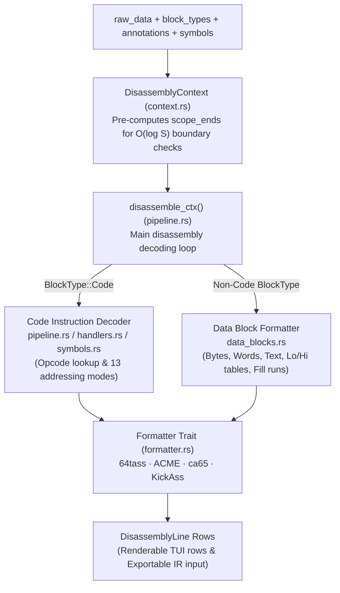

-   **`mod.rs`**: Exports `DisassemblyLine`, the zero-allocation static formatter lookup `Disassembler::formatter()`, the shared column-alignment and splitter constants `LABEL_COLUMN_WIDTH` (`20`), `DEFINITION_COLUMN_WIDTH` (`40`), `INSTRUCTION_COLUMN_WIDTH` (`40`), `CODE_COLUMN_WIDTH` (`41`), and `SPLITTER_MNEMONIC` (`"{splitter}"`), and the shared per-line semantic lowering and visual geometry layer consumed by the TUI disassembly view, search engine, action handlers, and batch exporters:

    -   `DisassemblyLineKind` and `DisassemblyLine::classify_kind()`: Classifies each line into `Blank`, `Splitter`, `CollapsedBlock`, `ExternalEquate(Addr)`, `EnumDefinition`, `ScopeDelimiter`, `HeaderComment`, or `Instruction` without ad-hoc string-sniffing.
    -   `LabelPlacement` (`None`, `Inline`, `OwnLine`) and `DisassemblyLine::label_placement()`: Evaluates formatted label length (`>= LABEL_COLUMN_WIDTH`, accounting for `ca65`/`KickAssembler` trailing `:`) and unindented scope braces (`{`/`}`).
    -   `MidInstructionLabel` and `DisassemblyLine::mid_instruction_labels()`: Resolves at most one highest-priority relative label (`* + offset`) per intermediate byte via `symbols::resolve_label` and formats local label prefixes deduplicated via `MidInstructionLabel::format_definition()`.
    -   `VisualLineCounts` and `DisassemblyLine::visual_line_counts()`: Computes exact sub-line counts (`labels`, `comments`, `instruction`, `total()`, `own_line_label_sub_index()`, `opcode_sub_index()`) alongside bidirectional address-to-sub-cursor resolvers `address_at_sub_index()` and `get_sub_index_for_address()`.

-   **`context.rs`**: `DisassemblyContext` holds references to memory buffers, block types, labels, cross-references, settings, and annotations. It pre-computes `scope_ends` into a `BTreeSet`. `is_virtual_splitter()` treats user splitters, scope starts, and scope ends as section breaks with `O(log S)` lookups, while `breaks_data_group()` provides a unified interior boundary predicate (block type changes, user labels, comments, virtual splitters, and mid-group cross-references) for multi-byte data formatters.
-   **`pipeline.rs`**: Drives the main disassembly loop, emits label header lines, and decodes instructions via `disassemble_code_instruction`.
-   **`symbols.rs`**: Enforces 5-tier symbol and symbolic-offset precedence (`Tier 1 operand_offset` > `User` > `Tier 2 address_offset` > `System` > `Auto`), formats local labels and scope paths (`compute_scope_names`), and wraps byte-extractor offsets via `OffsetParentheses`.
-   **`data_blocks.rs`**: Formats non-code blocks including byte tables (`.byte`), 16-bit words (`.word`), address tables, PETSCII and Screencode strings, split Lo/Hi and Hi/Lo tables, external binary includes (`.incbin`), and fill runs (`.fill`).
-   **`handlers.rs`**: Decodes instruction operands across all 13 MOS 6502 addressing modes.
-   **`formatter.rs`** and Assembler Formatters: Defines the `Formatter` trait, shared 13-mode operand formatting in `Formatter::format_operand()` (parameterized by `accumulator_operand()` and `absolute_zero_page_prefix()` with `FormatContext::should_force_absolute()`), file-level preamble directives via `FileDirective` and `Formatter::format_file_directives()`, and mid-instruction relative label definitions via `Formatter::format_relative_label()`:

    -   `formatter_64tass.rs`: Formats 64tass syntax (`.byte`, `.word`, `.text`, `.fill`, `.binary`, `* = $ADDR`, `.block`/`.bend`, and `@w` forced absolute operands).
    -   `formatter_acme.rs`: Formats ACME syntax (`!byte`, `!word`, `!text`, `!fill`, `!binary`, `* = $ADDR`, `!zone`, and `+2` forced absolute mnemonics).
    -   `formatter_ca65.rs`: Formats ca65 syntax (`.byte`, `.word`, `.res`, `.incbin`, `.org $ADDR`, `.proc`/`.endproc` scopes, `.enum`/`.endenum` definitions, `a:` forced absolute operands, and `.macpack cbm` via `format_file_directives`).
    -   `formatter_kickasm.rs`: Formats KickAssembler syntax (`.byte`, `.word`, `.text`, `.fill`, `.import binary`, `* = $ADDR`, `.label name = * + offset`, `{`/`}` scope blocks, `.namespace` enum blocks, and `.abs` forced absolute mnemonics).

---

### 3.4 MOS 6502/6510 CPU Model (`cpu.rs`)

The CPU module defines all 256 opcode bytes of the MOS 6502/6510 processor:

-   **`Opcode`**: Stores the mnemonic, addressing mode, byte length (1–3), cycle count, description, illegal-opcode flag, and `Opcode::xref_kind()` classifier (`Read`, `Write`, `ReadModifyWrite`, `Call`, or `Jump`).
-   **`AddressingMode`**: Enumerates all 13 addressing modes (`Implied`, `Accumulator`, `Immediate`, `ZeroPage`, `ZeroPageX`, `ZeroPageY`, `Relative`, `Absolute`, `AbsoluteX`, `AbsoluteY`, `Indirect`, `IndirectX`, and `IndirectY`), `AddressingMode::is_zero_page()`, and an `Unknown` sentinel for undecodable bytes.
-   **Undocumented Opcodes**: Supports undocumented 6502 opcodes (`LAX`, `SAX`, `DCP`, `ISC`, `SLO`, `RLA`, `SRE`, `RRA`, `ALR`, `ANC`, `ARR`, `AXS`, multi-byte `NOP` variants, and `KIL`/`JAM`). If you disable `use_illegal_opcodes` in Document Settings, the disassembler formats undocumented opcodes as raw `.byte` values.

---

### 3.5 Command Pattern & Undo/Redo Engine (`commands.rs`)

Every state mutation in Regenerator 2000 executes as an atomic, reversible `Command`:

```rust
pub enum Command {
    SetBlockType { range: Range<usize>, new_type: BlockType, old_types: Vec<BlockType> },
    SetLabel { address: Addr, new_label: Option<Vec<Label>>, old_label: Option<Vec<Label>> },
    SetAnalysisData { labels: BTreeMap<Addr, Vec<Label>>, cross_refs: BTreeMap<Addr, Vec<XRef>>, old_labels: BTreeMap<Addr, Vec<Label>>, old_cross_refs: BTreeMap<Addr, Vec<XRef>> },
    SetUserSideComment { address: Addr, new_comment: Option<String>, old_comment: Option<String> },
    SetUserLineComment { address: Addr, new_comment: Option<String>, old_comment: Option<String> },
    ChangeOrigin { new_origin: Addr, old_origin: Addr },
    SetImmediateFormat { address: Addr, new_format: Option<ImmediateFormat>, old_format: Option<ImmediateFormat> },
    CollapseBlock { range: (usize, usize) },
    UncollapseBlock { range: (usize, usize) },
    ToggleSplitter { address: Addr },
    ImportLabels { new_labels: Vec<(Addr, Label)>, old_labels: BTreeMap<Addr, Vec<Label>> },
    AddScope { start: Addr, end: Addr, old_end: Option<Addr> },
    RemoveScope { address: Addr, old_end: Addr },
    SetBookmark { address: Addr, new_name: Option<String>, old_name: Option<String> },
    SetUserExcludedAddress { address: Addr, add: bool, old_labels: BTreeMap<Addr, Vec<Label>>, old_cross_refs: BTreeMap<Addr, Vec<XRef>> },
    SetEnumUsage { address: Addr, new_enum: Option<String>, old_enum: Option<String> },
    SetEnumDefinition { name: String, new_definition: Option<EnumDefinition>, old_definition: Option<EnumDefinition> },
    SetOperandOffset { address: Addr, new_offset: Option<SymbolicOffset>, old_offset: Option<SymbolicOffset> },
    SetAddressOffset { address: Addr, new_offset: Option<SymbolicOffset>, old_offset: Option<SymbolicOffset> },
    Batch(Vec<Command>),
}
```

-   **`UndoStack`**: Maintains the undo and redo history and exposes a stack pointer. `AppState::is_dirty()` compares this pointer with `AppState::last_saved_pointer`.
-   **`apply(&self, state: &mut AppState)`**: Applies the state change and invalidates dependent caches.
-   **`undo(&self, state: &mut AppState)`**: Reverts the state change and restores previous values.
-   **Atomic Batches**: `Command::Batch` groups multiple mutations (such as multi-address label updates or batch MCP calls) into a single undoable operation.

---

### 3.6 Control-Flow & Heuristic Analyzer (`analyzer.rs`)

The analyzer scans the binary memory buffer to discover subroutines, jump targets, typed cross-references (`BTreeMap<Addr, Vec<XRef>>`), and fill runs:

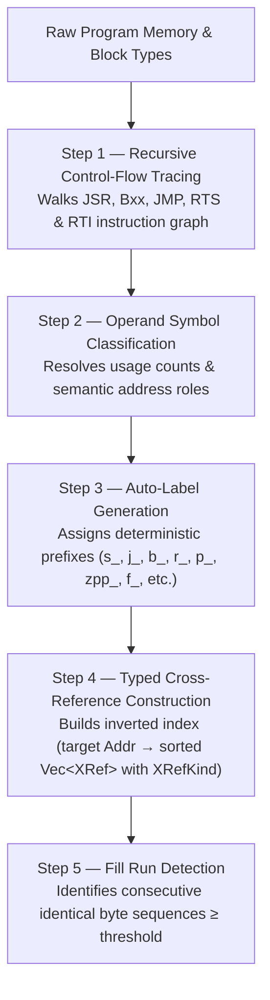

The analyzer records each reference as a typed `XRef` (`from: Addr`, `kind: XRefKind`) and deduplicates entries in `(from, kind)` order:

-   **Instruction Operands**: `Opcode::xref_kind()` classifies operands as `Read` (`[R]`), `Write` (`[W]`), `ReadModifyWrite` (`[R/W]`), `Call` (`[C]`), or `Jump` (`[J]`). Indirect jump targets resolved through `Address` blocks (`JMP ($xxxx)`) also emit `XRefKind::Jump`.
-   **Symbolic Offsets & Address Tables**: Immediate low/high byte formats (`ImmediateFormat::LowByte(Addr)` / `HighByte(Addr)`) and 16-bit address blocks (`BlockType::Address`, `LoHiAddress`, `HiLoAddress`) emit `XRefKind::Offset` (`[O]`).
-   **Displaced Target Redirection**: When an active `SymbolicOffset` applies (enforcing `base <= $00FF` in zero-page modes), the analyzer redirects cross-references and auto-label generation from `raw_target` to `sym.base`.

#### Auto-Generated Label Prefixes

The analyzer assigns deterministic prefixes based on instruction context and address width:

| Prefix | Category | Semantics |
| :--- | :--- | :--- |
| `s_` | Subroutine | Target of a `JSR` instruction (for example, `s_C000`). |
| `j_` | Jump Target | Target of an absolute `JMP` instruction (for example, `j_0400`). |
| `b_` | Branch Target | Target of a relative conditional branch (`BEQ`, `BNE`, `BCC`, `BCS`, `BPL`, `BMI`, `BVC`, or `BVS`). |
| `r_` | Return Target | Target of a branch or jump whose first instruction is `RTS` or `RTI` (equivalent to IDA Pro `locret_`). |
| `p_` | Pointer | 16-bit address referenced by data instructions (for example, `p_1000`). |
| `zpp_` | Zero-Page Pointer | Zero-page address used in indirect addressing (`($zp),Y` or `($zp,X)`). |
| `f_` | Field | Absolute memory location read or written by data instructions. |
| `zpf_` | Zero-Page Field | Zero-page memory location read or written by data instructions. |
| `a_` | Absolute Address | Target inside an address table or external memory reference. |
| `zpa_` | Zero-Page Absolute | Zero-page address embedded inside an address table. |
| `e_` | External Jump | Jump target located outside the loaded binary memory range. |

---

### 3.7 Parser Suite (`parser/`)

The parser modules load raw binaries, disk and tape containers, and symbol files:

-   **`prg.rs`**: Parses standard Commodore `.prg` files (2-byte little-endian load address header followed by payload bytes).
-   **`basic.rs`**: Analyzes tokenized Commodore BASIC headers and evaluates `SYS` entry point expressions (including parenthesized and arithmetic expressions such as `SYS 2048+16`).
-   **`crt.rs`**: Parses C64 cartridge images (`.crt`), including hardware types, `CHIP` packets, bank numbers, load addresses, and ROM sizes.
-   **`d64.rs`**: Parses `.d64` (35, 40, and 42 tracks), `.d71` (double-sided 70/80 tracks), and `.d81` (80 tracks x 40 sectors) floppy disk images and extracts `.prg` files.
-   **`t64.rs`**: Parses `.t64` tape container headers and directory records.
-   **`dis65.rs`**: Imports 6502bench SourceGen project files (`.dis65`), including labels, comments, and block types.
-   **`vice_lbl.rs`**: Imports and exports VICE monitor label files (`al C:0810 .label_name`).
-   **`vice_vsf.rs`**: Parses VICE emulator snapshot files (`.vsf`), detects the target machine (C64, C128, VIC-20, Plus/4, PET, or C1541), and extracts RAM dumps and CPU registers.

---

### 3.8 3-Stage Exporter Pipeline & Roundtrip Verification (`exporter/`)

The exporter subsystem separates semantic lowering, text rendering, and disk persistence into a three-stage pipeline:

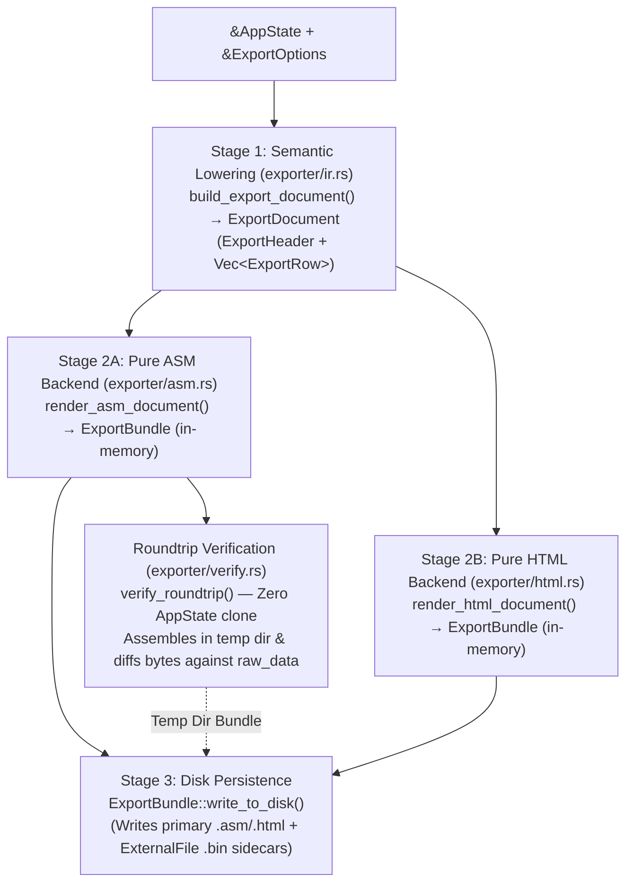

-   **`ir.rs`**: Implements Stage 1 semantic lowering via `build_export_document()`. Accepts `&AppState` and `ExportOptions` (which lets callers override the target `Assembler` without cloning `AppState`) and produces an in-memory `ExportDocument` containing:

    -   `ExportHeader`: Document title, assembler metadata, comment prefix, and banner lines.
    -   `Vec<ExportRow>`: Ordered semantic rows (`Blank`, `SectionComment`, `FileDirective`, `Equate` via `AppState::get_external_label_definitions_with_formatter()`, `EnumLine` via `AppState::get_enum_definition_lines_with_formatter()`, `Origin`, `ExternalFile`, and `Instruction(InstructionRow)`).
    -   Shared per-`DisassemblyLine` lowering (`mid_instruction_labels`, `formatted_label`, `LabelPlacement` at `LABEL_COLUMN_WIDTH`, `is_unindented_scope`, `is_splitter`), pre-tokenized operands (`tokenize_operand()` → `Vec<OperandToken>`), structured comments with cross-reference targets (`ExportComment`), centralized HTML entity escaping (`html_escape()`), and in-memory binary sidecar bundles (`ExportSidecar` / `ExportBundle`).

-   **`asm.rs`**: Pure assembly backend over `&ExportDocument` (`render_asm_document()`, `render_asm_with_options()`, `render_asm()`, and `export_asm()`). Renders source files for all 4 supported assemblers (64tass, ACME, ca65, and KickAssembler), including file directives, origin directives, scopes, local and mid-instruction relative labels, external binary includes, and enum definitions.
-   **`html.rs`**: Pure HTML5 backend over `&ExportDocument` (`render_html_document()`, `render_html_with_options()`, `render_html()`, and `export_html()`). Emits standalone HTML disassembly documents with deduplicated `id="L{:04X}"` address anchors, clickable operand and cross-reference links, dark and light CSS themes aligned to `INSTRUCTION_COLUMN_WIDTH` (`40ch`), and `ExternalFile` binary sidecars.
-   **`verify.rs`**: Runs automated roundtrip verification via `verify_roundtrip()`. Renders assembly in memory using `ExportOptions::for_assembler` (without cloning `AppState`), persists the `ExportBundle` to a temporary directory, invokes the external assembler CLI (`64tass`, `acme`, `ca65`/`ld65`, or `kickass`), and compares the assembled output byte-for-byte against `state.raw_data`.

---

### 3.9 6502 Sandbox Binary Unpacker & Declarative Packer Specs (`unpacker/` & `packers/`)

Regenerator 2000 embeds a system-agnostic 2-phase 6502 emulation sandbox to unpack compressed executables across Commodore 8-bit targets:

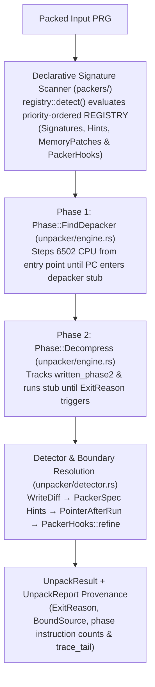

-   **`mod.rs`**: Public API facade exposing `unpack()`, `UnpackConfig`, `UnpackResult`, `UnpackerMemory`, `UnpackError`, and `find_sys_address()`, and re-exporting `PackerId`, `BoundSource`, `ExitReason`, `TRACE_TAIL_CAPACITY`, `UnpackEngine`, and `UnpackReport`.
-   **`bus.rs`**: `C64Bus` (`UnpackerMemory`) implements `mos6502::memory::Bus` over a 64 KB RAM buffer, C64 `$00`/`$01` processor port banking (`is_basic_rom_mapped`, `is_kernal_rom_mapped`, `is_io_mapped`), ROM overlays, and dual write-tracking bitmaps (`written` across both phases and `written_phase2` in `Phase::Decompress`).
-   **`cia.rs`**: `CiaState` emulates MOS 6526 CIA 1 and CIA 2 timer latches, counters, and cycle stepping (`step_cycles` and `step_tb_underflow`) for depackers that poll timer registers.
-   **`machine.rs`**: Defines system-keyed machine profiles (`RomTrapTable::for_system(system)`, `KernalRoutine`, `KernalTrap`, `Phase` [`FindDepacker` / `Decompress`], and `get_basic_start(load_addr)`), isolating target-specific KERNAL/BASIC ROM traps, exit vectors, and screen RAM boundaries from the execution engine.
-   **`engine.rs`**: `UnpackEngine` drives the 2-phase state machine (`Phase::FindDepacker` → `Phase::Decompress`), applies pre-emulation `MemoryPatch` rules, intercepts `RomTrapTable` routines, terminates with a typed `ExitReason` (`WrittenCodeReached`, `KnownEntryReached`, `LeftLoadedRegion`, `RomExitVector`, or `BasicRun`), and records structured diagnostics in `UnpackReport` (`BoundSource` provenance, phase instruction counts, and optional `trace_tail` ring buffer of `TRACE_TAIL_CAPACITY` = `32` PCs).
-   **`detector.rs`**: Implements memory range scanning (`detect_output_range`), trailing depacker workspace trimming, and pre/post-emulation snapshot diffing (`find_entry_in_snapshot`).
-   **Declarative Packer Specifications (`packers/`)**:
    -   `spec.rs`: Defines `PackerSpec` with declarative `Signature` patterns (`Anchor`, `Pat`, `sig!`), `Hints` (`AddrSource`: `Const`, `BasicStart(i16)`, `OperandLe`, `AbsoluteLe`, `PointerAfterRun` with `PointerGuard`), `MemoryPatch` (`PatchAddr`), optional `resolve` escape hatches (`ResolvedSpec`), and stateful `PackerHooks` (`StepContext`, `RefineContext`, `Bounds`).
    -   `registry.rs`: Evaluates `registry::detect(&LoadedImage)` across all **21 packer families** in deterministic `priority` order in `REGISTRY` (`eca`, `action_replay`, `cruel_cruncher`, `pucrunch`, `time_cruncher`, `card_cruncher`, `mc_cracken`, `tbc`, `byteboozer`, `alz64`, `tscrunch`, `dali`, `tiny_crunch`, `super_cruncher`, `final_cartridge`, `exomizer`, `ccs`, `triad`, `eagle`, `antiram`, and `turbo_cruncher`).
-   **Corpus Oracle & Benchmarking CLI (`src/bin/unpacker_compare_all/`)**: Compares Regenerator 2000 unpacker output against `unp64` across the `tests/6502/unpack_corpus.toml` manifest (`main.rs`, `cli.rs`, `check.rs`, `update.rs`, `record.rs`, `observation.rs`, `markdown.rs`, `unp64/`, and `corpus/`), supporting `--update` (record `unp64` reference expectations), `--check` (CI drift gate), and `--markdown` (classified comparison report).

---

### 3.10 Model Context Protocol (MCP) Server (`mcp/`)

Regenerator 2000 implements an MCP (`2024-11-05`) server so AI agents (Antigravity, Claude Code, Claude Desktop, and Cursor) can inspect and modify disassemblies programmatically:

-   **Transports**:

    -   **`http.rs`**: Serves streamable HTTP with Server-Sent Events (SSE) on port `3000` by default via `rmcp`, including `server/discover` and `subscriptions/listen` compatibility handlers.
    -   **`stdio.rs`**: Runs a headless standard I/O loop for subprocess clients.

-   **Request Dispatcher (`handler.rs`)**: Routes JSON-RPC requests (`initialize`, `notifications/initialized`, `ping`, `tools/list`, `resources/list`, `resources/read`, and `tools/call`) and preserves view state via `DisassemblyViewAnchor`.
-   **Tool Submodules (`mcp/tools/`)**:

    -   **`analysis_tools.rs`**: Reads disassembly regions, blocks, cross-references, symbols, address details, binary metadata, and search matches.
    -   **`navigation_tools.rs`**: Queries and moves the disassembly cursor.
    -   **`modification_tools.rs`**: Modifies block types, labels, symbolic offsets, comments, immediate formats, splitters, scopes, and enums.
    -   **`session_tools.rs`**: Executes project save, undo, redo, batch execution, and binary unpacking.
    -   **`common.rs`**: Validates address and range parameters (`get_address`, `get_optional_address`, `get_optional_address_range`, `parse_address_value`), applies block commands with re-analysis (`apply_block_command_with_analysis`), and builds JSON-RPC error responses (`make_mcp_error`).

---

### 3.11 VICE Emulator Live Debugger Integration (`vice/`)

The `vice` module provides live bidirectional debugging with the VICE emulator:

-   **`client.rs`**: Manages non-blocking TCP socket communication with the VICE binary monitor (default port `6502`) on a background reader thread.
-   **`protocol.rs`**: Encodes and decodes binary monitor packets (`0x02` STX byte, API version `0x02`, command IDs, request IDs, and payloads capped by `MAX_PAYLOAD_LEN` = `1 MiB`) for `MEMORY_GET` (`0x01`), `MEMORY_SET` (`0x02`), `CHECKPOINT_GET` (`0x11`), `CHECKPOINT_SET` (`0x12`), `CHECKPOINT_DELETE` (`0x13`), `CHECKPOINT_LIST` (`0x14`), `REGISTERS_GET` (`0x31`), `ADVANCE_INSTRUCTION` (`0x71`), `EXECUTE_UNTIL_RETURN` (`0x73`), `PING` (`0x81`), and `EXIT_MONITOR` (`0xAA`). It also decodes the asynchronous `STOPPED` (`0x62`) and `RESUMED` (`0x65`) events.
-   **`state.rs`**: Tracks connection status, CPU register snapshots (`PC`, `A`, `X`, `Y`, `SP`, and `NV-BDIZC` flags), modified register highlights, and active checkpoints (`BreakpointKind::Exec`, `Load`, `Store`, and `LoadStore`).
-   **`c64_hardware.rs`**: Decodes 16-byte MOS 6526 CIA 1 and CIA 2 register windows (`CiaState::decode`) from I/O memory snapshots (`$D000–$DFFF`).

---

### 3.12 Asset Management & Configuration (`assets.rs`, `config.rs`)

-   **`assets.rs`**: Embeds platform configuration files (`system-*.toml`), color themes (`theme-*.toml`), and hardware register enums (`enum-*.toml`). Exports embedded assets to user directories via `--dump-system-config-files`, `--dump-theme-files`, and `--dump-enum-files`.
-   **`config.rs`**: Loads and saves global user preferences (`config.toml`), including default assembler, target system, color theme, entropy warning threshold, view synchronization flags, update checks, and recent projects.

---

### 3.13 TUI Frontend Architecture (`regenerator2000-tui`)

The terminal user interface uses `ratatui` and `crossterm`:

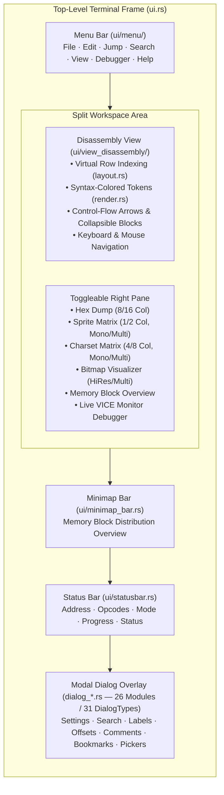

-   **`Widget` Trait (`ui/widget.rs`)**: Every TUI view and modal dialog implements the `Widget` trait:

    ```rust
    pub trait Widget {
        fn render(&self, f: &mut Frame, area: Rect, app_state: &AppState, ui_state: &mut UIState);
        fn handle_input(&mut self, key: KeyEvent, app_state: &mut AppState, ui_state: &mut UIState) -> WidgetResult;
        fn handle_mouse(&mut self, mouse: MouseEvent, app_state: &mut AppState, ui_state: &mut UIState) -> WidgetResult {
            WidgetResult::Ignored
        }
        fn handle_tick(&mut self, _app_state: &mut AppState, _ui_state: &mut UIState) -> WidgetResult {
            WidgetResult::Handled
        }
        fn refresh(&mut self, _app_state: &AppState) {}
    }
    ```

-   **`Navigable` Trait & Grid Helpers (`ui/navigable.rs`)**: Right-pane views share vim-style cursor movement, page scrolling, and visual selection via the `Navigable` trait and `AlignedGridRange` byte-range calculator.
-   **`UIState` Composition (`ui_state.rs`)**: `UIState` wraps `CoreViewState` via `Deref` and `DerefMut` and adds TUI-specific state (modal dialog queue `active_dialog` / `next_dialogs`, menu popups, Ratatui `ListState` handles, cached block/bitmap/debugger views, and mouse click regions).
-   **Modular Disassembly View (`ui/view_disassembly/`)**:

    -   `mod.rs`: Implements the `Widget` facade for the Disassembly View.
    -   `layout.rs`: Re-exports `VisualLineCounts` from `regenerator2000_core::disassembler`, delegates per-line visual row height calculation to `DisassemblyLine::visual_line_counts`, and maps between 1-indexed screen rows and disassembly line indices.
    -   `navigation.rs`: Handles cursor movement (`DisassemblyLine::is_navigable`), page scrolling, visual selection, and address pinning.
    -   `mouse.rs`: Handles scroll wheel input, single-click cursor placement, double-click operand jumps, and drag selection.
    -   `render.rs`: Renders the disassembly viewport via focused single-responsibility helpers (`stabilize_viewport_scroll`, `compute_visible_arrows`, `build_arrow_prefix_spans`, `build_scope_gutter_span`, `render_mid_instruction_sub_rows`, `render_line_comment_sub_rows`, and `render_instruction_sub_rows` with `RowRenderContext`) backed by `DisassemblyLine` semantic lowering (`classify_kind`, `mid_instruction_labels`, `formatted_label`, `label_placement`), `prefix_parts_count` scope-gutter partitioning, and `CODE_COLUMN_WIDTH` (`41`) comment alignment.

-   **Specialized Right-Pane Views**:

    -   `view_hexdump.rs`: Renders 8-column and 16-column hex dumps with PETSCII and Screencode character columns.
    -   `view_sprites.rs`: Renders 24x21 hardware sprites in 1-column or 2-column layouts (monochrome and multicolor).
    -   `view_charset.rs`: Renders 8x8 character sets in 4-column or 8-column layouts (monochrome and multicolor).
    -   `view_bitmap.rs`: Renders 320x200 high-resolution and 160x200 multicolor bitmaps with configurable Screen RAM offsets.
    -   `view_blocks.rs`: Lists all memory blocks with their types, address ranges, sizes, and collapsed states.
    -   `view_debugger.rs`: Displays live VICE CPU registers, processor flags, stack memory (`$0100–$01FF`), hardware registers, and active breakpoints.

-   **Unified Modal Dialogs (`ui/dialog_*.rs` & `ui/scoped_input.rs`)**:

    -   `scoped_input.rs`, `dialog_label.rs`, and `dialog_symbolic_offset.rs`: Shared `ScopedInputModal` (`ScopeLock`) for single-line text editing, scope toggles (`Tab`, `Alt+L`, `Alt+G`), and inline validation in `LabelDialog` and `SymbolicOffsetDialog` (`SymbolicOffsetDialogParams`).
    -   `dialog_file_browser.rs`: Unified `FileBrowserDialog` parameterized by `FileBrowserMode` (`Open`, `SaveProject`, `Export`, and `ImportViceLabels` / `ExportLabels`).
    -   `dialog_prompt.rs`: Unified single-line `PromptDialog` parameterized by `PromptMode` (`Origin`, `JumpToAddress`, `JumpToLine`, `BreakpointAddress`, and `MemoryDumpAddress`).
    -   `dialog_container_picker.rs`: Unified `ContainerPickerDialog` parameterized by `ContainerKind` for `.d64`/`.d71`/`.d81` disk directories and `.t64` tape directories.
    -   `dialog_document_settings.rs`: Table-driven `DocumentSettingsDialog` using static `FIELD_DESCRIPTORS` metadata.

-   **Menu System (`ui/menu/`)**:

    -   `menu_model.rs`: Defines menu items, keyboard shortcuts, and enablement rules across the 7 top-level menus (`File`, `Edit`, `Jump`, `Search`, `View`, `Debugger`, and `Help`).
    -   `menu_render.rs`: Renders the top menu bar and drop-down popups.
    -   `menu_action.rs`: Converts menu selections into `AppAction` variants and processes returned `CoreEvent` values.

-   **Theme Engine (`theme.rs`, `theme_file.rs`)**: Loads built-in and custom TOML color themes for 24-bit TrueColor and 256-color terminals.

---

## 4. End-to-End Data Flow & Reactive Cycles

### 4.1 Interactive User Action in TUI (Block Type Reclassification)

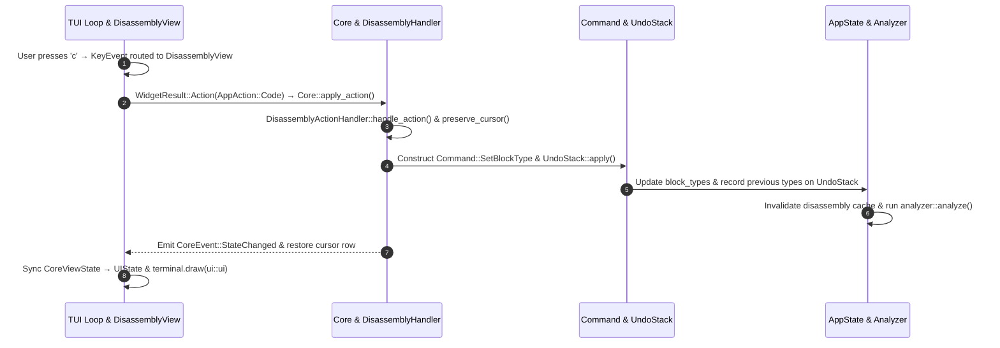

1.  **User Input**: User presses `c` in Disassembly View to mark bytes as Code.
2.  **Routing**: `events.rs` routes the `KeyEvent` to the active `DisassemblyView` widget.
3.  **Action Creation**: `DisassemblyView` returns `WidgetResult::Action(AppAction::Code)`.
4.  **Menu Dispatcher**: `handle_menu_action()` calls `Core::apply_action(AppAction::Code)`.
5.  **Domain Handler**: `Core` routes the action to `DisassemblyActionHandler::handle_action()`.
6.  **Context Setup**: The handler records the cursor address via `ActionContext::preserve_cursor()`.
7.  **Command Execution**: The handler constructs `Command::SetBlockType` and calls `UndoStack::apply()`.
8.  **State Mutation**: `AppState::block_types` updates, and `UndoStack` records the previous block types.
9.  **Downstream Analysis**: The disassembly cache invalidates, and `analyzer::analyze()` recalculates symbols and cross-references.
10. **Event Emission**: `Core` emits `CoreEvent::StateChanged`.
11. **UI Sync**: The TUI syncs `CoreViewState` to `UIState`, and `preserve_cursor()` restores the visual row.
12. **Render Frame**: The event loop calls `terminal.draw()` with `ui::ui()` to render the updated disassembly.

### 4.2 AI Agent / MCP Server Invocation (Setting a Label)

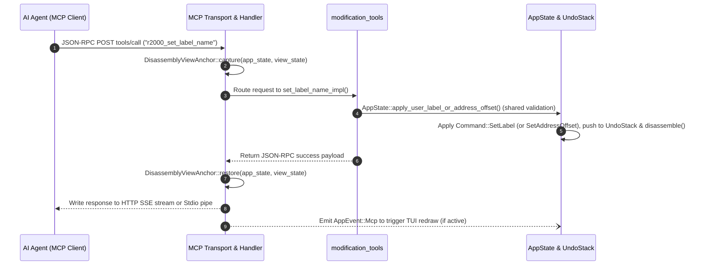

1.  **Client Request**: The external AI agent sends a JSON-RPC POST `tools/call` (`"r2000_set_label_name"`, `{address: 2064, name: "init"}`).
2.  **Transport Handling**: `mcp::http` or `mcp::stdio` decodes the JSON-RPC request.
3.  **Handler Router**: `mcp::handler` captures a `DisassemblyViewAnchor` and routes `tools/call` to `modification_tools::set_label_name_impl()`.
4.  **Shared Validation**: The tool calls `AppState::apply_user_label_or_address_offset()`. This core method validates label names or Tier 2 offset expressions, matching the `AppAction::ApplyLabel` TUI path.
5.  **Command Execution**: `AppState` constructs `Command::SetLabel` (or `Command::SetAddressOffset`) and records it on the `UndoStack`. MCP tools do not dispatch an `AppAction` through `Core::apply_action()`.
6.  **Reactive Invalidation**: `AppState` re-analyzes (when `auto_analyze` is active) and rebuilds the disassembly cache via `disassemble()`.
7.  **Anchor Restore & Reply**: `mcp::handler` restores `DisassemblyViewAnchor` on `CoreViewState` and constructs a JSON-RPC success response.
8.  **Transport Reply**: The transport writes the response to the HTTP SSE stream or Stdio pipe.
9.  **TUI Coordination**: If the TUI is active, the event loop receives `AppEvent::Mcp` and redraws the screen.

### 4.3 Background Binary Unpacker Sandbox Lifecycle

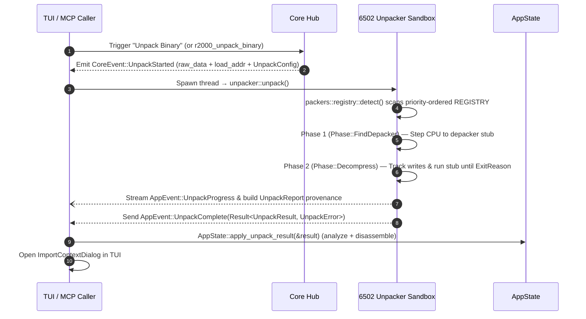

1.  **Trigger**: The user loads a packed binary or selects "Unpack Binary" (or an AI agent invokes the `r2000_unpack_binary` MCP tool).
2.  **Action Dispatch**: `Core` emits `CoreEvent::UnpackStarted` with `raw_data`, `load_addr`, and `UnpackConfig`.
3.  **Thread Spawn**: The TUI menu action dispatcher (`menu_action.rs`) processes `CoreEvent::UnpackStarted` and spawns a background thread that runs `unpacker::unpack()` with a throttled progress callback (MCP calls `unpacker::unpack()` directly with `None`).
4.  **6502 Emulation**:

    -   `packers::registry::detect()` scans the priority-ordered `REGISTRY` of `PackerSpec` definitions to resolve signatures, hints, patches, and hooks.
    -   **Phase 1 (`Phase::FindDepacker`)**: Steps the 6502 CPU from the entry point until `PC` reaches the depacker stub or crosses the target system return boundary (`system.ram_start()`).
    -   **Phase 2 (`Phase::Decompress`)**: Tracks every RAM write in `written` and `written_phase2` and runs the depacker stub until an `ExitReason` triggers.
    -   The engine sends `AppEvent::UnpackProgress` events to update the status bar and records `UnpackReport` telemetry (`ExitReason`, `BoundSource` provenance, phase instruction counts, and optional `trace_tail`).

5.  **Completion Event**: The background thread sends `AppEvent::UnpackComplete(result)` to the main event channel.
6.  **Unified State Initialization**: Both TUI (`handle_unpack_complete`) and MCP (`r2000_unpack_binary`) call `AppState::apply_unpack_result(&result)`, which loads the unpacked image at `start_addr`, seeds `Code` at `entry_point`, runs `perform_analysis()`, creates the `start` label, and returns an `UnpackOutcome` summary.
7.  **Context Dialog**: In the TUI, `handle_unpack_complete()` jumps to `entry_point` and opens `ImportContextDialog` so the user can review or adjust the target platform, origin, and entry point.

### 4.4 Live VICE Monitor Synchronization

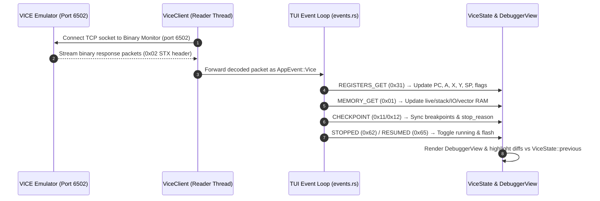

1.  **Connection**: `ViceClient` connects to the VICE binary monitor TCP socket on port `6502`.
2.  **Background Reader**: The reader thread parses incoming binary response packets (`0x02` STX header).
3.  **Event Bridge**: The client converts packets into `AppEvent::Vice` events and sends them to the TUI event channel.
4.  **State Update (`events.rs` `handle_vice_event`)**:

    -   `REGISTERS_GET` response (`0x31`) updates `ViceState::pc`, `a`, `x`, `y`, `sp`, and `p` (status flags). Before each step, `debug_handler.rs` stores the prior snapshot in `ViceState::previous`.
    -   `MEMORY_GET` response (`0x01`) updates `ViceState::live_memory`, `stack_memory`, `io_memory`, `vectors`, or `dump_memory`, based on the request.
    -   `CHECKPOINT_GET` / `CHECKPOINT_SET` responses (`0x11`/`0x12`) update `ViceState::breakpoints` and set `ViceState::stop_reason` on a hit.
    -   `STOPPED` event (`0x62`) sets `ViceState::running` to `false` and starts the debugger highlight flash. `RESUMED` (`0x65`) clears `stop_reason`.

5.  **UI Sync**: `DebuggerView` renders the updated registers and highlights values that differ from `ViceState::previous`.

---

## 5. Persistence & Serialization Model

Regenerator 2000 saves projects as `.regen2000proj` JSON files designed for schema stability, deterministic diffs, and compact storage. The example below omits some view-state fields, such as `cursor_address`, `right_pane_visible`, and `hexdump_view_mode`:

```json
{
  "version": 1,
  "origin": 2049,
  "raw_data_base64": "H4sIC...",
  "blocks": [
    { "start": 0, "end": 12, "type_": "Code", "collapsed": false },
    { "start": 13, "end": 100, "type_": "DataByte", "collapsed": false }
  ],
  "labels": {
    "251": [ { "name": "zp_ptr", "label_type": "ZeroPagePointer", "kind": "User" } ],
    "2049": [ { "name": "start", "label_type": "Subroutine", "kind": "User" } ]
  },
  "252": {
    "address_offset": { "base": 251, "offset": 1, "radix": "Decimal" }
  },
  "2049": {
    "user_side_comment": "Initialize VIC-II",
    "user_line_comment": "Main Program Entry Point",
    "bookmark": "Entry",
    "scope": 2100
  },
  "2052": { "immediate_format": "Hex" },
  "settings": {
    "assembler": "Tass64",
    "system": "Commodore 64",
    "use_illegal_opcodes": true
  },
  "splitters": [],
  "enums": {},
  "user_excluded_addresses": [ 53280, 53281 ]
}
```

### Key Persistence Characteristics

-   **Gzip + Base64 Raw Data**: The serializer compresses `raw_data` with gzip (`flate2`) and encodes the result in Base64 (`raw_data_base64`).
-   **Run-Length Encoded Blocks**: Contiguous memory regions that share a `BlockType` serialize as compact `{start, end, type_, collapsed}` range objects.
-   **Flattened Sparse Metadata**: `ProjectState` embeds `AnnotationManager` with `#[serde(flatten)]`. Each annotated address appears as a top-level key (for example, `"2049"`) whose value holds only the persistent `AddressEntry` fields. The serializer never saves transient `system_comment` values.
-   **Deterministic Serialization**: All address-keyed maps use `BTreeMap` and `BTreeSet` so saved project files produce sorted keys and clean Git diffs.
-   **Version Handling**: Project files store a numeric `version` field (`PROJECT_FORMAT_VERSION`, currently `1`). The loader rejects files with a newer version (`ProjectError::UnsupportedVersion`). The `AnnotationManager` deserializer upgrades legacy per-field annotation maps on load.
