# Architecture of Regenerator 2000

Regenerator 2000 is an interactive disassembler and reverse-engineering suite
for 8-bit MOS 6502/6510 Commodore computers (Commodore 64, Commodore 128,
VIC-20, Plus/4, C16, PET 2001, PET 4000/8000, 1541, 1571, and 1581), written
in Rust.

The system is designed with a strict **unidirectional data flow** and a clean
separation between a headless, multi-platform core engine and its frontends.
User interactions, automated analysis pipelines, external debuggers, and AI
agent integrations via the Model Context Protocol (MCP) all interact through a
single, deterministic action-dispatch architecture.

---

## 1. High-Level Overview

```mermaid
flowchart TD
    subgraph bin_crate [regenerator2000 Crate - CLI Application]
        Main[main.rs<br/>CLI Parsing & Terminal Init]
    end

    subgraph tui_crate [regenerator2000-tui Crate - TUI Frontend]
        EventLoop[Event Loop & Router<br/>events.rs / input.rs]
        UIState[UIState<br/>Deref to CoreViewState]
        WidgetSystem[Widget Trait System<br/>Disassembly / Views / Dialogs / Menu]
        Renderer[Ratatui Renderer<br/>ui.rs / render.rs]
        ThemeEngine[Theme Engine<br/>theme.rs / theme_file.rs]
    end

    subgraph core_crate [regenerator2000-core Crate - Headless Engine]
        Core[Core Hub<br/>core.rs]
        ActionHandlers[Action Handlers<br/>File / Disassembly / Debug / Navigation]
        AppAction[AppAction Enum<br/>actions.rs]
        CommandSys[Command Pattern & UndoStack<br/>commands.rs]
        AppState[AppState<br/>Memory / Labels / CrossRefs / Settings]
        AnnotationMap[AnnotationManager<br/>Sparse AddressEntry Metadata]
        CoreViewState[CoreViewState<br/>Cursors / Panes / Modes / History]
        Analyzer[Control-Flow Analyzer<br/>analyzer.rs]
        DisasmEngine[Disassembly Pipeline<br/>symbols / data_blocks / handlers / formatter]
        Parsers[Parser Suite<br/>PRG / CRT / D64 / T64 / VSF / SourceGen]
        Exporters[Exporter Suite & Verify<br/>ASM / HTML / Roundtrip Diff]
        UnpackerSandbox[6502 Emulation Sandbox<br/>bus / cia / engine / detector / 22+ packers]
        MCPServer[MCP Server Suite<br/>HTTP SSE / Stdio / handler / tools]
        ViceClient[VICE Monitor Client<br/>protocol / client / state / c64_hardware]
        AssetsConfig[Assets & Config<br/>system-*.toml / enum-*.toml / config.toml]
    end

    subgraph External [External Interfaces & Tools]
        MCPClient[MCP Client / AI Agent<br/>Claude Desktop / Cursor / Custom]
        VICE[VICE Emulator<br/>Binary Monitor TCP Port 6502]
        AssemblerBinaries[Assembler CLIs<br/>64tass / ACME / ca65 / KickAss]
        CommodoreFiles[Binary Media<br/>.prg / .crt / .d64 / .d71 / .d81 / .t64 / .vsf]
    end

    %% Lifecycle & Initialization
    Main -->|Initializes Engine| Core
    Main -->|Spawns Threads & Runs| EventLoop
    Main -->|Loads Files / Media| Parsers
    CommodoreFiles -->|Decoded by| Parsers
    Parsers -->|Populates Initial State| AppState

    %% UI Flow
    EventLoop -->|Routes Input Event| WidgetSystem
    WidgetSystem -->|Emits Action| AppAction
    AppAction -->|apply_action| Core
    Core -->|Delegates via ActionContext| ActionHandlers
    ActionHandlers -->|Applies / Undoes| CommandSys
    ActionHandlers -->|Mutates View State| CoreViewState
    CommandSys -->|Mutates State| AppState
    AppState -->|Maintains Metadata| AnnotationMap
    AppState -->|Triggers Analysis| Analyzer
    AppState -->|Provides Data| DisasmEngine
    DisasmEngine -->|Generates Formatted Lines| AppState

    %% Rendering Flow
    CoreViewState -.->|Embedded via Deref| UIState
    UIState -->|Supplies View State| Renderer
    AppState -->|Supplies Data| Renderer
    ThemeEngine -->|Supplies Styles| Renderer
    EventLoop -->|Drives Render Frame| Renderer

    %% Background & External Integrations
    Core -->|Emits UnpackStarted Event| EventLoop
    EventLoop -->|Spawns Sandbox Thread| UnpackerSandbox
    UnpackerSandbox -.->|Loads Unpacked Output| AppState

    MCPClient <-->|JSON-RPC via HTTP SSE or Stdio| MCPServer
    MCPServer -->|Dispatches AppAction| Core
    MCPServer -.->|Inspects Engine State| AppState

    VICE <-->|Binary Monitor Protocol| ViceClient
    ViceClient <-->|Updates Live Registers/RAM| AppState

    Exporters -->|Invokes Assemblers| AssemblerBinaries
    AssemblerBinaries -->|Byte-Level Diff Verification| Exporters
```



---

## 2. Workspace & Crate Structure

Regenerator 2000 is organized as a Cargo workspace with a strictly decoupled
tripartite architecture:

```
regenerator2000/
├── Cargo.toml                                 # Workspace manifest
├── src/                                       # Binary crate (CLI entry point)
│   └── main.rs
├── crates/
│   ├── regenerator2000-core/                  # Headless reverse-engineering engine
│   │   ├── Cargo.toml
│   │   └── src/
│   │       ├── lib.rs
│   │       ├── core.rs                        # Engine central hub
│   │       ├── action_handlers/               # Modular domain action dispatchers
│   │       ├── state/                         # Domain models, metadata & persistence
│   │       ├── disassembler/                  # Disassembly pipeline & formatters
│   │       ├── cpu.rs                         # MOS 6502/6510 opcode table & modes
│   │       ├── commands.rs                    # Command pattern & UndoStack
│   │       ├── analyzer.rs                    # Control-flow & symbol heuristics
│   │       ├── parser/                        # Binary container & snapshot parsers
│   │       ├── exporter/                      # Multi-assembler, HTML & roundtrip verification
│   │       ├── unpacker/                      # 6502 sandbox depacker engine
│   │       ├── packers/                       # 22+ binary packer detection strategies
│   │       ├── mcp/                           # Model Context Protocol server (HTTP & Stdio)
│   │       ├── vice/                          # Live VICE binary monitor client
│   │       ├── assets.rs                      # Embedded ROM definitions, system TOMLs & enums
│   │       ├── config.rs                      # System configuration persistence
│   │       ├── error.rs                       # Subsystem error hierarchy (thiserror)
│   │       ├── event.rs                       # CoreEvent & DialogType vocabularies
│   │       ├── navigation.rs                  # Address jump & bookmark helpers
│   │       ├── utils.rs                       # Shared string & formatting utilities
│   │       ├── view_state.rs                  # Frontend-agnostic CoreViewState
│   │       └── bin/
│   │           └── unpacker_compare_all.rs    # Depacker benchmarking & comparison tool
│   └── regenerator2000-tui/                   # Terminal User Interface frontend
│       ├── Cargo.toml
│       └── src/
│           ├── lib.rs
│           ├── events.rs                      # Main TUI event loop & background task coordination
│           ├── events/input.rs                # Input router for keyboard and mouse
│           ├── ui.rs                          # Top-level Ratatui layout engine
│           ├── ui_state.rs                    # UIState wrapping CoreViewState via Deref
│           ├── theme.rs                       # Runtime color theme engine
│           ├── theme_file.rs                  # TOML theme file parser & dumper
│           └── ui/
│               ├── widget.rs                  # Widget trait & WidgetResult
│               ├── statusbar.rs               # Dynamic bottom status bar
│               ├── minimap_bar.rs             # Memory map visualization bar
│               ├── navigable.rs               # Unified navigation trait
│               ├── graphics_common.rs         # Shared glyph & bit-matrix renderers
│               ├── menu/                      # Menu bar model, render & actions
│               ├── view_disassembly/          # Modular disassembly view (5 submodules)
│               ├── view_hexdump.rs            # Hex dump view (8/16 column)
│               ├── view_sprites.rs            # Sprite visualizer (1/2 column, mono/multicolor)
│               ├── view_charset.rs            # Character set visualizer (4/8 column)
│               ├── view_bitmap.rs             # Full bitmap visualizer (mono/multicolor)
│               ├── view_blocks.rs             # Memory block overview list
│               ├── view_debugger.rs           # Live VICE monitor register & RAM view
│               └── dialog_*.rs                # 35+ modal dialog implementations
```

---

## 3. Subsystem Deep Dives

### 3.1 Central Hub & Domain Action Handlers

The engine interface is centered around
[`Core`](file:///Users/ricardoq/progs/regenerator2000/crates/regenerator2000-core/src/core.rs),
which unifies persistent domain state
([`AppState`](file:///Users/ricardoq/progs/regenerator2000/crates/regenerator2000-core/src/state/app_state.rs))
and transient view state
([`CoreViewState`](file:///Users/ricardoq/progs/regenerator2000/crates/regenerator2000-core/src/view_state.rs)).

```rust
pub struct Core {
    pub state: AppState,
    pub view: CoreViewState,
}
```

#### The Action Dispatch Pipeline
Frontends dispatch semantic
[`AppAction`](file:///Users/ricardoq/progs/regenerator2000/crates/regenerator2000-core/src/state/actions.rs)
enum variants to
[`Core::apply_action()`](file:///Users/ricardoq/progs/regenerator2000/crates/regenerator2000-core/src/core.rs#L32).
The hub performs document safety guards, unconfirmed destructive action checks
(spawning confirmation dialogs if dirty), and delegates execution to domain
handlers via
[`ActionContext<'a>`](file:///Users/ricardoq/progs/regenerator2000/crates/regenerator2000-core/src/action_handlers/mod.rs#L21):

```rust
pub struct ActionContext<'a> {
    pub state: &'a mut AppState,
    pub view: &'a mut CoreViewState,
    pub events: &'a mut Vec<CoreEvent>,
}
```

The context provides
[`preserve_cursor()`](file:///Users/ricardoq/progs/regenerator2000/crates/regenerator2000-core/src/action_handlers/mod.rs#L32),
which captures the logical memory address at the active cursor line and
re-anchors the view cursor to that address after disassembly changes or
analysis recalculations.

#### Modular Action Handlers ([`action_handlers/`](file:///Users/ricardoq/progs/regenerator2000/crates/regenerator2000-core/src/action_handlers))
The single-responsibility handlers implement
[`DomainActionHandler`](file:///Users/ricardoq/progs/regenerator2000/crates/regenerator2000-core/src/action_handlers/mod.rs#L56):

- **[`file_handler.rs`](file:///Users/ricardoq/progs/regenerator2000/crates/regenerator2000-core/src/action_handlers/file_handler.rs)**:
  Project opening, saving, export generation (ASM/HTML), VICE label
  import/export, and binary unpacking initialization.
- **[`disassembly_handler.rs`](file:///Users/ricardoq/progs/regenerator2000/crates/regenerator2000-core/src/action_handlers/disassembly_handler.rs)**:
  Memory block type reclassification (`Code`, `Byte`, `Word`, `Address`,
  `Text`, `Screencode`, `LoHi`, `HiLo`, `ExternalFile`), user comments (inline
  side comments and preceding line comments), label assignments, immediate
  operand formatting overrides, routine scope creation/removal, splitter
  toggling, and enum usage.
- **[`debug_handler.rs`](file:///Users/ricardoq/progs/regenerator2000/crates/regenerator2000-core/src/action_handlers/debug_handler.rs)**:
  VICE monitor TCP connection, execution control (Step, Step Over, Step Out,
  Continue, Run to Cursor), and hardware breakpoint/watchpoint management.
- **[`navigation_handler.rs`](file:///Users/ricardoq/progs/regenerator2000/crates/regenerator2000-core/src/action_handlers/navigation_handler.rs)**:
  Address jumps, operand target tracking, history stack navigation
  (Back/Forward), bookmark management, symbol searches, and cross-reference
  inspection.

#### Domain Errors & Events
- **[`error.rs`](file:///Users/ricardoq/progs/regenerator2000/crates/regenerator2000-core/src/error.rs)**:
  Structured hierarchy using `thiserror`. `CoreError` aggregates subsystem
  error types: `UnpackError`, `ExportError`, `ViceError`, `ProjectError`, and
  generic `ParseFailed`. The
  [`IoResultExt`](file:///Users/ricardoq/progs/regenerator2000/crates/regenerator2000-core/src/error.rs#L243)
  trait enriches raw standard I/O errors with exact file path context
  (`with_path`).
- **[`event.rs`](file:///Users/ricardoq/progs/regenerator2000/crates/regenerator2000-core/src/event.rs)**:
  Defines frontend-agnostic event emissions:
  [`CoreEvent`](file:///Users/ricardoq/progs/regenerator2000/crates/regenerator2000-core/src/event.rs#L8)
  (`StateChanged`, `ViewChanged`, `StatusMessage`,
  `DialogRequested(DialogType)`, `DialogDismissalRequested`, `QuitRequested`,
  `OpenUrl`, `UnpackStarted`, `StartMcpServerRequested`,
  `StopMcpServerRequested`) and 30+ modal
  [`DialogType`](file:///Users/ricardoq/progs/regenerator2000/crates/regenerator2000-core/src/event.rs#L46)
  requests.
- **[`view_state.rs`](file:///Users/ricardoq/progs/regenerator2000/crates/regenerator2000-core/src/view_state.rs)**:
  Implements
  [`CoreViewState`](file:///Users/ricardoq/progs/regenerator2000/crates/regenerator2000-core/src/view_state.rs#L61)
  holding active panes
  ([`ActivePane`](file:///Users/ricardoq/progs/regenerator2000/crates/regenerator2000-core/src/view_state.rs#L8)),
  right-pane mode
  ([`RightPane`](file:///Users/ricardoq/progs/regenerator2000/crates/regenerator2000-core/src/view_state.rs#L25)),
  cursor indices, visual selection boundaries, scroll offsets, navigation
  history stacks, and search queries.

---

### 3.2 Application State & Memory Domain ([`state/`](file:///Users/ricardoq/progs/regenerator2000/crates/regenerator2000-core/src/state))

Persistent project state is encapsulated in
[`AppState`](file:///Users/ricardoq/progs/regenerator2000/crates/regenerator2000-core/src/state/app_state.rs#L45):

```rust
pub struct AppState {
    pub schema_version: u32,
    pub file_path: Option<PathBuf>,
    pub project_path: Option<PathBuf>,
    pub raw_data: Vec<u8>,
    pub disassembly: Vec<DisassemblyLine>,
    pub cached_arrows: Vec<CachedArrow>,
    pub origin: Addr,
    pub entry_point: Option<Addr>,
    pub entropy: Option<f32>,
    pub block_types: Vec<BlockType>,
    pub labels: BTreeMap<Addr, Vec<Label>>,
    pub settings: DocumentSettings,
    pub annotations: AnnotationManager,
    pub cross_refs: BTreeMap<Addr, Vec<Addr>>,
    pub enums: BTreeMap<String, EnumDefinition>,
    pub user_global_enums: BTreeMap<String, EnumDefinition>,
    pub builtin_enums: BTreeMap<String, EnumDefinition>,
    pub system_config: SystemConfig,
    pub undo_stack: UndoStack,
    pub last_saved_pointer: usize,
    pub user_excluded_addresses: BTreeSet<Addr>,
    pub collapsed_blocks: Vec<(usize, usize)>,
    pub splitters: BTreeSet<Addr>,
    pub vice_state: ViceState,
    pub vice_client: Option<ViceClient>,
    pub mcp_server_running: bool,
    // ...
}
```

#### Sparse Address Metadata ([`annotations.rs`](file:///Users/ricardoq/progs/regenerator2000/crates/regenerator2000-core/src/state/annotations.rs))
Rather than maintaining fragmented, parallel address-keyed tables, all
per-address metadata is consolidated into
[`AnnotationManager`](file:///Users/ricardoq/progs/regenerator2000/crates/regenerator2000-core/src/state/annotations.rs).
Each address maps to an
[`AddressEntry`](file:///Users/ricardoq/progs/regenerator2000/crates/regenerator2000-core/src/state/annotations.rs#L12):
- `system_comment`: Auto-loaded ROM/system comment (transient).
- `user_side_comment`: Inline trailing comment (persisted).
- `user_line_comment`: Preceding block/line comment (persisted).
- `immediate_format`: Operand representation override (`Hex`, `InvertedHex`,
  `Decimal`, `NegativeDecimal`, `Binary`, `InvertedBinary`, `LowByte(Addr)`,
  `HighByte(Addr)`).
- `bookmark`: User bookmark label (persisted).
- `scope`: Routine scope parent boundary address (persisted).
- `enum_usage`: Named enumeration reference (persisted).

`AnnotationManager` enforces automatic whitespace normalization, prunes empty
entries, and uses Serde flattening (`#[serde(flatten)]`) to maintain 100%
backward and forward compatibility with legacy `.regen2000proj` JSON project
schemas.

#### Domain Types ([`types.rs`](file:///Users/ricardoq/progs/regenerator2000/crates/regenerator2000-core/src/state/types.rs))
- **[`TargetSystem`](file:///Users/ricardoq/progs/regenerator2000/crates/regenerator2000-core/src/state/types.rs#L9)**:
  Zero-cost machine discriminator enum (`C64`, `C128`, `Vic20`, `Pet20`,
  `Pet40`, `Plus4`, `C16`, `C1541`, `C1571`, `C1581`, `Custom(Box<str>)`).
  Defines architecture parameters: RAM start, default BASIC entry, screen RAM
  range, hardware I/O boundaries, and ROM vector locations.
- **[`Addr`](file:///Users/ricardoq/progs/regenerator2000/crates/regenerator2000-core/src/state/types.rs#L503)**:
  Transparent 16-bit address newtype (`pub struct Addr(pub u16)`). Implements
  wrapping 16-bit 6502 address bus arithmetic, hex formatting, and transparent
  JSON number serialization.
- **[`BlockType`](file:///Users/ricardoq/progs/regenerator2000/crates/regenerator2000-core/src/state/types.rs#L771)**:
  Classification enum (`Code`, `DataByte`, `DataWord`, `Address`, `PetsciiText`,
  `ScreencodeText`, `LoHiAddress`, `HiLoAddress`, `LoHiWord`, `HiLoWord`,
  `ExternalFile`, `Undefined`).
- **[`Assembler`](file:///Users/ricardoq/progs/regenerator2000/crates/regenerator2000-core/src/state/types.rs#L739)**:
  Supported export targets (`Tass64`, `Acme`, `Ca65`, `Kick`).

---

### 3.3 Disassembly Pipeline & Assembler Formatting Suite ([`disassembler/`](file:///Users/ricardoq/progs/regenerator2000/crates/regenerator2000-core/src/disassembler))

The disassembly engine transforms raw binary memory into structured, formatted
assembly lines.

```
raw_data + block_types + annotations + symbols
                     │
                     ▼
       ┌───────────────────────────┐
       │   DisassemblyContext      │  (Pre-computes scope ends for O(log S) checks)
       └─────────────┬─────────────┘
                     │
                     ▼
       ┌───────────────────────────┐
       │    disassemble_ctx()      │  (pipeline.rs decoding loop)
       └─────────────┬─────────────┘
                     │
       ┌─────────────┴────────────────────────┐
       ▼                                      ▼
[Code Instruction]                     [Data Block Formatter]
pipeline.rs / handlers.rs              data_blocks.rs
(Opcode lookup & operand format)       (Bytes, Words, Text, Fill runs)
       │                                      │
       └─────────────┬────────────────────────┘
                     │
                     ▼
       ┌───────────────────────────┐
       │     Formatter Trait       │  (64tass / ACME / ca65 / KickAss)
       └─────────────┬─────────────┘
                     │
                     ▼
       Vec<DisassemblyLine> (Renderable & Exportable rows)
```

- **[`context.rs`](file:///Users/ricardoq/progs/regenerator2000/crates/regenerator2000-core/src/disassembler/context.rs)**:
  [`DisassemblyContext`](file:///Users/ricardoq/progs/regenerator2000/crates/regenerator2000-core/src/disassembler/context.rs#L12)
  bundles references to memory buffers, block types, label tables,
  cross-references, settings, and annotations. It pre-computes sorted scope
  boundaries into a vector for $O(\log S)$ binary search virtual splitter
  validation.
- **[`pipeline.rs`](file:///Users/ricardoq/progs/regenerator2000/crates/regenerator2000-core/src/disassembler/pipeline.rs)**:
  Orchestrates the main disassembly iteration, emits label definition header
  lines, and processes instructions through `disassemble_code_instruction`.
- **[`symbols.rs`](file:///Users/ricardoq/progs/regenerator2000/crates/regenerator2000-core/src/disassembler/symbols.rs)**:
  Resolves symbol priority precedence (`LabelKind::User` > `LabelKind::System` >
  `LabelKind::Auto`), formats local labels (`.local_label`), resolves routine
  scope paths (`compute_scope_names`), and identifies instruction target
  addresses.
- **[`data_blocks.rs`](file:///Users/ricardoq/progs/regenerator2000/crates/regenerator2000-core/src/disassembler/data_blocks.rs)**:
  Decodes non-code regions: single/multi-byte hex tables (`.byte`), 16-bit words
  (`.word`), address tables, PETSCII/Screencode strings, split Lo/Hi and Hi/Lo
  address tables (`<table, >table`), external binary includes (`.incbin`), and
  fill runs (`.fill`).
- **[`handlers.rs`](file:///Users/ricardoq/progs/regenerator2000/crates/regenerator2000-core/src/disassembler/handlers.rs)**:
  Implements operand decoding across all 13 6502 addressing modes.
- **[`formatter.rs`](file:///Users/ricardoq/progs/regenerator2000/crates/regenerator2000-core/src/disassembler/formatter.rs)**
  & Assembler Formatters:
  - [`formatter_64tass.rs`](file:///Users/ricardoq/progs/regenerator2000/crates/regenerator2000-core/src/disassembler/formatter_64tass.rs):
    64tass syntax (`.byte`, `.word`, `.text`, `.fill`, `.binclude`,
    `* = $ADDR`).
  - [`formatter_acme.rs`](file:///Users/ricardoq/progs/regenerator2000/crates/regenerator2000-core/src/disassembler/formatter_acme.rs):
    ACME syntax (`!byte`, !16, `!pet`, `!fill`, `!binary`, `* = $ADDR`).
  - [`formatter_ca65.rs`](file:///Users/ricardoq/progs/regenerator2000/crates/regenerator2000-core/src/disassembler/formatter_ca65.rs):
    ca65 syntax (`.byte`, `.word`, `.res`, `.incbin`, `.org $ADDR`).
  - [`formatter_kickasm.rs`](file:///Users/ricardoq/progs/regenerator2000/crates/regenerator2000-core/src/disassembler/formatter_kickasm.rs):
    KickAssembler syntax (`.byte`, `.word`, `.text`, `.fill`,
    `.import binary`, `* = $ADDR`).

---

### 3.4 MOS 6502/6510 CPU Model ([`cpu.rs`](file:///Users/ricardoq/progs/regenerator2000/crates/regenerator2000-core/src/cpu.rs))

The CPU model provides an exhaustive specification of all 256 opcode bytes
for the MOS 6502/6510 microprocessor:
- **`Opcode`**: Represents mnemonic, addressing mode, instruction length in
  bytes (1–3), base cycle timing, descriptive metadata, and illegal/undocumented
  flag.
- **`AddressingMode`**: Enum covering all 13 addressing modes: `Implied`,
  `Accumulator`, `Immediate`, `ZeroPage`, `ZeroPageX`, `ZeroPageY`, `Relative`,
  `Absolute`, `AbsoluteX`, `AbsoluteY`, `Indirect`, `IndirectX`, `IndirectY`.
- **Undocumented Opcodes**: Full support for undocumented/illegal 6502 opcodes
  (`LAX`, `SAX`, `DCP`, `ISC`, `SLO`, `RLA`, `SRE`, `RRA`, `ALR`, `ANC`, `ARR`,
  `AXS`, `NOP` aliases, `KIL`/`JAM`). When the document setting
  `use_illegal_opcodes` is disabled, illegal opcodes are treated as raw data
  bytes.

---

### 3.5 Command Pattern & Undo/Redo Engine ([`commands.rs`](file:///Users/ricardoq/progs/regenerator2000/crates/regenerator2000-core/src/commands.rs))

All state mutations in Regenerator 2000 are modeled as atomic, reversible
commands implementing the Command Pattern:

```rust
pub enum Command {
    SetBlockType { range: Range<usize>, new_type: BlockType, old_types: Vec<BlockType> },
    SetLabel { address: Addr, new_label: Option<Vec<Label>>, old_label: Option<Vec<Label>> },
    SetAnalysisData { labels: BTreeMap<Addr, Vec<Label>>, cross_refs: BTreeMap<Addr, Vec<Addr>>, old_labels: BTreeMap<Addr, Vec<Label>>, old_cross_refs: BTreeMap<Addr, Vec<Addr>> },
    SetUserSideComment { address: Addr, new_comment: Option<String>, old_comment: Option<String> },
    SetUserLineComment { address: Addr, new_comment: Option<String>, old_comment: Option<String> },
    ChangeOrigin { new_origin: Addr, old_origin: Addr },
    SetImmediateFormat { address: Addr, new_format: Option<ImmediateFormat>, old_format: Option<ImmediateFormat> },
    CollapseBlock { range: (usize, usize) },
    UncollapseBlock { range: (usize, usize) },
    ToggleSplitter { address: Addr },
    ImportLabels { new_labels: Vec<(Addr, Label)>, old_labels: BTreeMap<Addr, Vec<Label>> },
    AddScope { start: Addr, end: Addr, old_end: Option<Addr> },
    RemoveScope { address: Addr, old_end: Addr },
    SetBookmark { address: Addr, new_name: Option<String>, old_name: Option<String> },
    SetUserExcludedAddress { address: Addr, add: bool, old_labels: BTreeMap<Addr, Vec<Label>>, old_cross_refs: BTreeMap<Addr, Vec<Addr>> },
    SetEnumUsage { address: Addr, new_enum: Option<String>, old_enum: Option<String> },
    SetEnumDefinition { name: String, new_definition: Option<EnumDefinition>, old_definition: Option<EnumDefinition> },
    Batch(Vec<Command>),
}
```

- **`UndoStack`**: Manages the undo/redo history, tracking a pointer relative
  to the last saved state (`is_dirty()` comparison).
- **`apply(&mut self, state: &mut AppState)`**: Executes the mutation and
  invalidates downstream caches.
- **`undo(&mut self, state: &mut AppState)`**: Reverts the modification cleanly.
- **Atomic Batches**: `Command::Batch` groups multiple operations (such as
  multi-address label updates or whole-file analysis results) into a single
  undo step.

---

### 3.6 Control-Flow & Heuristic Analyzer ([`analyzer.rs`](file:///Users/ricardoq/progs/regenerator2000/crates/regenerator2000-core/src/analyzer.rs))

The analyzer performs automated reverse-engineering passes over the memory
buffer to discover subroutines, jump targets, data references, and consecutive
fill sequences:

```
[Raw Program Memory]
         │
         ▼
Recursive Control-Flow Tracing ──► JSR / Bxx / JMP / RTS / RTI graph
         │
         ▼
Operand Symbol Classification ──► Usage count & semantic role resolution
         │
         ▼
Auto-Label Generation ──────────► Prefix assignment (s_, j_, b_, p_, etc.)
         │
         ▼
Cross-Reference Construction ───► Inverted index (target -> [referencing addrs])
         │
         ▼
Fill Run Detection ─────────────► Consecutive byte sequences >= threshold
```

#### Auto-Generated Label Prefixes
Labels are generated deterministically based on instruction usage context and
address width:

| Prefix | Category | Semantics |
| :--- | :--- | :--- |
| `s_` | Subroutine | Target of a `JSR` instruction (e.g. `s_C000`). |
| `j_` | Jump Target | Target of an absolute `JMP` instruction (e.g. `j_0400`). |
| `b_` | Branch Target | Target of relative conditional branch instructions (`BEQ`, `BNE`, `BCC`, `BCS`, `BPL`, `BMI`, `BVC`, `BVS`). |
| `r_` | Return Target | Target of a branch/jump whose first instruction is `RTS` or `RTI` (mirrors IDA Pro `locret_`). |
| `p_` | Pointer | 16-bit address referenced by non-flow instructions (e.g. `p_1000`). |
| `zpp_` | Zero-Page Pointer | Zero-page address used in indirect addressing modes (`($zp),Y` or `($zp,X)`). |
| `f_` | Field | Absolute memory location read or written by data instructions. |
| `zpf_` | Zero-Page Field | Zero-page location read or written by data instructions. |
| `a_` | Absolute Address | Target in an address table or external memory reference. |
| `zpa_` | Zero-Page Absolute | Zero-page address embedded in an address table. |
| `e_` | External Jump | Jump target located outside the loaded binary memory range. |

---

### 3.7 Parser Suite ([`parser/`](file:///Users/ricardoq/progs/regenerator2000/crates/regenerator2000-core/src/parser))

The parser suite handles importing raw files, container formats, and debug
symbol files:

- **[`prg.rs`](file:///Users/ricardoq/progs/regenerator2000/crates/regenerator2000-core/src/parser/prg.rs)**:
  Standard Commodore PRG files (extracts 2-byte little-endian load address
  header and raw binary payload).
- **[`basic.rs`](file:///Users/ricardoq/progs/regenerator2000/crates/regenerator2000-core/src/parser/basic.rs)**:
  Tokenized Commodore BASIC V2 header analyzer. Evaluates `SYS` entry points,
  including parenthesized arguments and arithmetic expressions (e.g.,
  `SYS 2048+16`).
- **[`crt.rs`](file:///Users/ricardoq/progs/regenerator2000/crates/regenerator2000-core/src/parser/crt.rs)**:
  C64 cartridge images (.crt). Parses cartridge hardware types, chip packet
  headers (`CHIP`), bank numbers, load addresses, and ROM sizes with bank
  selection dialogs.
- **[`d64.rs`](file:///Users/ricardoq/progs/regenerator2000/crates/regenerator2000-core/src/parser/d64.rs)**:
  Unified floppy disk parser supporting D64 (35, 40, and 42-track images with
  error info), D71 (double-sided 70/80 tracks), and D81 (80 tracks x 40 sectors
  1581 format). Traverses Track/Sector chains and extracts PRG files.
- **[`t64.rs`](file:///Users/ricardoq/progs/regenerator2000/crates/regenerator2000-core/src/parser/t64.rs)**:
  Tape container parser (.t64). Decodes tape headers, record entries, and
  container metadata.
- **[`dis65.rs`](file:///Users/ricardoq/progs/regenerator2000/crates/regenerator2000-core/src/parser/dis65.rs)**:
  Imports 6502bench SourceGen project definitions (.dis65), restoring labels,
  comments, and block types.
- **[`vice_lbl.rs`](file:///Users/ricardoq/progs/regenerator2000/crates/regenerator2000-core/src/parser/vice_lbl.rs)**:
  Parses VICE monitor symbol/label files (`al C:0810 .label_name`).
- **[`vice_vsf.rs`](file:///Users/ricardoq/progs/regenerator2000/crates/regenerator2000-core/src/parser/vice_vsf.rs)**:
  Parses VICE snapshot files (.vsf). Auto-detects machine architecture (C64,
  C128, VIC-20, Plus/4, PET, C1541) and restores full RAM dumps and CPU
  register states.

---

### 3.8 Exporter Suite & Roundtrip Verification ([`exporter/`](file:///Users/ricardoq/progs/regenerator2000/crates/regenerator2000-core/src/exporter))

- **[`asm.rs`](file:///Users/ricardoq/progs/regenerator2000/crates/regenerator2000-core/src/exporter/asm.rs)**:
  Generates complete, compilable assembly files for all 4 supported assembler
  formats (64tass, ACME, ca65, KickAssembler). Emits build headers, origin
  directives, symbol scopes, local labels, external file includes (`incbin`),
  and enum value substitutions.
- **[`html.rs`](file:///Users/ricardoq/progs/regenerator2000/crates/regenerator2000-core/src/exporter/html.rs)**:
  Exports self-contained, interactive HTML disassembly. Features full syntax
  highlighting, hyperlinked cross-references (jump to definition / jump to
  reference), dark/light theme switching, and external file sub-pages.
- **[`verify.rs`](file:///Users/ricardoq/progs/regenerator2000/crates/regenerator2000-core/src/exporter/verify.rs)**:
  **Automated Roundtrip Verification Engine**. Exports disassembly, invokes the
  actual assembler binary CLI (`64tass`, `acme`, `ca65`/`ld65`, `kickass`),
  and performs byte-for-byte binary diffing against the original input binary.
  Ensures zero-regression disassembly correctness.

---

### 3.9 6502 Sandbox Binary Unpacker & Packer Strategies ([`unpacker/`](file:///Users/ricardoq/progs/regenerator2000/crates/regenerator2000-core/src/unpacker) & [`packers/`](file:///Users/ricardoq/progs/regenerator2000/crates/regenerator2000-core/src/packers))

Many Commodore 64 executables are compressed with custom crunchers/packers.
Regenerator 2000 embeds a cycle-accurate 6502 emulation sandbox based on the
`unp64` decompression algorithm:

```
[Packed Input PRG]
         │
         ▼
[Packer Signature Scanner] ──► detect_packer() matches known signature
         │
         ▼
[Phase 1: Depacker Locator] ──► Emulate 6502 from SYS entry until PC < ReturnAddr
         │
         ▼
[Phase 2: Decompression Execution] ──► Emulate depacker stub until PC jumps back
         │
         ▼
[Detector & Memory Diffing] ──► Snapshot diffing & trailing cluster trimming
         │
         ▼
[Unpacked Output PRG + Entry Point]
```

- **[`bus.rs`](file:///Users/ricardoq/progs/regenerator2000/crates/regenerator2000-core/src/unpacker/bus.rs)**:
  `C64Bus` (`UnpackerMemory`) implements the full 64 KB memory bus, $00/$01
  processor port banking, and safe checked ROM lookups.
- **[`cia.rs`](file:///Users/ricardoq/progs/regenerator2000/crates/regenerator2000-core/src/unpacker/cia.rs)**:
  `CiaState` provides MOS 6526 CIA 1 and CIA 2 timer emulation for depackers
  that synchronize on timer interrupts.
- **[`engine.rs`](file:///Users/ricardoq/progs/regenerator2000/crates/regenerator2000-core/src/unpacker/engine.rs)**:
  `UnpackEngine` drives the 2-phase 6502 execution loop with step hooks and
  ROM trap interception.
- **[`detector.rs`](file:///Users/ricardoq/progs/regenerator2000/crates/regenerator2000-core/src/unpacker/detector.rs)**:
  Compares post-execution RAM snapshots against initial memory, identifying
  memory boundaries and trimming trailing garbage.
- **Packer Strategy Pattern
  ([`packers/`](file:///Users/ricardoq/progs/regenerator2000/crates/regenerator2000-core/src/packers))**:
  Modular
  [`Packer`](file:///Users/ricardoq/progs/regenerator2000/crates/regenerator2000-core/src/packers/mod.rs#L62)
  trait implementations (`info`, `pre_emulate`, `on_step`, `post_emulate`)
  supporting **22+ commercial and demoscene packer formats**:
  - `action_replay`, `alz64`, `antiram`, `byteboozer`, `card_cruncher`, `ccs`,
    `cruel_cruncher`, `dali`, `eagle`, `eca`, `exomizer`, `final_cartridge`,
    `mc_cracken`, `pucrunch`, `simple`, `super_cruncher`, `tbc`,
    `time_cruncher`, `tiny_crunch`, `triad`, `tscrunch`, `turbo_cruncher`.
- **Benchmarking CLI
  ([`src/bin/unpacker_compare_all.rs`](file:///Users/ricardoq/progs/regenerator2000/crates/regenerator2000-core/src/bin/unpacker_compare_all.rs))**:
  Regression test harness comparing Regenerator 2000's unpacker against
  reference `unp64` binaries across hundreds of test samples.

---

### 3.10 Model Context Protocol (MCP) Server ([`mcp/`](file:///Users/ricardoq/progs/regenerator2000/crates/regenerator2000-core/src/mcp))

Regenerator 2000 implements a full Model Context Protocol (MCP 2024-11-05)
server, enabling AI agents (Claude Desktop, Cursor, Gemini CLI) to inspect,
query, and refactor disassemblies programmatically:

- **Transports**:
  - **[`http.rs`](file:///Users/ricardoq/progs/regenerator2000/crates/regenerator2000-core/src/mcp/http.rs)**:
    Streamable HTTP transport with Server-Sent Events (SSE) (default port 3000)
    for network or local agent connectivity.
  - **[`stdio.rs`](file:///Users/ricardoq/progs/regenerator2000/crates/regenerator2000-core/src/mcp/stdio.rs)**:
    Headless standard I/O loop for CLI-based subagent integration.
- **Request Dispatcher
  ([`handler.rs`](file:///Users/ricardoq/progs/regenerator2000/crates/regenerator2000-core/src/mcp/handler.rs))**:
  Decodes JSON-RPC requests, handling `initialize`, `ping`, `tools/list`,
  `resources/list`, `resources/read`, and `tools/call`.
- **Tool Catalogs
  ([`mcp/tools/`](file:///Users/ricardoq/progs/regenerator2000/crates/regenerator2000-core/src/mcp/tools))**:
  - **[`analysis_tools.rs`](file:///Users/ricardoq/progs/regenerator2000/crates/regenerator2000-core/src/mcp/tools/analysis_tools.rs)**:
    `get_disassembly`, `get_disassembly_lines`, `get_memory_region`,
    `get_entropy`, `get_cross_references`, `get_symbols`, `get_address_details`,
    `get_system_info`, `search_disassembly`, `search_memory`, `get_file_info`.
  - **[`navigation_tools.rs`](file:///Users/ricardoq/progs/regenerator2000/crates/regenerator2000-core/src/mcp/tools/navigation_tools.rs)**:
    `navigate_to_address`, `get_cursor_position`.
  - **[`modification_tools.rs`](file:///Users/ricardoq/progs/regenerator2000/crates/regenerator2000-core/src/mcp/tools/modification_tools.rs)**:
    `set_block_type`, `set_label`, `remove_label`, `set_comment`,
    `set_immediate_format`, `toggle_splitter`, `add_scope`, `remove_scope`,
    `apply_enum`, `set_enum_definition`.
  - **[`session_tools.rs`](file:///Users/ricardoq/progs/regenerator2000/crates/regenerator2000-core/src/mcp/tools/session_tools.rs)**:
    `save_project`, `undo`, `redo`, `batch_execute`, `unpack_binary`.
  - **[`common.rs`](file:///Users/ricardoq/progs/regenerator2000/crates/regenerator2000-core/src/mcp/tools/common.rs)**:
    Parameter extraction, validation, and JSON-RPC error construction
    (`make_mcp_error`).

---

### 3.11 VICE Emulator Live Debugger Integration ([`vice/`](file:///Users/ricardoq/progs/regenerator2000/crates/regenerator2000-core/src/vice))

Provides bi-directional live debugging with the VICE emulator:
- **[`client.rs`](file:///Users/ricardoq/progs/regenerator2000/crates/regenerator2000-core/src/vice/client.rs)**:
  Manages non-blocking TCP socket communication with the VICE binary monitor
  (default port 6502) and spawns an asynchronous reader thread.
- **[`protocol.rs`](file:///Users/ricardoq/progs/regenerator2000/crates/regenerator2000-core/src/vice/protocol.rs)**:
  Implements packet framing (`0x02` start byte, command types, request IDs,
  body lengths, and error codes). Encodes command packets (`REGISTERS_GET`,
  `REGISTERS_SET`, `MEMORY_GET`, `MEMORY_SET`, `CHECKPOINT_SET`,
  `CHECKPOINT_GET`, `CHECKPOINT_DELETE`, `CHECKPOINT_LIST`, `CHECKPOINT_TOGGLE`,
  `ADVANCE_INSTRUCTIONS`, `EXECUTE_UNTIL_RETURN`, `PING`).
- **[`state.rs`](file:///Users/ricardoq/progs/regenerator2000/crates/regenerator2000-core/src/vice/state.rs)**:
  Tracks connection state, CPU register snapshots (PC, A, X, Y, SP, Flags
  `NV-BDIZC`), changed register highlights (rendered in yellow), execution
  status, and active breakpoints/watchpoints (`BreakpointKind::Exec`, `Load`,
  `Store`, `LoadStore`).
- **[`c64_hardware.rs`](file:///Users/ricardoq/progs/regenerator2000/crates/regenerator2000-core/src/vice/c64_hardware.rs)**:
  Decodes I/O block memory snapshots ($D000–$DFFF) into live VIC-II, SID, and
  CIA register displays in the Debugger view.

---

### 3.12 Asset Management & Configuration ([`assets.rs`](file:///Users/ricardoq/progs/regenerator2000/crates/regenerator2000-core/src/assets.rs), [`config.rs`](file:///Users/ricardoq/progs/regenerator2000/crates/regenerator2000-core/src/config.rs))

- **[`assets.rs`](file:///Users/ricardoq/progs/regenerator2000/crates/regenerator2000-core/src/assets.rs)**:
  Embeds system definition files (`system-c64.toml`, `system-c128.toml`,
  `system-vic20.toml`, `system-plus4.toml`, `system-c16.toml`,
  `system-pet2001.toml`, `system-pet4000.toml`, `system-1541.toml`,
  `system-1571.toml`, `system-1581.toml`), theme files (`theme-*.toml`), and
  hardware register enums (`enum-*.toml`). Supports exporting embedded assets to
  user directories via CLI dump flags (`--dump-system-config-files`,
  `--dump-theme-files`, `--dump-enum-files`).
- **[`config.rs`](file:///Users/ricardoq/progs/regenerator2000/crates/regenerator2000-core/src/config.rs)**:
  Manages persistent user preferences (`config.toml` in
  `~/.config/regenerator2000/`), storing assembler preferences, default
  systems, theme selections, view synchronization flags, update check
  preferences, and recent project paths.

---

### 3.13 TUI Frontend Architecture ([`regenerator2000-tui`](file:///Users/ricardoq/progs/regenerator2000/crates/regenerator2000-tui))

The terminal user interface is built on `ratatui` and `crossterm`:

```
┌─────────────────────────────────────────────────────────────┐
│ Menu Bar (File, Edit, View, Navigate, Tools, Help)          │
├──────────────────────────────┬──────────────────────────────┤
│                              │ Right Pane (Toggleable)      │
│                              │ - Hex Dump (8/16 Col)        │
│ Disassembly View             │ - Sprite Matrix (1/2 Col)    │
│ (Primary Left Pane)          │ - Charset Matrix (4/8 Col)   │
│ - Virtual Row Indexing       │ - Bitmap Visualizer          │
│ - Syntax Colored Tokens      │ - Memory Block Overview      │
│ - Control-Flow Arrows        │ - Live VICE Monitor Debugger │
│ - Collapsible Code Blocks    │                              │
│                              │                              │
├──────────────────────────────┴──────────────────────────────┤
│ Minimap Bar (Memory Block Distribution Overview)            │
├─────────────────────────────────────────────────────────────┤
│ Status Bar (Address, Opcodes, Mode, Progress, Status)       │
└─────────────────────────────────────────────────────────────┘
  [ Modal Dialog Overlay: Settings, Search, Labels, Pickers ]
```

- **`Widget` Trait
  ([`ui/widget.rs`](file:///Users/ricardoq/progs/regenerator2000/crates/regenerator2000-tui/src/ui/widget.rs))**:
  All UI views and dialogs implement the unified component trait:
  ```rust
  pub trait Widget {
      fn render(&self, f: &mut Frame, area: Rect, app_state: &AppState, ui_state: &mut UIState);
      fn handle_input(&mut self, key: KeyEvent, app_state: &mut AppState, ui_state: &mut UIState) -> WidgetResult;
      fn handle_mouse(&mut self, mouse: MouseEvent, app_state: &mut AppState, ui_state: &mut UIState) -> WidgetResult {
          WidgetResult::Ignored
      }
      fn handle_tick(&mut self, _app_state: &mut AppState, _ui_state: &mut UIState) -> WidgetResult {
          WidgetResult::Ignored
      }
  }
  ```
- **`UIState` Composition
  ([`ui_state.rs`](file:///Users/ricardoq/progs/regenerator2000/crates/regenerator2000-tui/src/ui_state.rs))**:
  `UIState` wraps the core engine's `CoreViewState` via `Deref`/`DerefMut`,
  adding TUI-specific runtime fields (active modal dialog stack, menu popup
  states, Ratatui `ListState` instances, image pickers, and click bounding
  boxes).
- **Modular Disassembly View
  ([`ui/view_disassembly/`](file:///Users/ricardoq/progs/regenerator2000/crates/regenerator2000-tui/src/ui/view_disassembly))**:
  - [`mod.rs`](file:///Users/ricardoq/progs/regenerator2000/crates/regenerator2000-tui/src/ui/view_disassembly/mod.rs):
    Widget facade implementing the `Widget` trait.
  - [`layout.rs`](file:///Users/ricardoq/progs/regenerator2000/crates/regenerator2000-tui/src/ui/view_disassembly/layout.rs):
    Computes visual row heights, collapsed block spans, and bidirectional
    mappings between visual screen lines and disassembly line indices.
  - [`navigation.rs`](file:///Users/ricardoq/progs/regenerator2000/crates/regenerator2000-tui/src/ui/view_disassembly/navigation.rs):
    Cursor stepping, viewport scrolling, page scrolling, visual selection, and
    address pinning.
  - [`mouse.rs`](file:///Users/ricardoq/progs/regenerator2000/crates/regenerator2000-tui/src/ui/view_disassembly/mouse.rs):
    Mouse wheel scrolling, single-click row positioning, double-click operand
    navigation or label editing, and drag selection.
  - [`render.rs`](file:///Users/ricardoq/progs/regenerator2000/crates/regenerator2000-tui/src/ui/view_disassembly/render.rs):
    High-performance Ratatui rendering pipeline formatting addresses, bytes,
    labels, mnemonics, operands, comments, and control-flow arrow glyphs.
- **Specialized Right-Pane Views**:
  - [`view_hexdump.rs`](file:///Users/ricardoq/progs/regenerator2000/crates/regenerator2000-tui/src/ui/view_hexdump.rs):
    8-column and 16-column hex dump with PETSCII and Screencode decoding and
    synchronized cursor tracking.
  - [`view_sprites.rs`](file:///Users/ricardoq/progs/regenerator2000/crates/regenerator2000-tui/src/ui/view_sprites.rs):
    24x21 sprite visualizer supporting single-column and 2-column layouts in
    monochrome and multicolor modes.
  - [`view_charset.rs`](file:///Users/ricardoq/progs/regenerator2000/crates/regenerator2000-tui/src/ui/view_charset.rs):
    8x8 character set visualizer supporting 4-column and 8-column layouts in
    monochrome and multicolor modes.
  - [`view_bitmap.rs`](file:///Users/ricardoq/progs/regenerator2000/crates/regenerator2000-tui/src/ui/view_bitmap.rs):
    320x200 standard and 160x200 multicolor bitmap graphics visualizer with
    configurable Screen RAM mapping (`AfterBitmap` or `BankOffset`).
  - [`view_blocks.rs`](file:///Users/ricardoq/progs/regenerator2000/crates/regenerator2000-tui/src/ui/view_blocks.rs):
    Structured overview of all memory blocks, their classifications, ranges,
    sizes, and collapsed states.
  - [`view_debugger.rs`](file:///Users/ricardoq/progs/regenerator2000/crates/regenerator2000-tui/src/ui/view_debugger.rs):
    Live VICE monitor debugging console displaying CPU registers, changed
    flags, disassembled instructions around PC, stack page ($0100–$01FF), I/O
    registers, memory dump window, and active breakpoints.
- **Menu System
  ([`ui/menu/`](file:///Users/ricardoq/progs/regenerator2000/crates/regenerator2000-tui/src/ui/menu))**:
  - `menu_model.rs`: Menu structure, shortcuts, and dynamic item enablement
    based on document and pane state.
  - `menu_render.rs`: Renders top menu bar and active drop-down popup boxes.
  - `menu_action.rs`: Converts menu activations into `AppAction`s and processes
    emitted `CoreEvent`s (opening dialogs, launching threads).
- **Theme Engine
  ([`theme.rs`](file:///Users/ricardoq/progs/regenerator2000/crates/regenerator2000-tui/src/theme.rs),
  [`theme_file.rs`](file:///Users/ricardoq/progs/regenerator2000/crates/regenerator2000-tui/src/theme_file.rs))**:
  Full 24-bit TrueColor and 256-color TOML theme support with built-in presets
  (Default, C64 Blue, Green Monochrome, Amber Monochrome, Cyberpunk,
  Solarized Dark, Nord, Dracula, Monokai, Gruvbox) and user theme file loading.

---

## 4. End-to-End Data Flow & Reactive Cycles

### 4.1 Interactive User Action in TUI (e.g. Block Type Reclassification)

```
1. User Input: User presses 'C' in Disassembly View to mark bytes as Code.
2. Routing: events.rs routes KeyEvent to active DisassemblyView widget.
3. Action Creation: DisassemblyView returns
   WidgetResult::Action(AppAction::Code).
4. Menu Dispatcher: dispatch_menu_action() invokes
   Core::apply_action(AppAction::Code).
5. Domain Handler: Core routes action to
   DisassemblyActionHandler::handle_action().
6. Context Setup: Handler captures cursor address via
   ActionContext::preserve_cursor().
7. Command Execution: Handler constructs Command::SetBlockType and calls
   UndoStack::apply().
8. State Mutation: AppState::block_types is updated; UndoStack records previous
   types.
9. Downstream Analysis: Disassembly cache is invalidated; analyzer::analyze()
   recalculates symbols.
10. Event Emission: Core emits CoreEvent::StateChanged.
11. UI Sync: TUI syncs CoreViewState to UIState; preserve_cursor() restores
    visual row.
12. Render Frame: Event loop invokes ui::draw(), rendering updated disassembly
    with syntax highlighting.
```

### 4.2 AI Agent / MCP Server Invocation (e.g. Setting a Label)

```
1. Client Request: External AI Agent sends JSON-RPC POST 'tools/call'
   ("set_label", {address: 0x0810, name: "init"}).
2. Transport Handling: mcp::http or mcp::stdio decodes JSON-RPC payload.
3. Handler Router: mcp::handler dispatches request to
   modification_tools::handle_set_label().
4. Action Dispatch: Tool constructs AppAction::SetLabel and invokes
   Core::apply_action().
5. Command Execution: DisassemblyActionHandler applies Command::SetLabel onto
   AppState.
6. Reactive Invalidation: State updates labels; disassembly cache updates;
   analyzer generates cross-refs.
7. Response Construction: MCP handler builds JSON-RPC success response
   confirming label creation.
8. Transport Reply: Response is sent back over HTTP SSE stream or Stdio pipe.
9. TUI Coordination (if running): Event loop receives AppEvent::Mcp and
   redraws TUI asynchronously.
```

### 4.3 Background Binary Unpacker Sandbox Lifecycle

```
1. Trigger: User loads packed binary or selects "Unpack Binary".
2. Action Dispatch: Core emits CoreEvent::UnpackStarted with binary buffer
   and UnpackConfig.
3. Thread Spawn: TUI event loop spawns a background OS thread running
   unpacker::unpack().
4. 6502 Emulation:
   a. Signature scanner identifies packer format (e.g. Exomizer).
   b. Phase 1 emulates 6502 instructions from SYS address until PC reaches
      depacker loop.
   c. Phase 2 emulates depacker execution until decompression finishes.
   d. Periodically emits AppEvent::UnpackProgress to update the TUI status bar.
5. Completion Event: Background thread posts AppEvent::UnpackComplete(result)
   to main event channel.
6. Result Handling: Event loop invokes handle_unpack_complete(), loading
   unpacked bytes into AppState.
7. Context Dialog: TUI opens ImportContextDialog, allowing the user to
   review origin and entry point.
```

### 4.4 Live VICE Monitor Synchronization

```
1. Connection: ViceClient connects to VICE binary monitor TCP socket on port
   6502.
2. Background Reader: Async reader thread parses incoming binary response
   frames (magic 0x02).
3. Event Bridge: Packets are converted into AppEvent::Vice and forwarded to the
   TUI event channel.
4. State Update:
   - Registers response (0x01) -> updates ViceState::registers (A, X, Y, SP, PC,
     Flags).
   - Memory response (0x02) -> updates ViceState::live_memory (disassembly
     window around PC) and stack.
   - Checkpoint hit (0x11/0x12) -> sets ViceState::stop_reason and triggers
     debugger flash countdown.
5. UI Sync: DebuggerView renders updated registers with changed values
   highlighted in yellow.
```

---

## 5. Persistence & Serialization Model

Projects are saved as `.regen2000proj` JSON documents, designed for version
stability, deterministic diffs, and small file sizes:

```json
{
  "version": 1,
  "origin": 2049,
  "raw_data_base64": "H4sIC...",
  "blocks": [
    { "start": 0, "end": 12, "type_": "Code", "collapsed": false },
    { "start": 13, "end": 100, "type_": "DataByte", "collapsed": false }
  ],
  "labels": {
    "2049": [ { "name": "start", "label_type": "Subroutine", "kind": "User" } ]
  },
  "side_comments": { "2049": "Initialize VIC-II" },
  "line_comments": { "2049": "Main Program Entry Point" },
  "immediate_formats": { "2052": "Hex" },
  "bookmarks": { "2049": "Entry" },
  "scopes": { "2049": 2100 },
  "enums": {},
  "settings": {
    "assembler": "Tass64",
    "system": "Commodore 64",
    "use_illegal_opcodes": true
  },
  "user_excluded_addresses": [ 53280, 53281 ]
}
```

### Key Persistence Characteristics
- **Gzip + Base64 Raw Data**: The original binary is compressed using gzip
  (`flate2`) and encoded in Base64 (`raw_data_base64`), keeping project files
  compact.
- **Run-Length Encoded Blocks**: Contiguous memory regions sharing a `BlockType`
  are serialized as start/end offset ranges.
- **Flattened Sparse Metadata**: `AnnotationManager` is serialized using
  `#[serde(flatten)]`. All per-address properties (side comments, line comments,
  bookmarks, scopes, immediate formats) are emitted as top-level JSON objects,
  maintaining 100% backward compatibility with early project schemas while
  internally managed in a single sparse structure.
- **Deterministic Serialization**: All address-keyed maps use `BTreeMap` and
  `BTreeSet`, guaranteeing consistent, sorted JSON keys across save cycles and
  enabling clean Git diffs.
- **Version Migration**: Projects declare a numeric `version`. When newer
  formats are introduced, `AppState::migrate_project()` upgrades legacy schemas
  automatically.
