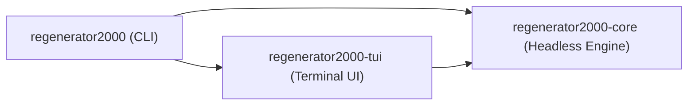
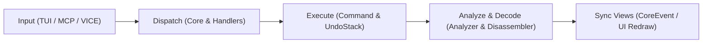
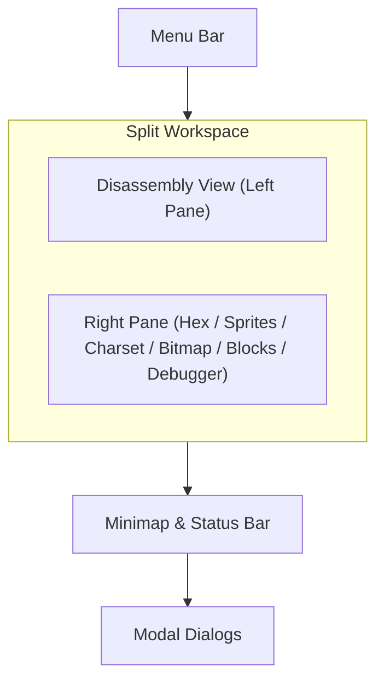

# Architecture

Regenerator 2000 is an interactive 6502 disassembler in Rust for 8-bit Commodore computers.

Three design rules guide the codebase:

- **Headless core**: `regenerator2000-core` owns domain state, rules, and analysis without UI dependencies.
- **Unidirectional data flow**: User input, MCP tool calls, and debugger events change state through reversible `Command` values.
- **Shared domain logic**: Both the TUI and the MCP server call shared `AppState` methods to avoid duplicate rules.

Individual modules document their types and functions in Rust doc comments. Run `cargo doc --no-deps --open` to read API documentation locally.

---

## 1. Workspace Crates

The Cargo workspace splits Regenerator 2000 into three crates with strict one-way dependencies.

| Crate | Location | Responsibility |
| :--- | :--- | :--- |
| `regenerator2000` | `src/` | Parses CLI flags and starts the TUI and MCP server. |
| `regenerator2000-core` | `crates/regenerator2000-core/` | Owns state, analysis, disassembly, parsers, exporters, unpacker, MCP, and VICE. |
| `regenerator2000-tui` | `crates/regenerator2000-tui/` | Renders the terminal UI and routes keyboard and mouse events. |

---

## 2. Unidirectional Data Flow

All frontends change project state through a single pipeline.

1. **Input**: The TUI maps key and mouse events to `AppAction` values, while external clients send [MCP](mcp.md) or [VICE](debugger.md) requests.
2. **Dispatch**: `Core` checks document safety guards and routes each action to a domain handler in `action_handlers/`.
3. **Execute**: The handler builds a reversible `Command` and applies it through `UndoStack` to change `AppState`.
4. **Analyze**: `AppState` updates cross-references, auto-labels, and disassembly lines when state changes.
5. **Sync**: `Core` emits `CoreEvent` notifications so the TUI updates views, status messages, or modal dialogs.

MCP tools call the same `AppState` methods to push `Command` values onto `UndoStack` and re-anchor the disassembly cursor. When the TUI runs alongside MCP, an event wakes the render loop so the screen shows changes right away.

---

## 3. Core Subsystems

The `regenerator2000-core` crate groups domain logic into top-level subsystems.

| Subsystem | Module | Role |
| :--- | :--- | :--- |
| **Central Hub** | `core.rs`, `action_handlers/` | Coordinates `AppState`, `CoreViewState`, and action handlers for file, disassembly, navigation, and debug tasks. |
| **State and Undo** | `state/`, `commands.rs` | Stores binary data, [block types](blocks.md), labels, sparse address annotations, and reversible `Command` history. |
| **CPU and Analyzer** | `cpu.rs`, `analyzer.rs` | Decodes 6502 opcodes, scans code and tables, creates auto-labels, and builds typed cross-references (see [Analysis](analysis.md)). |
| **Disassembler** | `disassembler/` | Resolves symbols and formats instructions and data blocks for [target assemblers](assemblers.md). |
| **Parsers** | `parser/` | Loads Commodore binaries and containers, SourceGen `.dis65` projects, and VICE `.lbl` symbol files. |
| **Exporter** | `exporter/` | Lowers disassembly into a syntax-neutral document, renders `.asm` or `.html` output, and checks roundtrip assembly. |
| **Binary Unpacker** | `unpacker/`, `packers/` | Runs packed binaries in a 2-phase 6502 sandbox with declarative packer rules (see [Binary Unpacker](unpacker.md)). |
| **External Bridges** | `mcp/`, `vice/` | Serves AI agent tools over [MCP](mcp.md) and connects to the live [VICE binary monitor](debugger.md). |
| **Assets and Config** | `assets.rs`, `config.rs` | Loads built-in platform labels, comments, themes, hardware enums, and global user settings. |

### State and View Separation

`AppState` holds all persistent project data, including raw bytes, block types, labels, cross-references, and settings. `AnnotationManager` stores sparse per-address metadata such as comments, offsets, number formats, bookmarks, scopes, and enums.

`CoreViewState` tracks transient navigation state without terminal dependencies. It owns the active pane, cursor position, selection range, scroll offset, and jump history.

### Disassembly and Export Pipeline

The disassembler turns `AppState` into formatted lines that both the TUI and exporter reuse.

Symbol resolution follows five priority tiers from highest to lowest:

1. Per-site operand offsets
2. User labels
3. Global address offsets
4. System labels
5. Auto-generated labels

A shared `Formatter` trait adapts operands and directives for `64tass`, `ACME`, `ca65`, and `KickAssembler`. The exporter builds a neutral `ExportDocument` representation before it writes `.asm` or `.html` files. For roundtrip checks, the exporter assembles the generated `.asm` output and compares its bytes against `raw_data`.

### System-Agnostic Unpacker

The unpacker sandbox scans for known packer rules and runs decompression code in two phases. Phase 1 steps the 6502 CPU until execution enters the depacker stub. Phase 2 tracks RAM writes during decompression until execution jumps to the unpacked program.

Unpacker code never hardcodes C64 memory addresses. Instead, `TargetSystem` methods supply platform RAM bounds, BASIC start addresses, and ROM trap vectors across all Commodore 8-bit machines.

### Terminal UI (`regenerator2000-tui`)

`UIState` wraps `CoreViewState` through `Deref` and adds terminal-only state such as popup queues and mouse hitboxes.

Every TUI view and modal dialog implements the `Widget` trait to render frames and process input. Right-pane [views](views.md) share cursor movement and selection behavior through the `Navigable` trait.

---

## 4. Project Persistence (`.regen2000proj`)

Regenerator 2000 saves project state as JSON files with four storage rules:

- **Compressed binary payload**: Compresses `raw_data` with gzip and encodes the bytes in Base64.
- **Run-length block ranges**: Merges adjacent bytes with the same `BlockType` into compact `{start, end, type_, collapsed}` entries.
- **Sparse address metadata**: Saves one JSON object per annotated address and skips transient ROM comments.
- **Deterministic output**: Stores address maps in `BTreeMap` and `BTreeSet` so saved files produce clean Git diffs.

---

## 5. Adding New Features

Follow these entry points when you extend Regenerator 2000:

- **New State Command**: Add a variant to `Command` in `commands.rs`. Implement `apply` and `undo`. Expose a shared helper method on `AppState`.
- **New Block Type**: Add the variant to `BlockType` in `state/types.rs`. Update `analyzer.rs`, `disassembler/`, and key bindings in `regenerator2000-tui`.
- **New Assembler**: Add the variant to `Assembler` in `state/types.rs`. Implement `Formatter` in `disassembler/`. Add roundtrip support in `exporter/`.
- **New Packer**: Create a `PackerSpec` module in `packers/` with system-relative anchors. Register it in `packers/registry.rs`. Add a corpus test.
- **New MCP Tool**: Call a shared `AppState` method from `mcp/tools/`. Register the tool in `mcp/handler.rs`. Update [MCP Integration](mcp.md).
