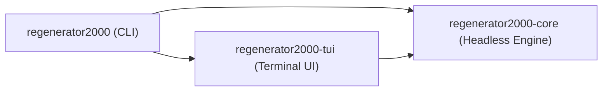
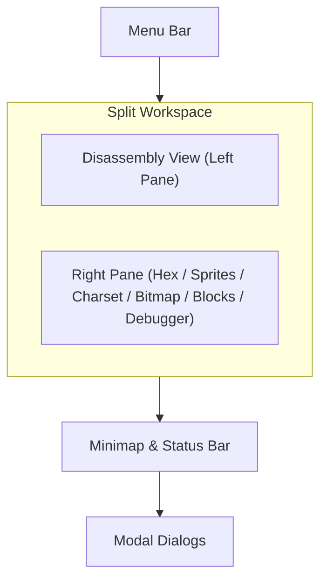

# Architecture

Regenerator 2000 is an interactive 6502 disassembler written in Rust for 8-bit Commodore systems. Three core design rules guide the workspace:

**Headless core**
:   `regenerator2000-core` owns all persistent state, validation, analysis, and formatting with zero UI dependencies.

**Unidirectional data flow**
:   User input, MCP tool calls, and debugger events mutate state solely through reversible `Command` values.

**Shared domain logic**
:   Both the TUI and the MCP server invoke shared `AppState` methods so validation and business rules never drift.

!!! tip "Rust API Docs"

    Individual modules carry Rust doc comments—run `cargo doc --no-deps --open` to browse the full crate API reference locally.

---

## Workspace Crates

The Cargo workspace enforces strict one-way dependencies across three crates:

| Crate | Location | Responsibility |
| :--- | :--- | :--- |
| `regenerator2000` | `src/` | Parses CLI flags and launches the TUI or headless/MCP runners. |
| `regenerator2000-core` | `crates/regenerator2000-core/` | Owns state, analysis, disassembly, parsers, exporters, unpacker, MCP, and VICE. |
| `regenerator2000-tui` | `crates/regenerator2000-tui/` | Renders the terminal UI and translates keyboard/mouse events into actions. |

---

## Unidirectional Data Flow

Every frontend mutates project state through the same pipeline:

1. **Input:** The TUI maps key and mouse events to `AppAction` values, while external clients dispatch [MCP](mcp.md) or [VICE](debugger.md) requests.
2. **Dispatch:** `Core` checks document safety guards and delegates to a modular handler in `action_handlers/`.
3. **Execute:** The handler constructs a reversible `Command` and applies it through `UndoStack` onto `AppState`.
4. **Analyze:** `AppState` refreshes cross-references, auto-labels, and decoded lines after edits.
5. **Sync:** `Core` emits `CoreEvent` updates so views, dialogs, and status indicators redraw.

MCP tools invoke the exact same `AppState` methods to push `Command` entries onto `UndoStack` and update the cursor; when running alongside the TUI, an event wakes the terminal loop immediately.

---

## Core Subsystems

`regenerator2000-core` organizes domain logic into decoupled modules:

| Subsystem | Module | Role |
| :--- | :--- | :--- |
| **Central Hub** | `core.rs`, `action_handlers/` | Coordinates `AppState`, `CoreViewState`, and handlers for file, disassembly, navigation, and debug actions. |
| **State & Undo** | `state/`, `commands.rs` | Stores binary data, [block types](blocks.md), labels, sparse annotations, and reversible `Command` history. |
| **CPU & Analyzer** | `cpu.rs`, `analyzer.rs` | Decodes 6502 opcodes, walks reachable code and tables, assigns auto-labels, and builds typed X-Refs (see [Analysis](analysis.md)). |
| **Disassembler** | `disassembler/` | Resolves symbols and formats lines for [target assemblers](assemblers.md). |
| **Parsers** | `parser/` | Loads Commodore binaries and containers, SourceGen `.dis65` projects, and VICE `.lbl` files. |
| **Exporter** | `exporter/` | Lowers disassembly to neutral IR, renders `.asm` or `.html`, and verifies roundtrip builds. |
| **Binary Unpacker** | `unpacker/`, `packers/` | Runs packed binaries inside a 2-phase 6502 sandbox using declarative packer rules (see [Binary Unpacker](unpacker.md)). |
| **External Bridges** | `mcp/`, `vice/` | Exposes AI agent tools over [MCP](mcp.md) and connects to the live [VICE binary monitor](debugger.md). |
| **Assets & Config** | `assets.rs`, `config.rs` | Loads built-in system labels, comments, themes, enums, and global user settings. |

### State and View Separation

`AppState` holds all persistent project data (`raw_data`, block classifications, labels, cross-references, and settings), while `AnnotationManager` stores sparse per-address metadata (comments, symbolic offsets, immediate formats, bookmarks, scopes, and enum usages).

`CoreViewState` tracks transient navigation state (active pane, cursor position, selection range, scroll offset, and jump history) without terminal dependencies.

### Disassembly and Export Pipeline

The disassembler produces formatted lines shared identically by both the TUI and the exporter:

Symbol resolution evaluates five priority levels from highest to lowest:

| Priority | Source |
| :---: | :--- |
| `1` | Per-site operand symbolic offsets |
| `2` | User-defined labels |
| `3` | Global address symbolic offsets |
| `4` | Predefined system labels |
| `5` | Auto-generated analyzer labels |

A shared `Formatter` trait emits native directives for **64tass**, **ACME**, **ca65**, and **KickAssembler**. The exporter builds a syntax-neutral `ExportDocument` IR before writing `.asm` or `.html`, and roundtrip verification (`--verify`) reassembles `.asm` output to check byte-for-byte parity with `raw_data`.

### System-Agnostic Unpacker

The unpacker detects packer signatures and executes decompression in two phases: Phase 1 steps the 6502 CPU until reaching the depacker stub, and Phase 2 tracks RAM writes until execution jumps into unpacked code.

Unpacker logic never hardcodes C64 constants—`TargetSystem` supplies RAM bounds, BASIC start addresses, and ROM trap vectors across all supported Commodore 8-bit machines.

### Terminal UI (`regenerator2000-tui`)

`UIState` wraps `CoreViewState` via `Deref` and adds terminal-only state such as modal popup queues and mouse hitboxes:

Every TUI view and modal implements `Widget`, while companion right-pane [views](views.md) share cursor navigation and range selection through the `Navigable` trait.

---

## Project Persistence (`.regen2000proj`)

Project files serialize cleanly as deterministic JSON using four storage rules:

**Compressed binary payload**
:   Compresses `raw_data` with gzip and encodes it in Base64.

**Run-length block ranges**
:   Collapses contiguous bytes sharing a `BlockType` into `{start, end, type_, collapsed}` spans.

**Sparse address metadata**
:   Writes one JSON entry per annotated address while omitting transient ROM comments.

**Deterministic ordering**
:   Backs address maps with `BTreeMap` and `BTreeSet` so project saves yield clean Git diffs.

---

## Extending Regenerator 2000

| Feature | Entry Points & Steps |
| :--- | :--- |
| **State Command** | Add a variant to `Command` in `commands.rs`, implement `apply`/`undo`, and expose a helper on `AppState`. |
| **Block Type** | Add the variant to `BlockType` in `state/types.rs`, then update `analyzer.rs`, `disassembler/`, and key bindings in `regenerator2000-tui`. |
| **Target Assembler** | Add the variant to `Assembler` in `state/types.rs`, implement `Formatter` in `disassembler/`, and wire roundtrip checks in `exporter/`. |
| **Binary Packer** | Add a declarative `PackerSpec` module under `packers/` using system-relative anchors, register it in `packers/registry.rs`, and add a corpus test. |
| **MCP Tool** | Delegate to a shared `AppState` method in `mcp/tools/`, register in `mcp/handler.rs`, and run `update-mcp-docs` to sync [MCP Integration](mcp.md). |
