# Architecture of Regenerator 2000

Regenerator 2000 is an interactive disassembler and reverse-engineering suite in Rust for 8-bit MOS 6502/6510 Commodore computers (C64, C128, VIC-20, Plus/4, C16, PET 2001, PET 4000/8000, and 1541/1571/1581 drives).

The system enforces a **unidirectional data flow** and separates the headless core engine from the user interfaces. User input, automated analysis passes, external debuggers, and Model Context Protocol (MCP) AI agents all communicate through a single deterministic action-dispatch pipeline.

---

## 1. High-Level Overview

```mermaid
flowchart TD
    subgraph bin_crate [regenerator2000 Crate - CLI Application]
        Main[main.rs<br/>CLI Parsing & Terminal Init]
    end

    subgraph tui_crate [regenerator2000-tui Crate - TUI Frontend]
        EventLoop[Event Loop & Router<br/>events.rs / input.rs]
        UIState[UIState<br/>Deref to CoreViewState]
        WidgetSystem[Widget Trait System<br/>Disassembly / Views / Dialogs / Menu]
        Renderer[Ratatui Renderer<br/>ui.rs / render.rs]
        ThemeEngine[Theme Engine<br/>theme.rs / theme_file.rs]
    end

    subgraph core_crate [regenerator2000-core Crate - Headless Engine]
        Core[Core Hub<br/>core.rs]
        ActionHandlers[Action Handlers<br/>File / Disassembly / Debug / Navigation]
        AppAction[AppAction Enum<br/>actions.rs]
        CommandSys[Command Pattern & UndoStack<br/>commands.rs]
        AppState[AppState<br/>Memory / Labels / CrossRefs / Settings]
        AnnotationMap[AnnotationManager<br/>Sparse AddressEntry Metadata]
        CoreViewState[CoreViewState<br/>Cursors / Panes / Modes / History]
        Analyzer[Control-Flow Analyzer<br/>analyzer.rs]
        DisasmEngine[Disassembly Pipeline<br/>symbols / data_blocks / handlers / formatter]
        Parsers[Parser Suite<br/>PRG / CRT / D64 / T64 / VSF / SourceGen]
        Exporters[Exporter Suite & Verify<br/>ASM / HTML / Roundtrip Diff]
        UnpackerSandbox[6502 Emulation Sandbox<br/>bus / cia / engine / detector / 21 packers]
        MCPServer[MCP Server Suite<br/>HTTP SSE / Stdio / handler / tools]
        ViceClient[VICE Monitor Client<br/>protocol / client / state / c64_hardware]
        AssetsConfig[Assets & Config<br/>system-*.toml / enum-*.toml / config.toml]
    end

    subgraph External [External Interfaces & Tools]
        MCPClient[MCP Client / AI Agent<br/>Claude Desktop / Cursor / Custom]
        VICE[VICE Emulator<br/>Binary Monitor TCP Port 6502]
        AssemblerBinaries[Assembler CLIs<br/>64tass / ACME / ca65 / KickAss]
        CommodoreFiles[Binary Media<br/>.prg / .crt / .d64 / .d71 / .d81 / .t64 / .vsf]
    end

    %% Lifecycle & Initialization
    Main -->|Initializes Engine| Core
    Main -->|Spawns Threads & Runs| EventLoop
    Main -->|Loads Files / Media| Parsers
    CommodoreFiles -->|Decoded by| Parsers
    Parsers -->|Populates Initial State| AppState

    %% UI Flow
    EventLoop -->|Routes Input Event| WidgetSystem
    WidgetSystem -->|Emits Action| AppAction
    AppAction -->|apply_action| Core
    Core -->|Delegates via ActionContext| ActionHandlers
    ActionHandlers -->|Applies / Undoes| CommandSys
    ActionHandlers -->|Mutates View State| CoreViewState
    CommandSys -->|Mutates State| AppState
    AppState -->|Maintains Metadata| AnnotationMap
    AppState -->|Triggers Analysis| Analyzer
    AppState -->|Provides Data| DisasmEngine
    DisasmEngine -->|Generates Formatted Lines| AppState

    %% Rendering Flow
    CoreViewState -.->|Embedded via Deref| UIState
    UIState -->|Supplies View State| Renderer
    AppState -->|Supplies Data| Renderer
    ThemeEngine -->|Supplies Styles| Renderer
    EventLoop -->|Drives Render Frame| Renderer

    %% Background & External Integrations
    Core -->|Emits UnpackStarted Event| EventLoop
    EventLoop -->|Spawns Sandbox Thread| UnpackerSandbox
    UnpackerSandbox -.->|Loads Unpacked Output| AppState

    MCPClient <-->|JSON-RPC via HTTP SSE or Stdio| MCPServer
    MCPServer -->|Builds & Applies Commands via AppState| CommandSys
    MCPServer -.->|Inspects Engine State| AppState

    VICE <-->|Binary Monitor Protocol| ViceClient
    ViceClient <-->|Updates Live Registers/RAM| AppState

    Exporters -->|Invokes Assemblers| AssemblerBinaries
    AssemblerBinaries -->|Byte-Level Diff Verification| Exporters
```



---

## 2. Workspace & Crate Structure

The Cargo workspace splits Regenerator 2000 into three crates:

```text
regenerator2000/
├── Cargo.toml                                 # Workspace manifest
├── src/                                       # Binary crate (CLI entry point)
│   └── main.rs
├── crates/
│   ├── regenerator2000-core/                  # Headless reverse-engineering engine
│   │   ├── Cargo.toml
│   │   └── src/
│   │       ├── lib.rs
│   │       ├── core.rs                        # Engine central hub
│   │       ├── action_handlers/               # Modular domain action dispatchers
│   │       ├── state/                         # Domain models, metadata & persistence
│   │       ├── disassembler/                  # Disassembly pipeline & formatters
│   │       ├── cpu.rs                         # MOS 6502/6510 opcode table & modes
│   │       ├── commands.rs                    # Command pattern & UndoStack
│   │       ├── analyzer.rs                    # Control-flow & symbol heuristics
│   │       ├── parser/                        # Binary container & snapshot parsers
│   │       ├── exporter/                      # Multi-assembler, HTML & roundtrip verification
│   │       ├── unpacker/                      # 6502 sandbox depacker engine
│   │       ├── packers/                       # 21 binary packer detection strategies
│   │       ├── mcp/                           # Model Context Protocol server (HTTP & Stdio)
│   │       ├── vice/                          # Live VICE binary monitor client
│   │       ├── assets.rs                      # Embedded ROM definitions, system TOMLs & enums
│   │       ├── config.rs                      # System configuration persistence
│   │       ├── error.rs                       # Subsystem error hierarchy (thiserror)
│   │       ├── event.rs                       # CoreEvent & DialogType vocabularies
│   │       ├── navigation.rs                  # Address jump & bookmark helpers
│   │       ├── utils.rs                       # Shared string & formatting utilities
│   │       ├── view_state.rs                  # Frontend-agnostic CoreViewState
│   │       └── bin/
│   │           └── unpacker_compare_all.rs    # Depacker benchmarking & comparison tool
│   └── regenerator2000-tui/                   # Terminal User Interface frontend
│       ├── Cargo.toml
│       └── src/
│           ├── lib.rs
│           ├── events.rs                      # Main TUI event loop & background task coordination
│           ├── events/input.rs                # Input router for keyboard and mouse
│           ├── ui.rs                          # Top-level Ratatui layout engine
│           ├── ui_state.rs                    # UIState wrapping CoreViewState via Deref
│           ├── theme.rs                       # Runtime color theme engine
│           ├── theme_file.rs                  # TOML theme file parser & dumper
│           └── ui/
│               ├── widget.rs                  # Widget trait & WidgetResult
│               ├── statusbar.rs               # Dynamic bottom status bar
│               ├── minimap_bar.rs             # Memory map visualization bar
│               ├── navigable.rs               # Unified navigation trait
│               ├── graphics_common.rs         # Shared glyph & bit-matrix renderers
│               ├── menu/                      # Menu bar model, render & actions
│               ├── view_disassembly/          # Modular disassembly view (5 submodules)
│               ├── view_hexdump.rs            # Hex dump view (8/16 column)
│               ├── view_sprites.rs            # Sprite visualizer (1/2 column, mono/multicolor)
│               ├── view_charset.rs            # Character set visualizer (4/8 column)
│               ├── view_bitmap.rs             # Full bitmap visualizer (mono/multicolor)
│               ├── view_blocks.rs             # Memory block overview list
│               ├── view_debugger.rs           # Live VICE monitor register & RAM view
│               └── dialog_*.rs                # 34 modal dialog implementations
```

---

## 3. Subsystem Deep Dives

### 3.1 Central Hub & Domain Action Handlers

[`Core`](file:///Users/ricardoq/progs/regenerator2000/crates/regenerator2000-core/src/core.rs) combines persistent domain state ([`AppState`](file:///Users/ricardoq/progs/regenerator2000/crates/regenerator2000-core/src/state/app_state.rs)) and transient view state ([`CoreViewState`](file:///Users/ricardoq/progs/regenerator2000/crates/regenerator2000-core/src/view_state.rs)):

```rust
pub struct Core {
    pub state: AppState,
    pub view: CoreViewState,
}
```

#### The Action Dispatch Pipeline

Frontends send [`AppAction`](file:///Users/ricardoq/progs/regenerator2000/crates/regenerator2000-core/src/state/actions.rs) enum variants to [`Core::apply_action()`](file:///Users/ricardoq/progs/regenerator2000/crates/regenerator2000-core/src/core.rs#L32). The hub checks document safety guards, prompts for confirmation on unsaved changes, and delegates execution to domain handlers via [`ActionContext<'a>`](file:///Users/ricardoq/progs/regenerator2000/crates/regenerator2000-core/src/action_handlers/mod.rs#L21):

```rust
pub struct ActionContext<'a> {
    pub state: &'a mut AppState,
    pub view: &'a mut CoreViewState,
    pub events: &'a mut Vec<CoreEvent>,
}
```

The context provides [`preserve_cursor()`](file:///Users/ricardoq/progs/regenerator2000/crates/regenerator2000-core/src/action_handlers/mod.rs#L32). This method records the memory address at the active cursor line and re-anchors the view cursor after disassembly or analysis updates.

#### Modular Action Handlers ([`action_handlers/`](file:///Users/ricardoq/progs/regenerator2000/crates/regenerator2000-core/src/action_handlers))

Each domain handler implements [`DomainActionHandler`](file:///Users/ricardoq/progs/regenerator2000/crates/regenerator2000-core/src/action_handlers/mod.rs#L56):

-   **[`file_handler.rs`](file:///Users/ricardoq/progs/regenerator2000/crates/regenerator2000-core/src/action_handlers/file_handler.rs)**: Opens and saves projects, exports ASM and HTML files, imports and exports VICE labels, and starts binary unpacking.
-   **[`disassembly_handler.rs`](file:///Users/ricardoq/progs/regenerator2000/crates/regenerator2000-core/src/action_handlers/disassembly_handler.rs)**: Updates memory block types, user comments, labels, immediate operand formats, scopes, splitters, and enum usages.
-   **[`debug_handler.rs`](file:///Users/ricardoq/progs/regenerator2000/crates/regenerator2000-core/src/action_handlers/debug_handler.rs)**: Manages the VICE monitor TCP connection, execution stepping (Step, Step Over, Step Out, Continue, Run to Cursor), and breakpoints/watchpoints.
-   **[`navigation_handler.rs`](file:///Users/ricardoq/progs/regenerator2000/crates/regenerator2000-core/src/action_handlers/navigation_handler.rs)**: Handles address jumps, operand target resolution, navigation history, bookmarks, symbol lookup, and cross-reference queries.

#### Domain Errors & Events

-   **[`error.rs`](file:///Users/ricardoq/progs/regenerator2000/crates/regenerator2000-core/src/error.rs)**: Defines a typed error hierarchy using `thiserror`. `CoreError` wraps `UnpackError`, `ExportError`, `ViceError`, `ProjectError`, and `ParseFailed`. The [`IoResultExt`](file:///Users/ricardoq/progs/regenerator2000/crates/regenerator2000-core/src/error.rs#L243) trait attaches file path context (`with_path`) to standard I/O errors.
-   **[`event.rs`](file:///Users/ricardoq/progs/regenerator2000/crates/regenerator2000-core/src/event.rs)**: Defines frontend-agnostic events via [`CoreEvent`](file:///Users/ricardoq/progs/regenerator2000/crates/regenerator2000-core/src/event.rs#L8) (`StateChanged`, `ViewChanged`, `StatusMessage`, `DialogRequested(DialogType)`, `DialogDismissalRequested`, `QuitRequested`, `OpenUrl`, `UnpackStarted`, `StartMcpServerRequested`, and `StopMcpServerRequested`) and 30+ modal [`DialogType`](file:///Users/ricardoq/progs/regenerator2000/crates/regenerator2000-core/src/event.rs#L46) variants.
-   **[`view_state.rs`](file:///Users/ricardoq/progs/regenerator2000/crates/regenerator2000-core/src/view_state.rs)**: Implements [`CoreViewState`](file:///Users/ricardoq/progs/regenerator2000/crates/regenerator2000-core/src/view_state.rs#L61) to track active panes ([`ActivePane`](file:///Users/ricardoq/progs/regenerator2000/crates/regenerator2000-core/src/view_state.rs#L8)), right-pane modes ([`RightPane`](file:///Users/ricardoq/progs/regenerator2000/crates/regenerator2000-core/src/view_state.rs#L25)), cursor indices, visual selections, scroll offsets, navigation history, and search queries.

---

### 3.2 Application State & Memory Domain ([`state/`](file:///Users/ricardoq/progs/regenerator2000/crates/regenerator2000-core/src/state))

[`AppState`](file:///Users/ricardoq/progs/regenerator2000/crates/regenerator2000-core/src/state/app_state.rs#L45) stores all persistent project state:

```rust
pub struct AppState {
    pub schema_version: u32,
    pub file_path: Option<PathBuf>,
    pub project_path: Option<PathBuf>,
    pub raw_data: Vec<u8>,
    pub disassembly: Vec<DisassemblyLine>,
    pub cached_arrows: Vec<CachedArrow>,
    pub origin: Addr,
    pub entry_point: Option<Addr>,
    pub entropy: Option<f32>,
    pub block_types: Vec<BlockType>,
    pub labels: BTreeMap<Addr, Vec<Label>>,
    pub settings: DocumentSettings,
    pub annotations: AnnotationManager,
    pub cross_refs: BTreeMap<Addr, Vec<Addr>>,
    pub enums: BTreeMap<String, EnumDefinition>,
    pub user_global_enums: BTreeMap<String, EnumDefinition>,
    pub builtin_enums: BTreeMap<String, EnumDefinition>,
    pub system_config: SystemConfig,
    pub undo_stack: UndoStack,
    pub last_saved_pointer: usize,
    pub user_excluded_addresses: BTreeSet<Addr>,
    pub collapsed_blocks: Vec<(usize, usize)>,
    pub splitters: BTreeSet<Addr>,
    pub vice_state: ViceState,
    pub vice_client: Option<ViceClient>,
    pub mcp_server_running: bool,
    // ...
}
```

#### Sparse Address Metadata ([`annotations.rs`](file:///Users/ricardoq/progs/regenerator2000/crates/regenerator2000-core/src/state/annotations.rs))

[`AnnotationManager`](file:///Users/ricardoq/progs/regenerator2000/crates/regenerator2000-core/src/state/annotations.rs) consolidates per-address metadata into a single sparse map instead of separate address-keyed tables. Each address maps to an [`AddressEntry`](file:///Users/ricardoq/progs/regenerator2000/crates/regenerator2000-core/src/state/annotations.rs#L12):

-   `system_comment`: Transient ROM or hardware comment loaded from system assets.
-   `user_side_comment`: Persisted inline trailing comment.
-   `user_line_comment`: Persisted preceding block or line comment.
-   `immediate_format`: Operand representation override (`Hex`, `InvertedHex`, `Decimal`, `NegativeDecimal`, `Binary`, `InvertedBinary`, `LowByte(Addr)`, or `HighByte(Addr)`).
-   `bookmark`: Persisted user bookmark label.
-   `scope`: Persisted routine scope boundary address.
-   `enum_usage`: Persisted enumeration reference name.

`AnnotationManager` normalizes whitespace and removes empty entries automatically. Its custom `Serialize` implementation writes one JSON object per address and skips transient `system_comment` values. Its custom `Deserialize` implementation also accepts the legacy per-field maps (`user_side_comments`, `user_line_comments`, `immediate_value_formats`, `bookmarks`, `scopes`, and `enum_usages`), so older `.regen2000proj` files load without errors.

#### Domain Types ([`types.rs`](file:///Users/ricardoq/progs/regenerator2000/crates/regenerator2000-core/src/state/types.rs))

-   **[`TargetSystem`](file:///Users/ricardoq/progs/regenerator2000/crates/regenerator2000-core/src/state/types.rs#L9)**: Identifies the target hardware platform (`C64`, `C128`, `Vic20`, `Pet20`, `Pet40`, `Plus4`, `C16`, `C1541`, `C1571`, `C1581`, or `Custom(Box<str>)`). Provides platform constants such as RAM start, default BASIC start, screen RAM address, I/O boundaries, and hardware vectors.
-   **[`Addr`](file:///Users/ricardoq/progs/regenerator2000/crates/regenerator2000-core/src/state/types.rs#L503)**: Wraps a 16-bit memory address (`pub struct Addr(pub u16)`). Implements wrapping 16-bit address arithmetic, hexadecimal formatting, and numeric JSON serialization.
-   **[`BlockType`](file:///Users/ricardoq/progs/regenerator2000/crates/regenerator2000-core/src/state/types.rs#L771)**: Classifies memory regions (`Code`, `DataByte`, `DataWord`, `Address`, `PetsciiText`, `ScreencodeText`, `LoHiAddress`, `HiLoAddress`, `LoHiWord`, `HiLoWord`, `ExternalFile`, and `Undefined`).
-   **[`Assembler`](file:///Users/ricardoq/progs/regenerator2000/crates/regenerator2000-core/src/state/types.rs#L739)**: Selects the target assembler syntax (`Tass64`, `Acme`, `Ca65`, or `Kick`).

---

### 3.3 Disassembly Pipeline & Assembler Formatting Suite ([`disassembler/`](file:///Users/ricardoq/progs/regenerator2000/crates/regenerator2000-core/src/disassembler))

The disassembly pipeline converts raw binary bytes and metadata into formatted assembly lines:

```text
raw_data + block_types + annotations + symbols
                     │
                     ▼
       ┌───────────────────────────┐
       │   DisassemblyContext      │  (Pre-computes scope ends for O(log S) checks)
       └─────────────┬─────────────┘
                     │
                     ▼
       ┌───────────────────────────┐
       │    disassemble_ctx()      │  (pipeline.rs decoding loop)
       └─────────────┬─────────────┘
                     │
       ┌─────────────┴────────────────────────┐
       ▼                                      ▼
[Code Instruction]                     [Data Block Formatter]
pipeline.rs / handlers.rs              data_blocks.rs
(Opcode lookup & operand format)       (Bytes, Words, Text, Fill runs)
       │                                      │
       └─────────────┬────────────────────────┘
                     │
                     ▼
       ┌───────────────────────────┐
       │     Formatter Trait       │  (64tass / ACME / ca65 / KickAss)
       └─────────────┬─────────────┘
                     │
                     ▼
       Vec<DisassemblyLine> (Renderable & Exportable rows)
```

-   **[`context.rs`](file:///Users/ricardoq/progs/regenerator2000/crates/regenerator2000-core/src/disassembler/context.rs)**: [`DisassemblyContext`](file:///Users/ricardoq/progs/regenerator2000/crates/regenerator2000-core/src/disassembler/context.rs#L7) holds references to memory buffers, block types, labels, cross-references, settings, and annotations. It pre-computes `scope_ends` into a `BTreeSet`. `is_virtual_splitter()` treats user splitters, scope starts, and scope ends as section breaks with $$O(\log S)$$ lookups.
-   **[`pipeline.rs`](file:///Users/ricardoq/progs/regenerator2000/crates/regenerator2000-core/src/disassembler/pipeline.rs)**: Drives the main disassembly loop, emits label header lines, and decodes instructions via `disassemble_code_instruction`.
-   **[`symbols.rs`](file:///Users/ricardoq/progs/regenerator2000/crates/regenerator2000-core/src/disassembler/symbols.rs)**: Resolves symbol precedence (`LabelKind::User` > `LabelKind::System` > `LabelKind::Auto`), formats local labels, computes scope paths (`compute_scope_names`), and resolves operand target addresses.
-   **[`data_blocks.rs`](file:///Users/ricardoq/progs/regenerator2000/crates/regenerator2000-core/src/disassembler/data_blocks.rs)**: Formats non-code blocks including byte tables (`.byte`), 16-bit words (`.word`), address tables, PETSCII and Screencode strings, split Lo/Hi and Hi/Lo tables, external binary includes (`.incbin`), and fill runs (`.fill`).
-   **[`handlers.rs`](file:///Users/ricardoq/progs/regenerator2000/crates/regenerator2000-core/src/disassembler/handlers.rs)**: Decodes instruction operands across all 13 MOS 6502 addressing modes.
-   **[`formatter.rs`](file:///Users/ricardoq/progs/regenerator2000/crates/regenerator2000-core/src/disassembler/formatter.rs)** and Assembler Formatters:

    -   [`formatter_64tass.rs`](file:///Users/ricardoq/progs/regenerator2000/crates/regenerator2000-core/src/disassembler/formatter_64tass.rs): Formats 64tass syntax (`.byte`, `.word`, `.text`, `.fill`, `.binary`, `* = $ADDR`).
    -   [`formatter_acme.rs`](file:///Users/ricardoq/progs/regenerator2000/crates/regenerator2000-core/src/disassembler/formatter_acme.rs): Formats ACME syntax (`!byte`, `!word`, `!text`, `!fill`, `!binary`, `* = $ADDR`).
    -   [`formatter_ca65.rs`](file:///Users/ricardoq/progs/regenerator2000/crates/regenerator2000-core/src/disassembler/formatter_ca65.rs): Formats ca65 syntax (`.byte`, `.word`, `.res`, `.incbin`, `.org $ADDR`).
    -   [`formatter_kickasm.rs`](file:///Users/ricardoq/progs/regenerator2000/crates/regenerator2000-core/src/disassembler/formatter_kickasm.rs): Formats KickAssembler syntax (`.byte`, `.word`, `.text`, `.fill`, `.import binary`, `* = $ADDR`).

---

### 3.4 MOS 6502/6510 CPU Model ([`cpu.rs`](file:///Users/ricardoq/progs/regenerator2000/crates/regenerator2000-core/src/cpu.rs))

The CPU module defines all 256 opcode bytes of the MOS 6502/6510 processor:

-   **`Opcode`**: Stores the mnemonic, addressing mode, byte length (1–3), cycle count, description, and illegal-opcode flag.
-   **`AddressingMode`**: Enumerates all 13 addressing modes (`Implied`, `Accumulator`, `Immediate`, `ZeroPage`, `ZeroPageX`, `ZeroPageY`, `Relative`, `Absolute`, `AbsoluteX`, `AbsoluteY`, `Indirect`, `IndirectX`, and `IndirectY`), plus an `Unknown` sentinel for undecodable bytes.
-   **Undocumented Opcodes**: Supports undocumented 6502 opcodes (`LAX`, `SAX`, `DCP`, `ISC`, `SLO`, `RLA`, `SRE`, `RRA`, `ALR`, `ANC`, `ARR`, `AXS`, multi-byte `NOP` variants, and `KIL`/`JAM`). If you disable `use_illegal_opcodes` in Document Settings, the disassembler formats undocumented opcodes as raw `.byte` values.

---

### 3.5 Command Pattern & Undo/Redo Engine ([`commands.rs`](file:///Users/ricardoq/progs/regenerator2000/crates/regenerator2000-core/src/commands.rs))

Every state mutation in Regenerator 2000 executes as an atomic, reversible [`Command`](file:///Users/ricardoq/progs/regenerator2000/crates/regenerator2000-core/src/commands.rs):

```rust
pub enum Command {
    SetBlockType { range: Range<usize>, new_type: BlockType, old_types: Vec<BlockType> },
    SetLabel { address: Addr, new_label: Option<Vec<Label>>, old_label: Option<Vec<Label>> },
    SetAnalysisData { labels: BTreeMap<Addr, Vec<Label>>, cross_refs: BTreeMap<Addr, Vec<Addr>>, old_labels: BTreeMap<Addr, Vec<Label>>, old_cross_refs: BTreeMap<Addr, Vec<Addr>> },
    SetUserSideComment { address: Addr, new_comment: Option<String>, old_comment: Option<String> },
    SetUserLineComment { address: Addr, new_comment: Option<String>, old_comment: Option<String> },
    ChangeOrigin { new_origin: Addr, old_origin: Addr },
    SetImmediateFormat { address: Addr, new_format: Option<ImmediateFormat>, old_format: Option<ImmediateFormat> },
    CollapseBlock { range: (usize, usize) },
    UncollapseBlock { range: (usize, usize) },
    ToggleSplitter { address: Addr },
    ImportLabels { new_labels: Vec<(Addr, Label)>, old_labels: BTreeMap<Addr, Vec<Label>> },
    AddScope { start: Addr, end: Addr, old_end: Option<Addr> },
    RemoveScope { address: Addr, old_end: Addr },
    SetBookmark { address: Addr, new_name: Option<String>, old_name: Option<String> },
    SetUserExcludedAddress { address: Addr, add: bool, old_labels: BTreeMap<Addr, Vec<Label>>, old_cross_refs: BTreeMap<Addr, Vec<Addr>> },
    SetEnumUsage { address: Addr, new_enum: Option<String>, old_enum: Option<String> },
    SetEnumDefinition { name: String, new_definition: Option<EnumDefinition>, old_definition: Option<EnumDefinition> },
    Batch(Vec<Command>),
}
```

-   **`UndoStack`**: Maintains the undo and redo history and exposes a stack pointer. `AppState::is_dirty()` compares this pointer with `AppState::last_saved_pointer`.
-   **`apply(&self, state: &mut AppState)`**: Applies the state change and invalidates dependent caches.
-   **`undo(&self, state: &mut AppState)`**: Reverts the state change and restores previous values.
-   **Atomic Batches**: `Command::Batch` groups multiple mutations (such as multi-address label updates or batch MCP calls) into a single undoable operation.

---

### 3.6 Control-Flow & Heuristic Analyzer ([`analyzer.rs`](file:///Users/ricardoq/progs/regenerator2000/crates/regenerator2000-core/src/analyzer.rs))

The analyzer scans the binary memory buffer to discover subroutines, jump targets, data references, and fill runs:

```text
[Raw Program Memory]
         │
         ▼
Recursive Control-Flow Tracing ──► JSR / Bxx / JMP / RTS / RTI graph
         │
         ▼
Operand Symbol Classification ──► Usage count & semantic role resolution
         │
         ▼
Auto-Label Generation ──────────► Prefix assignment (s_, j_, b_, p_, etc.)
         │
         ▼
Cross-Reference Construction ───► Inverted index (target -> [referencing addrs])
         │
         ▼
Fill Run Detection ─────────────► Consecutive byte sequences >= threshold
```

#### Auto-Generated Label Prefixes

The analyzer assigns deterministic prefixes based on instruction context and address width:

| Prefix | Category | Semantics |
| :--- | :--- | :--- |
| `s_` | Subroutine | Target of a `JSR` instruction (for example, `s_C000`). |
| `j_` | Jump Target | Target of an absolute `JMP` instruction (for example, `j_0400`). |
| `b_` | Branch Target | Target of a relative conditional branch (`BEQ`, `BNE`, `BCC`, `BCS`, `BPL`, `BMI`, `BVC`, or `BVS`). |
| `r_` | Return Target | Target of a branch or jump whose first instruction is `RTS` or `RTI` (equivalent to IDA Pro `locret_`). |
| `p_` | Pointer | 16-bit address referenced by data instructions (for example, `p_1000`). |
| `zpp_` | Zero-Page Pointer | Zero-page address used in indirect addressing (`($zp),Y` or `($zp,X)`). |
| `f_` | Field | Absolute memory location read or written by data instructions. |
| `zpf_` | Zero-Page Field | Zero-page memory location read or written by data instructions. |
| `a_` | Absolute Address | Target inside an address table or external memory reference. |
| `zpa_` | Zero-Page Absolute | Zero-page address embedded inside an address table. |
| `e_` | External Jump | Jump target located outside the loaded binary memory range. |

---

### 3.7 Parser Suite ([`parser/`](file:///Users/ricardoq/progs/regenerator2000/crates/regenerator2000-core/src/parser))

The parser modules load raw binaries, disk and tape containers, and symbol files:

-   **[`prg.rs`](file:///Users/ricardoq/progs/regenerator2000/crates/regenerator2000-core/src/parser/prg.rs)**: Parses standard Commodore `.prg` files (2-byte little-endian load address header followed by payload bytes).
-   **[`basic.rs`](file:///Users/ricardoq/progs/regenerator2000/crates/regenerator2000-core/src/parser/basic.rs)**: Analyzes tokenized Commodore BASIC headers and evaluates `SYS` entry point expressions (including parenthesized and arithmetic expressions such as `SYS 2048+16`).
-   **[`crt.rs`](file:///Users/ricardoq/progs/regenerator2000/crates/regenerator2000-core/src/parser/crt.rs)**: Parses C64 cartridge images (`.crt`), including hardware types, `CHIP` packets, bank numbers, load addresses, and ROM sizes.
-   **[`d64.rs`](file:///Users/ricardoq/progs/regenerator2000/crates/regenerator2000-core/src/parser/d64.rs)**: Parses `.d64` (35, 40, and 42 tracks), `.d71` (double-sided 70/80 tracks), and `.d81` (80 tracks x 40 sectors) floppy disk images and extracts `.prg` files.
-   **[`t64.rs`](file:///Users/ricardoq/progs/regenerator2000/crates/regenerator2000-core/src/parser/t64.rs)**: Parses `.t64` tape container headers and directory records.
-   **[`dis65.rs`](file:///Users/ricardoq/progs/regenerator2000/crates/regenerator2000-core/src/parser/dis65.rs)**: Imports 6502bench SourceGen project files (`.dis65`), including labels, comments, and block types.
-   **[`vice_lbl.rs`](file:///Users/ricardoq/progs/regenerator2000/crates/regenerator2000-core/src/parser/vice_lbl.rs)**: Imports and exports VICE monitor label files (`al C:0810 .label_name`).
-   **[`vice_vsf.rs`](file:///Users/ricardoq/progs/regenerator2000/crates/regenerator2000-core/src/parser/vice_vsf.rs)**: Parses VICE emulator snapshot files (`.vsf`), detects the target machine (C64, C128, VIC-20, Plus/4, PET, or C1541), and extracts RAM dumps and CPU registers.

---

### 3.8 Exporter Suite & Roundtrip Verification ([`exporter/`](file:///Users/ricardoq/progs/regenerator2000/crates/regenerator2000-core/src/exporter))

-   **[`asm.rs`](file:///Users/ricardoq/progs/regenerator2000/crates/regenerator2000-core/src/exporter/asm.rs)**: Exports complete assembly source files for all 4 supported assemblers (64tass, ACME, ca65, and KickAssembler), including origin directives, scopes, local labels, external binary includes, and enum substitutions.
-   **[`html.rs`](file:///Users/ricardoq/progs/regenerator2000/crates/regenerator2000-core/src/exporter/html.rs)**: Exports standalone HTML disassembly files with syntax highlighting, clickable cross-reference links, dark and light themes, and external file sub-pages.
-   **[`verify.rs`](file:///Users/ricardoq/progs/regenerator2000/crates/regenerator2000-core/src/exporter/verify.rs)**: Runs automated roundtrip verification. This module exports the disassembly, runs the external assembler CLI (`64tass`, `acme`, `ca65`/`ld65`, or `kickass`), and compares the assembled output byte-for-byte against the original binary.

---

### 3.9 6502 Sandbox Binary Unpacker & Packer Strategies ([`unpacker/`](file:///Users/ricardoq/progs/regenerator2000/crates/regenerator2000-core/src/unpacker) & [`packers/`](file:///Users/ricardoq/progs/regenerator2000/crates/regenerator2000-core/src/packers))

Regenerator 2000 embeds a 6502 emulation sandbox based on `unp64` heuristics to unpack compressed executables:

```text
[Packed Input PRG]
         │
         ▼
[Packer Signature Scanner] ──► detect_packer() matches known signature
         │
         ▼
[Phase 1: Depacker Locator] ──► Emulate 6502 from SYS entry until PC < ReturnAddr
         │
         ▼
[Phase 2: Decompression Execution] ──► Emulate depacker stub until PC jumps back
         │
         ▼
[Detector & Memory Diffing] ──► Snapshot diffing & trailing cluster trimming
         │
         ▼
[Unpacked Output PRG + Entry Point]
```

-   **[`bus.rs`](file:///Users/ricardoq/progs/regenerator2000/crates/regenerator2000-core/src/unpacker/bus.rs)**: `C64Bus` (`UnpackerMemory`) emulates the 64 KB address space, C64 `$00`/`$01` processor port banking, and ROM reads.
-   **[`cia.rs`](file:///Users/ricardoq/progs/regenerator2000/crates/regenerator2000-core/src/unpacker/cia.rs)**: `CiaState` emulates MOS 6526 CIA 1 and CIA 2 timers for depackers that poll timer registers.
-   **[`engine.rs`](file:///Users/ricardoq/progs/regenerator2000/crates/regenerator2000-core/src/unpacker/engine.rs)**: `UnpackEngine` runs the two-phase 6502 execution loop with step hooks and ROM traps.
-   **[`detector.rs`](file:///Users/ricardoq/progs/regenerator2000/crates/regenerator2000-core/src/unpacker/detector.rs)**: Diffs post-emulation RAM against the initial memory snapshot to determine unpacked start/end boundaries and trim trailing depacker stubs.
-   **Packer Strategy Pattern ([`packers/`](file:///Users/ricardoq/progs/regenerator2000/crates/regenerator2000-core/src/packers))**: Implements the [`Packer`](file:///Users/ricardoq/progs/regenerator2000/crates/regenerator2000-core/src/packers/mod.rs#L62) trait (`info`, `pre_emulate`, `on_step`, and `post_emulate`) across **21 packer families** registered in `detect_packer()`:

    -   `action_replay`, `alz64`, `antiram`, `byteboozer`, `card_cruncher`, `ccs`, `cruel_cruncher`, `dali`, `eagle`, `eca`, `exomizer`, `final_cartridge`, `mc_cracken`, `pucrunch`, `super_cruncher`, `tbc`, `time_cruncher`, `tiny_crunch`, `triad`, `tscrunch`, and `turbo_cruncher`.
    -   `simple.rs` supplies the shared `SimplePacker` helper for signature-only packers. It is not a packer family.

-   **Benchmarking CLI ([`src/bin/unpacker_compare_all.rs`](file:///Users/ricardoq/progs/regenerator2000/crates/regenerator2000-core/src/bin/unpacker_compare_all.rs))**: Compares Regenerator 2000 unpacker output against `unp64` across test binaries.

---

### 3.10 Model Context Protocol (MCP) Server ([`mcp/`](file:///Users/ricardoq/progs/regenerator2000/crates/regenerator2000-core/src/mcp))

Regenerator 2000 implements an MCP (`2024-11-05`) server so AI agents (Antigravity, Claude Code, Claude Desktop, and Cursor) can inspect and modify disassemblies programmatically:

-   **Transports**:

    -   **[`http.rs`](file:///Users/ricardoq/progs/regenerator2000/crates/regenerator2000-core/src/mcp/http.rs)**: Serves streamable HTTP with Server-Sent Events (SSE) on port `3000` by default.
    -   **[`stdio.rs`](file:///Users/ricardoq/progs/regenerator2000/crates/regenerator2000-core/src/mcp/stdio.rs)**: Runs a headless standard I/O loop for subprocess clients.

-   **Request Dispatcher ([`handler.rs`](file:///Users/ricardoq/progs/regenerator2000/crates/regenerator2000-core/src/mcp/handler.rs))**: Routes JSON-RPC requests (`initialize`, `notifications/initialized`, `tools/list`, `resources/list`, `resources/read`, and `tools/call`).
-   **Tool Submodules ([`mcp/tools/`](file:///Users/ricardoq/progs/regenerator2000/crates/regenerator2000-core/src/mcp/tools))**:

    -   **[`analysis_tools.rs`](file:///Users/ricardoq/progs/regenerator2000/crates/regenerator2000-core/src/mcp/tools/analysis_tools.rs)**: Reads disassembly regions, blocks, cross-references, symbols, address details, binary metadata, and search matches.
    -   **[`navigation_tools.rs`](file:///Users/ricardoq/progs/regenerator2000/crates/regenerator2000-core/src/mcp/tools/navigation_tools.rs)**: Queries and moves the disassembly cursor.
    -   **[`modification_tools.rs`](file:///Users/ricardoq/progs/regenerator2000/crates/regenerator2000-core/src/mcp/tools/modification_tools.rs)**: Modifies block types, labels, comments, immediate formats, splitters, scopes, and enums.
    -   **[`session_tools.rs`](file:///Users/ricardoq/progs/regenerator2000/crates/regenerator2000-core/src/mcp/tools/session_tools.rs)**: Executes project save, undo, redo, batch execution, and binary unpacking.
    -   **[`common.rs`](file:///Users/ricardoq/progs/regenerator2000/crates/regenerator2000-core/src/mcp/tools/common.rs)**: Validates parameters and builds JSON-RPC error responses (`make_mcp_error`).

---

### 3.11 VICE Emulator Live Debugger Integration ([`vice/`](file:///Users/ricardoq/progs/regenerator2000/crates/regenerator2000-core/src/vice))

The `vice` module provides live bidirectional debugging with the VICE emulator:

-   **[`client.rs`](file:///Users/ricardoq/progs/regenerator2000/crates/regenerator2000-core/src/vice/client.rs)**: Manages non-blocking TCP socket communication with the VICE binary monitor (default port `6502`) on a background reader thread.
-   **[`protocol.rs`](file:///Users/ricardoq/progs/regenerator2000/crates/regenerator2000-core/src/vice/protocol.rs)**: Encodes and decodes binary monitor packets (`0x02` STX byte, API version `0x02`, command IDs, request IDs, and payloads) for `MEMORY_GET` (`0x01`), `MEMORY_SET` (`0x02`), `CHECKPOINT_GET` (`0x11`), `CHECKPOINT_SET` (`0x12`), `CHECKPOINT_DELETE` (`0x13`), `CHECKPOINT_LIST` (`0x14`), `REGISTERS_GET` (`0x31`), `ADVANCE_INSTRUCTION` (`0x71`), `EXECUTE_UNTIL_RETURN` (`0x73`), `PING` (`0x81`), and `EXIT_MONITOR` (`0xAA`). It also decodes the asynchronous `STOPPED` (`0x62`) and `RESUMED` (`0x65`) events.
-   **[`state.rs`](file:///Users/ricardoq/progs/regenerator2000/crates/regenerator2000-core/src/vice/state.rs)**: Tracks connection status, CPU register snapshots (`PC`, `A`, `X`, `Y`, `SP`, and `NV-BDIZC` flags), modified register highlights, and active checkpoints (`BreakpointKind::Exec`, `Load`, `Store`, and `LoadStore`).
-   **[`c64_hardware.rs`](file:///Users/ricardoq/progs/regenerator2000/crates/regenerator2000-core/src/vice/c64_hardware.rs)**: Decodes C64 I/O memory snapshots (`$D000–$DFFF`) into live VIC-II, SID, and CIA register views.

---

### 3.12 Asset Management & Configuration ([`assets.rs`](file:///Users/ricardoq/progs/regenerator2000/crates/regenerator2000-core/src/assets.rs), [`config.rs`](file:///Users/ricardoq/progs/regenerator2000/crates/regenerator2000-core/src/config.rs))

-   **[`assets.rs`](file:///Users/ricardoq/progs/regenerator2000/crates/regenerator2000-core/src/assets.rs)**: Embeds platform configuration files (`system-*.toml`), color themes (`theme-*.toml`), and hardware register enums (`enum-*.toml`). Exports embedded assets to user directories via `--dump-system-config-files`, `--dump-theme-files`, and `--dump-enum-files`.
-   **[`config.rs`](file:///Users/ricardoq/progs/regenerator2000/crates/regenerator2000-core/src/config.rs)**: Loads and saves global user preferences (`config.toml`), including default assembler, target system, color theme, view synchronization flags, update checks, and recent projects.

---

### 3.13 TUI Frontend Architecture ([`regenerator2000-tui`](file:///Users/ricardoq/progs/regenerator2000/crates/regenerator2000-tui))

The terminal user interface uses `ratatui` and `crossterm`:

```text
┌─────────────────────────────────────────────────────────────┐
│ Menu Bar (File, Edit, View, Navigate, Tools, Help)          │
├──────────────────────────────┬──────────────────────────────┤
│                              │ Right Pane (Toggleable)      │
│                              │ - Hex Dump (8/16 Col)        │
│ Disassembly View             │ - Sprite Matrix (1/2 Col)    │
│ (Primary Left Pane)          │ - Charset Matrix (4/8 Col)   │
│ - Virtual Row Indexing       │ - Bitmap Visualizer          │
│ - Syntax Colored Tokens      │ - Memory Block Overview      │
│ - Control-Flow Arrows        │ - Live VICE Monitor Debugger │
│ - Collapsible Code Blocks    │                              │
│                              │                              │
├──────────────────────────────┴──────────────────────────────┤
│ Minimap Bar (Memory Block Distribution Overview)            │
├─────────────────────────────────────────────────────────────┤
│ Status Bar (Address, Opcodes, Mode, Progress, Status)       │
└─────────────────────────────────────────────────────────────┘
  [ Modal Dialog Overlay: Settings, Search, Labels, Pickers ]
```

-   **`Widget` Trait ([`ui/widget.rs`](file:///Users/ricardoq/progs/regenerator2000/crates/regenerator2000-tui/src/ui/widget.rs))**: Every TUI view and modal dialog implements the `Widget` trait:

    ```rust
    pub trait Widget {
        fn render(&self, f: &mut Frame, area: Rect, app_state: &AppState, ui_state: &mut UIState);
        fn handle_input(&mut self, key: KeyEvent, app_state: &mut AppState, ui_state: &mut UIState) -> WidgetResult;
        fn handle_mouse(&mut self, mouse: MouseEvent, app_state: &mut AppState, ui_state: &mut UIState) -> WidgetResult {
            WidgetResult::Ignored
        }
        fn handle_tick(&mut self, _app_state: &mut AppState, _ui_state: &mut UIState) -> WidgetResult {
            WidgetResult::Ignored
        }
    }
    ```

-   **`UIState` Composition ([`ui_state.rs`](file:///Users/ricardoq/progs/regenerator2000/crates/regenerator2000-tui/src/ui_state.rs))**: `UIState` wraps `CoreViewState` via `Deref` and `DerefMut` and adds TUI-specific state (modal dialog stack, menu popups, Ratatui `ListState` handles, image pickers, and mouse click regions).
-   **Modular Disassembly View ([`ui/view_disassembly/`](file:///Users/ricardoq/progs/regenerator2000/crates/regenerator2000-tui/src/ui/view_disassembly))**:

    -   [`mod.rs`](file:///Users/ricardoq/progs/regenerator2000/crates/regenerator2000-tui/src/ui/view_disassembly/mod.rs): Implements the `Widget` facade for the Disassembly View.
    -   [`layout.rs`](file:///Users/ricardoq/progs/regenerator2000/crates/regenerator2000-tui/src/ui/view_disassembly/layout.rs): Computes visual row heights, collapsed block spans, and mappings between screen rows and disassembly line indices.
    -   [`navigation.rs`](file:///Users/ricardoq/progs/regenerator2000/crates/regenerator2000-tui/src/ui/view_disassembly/navigation.rs): Handles cursor movement, page scrolling, visual selection, and address pinning.
    -   [`mouse.rs`](file:///Users/ricardoq/progs/regenerator2000/crates/regenerator2000-tui/src/ui/view_disassembly/mouse.rs): Handles scroll wheel input, single-click cursor placement, double-click operand jumps, and drag selection.
    -   [`render.rs`](file:///Users/ricardoq/progs/regenerator2000/crates/regenerator2000-tui/src/ui/view_disassembly/render.rs): Renders addresses, raw bytes, labels, mnemonics, operands, comments, and control-flow arrows.

-   **Specialized Right-Pane Views**:

    -   [`view_hexdump.rs`](file:///Users/ricardoq/progs/regenerator2000/crates/regenerator2000-tui/src/ui/view_hexdump.rs): Renders 8-column and 16-column hex dumps with PETSCII and Screencode character columns.
    -   [`view_sprites.rs`](file:///Users/ricardoq/progs/regenerator2000/crates/regenerator2000-tui/src/ui/view_sprites.rs): Renders 24x21 hardware sprites in 1-column or 2-column layouts (monochrome and multicolor).
    -   [`view_charset.rs`](file:///Users/ricardoq/progs/regenerator2000/crates/regenerator2000-tui/src/ui/view_charset.rs): Renders 8x8 character sets in 4-column or 8-column layouts (monochrome and multicolor).
    -   [`view_bitmap.rs`](file:///Users/ricardoq/progs/regenerator2000/crates/regenerator2000-tui/src/ui/view_bitmap.rs): Renders 320x200 high-resolution and 160x200 multicolor bitmaps with configurable Screen RAM offsets.
    -   [`view_blocks.rs`](file:///Users/ricardoq/progs/regenerator2000/crates/regenerator2000-tui/src/ui/view_blocks.rs): Lists all memory blocks with their types, address ranges, sizes, and collapsed states.
    -   [`view_debugger.rs`](file:///Users/ricardoq/progs/regenerator2000/crates/regenerator2000-tui/src/ui/view_debugger.rs): Displays live VICE CPU registers, processor flags, stack memory (`$0100–$01FF`), hardware registers, and active breakpoints.

-   **Menu System ([`ui/menu/`](file:///Users/ricardoq/progs/regenerator2000/crates/regenerator2000-tui/src/ui/menu))**:

    -   `menu_model.rs`: Defines menu items, keyboard shortcuts, and enablement rules.
    -   `menu_render.rs`: Renders the top menu bar and drop-down popups.
    -   `menu_action.rs`: Converts menu selections into `AppAction` variants and processes returned `CoreEvent` values.

-   **Theme Engine ([`theme.rs`](file:///Users/ricardoq/progs/regenerator2000/crates/regenerator2000-tui/src/theme.rs), [`theme_file.rs`](file:///Users/ricardoq/progs/regenerator2000/crates/regenerator2000-tui/src/theme_file.rs))**: Loads built-in and custom TOML color themes for 24-bit TrueColor and 256-color terminals.

---

## 4. End-to-End Data Flow & Reactive Cycles

### 4.1 Interactive User Action in TUI (Block Type Reclassification)

```text
1. User Input: User presses 'c' in Disassembly View to mark bytes as Code.
2. Routing: events.rs routes the KeyEvent to the active DisassemblyView widget.
3. Action Creation: DisassemblyView returns
   WidgetResult::Action(AppAction::Code).
4. Menu Dispatcher: dispatch_menu_action() calls
   Core::apply_action(AppAction::Code).
5. Domain Handler: Core routes the action to
   DisassemblyActionHandler::handle_action().
6. Context Setup: The handler records the cursor address via
   ActionContext::preserve_cursor().
7. Command Execution: The handler constructs Command::SetBlockType and calls
   UndoStack::apply().
8. State Mutation: AppState::block_types updates, and UndoStack records the
   previous block types.
9. Downstream Analysis: The disassembly cache invalidates, and
   analyzer::analyze() recalculates symbols and cross-references.
10. Event Emission: Core emits CoreEvent::StateChanged.
11. UI Sync: The TUI syncs CoreViewState to UIState, and preserve_cursor()
    restores the visual row.
12. Render Frame: The event loop calls terminal.draw() with ui::ui() to render
    the updated disassembly.
```

### 4.2 AI Agent / MCP Server Invocation (Setting a Label)

```text
1. Client Request: The external AI agent sends a JSON-RPC POST 'tools/call'
   ("r2000_set_label_name", {address: 2064, name: "init"}).
2. Transport Handling: mcp::http or mcp::stdio decodes the JSON-RPC request.
3. Handler Router: mcp::handler routes 'tools/call' to
   modification_tools, which matches the tool name to set_label_name_impl().
4. Shared Validation: The tool calls
   AppState::create_set_user_label_command(). This core method validates the
   name (for example, it rejects duplicates) and builds a Command::SetLabel.
   The TUI path (DisassemblyActionHandler for AppAction::SetLabel) calls the
   same method.
5. Command Execution: The tool calls Command::apply() on AppState. Then
   AppState::push_command() records it on the UndoStack. MCP tools do not
   dispatch an AppAction through Core::apply_action().
6. Reactive Invalidation: The tool calls AppState::disassemble() to rebuild
   the disassembly cache.
7. Response Construction: The MCP handler constructs a JSON-RPC success
   response.
8. Transport Reply: The transport writes the response to the HTTP SSE stream or
   Stdio pipe.
9. TUI Coordination: If the TUI is active, the event loop receives
   AppEvent::Mcp and redraws the screen.
```

### 4.3 Background Binary Unpacker Sandbox Lifecycle

```text
1. Trigger: The user loads a packed binary or selects "Unpack Binary".
2. Action Dispatch: Core emits CoreEvent::UnpackStarted with the binary buffer
   and UnpackConfig.
3. Thread Spawn: The TUI menu action dispatcher (menu_action.rs) processes
   CoreEvent::UnpackStarted and spawns a background thread that runs
   unpacker::unpack().
4. 6502 Emulation:
   a. The signature scanner identifies the packer format (such as Exomizer).
   b. Phase 1 emulates 6502 instructions from the SYS entry point until PC
      reaches the depacker loop.
   c. Phase 2 emulates the depacker loop until decompression completes.
   d. The engine sends AppEvent::UnpackProgress events to update the status bar.
5. Completion Event: The background thread sends AppEvent::UnpackComplete(result)
   to the main event channel.
6. Result Handling: The event loop calls handle_unpack_complete() and loads the
   unpacked bytes into AppState.
7. Context Dialog: The TUI opens ImportContextDialog so the user can confirm the
   origin and entry point.
```

### 4.4 Live VICE Monitor Synchronization

```text
1. Connection: ViceClient connects to the VICE binary monitor TCP socket on
   port 6502.
2. Background Reader: The reader thread parses incoming binary response packets
   (0x02 STX header).
3. Event Bridge: The client converts packets into AppEvent::Vice events and
   sends them to the TUI event channel.
4. State Update (events.rs handle_vice_message):
   - REGISTERS_GET response (0x31) updates ViceState::pc, a, x, y, sp, and p
     (status flags). Before each step, debug_handler.rs stores the prior
     snapshot in ViceState::previous.
   - MEMORY_GET response (0x01) updates ViceState::live_memory,
     stack_memory, io_memory, vectors, or dump_memory, based on the request.
   - CHECKPOINT_GET / CHECKPOINT_SET responses (0x11/0x12) update
     ViceState::breakpoints and set ViceState::stop_reason on a hit.
   - STOPPED event (0x62) sets ViceState::running to false and starts the
     debugger highlight flash. RESUMED (0x65) clears stop_reason.
5. UI Sync: DebuggerView renders the updated registers and highlights values
   that differ from ViceState::previous.
```

---

## 5. Persistence & Serialization Model

Regenerator 2000 saves projects as `.regen2000proj` JSON files designed for schema stability, deterministic diffs, and compact storage. The example below omits some view-state fields, such as `cursor_address`, `right_pane_visible`, and `hexdump_view_mode`:

```json
{
  "version": 1,
  "origin": 2049,
  "raw_data_base64": "H4sIC...",
  "blocks": [
    { "start": 0, "end": 12, "type_": "Code", "collapsed": false },
    { "start": 13, "end": 100, "type_": "DataByte", "collapsed": false }
  ],
  "labels": {
    "2049": [ { "name": "start", "label_type": "Subroutine", "kind": "User" } ]
  },
  "2049": {
    "user_side_comment": "Initialize VIC-II",
    "user_line_comment": "Main Program Entry Point",
    "bookmark": "Entry",
    "scope": 2100
  },
  "2052": { "immediate_format": "Hex" },
  "settings": {
    "assembler": "Tass64",
    "system": "Commodore 64",
    "use_illegal_opcodes": true
  },
  "splitters": [],
  "enums": {},
  "user_excluded_addresses": [ 53280, 53281 ]
}
```

### Key Persistence Characteristics

-   **Gzip + Base64 Raw Data**: The serializer compresses `raw_data` with gzip (`flate2`) and encodes the result in Base64 (`raw_data_base64`).
-   **Run-Length Encoded Blocks**: Contiguous memory regions that share a `BlockType` serialize as compact `{start, end, type_, collapsed}` range objects.
-   **Flattened Sparse Metadata**: `ProjectState` embeds `AnnotationManager` with `#[serde(flatten)]`. Each annotated address appears as a top-level key (for example, `"2049"`) whose value holds only the persistent `AddressEntry` fields. The serializer never saves transient `system_comment` values.
-   **Deterministic Serialization**: All address-keyed maps use `BTreeMap` and `BTreeSet` so saved project files produce sorted keys and clean Git diffs.
-   **Version Handling**: Project files store a numeric `version` field (`PROJECT_FORMAT_VERSION`, currently `1`). The loader rejects files with a newer version (`ProjectError::UnsupportedVersion`). The `AnnotationManager` deserializer upgrades legacy per-field annotation maps on load.
