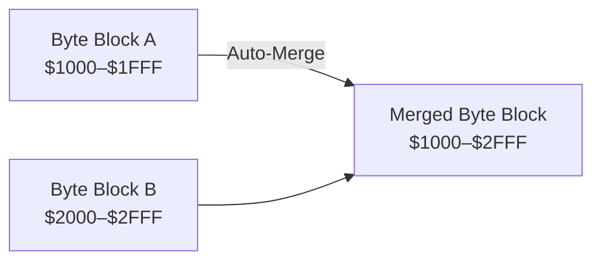
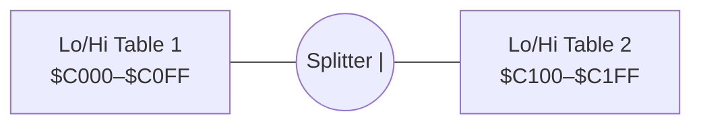

# Block Types and Helpers

Every byte in a Regenerator 2000 project belongs to a **Block Type**, which controls how the disassembler decodes, labels, and formats that byte range.

Press any block shortcut on the current line—or press ++shift+v++ first to enter **Visual Mode** and convert an entire range at once.

## Quick Reference

| Key | Block Type | Labels & X-Refs? | Best Used For |
| :--- | :--- | :---: | :--- |
| ++d++ | [Disassemble Address (Flow)](#disassemble-address-flow-analysis) | Yes | Tracing entry points and subroutines automatically |
| ++c++ | [Code](#code) | Yes | Forcing 6502 instruction decoding on a fixed range |
| ++b++ | [Data Byte](#data-byte) | — | Sprite/charset bytes, lookup tables, single-byte variables |
| ++w++ | [Data Word](#data-word) | — | 16-bit numeric counters and non-pointer constants |
| ++a++ | [Address](#address) | Yes | Jump tables and 16-bit pointer arrays |
| ++p++ | [PETSCII Text](#petscii-text) | — | `CHROUT` strings, menus, high-score text |
| ++s++ | [Screencode Text](#screencode-text) | — | Strings copied straight into Screen RAM (e.g. `$0400`) |
| ++less-than++ | [Lo/Hi Address Table](#split-lohi-hilo-tables) | Yes | Split pointer tables (low bytes first, high bytes second) |
| ++greater-than++ | [Hi/Lo Address Table](#split-lohi-hilo-tables) | Yes | Split pointer tables (high bytes first, low bytes second) |
| ++comma++ | [Lo/Hi Word Table](#split-lohi-hilo-tables) | — | Split 16-bit numeric tables (e.g. SID frequency tables) |
| ++period++ | [Hi/Lo Word Table](#split-lohi-hilo-tables) | — | Split 16-bit numeric tables stored high-byte first |
| ++shift+e++ | [External File](#external-file) | — | Large binary blobs (SID music, bitmaps) exported to `.bin` |
| ++question-mark++ | [Undefined](#undefined) | — | Clearing classifications back to unexplored bytes |

!!! info "Assembler Directive Conventions"

    Most block types look nearly identical across all four assemblers—only three syntax conventions differ globally:

    - **ACME** prefixes data and fill directives with `!` instead of `.` (`!byte`, `!word`, `!fill`, `!binary`).
    - **KickAssembler** uses `//` for comments instead of `;`.
    - **ca65** emits `.res N, $XX` for compressed byte fill runs instead of `.fill` / `!fill`.

    Multi-assembler tabs are shown below only where directives diverge significantly (text encodings, external binaries, and lexical scopes).

---

## Code & Flow Analysis

### Disassemble Address (Flow Analysis)

**Shortcut:** ++d++

Traces execution starting from the cursor across 6502 branches, jumps, and `JSR` calls, converting every reachable instruction range into **Code** blocks. Because flow analysis skips inline data tables parked between subroutines, prefer ++d++ over ++c++ when exploring unknown code.

!!! note "Where Tracing Stops"

    Unconditional return instructions (`RTS` and `RTI`) stop the active trace path. Unreferenced bytes immediately after a return remain unexplored until another branch or jump reaches them.

### Code

**Shortcut:** ++c++

Decodes the selected byte range directly as MOS 6502/6510 instructions without following branches beyond the selection. Useful when jump tables or self-modifying code jump into a block that flow analysis did not discover.

```ca65 title="64tass / ca65"
lda #$00
sta a_D020
```

---

## Data & Pointer Blocks

### Data Byte

**Shortcut:** ++b++

Formats bytes as 8-bit hexadecimal values—ideal for graphics bytes, lookup tables, and 8-bit variables.

```ca65 title="64tass / ca65"
.byte $80, $40, $a2, $ff
```

!!! note "Fill Run Threshold"

    When a contiguous run of identical bytes meets or exceeds the **Fill run threshold** in [Document Settings](settings.md) (default `8`), Regenerator 2000 collapses it into a single fill directive:

    | Assembler | Fill Syntax |
    | :--- | :--- |
    | **64tass / KickAssembler** | `.fill N, $XX` |
    | **ACME** | `!fill N, $XX` |
    | **ca65** | `.res N, $XX` |

### Data Word

**Shortcut:** ++w++

Formats pairs of bytes as little-endian 16-bit numeric constants without generating labels or cross-references. Use this for numeric values—never for pointers.

```ca65 title="64tass / ca65"
.word $1234, $ffaa, $5678, $0000, $abcd
```

### Address

**Shortcut:** ++a++

Formats pairs of bytes as 16-bit little-endian memory pointers. Unlike **Data Word**, the analyzer resolves every word to a label and records an `[O]` offset cross-reference at the target address.

```ca65 title="64tass / ca65"
.word a_1234, a_FFAA, a_5678, a_0000, a_ABCD ; (1)!
```

1. Each entry creates (or reuses) a label at that target address and links it to the **Jump to Operand** picker (++enter++).

---

## Text Blocks

### PETSCII Text

**Shortcut:** ++p++

Decodes bytes as Commodore PETSCII strings—the standard encoding for `CHROUT` (`$FFD2`) output and BASIC messages. Contiguous printable runs are grouped into quoted strings.

=== "64tass"

    ```ca65
    .encode
    .enc "none"
    .text "hello world"
    .endencode
    ```

=== "ACME"

    ```ca65
    !text "hello world"
    ```

=== "KickAssembler"

    ```ca65
    .encoding "petscii_upper"
    .text "hello world"
    ```

=== "ca65"

    ```ca65
    .byte "hello world"
    ```

### Screencode Text

**Shortcut:** ++s++

Decodes bytes as Commodore video-matrix screen codes for buffers written directly to Screen RAM (such as `$0400` on the C64, where `'A'` is `$01` instead of PETSCII `$41`).

=== "64tass"

    ```ca65
    .encode
    .enc "screen"
    .text "hello world"
    .endencode
    ```

=== "ACME"

    ```ca65
    !scr "hello world"
    ```

=== "KickAssembler"

    ```ca65
    .encoding "screencode_mixed"
    .text "hello world"
    ```

=== "ca65"

    ```ca65
    ; Requires .macpack cbm
    scrcode "hello world"
    ```

---

## Split Lo/Hi & Hi/Lo Tables

6502 programs frequently store 16-bit tables as two separate parallel arrays indexed by `X` or `Y` (`LDA table_lo,X` / `LDA table_hi,X`). Select an **even number of bytes** in Visual Mode and choose one of the four split formats:

| Key | Block Type | First Half | Second Half | Labels & X-Refs? | Typical Use |
| :--- | :--- | :--- | :--- | :---: | :--- |
| ++less-than++ | **Lo/Hi Address** | Low bytes | High bytes | Yes | Split jump/RTS/pointer tables (low first) |
| ++greater-than++ | **Hi/Lo Address** | High bytes | Low bytes | Yes | Split jump/RTS/pointer tables (high first) |
| ++comma++ | **Lo/Hi Word** | Low bytes | High bytes | — | Split numeric tables like SID frequencies |
| ++period++ | **Hi/Lo Word** | High bytes | Low bytes | — | Split numeric tables stored high-byte first |

Here is how the exact same 8 raw bytes (`$00, $01, $02, $03, $c0, $d1, $e2, $f3`) decode under each split block type:

=== "Lo/Hi Address (<)"

    ```ca65 title="64tass / ca65"
    .byte <a_C000, <a_D101, <a_E202, <a_F303 ; (1)!
    .byte >a_C000, >a_D101, >a_E202, >a_F303
    ```

    1. Pairs `$00`+`$C0` as `$C000`, generating `a_C000` (or reusing any user label) and `[O]` cross-references.

=== "Hi/Lo Address (>)"

    ```ca65 title="64tass / ca65"
    .byte >a_00C0, >a_01D1, >a_02E2, >a_03F3 ; (1)!
    .byte <a_00C0, <a_01D1, <a_02E2, <a_03F3
    ```

    1. Pairs `$00` (high) + `$C0` (low) as `$00C0`, generating `a_00C0` and `[O]` cross-references.

=== "Lo/Hi Word (,)"

    ```ca65 title="64tass / ca65"
    .byte <$C000, <$D101, <$E202, <$F303 ; (1)!
    .byte >$C000, >$D101, >$E202, >$F303
    ```

    1. Keeps `$C000`–`$F303` as raw 16-bit literals with no labels or cross-references.

=== "Hi/Lo Word (.)"

    ```ca65 title="64tass / ca65"
    .byte >$00C0, >$01D1, >$02E2, >$03F3 ; (1)!
    .byte <$00C0, <$01D1, <$02E2, <$03F3
    ```

    1. Pairs `$00` (high) + `$C0` (low) as raw 16-bit literal `$00C0` with no labels.

---

## External Files & Resetting

### External File

**Shortcut:** ++shift+e++

Keeps large binary blobs—such as SID music, bitmaps, or level maps—out of your `.asm` listing. During export, Regenerator 2000 writes the range to a separate `.bin` file and emits the target assembler's binary include directive (for bytes at `$1000`–`$1007`):

=== "64tass"

    ```ca65
    .binary "export-$1000-$1007.bin"
    ```

=== "ACME"

    ```ca65
    !binary "export-$1000-$1007.bin"
    ```

=== "KickAssembler"

    ```ca65
    .import binary "export-$1000-$1007.bin"
    ```

=== "ca65"

    ```ca65
    .incbin "export-$1000-$1007.bin"
    ```

### Undefined

**Shortcut:** ++question-mark++

Clears manual block classifications back to unexplored single-byte lines:

```ca65 title="64tass / ca65"
.byte $00
.byte $ca
.byte $ff
```

---

## Immediate Mode Helpers

### Cycle Immediate Operand Formats

**Shortcuts:** ++i++ (forward) · ++shift+i++ (backward)

Cycles the immediate operand under the cursor across six representations—handy when a bitmask reads better in binary or a counter reads better in decimal:

| Disassembly Output | Format |
| :--- | :--- |
| `lda #$d2` | Hexadecimal |
| `lda #~$2d` | Inverse Hexadecimal |
| `lda #210` | Decimal |
| `lda #-46` | Inverse Decimal |
| `lda #%11010010` | Binary |
| `lda #~%00101101` | Inverse Binary |

### Pack Lo/Hi or Hi/Lo Immediate Addresses

**Shortcuts:** ++open-bracket++ (Lo/Hi) · ++close-bracket++ (Hi/Lo)

Links two separate 8-bit immediate loads (`LDA`, `LDX`, or `LDY`) into a single 16-bit symbolic pointer reference (`#<label` and `#>label`).

For example, to turn the raw bytes loading an IRQ vector at `$1480` into a symbolic reference, select lines 1–3 in Visual Mode and press ++open-bracket++:

=== "Before (Select lines 1–3, press [)"

    ```ca65 hl_lines="1-3"
    lda #$80        ; $80 is the low byte of $1480
    sta $0314
    lda #$14        ; $14 is the high byte of $1480
    sta $0315

    ; IRQ handler at $1480
    rti
    ```

=== "After (Linked to p_1480)"

    ```ca65 hl_lines="1 3"
    lda #<p_1480 ; (1)!
    sta $0314
    lda #>p_1480
    sta $0315

    p_1480
    rti
    ```

    1. Regenerator 2000 creates `p_1480` (or reuses an existing label) and replaces both immediates with `#<` / `#>`.

To revert, press ++u++ to undo the command or press ++i++ on either instruction to cycle back to hex.

---

## Organization Tools

Use comments, scopes, splitters, and collapsing to keep large disassemblies navigable.

### Comments

- **Side Comment (++semicolon++):** Appears inline to the right of an instruction or data directive.
- **Line Comment (++colon++):** Appears on dedicated lines above the address (++shift+enter++ or ++ctrl+j++ inserts newlines; ++alt+minus++, ++alt+equal++, and ++alt+backslash++ insert divider lines).

!!! note "Line Comments Split Tables"

    Adding a line comment inside a grouped `Address` or `Word` block also splits the table at that address.

### Scopes

**Shortcuts:** ++r++ (create) · ++delete++ (remove at boundary) · ++alt+up++ / ++alt+down++ (nudge boundary)

Scopes wrap existing blocks in a lexical namespace so subroutines can reuse short local names (like `l00` or `loop`) without global collisions.

!!! note "Non-Destructive Grouping"

    Scopes do not alter block types—they wrap the underlying Code or Data blocks inside native assembler scope directives during export.

=== "64tass"

    Places the scope label immediately before `.block` / `.bend`:

    ```ca65
    my_routine
        .block
        lda #$00
        beq l00
        bne l11
    l00
        sta $d020
    l11
        rts
        .bend

        jsr my_routine
        jmp my_routine.l00
    ```

=== "ACME"

    ACME does **not** support lexical scopes in Regenerator 2000 exports. The exporter omits scope wrappers when ACME is active.

=== "KickAssembler"

    Wraps scopes in `{` and `}` with the label above the opening brace:

    ```ca65
    my_routine
    {
        lda #$00
        beq l00
        bne l11
    l00:
        sta $d020
    l11:
        rts
    }

        jsr my_routine
        jmp my_routine.l00
    ```

=== "ca65"

    Maps scopes to `.proc` / `.endproc` (unnamed scopes default to `unnamed_scope`):

    ```ca65
        .proc my_routine
        lda #$00
        beq l00
        bne l11
    l00:
        sta $d020
    l11:
        rts
        .endproc

        jsr my_routine
        ; ca65 is single-pass: external jumps into a scope require
        ; the target label to be defined before the jump.
        jmp my_routine::l00
    ```

### Splitters and Auto-Merging

**Shortcut:** ++pipe++

By default, Regenerator 2000 automatically merges adjacent blocks that share the exact same **Block Type**.



Press ++pipe++ at an address to place a **Splitter**—this draws a visual separator line and stops the auto-merger from combining blocks across that boundary:



!!! important "Always Split Adjacent Lo/Hi and Hi/Lo Tables"

    Split tables compute their midpoint (`lo` vs `hi` half) from the **total length of the block**. If two adjacent `Lo/Hi` tables merge into one, every paired 16-bit address is corrupted—insert a splitter (++pipe++) between them.

### Collapsing Blocks

**Shortcut:** ++ctrl+k++

Folds a large data table or finished subroutine into a single summary line in the TUI without changing exported `.asm` output or secondary views:

=== "Disassembly View"

    ```ca65 title="Expanded"
    a_1000  .byte $01, $02, $03, $04, $05, $06, $07, $08
            .byte $09, $0a, $0b, $0c, $0d, $0e, $0f, $10
    ```

    ```ca65 title="Collapsed (Ctrl+K)"
    a_1000  ; Collapsed Byte block from $1000-$100F
    ```

=== "Blocks View"

    A `+` marker highlights collapsed ranges in the Blocks pane:

    ```text
      $0900-$09FF [Code]
    + $1000-$100F [Byte]
      $1010-$11FF [Code]
    ```
