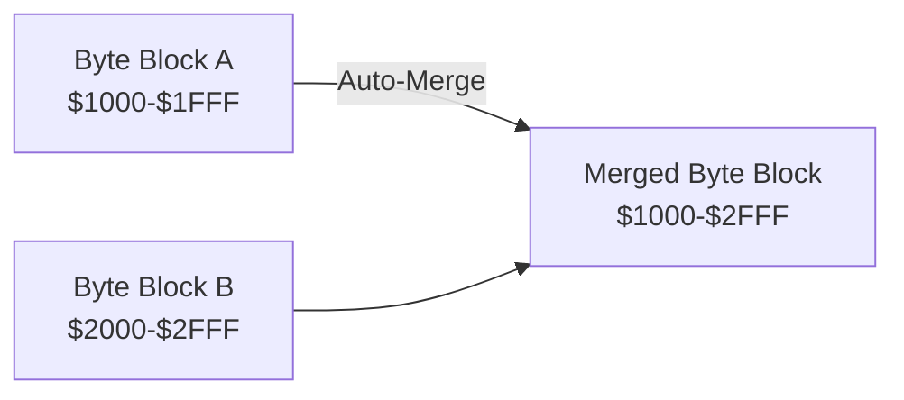
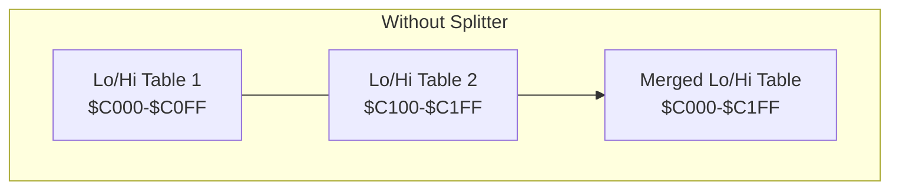
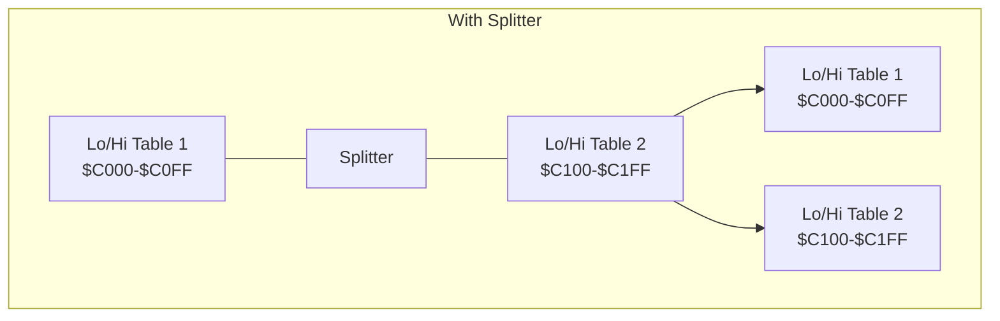

# Block Types and Helpers

Regenerator 2000 assigns a **Block Type** to every byte in the loaded binary. The block type specifies how the disassembly engine decodes and formats that byte. To change the block classification for a memory range, press a block-type shortcut. You can press it on a single line or in Visual Mode (++shift+v++).

## 1. Disassemble Address (Flow Analysis)

-   **Shortcut**: ++d++
-   **Description**: Traces execution from the current cursor address across 6502 branches and jumps to discover reachable code paths. The analyzer follows relative branches, absolute jumps, and subroutine calls until it encounters an invalid opcode or return instruction. Regenerator 2000 converts all discovered instruction ranges into **Code** blocks.
-   **Use Case**: Move the cursor to an unanalyzed entry point. Press ++d++. Flow analysis skips static data tables embedded between subroutines. This makes it more accurate than manual range conversion with ++c++.

!!! note

    Unconditional return instructions (`RTS` and `RTI`) stop the active trace path. Unreferenced bytes after a return remain unanalyzed unless another branch or jump targets them.

## 2. Code

-   **Shortcut**: ++c++
-   **Description**: Decodes the selected bytes as MOS 6502/6510 instructions without flow tracing.
-   **Use Case**: Use this type for known executable machine code ranges.

!!! example

    === "64tass"

        ```asm
        ; Code blocks are represented as code
        lda #$00
        sta a_D020
        ```

    === "ACME"

        ```asm
        ; Code blocks are represented as code
        lda #$00
        sta a_D020
        ```

    === "KickAssembler"

        ```asm
        // Code blocks are represented as code
        lda #$00
        sta a_D020
        ```

    === "ca65"

        ```asm
        ; Code blocks are represented as code
        lda #$00
        sta a_D020
        ```

## 3. Data Byte

-   **Shortcut**: ++b++
-   **Description**: Formats bytes as 8-bit hexadecimal values.
-   **Use Case**: Use this type for sprite data, single-byte variables, lookup tables, and unknown data regions.

!!! example

    === "64tass"

        ```asm
        ; Byte blocks are represented as bytes
        .byte $80, $40, $a2, $ff
        ```

    === "ACME"

        ```asm
        ; Byte blocks are represented as bytes
        !byte $80, $40, $a2, $ff
        ```

    === "KickAssembler"

        ```asm
        // Byte blocks are represented as bytes
        .byte $80, $40, $a2, $ff
        ```

    === "ca65"

        ```asm
        ; Byte blocks are represented as bytes
        .byte $80, $40, $a2, $ff
        ```

!!! note "Fill Run Threshold"

    When a contiguous run of identical bytes meets or exceeds the **Fill run threshold** in Document Settings, the formatter emits a single fill directive:

    -   64tass: `.fill N, $XX`
    -   ACME: `!fill N, $XX`
    -   KickAssembler: `.fill N, $XX`
    -   ca65: `.res N, $XX`

## 4. Data Word

-   **Shortcut**: ++w++
-   **Description**: Formats pairs of bytes as 16-bit little-endian numeric values.
-   **Use Case**: Use this type for 16-bit counters, numeric constants, or raw pointers. This type does not generate symbolic cross-references.

!!! example

    === "64tass"

        ```asm
        ; Word blocks are represented as words
        .word $1234, $ffaa, $5678, $0000, $abcd
        ```

    === "ACME"

        ```asm
        ; Word blocks are represented as words
        !word $1234, $ffaa, $5678, $0000, $abcd
        ```

    === "KickAssembler"

        ```asm
        // Word blocks are represented as words
        .word $1234, $ffaa, $5678, $0000, $abcd
        ```

    === "ca65"

        ```asm
        ; Word blocks are represented as words
        .word $1234, $ffaa, $5678, $0000, $abcd
        ```

## 5. Address

-   **Shortcut**: ++a++
-   **Description**: Formats pairs of bytes as 16-bit memory addresses. Unlike `Data Word`, this type instructs the analyzer to treat each 16-bit value as a memory reference.
-   **Use Case**: Use this type for **Jump Tables** and pointer tables. Regenerator 2000 generates labels and cross-references (`x-ref`) for every target address in the table.

!!! example

    === "64tass"

        ```asm
        ; Address blocks are represented as words that generate an address reference
        .word a_1234, a_FFAA, a_5678, a_0000, a_ABCD
        ```

    === "ACME"

        ```asm
        ; Address blocks are represented as words that generate an address reference
        !word a_1234, a_FFAA, a_5678, a_0000, a_ABCD
        ```

    === "KickAssembler"

        ```asm
        // Address blocks are represented as words that generate an address reference
        .word a_1234, a_FFAA, a_5678, a_0000, a_ABCD
        ```

    === "ca65"

        ```asm
        ; Address blocks are represented as words that generate an address reference
        .word a_1234, a_FFAA, a_5678, a_0000, a_ABCD
        ```

## 6. PETSCII Text

-   **Shortcut**: ++p++
-   **Description**: Decodes bytes as Commodore PETSCII character strings.
-   **Use Case**: Use this type for text messages, high-score tables, and `CHROUT` (`$FFD2`) strings. The formatter groups contiguous printable characters into quoted strings.

!!! example

    === "64tass"

        ```asm
        .encode
        .enc "none"
        .text "hello world"
        .endencode
        ```

    === "ACME"

        ```asm
        !text "hello world"
        ```

    === "KickAssembler"

        ```asm
        .encoding "petscii_upper"
        .text "hello world"
        ```

    === "ca65"

        ```asm
        .byte "hello world"
        ```

## 7. Screencode Text

-   **Shortcut**: ++s++
-   **Description**: Decodes bytes as Commodore screen codes (video matrix codes).
-   **Use Case**: Use this type for text buffers copied directly to Screen RAM (such as `$0400` on the C64). Screen codes differ from PETSCII values (for example, `'A'` is `$01` instead of `$41`).

!!! example

    === "64tass"

        ```asm
        .encode
        .enc "screen"
        .text "hello world"
        .endencode
        ```

    === "ACME"

        ```asm
        !scr "hello world"
        ```

    === "KickAssembler"

        ```asm
        .encoding "screencode_mixed"
        .text "hello world"
        ```

    === "ca65"

        ```asm
        ; Requires .macpack cbm
        scrcode "hello world"
        ```

## 8. Lo/Hi Address Table

-   **Shortcut**: ++less-than++
-   **Description**: Formats an even number of selected bytes as a split **Low / High** address table. The first half contains the low bytes of the addresses, and the second half contains the high bytes.
-   **Use Case**: Use this type when 6502 code splits a pointer or jump table into separate low-byte and high-byte arrays. The code reads these arrays with indexed addressing (`LDA table_lo,X` / `LDA table_hi,X`).

!!! example

    === "64tass"

        ```asm
        ; Assume that you have these bytes:
        ; $00, $01, $02, $03, $c0, $d1, $e2, $f3
        ; They will be represented as:
        .byte <a_C000, <a_D101, <a_E202, <a_F303
        .byte >a_C000, >a_D101, >a_E202, >a_F303
        ```

    === "ACME"

        ```asm
        ; Assume that you have these bytes:
        ; $00, $01, $02, $03, $c0, $d1, $e2, $f3
        ; They will be represented as:
        !byte <a_C000, <a_D101, <a_E202, <a_F303
        !byte >a_C000, >a_D101, >a_E202, >a_F303
        ```

    === "KickAssembler"

        ```asm
        // Assume that you have these bytes:
        // $00, $01, $02, $03, $c0, $d1, $e2, $f3
        // They will be represented as:
        .byte <a_C000, <a_D101, <a_E202, <a_F303
        .byte >a_C000, >a_D101, >a_E202, >a_F303
        ```

    === "ca65"

        ```asm
        ; Assume that you have these bytes:
        ; $00, $01, $02, $03, $c0, $d1, $e2, $f3
        ; They will be represented as:
        .byte <a_C000, <a_D101, <a_E202, <a_F303
        .byte >a_C000, >a_D101, >a_E202, >a_F303
        ```

## 9. Hi/Lo Address Table

-   **Shortcut**: ++greater-than++
-   **Description**: Formats an even number of selected bytes as a split **High / Low** address table. The first half contains the high bytes of the addresses, and the second half contains the low bytes.
-   **Use Case**: Use this type when a split address table stores the high-byte array before the low-byte array.

!!! example

    === "64tass"

        ```asm
        ; Assume that you have these bytes:
        ; $00, $01, $02, $03, $c0, $d1, $e2, $f3
        ; They will be represented as:
        .byte >a_00C0, >a_01D1, >a_02E2, >a_03F3
        .byte <a_00C0, <a_01D1, <a_02E2, <a_03F3
        ```

    === "ACME"

        ```asm
        ; Assume that you have these bytes:
        ; $00, $01, $02, $03, $c0, $d1, $e2, $f3
        ; They will be represented as:
        !byte >a_00C0, >a_01D1, >a_02E2, >a_03F3
        !byte <a_00C0, <a_01D1, <a_02E2, <a_03F3
        ```

    === "KickAssembler"

        ```asm
        // Assume that you have these bytes:
        // $00, $01, $02, $03, $c0, $d1, $e2, $f3
        // They will be represented as:
        .byte >a_00C0, >a_01D1, >a_02E2, >a_03F3
        .byte <a_00C0, <a_01D1, <a_02E2, <a_03F3
        ```

    === "ca65"

        ```asm
        ; Assume that you have these bytes:
        ; $00, $01, $02, $03, $c0, $d1, $e2, $f3
        ; They will be represented as:
        .byte >a_00C0, >a_01D1, >a_02E2, >a_03F3
        .byte <a_00C0, <a_01D1, <a_02E2, <a_03F3
        ```

## 10. Lo/Hi Word Table

-   **Shortcut**: ++comma++
-   **Description**: Formats an even number of selected bytes as a split **Low / High** 16-bit word table without generating address labels. The first half contains the low bytes of the words, and the second half contains the high bytes.
-   **Use Case**: Use this type for split 16-bit numeric tables such as C64 SID frequency tables.

!!! example

    === "64tass"

        ```asm
        ; Assume that you have these bytes:
        ; $00, $01, $02, $03, $c0, $d1, $e2, $f3
        ; They will be represented as:
        .byte <$C000, <$D101, <$E202, <$F303
        .byte >$C000, >$D101, >$E202, >$F303
        ```

    === "ACME"

        ```asm
        ; Assume that you have these bytes:
        ; $00, $01, $02, $03, $c0, $d1, $e2, $f3
        ; They will be represented as:
        !byte <$C000, <$D101, <$E202, <$F303
        !byte >$C000, >$D101, >$E202, >$F303
        ```

    === "KickAssembler"

        ```asm
        // Assume that you have these bytes:
        // $00, $01, $02, $03, $c0, $d1, $e2, $f3
        // They will be represented as:
        .byte <$C000, <$D101, <$E202, <$F303
        .byte >$C000, >$D101, >$E202, >$F303
        ```

    === "ca65"

        ```asm
        ; Assume that you have these bytes:
        ; $00, $01, $02, $03, $c0, $d1, $e2, $f3
        ; They will be represented as:
        .byte <$C000, <$D101, <$E202, <$F303
        .byte >$C000, >$D101, >$E202, >$F303
        ```

## 11. Hi/Lo Word Table

-   **Shortcut**: ++period++
-   **Description**: Formats an even number of selected bytes as a split **High / Low** 16-bit word table without generating address labels. The first half contains the high bytes of the words, and the second half contains the low bytes.
-   **Use Case**: Use this type for split 16-bit numeric tables that store high bytes before low bytes.

!!! example

    === "64tass"

        ```asm
        ; Assume that you have these bytes:
        ; $00, $01, $02, $03, $c0, $d1, $e2, $f3
        ; They will be represented as:
        .byte >$00C0, >$01D1, >$02E2, >$03F3
        .byte <$00C0, <$01D1, <$02E2, <$03F3
        ```

    === "ACME"

        ```asm
        ; Assume that you have these bytes:
        ; $00, $01, $02, $03, $c0, $d1, $e2, $f3
        ; They will be represented as:
        !byte >$00C0, >$01D1, >$02E2, >$03F3
        !byte <$00C0, <$01D1, <$02E2, <$03F3
        ```

    === "KickAssembler"

        ```asm
        // Assume that you have these bytes:
        // $00, $01, $02, $03, $c0, $d1, $e2, $f3
        // They will be represented as:
        .byte >$00C0, >$01D1, >$02E2, >$03F3
        .byte <$00C0, <$01D1, <$02E2, <$03F3
        ```

    === "ca65"

        ```asm
        ; Assume that you have these bytes:
        ; $00, $01, $02, $03, $c0, $d1, $e2, $f3
        ; They will be represented as:
        .byte >$00C0, >$01D1, >$02E2, >$03F3
        .byte <$00C0, <$01D1, <$02E2, <$03F3
        ```

## 12. External File

-   **Shortcut**: ++shift+e++
-   **Description**: Marks the selected range as an external binary include file.
-   **Use Case**: Use this type for large binary assets, such as SID music, bitmaps, or character sets. This keeps the main `.asm` source file compact. During export, Regenerator 2000 writes the raw bytes to a `.bin` file and emits an assembler include directive.

!!! example

    === "64tass"

        ```asm
        ; Assume that you have these bytes at address $1000
        ; $00, $01, $02, $03, $c0, $d1, $e2, $f3
        ; A binary file called "export-$1000-$1007.bin" will be generated
        ; And this code will be generated
        .binary "export-$1000-$1007.bin"
        ```

    === "ACME"

        ```asm
        ; Assume that you have these bytes at address $1000
        ; $00, $01, $02, $03, $c0, $d1, $e2, $f3
        ; A binary file called "export-$1000-$1007.bin" will be generated
        ; And this code will be generated
        !binary "export-$1000-$1007.bin"
        ```

    === "KickAssembler"

        ```asm
        // Assume that you have these bytes at address $1000
        // $00, $01, $02, $03, $c0, $d1, $e2, $f3
        // A binary file called "export-$1000-$1007.bin" will be generated
        // And this code will be generated
        .import binary "export-$1000-$1007.bin"
        ```

    === "ca65"

        ```asm
        ; Assume that you have these bytes at address $1000
        ; $00, $01, $02, $03, $c0, $d1, $e2, $f3
        ; A binary file called "export-$1000-$1007.bin" will be generated
        ; And this code will be generated
        .incbin "export-$1000-$1007.bin"
        ```

## 13. Undefined

-   **Shortcut**: ++question-mark++
-   **Description**: Resets the selected bytes to the `Undefined` (unexplored) state.
-   **Use Case**: Use this type to clear a manual block classification and return the bytes to single-byte unexplored lines.

!!! example

    === "64tass"

        ```asm
        ; Undefined blocks are represented as single bytes, one byte per line.
        .byte $00
        .byte $ca
        .byte $ff
        ```

    === "ACME"

        ```asm
        ; Undefined blocks are represented as single bytes, one byte per line.
        !byte $00
        !byte $ca
        !byte $ff
        ```

    === "KickAssembler"

        ```asm
        // Undefined blocks are represented as single bytes, one byte per line.
        .byte $00
        .byte $ca
        .byte $ff
        ```

    === "ca65"

        ```asm
        ; Undefined blocks are represented as single bytes, one byte per line.
        .byte $00
        .byte $ca
        .byte $ff
        ```

## 14. Immediate Mode Helpers

### Cycle Immediate Operand Formats

-   **Shortcut**: ++i++ / ++shift+i++
-   **Description**: Cycles the immediate operand under the cursor through hexadecimal, decimal, and binary formats:

    -   **++i++**: Cycles forward.
    -   **++shift+i++**: Cycles backward.

-   **Use Case**: Use decimal or binary notation when bitmasks or base-10 constants are clearer than hexadecimal values.

| Representation | Name |
|:---|:---|
| `lda #$d2` | Hexadecimal |
| `lda #~$2d` | Inverse Hexadecimal |
| `lda #210` | Decimal |
| `lda #-46` | Inverse Decimal |
| `lda #%11010010` | Binary |
| `lda #~%00101101` | Inverse Binary |

### Pack Lo/Hi or Hi/Lo Immediate Addresses

-   **Shortcut**: ++open-bracket++ / ++close-bracket++
-   **Description**: Links two immediate load instructions (`LDA`, `LDX`, or `LDY`) into a 16-bit symbolic pointer reference:

    -   **++open-bracket++**: Packs the first immediate value as the **low byte** and the second as the **high byte** (`Lo/Hi Address`).
    -   **++close-bracket++**: Packs the first immediate value as the **high byte** and the second as the **low byte** (`Hi/Lo Address`).

-   **Use Case**: Use this helper when 6502 code loads a 16-bit vector or pointer using two 8-bit immediate instructions.

**Example:**

In the following code, `$0314` and `$0315` store the IRQ vector `$1480`. Select lines 1 through 3 in the Disassembly View. Then press ++open-bracket++:

```asm hl_lines="1-3"
    lda #$80        ; $80 is the low part of $1480
    sta $0314
    lda #$14        ; $14 is the high part of $1480
    sta $0315

; IRQ handler in address $1480
    rti
```

Regenerator 2000 creates the pointer label `p_1480` and formats the immediate operands as low/high byte references:

```asm
    ; The immediate operands now reference p_1480
    lda #<p_1480
    sta $0314
    lda #>p_1480
    sta $0315

; IRQ handler in address $1480
p_1480
    rti
```

To revert this change:

-   Press ++u++ to undo the command.
-   Or press ++i++ on each instruction to cycle the immediate operand back to hexadecimal format.

## Organization Tools

Use comments, scopes, splitters, and collapsed blocks to structure your disassembly project.

### Comments

-   **Side Comment**: ++semicolon++
-   **Line Comment**: ++colon++

Add comments to any address to document your findings:

-   **Side Comments**: Appear inline to the right of the instruction or data directive.
-   **Line Comments**: Appear on dedicated lines above the instruction or data directive.

!!! note

    **Line Comments** also act as **Splitters** inside `Address` and `Word` blocks. A line comment inside a grouped table splits the block at that address.

### Scopes

-   **Create Scope**: ++r++
-   **Remove Scope**: ++delete++ (at the start or end boundary of a scope)
-   **Exclude External Address**: ++delete++ (on an external label definition)

!!! note

    **Scopes** do not replace block types. Instead, a scope wraps existing blocks inside a lexical namespace (`.block`, `.proc`, or `{ ... }`).

Scopes group instructions and data into logical subroutines and isolate local labels to prevent naming collisions. When you export the project, Regenerator 2000 emits the native scope directives for the selected assembler.

!!! example

    === "64tass"

        64tass maps scopes to `.block` and `.bend` directives and places the scope label immediately before `.block`:

        ```asm
        my_routine
            .block
            lda #$00
            beq l00
            bne l11
        l00
            sta $d020
        l11
            rts
            .bend

            jsr my_routine
            jmp my_routine.l00
        ```

    === "ACME"

        ACME does **not** support lexical scopes in Regenerator 2000 exports. The exporter omits scope wrappers when ACME is the selected assembler.

    === "KickAssembler"

        KickAssembler wraps scopes in curly braces (`{` and `}`) with the scope label before the opening brace:

        ```asm
        my_routine
        {
            lda #$00
            beq l00
            bne l11
        l00:
            sta $d020
        l11:
            rts
        }

            jsr my_routine
            jmp my_routine.l00
        ```

    === "ca65"

        ca65 maps scopes to `.proc` and `.endproc` directives. Unnamed scopes receive the default name `unnamed_scope`:

        ```asm
            .proc my_routine
            lda #$00
            beq l00
            bne l11
        l00:
            sta $d020
        l11:
            rts
            .endproc

            jsr my_routine
            ; IMPORTANT: ca65 is a one-pass assembler, so if calling a label defined in a scope,
            ; the label must be defined before the call. Otherwise, it will be treated as an undefined label,
            ; and the assembly will fail.
            jmp my_routine::l00
        ```

### Splitters and Auto-Merging

-   **Shortcut**: ++pipe++

Regenerator 2000 merges adjacent blocks of the same type into a single contiguous block automatically.

!!! note

    The auto-merger combines only **adjacent** blocks that share the **exact same block type**.



Insert a **Splitter** (++pipe++) to prevent automatic merging at a specific address. Splitters perform two functions:

1.  **Visual Separation**: Inserts a blank separator line in the Disassembly View.
2.  **Logical Separation**: Stops the auto-merger from combining blocks across the splitter address.

**Example**:
Without a splitter, two adjacent `Lo/Hi` tables merge into a single table. A splitter between them preserves two independent tables:





!!! important

    Splitters are essential between adjacent **Lo/Hi** and **Hi/Lo** tables. Each split table calculates its midpoint from the total block length. If two separate tables merge, the merge corrupts the paired 16-bit values.

### Collapsing Blocks

-   **Shortcut**: ++ctrl+k++
-   **Description**: Collapses or expands the block under the cursor into a single summary line.

!!! example

    In the **Disassembly View**:

    **Expanded View:**

    ```asm
    a_1000   .byte $01, $02, $03, $04, $05, $06, $07, $08
            .byte $09, $0a, $0b, $0c, $0d, $0e, $0f, $10
    ```

    **Collapsed View:**

    ```asm
    a_1000  ; Collapsed Byte block from $1000-$100F
    ```

!!! example

    In the **Blocks View**, a `+` prefix marks collapsed blocks:

    ```text
      $0900-$09FF [Code]
    + $1000-$100F [Byte]
      $1010-$11FF [Code]
    ```

-   **Use Case**: Collapse large data tables, long strings, or analyzed subroutines to focus on active work areas.
-   **Scope**: This feature affects only the TUI display. It does **not** alter exported `.asm` files or secondary views (such as Hex Dump or Charset).
