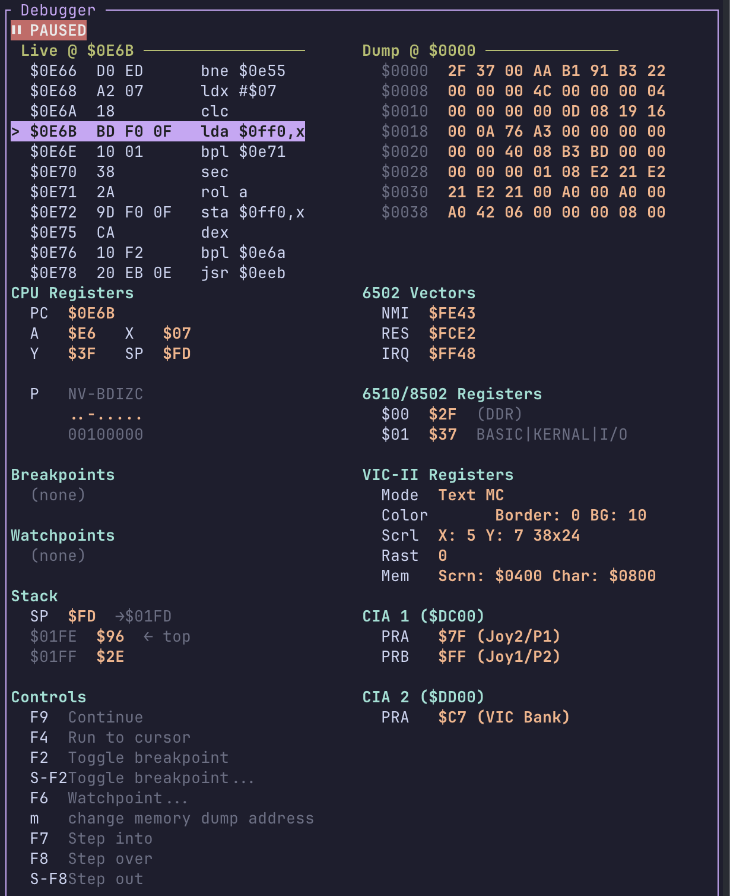

# Debugger (VICE Integration)

Regenerator 2000 connects to the [VICE](https://vice-emu.sourceforge.io/) emulator for live debugging. You can inspect the program counter (PC), registers, and disassembly, and use breakpoints, step commands, and run-to-cursor from the TUI.

## Connecting to VICE

!!! note

    Run the same binary in both VICE and Regenerator 2000:

    ```bash
    # Start VICE
    x64 -binarymonitor my_program.prg

    # Start Regenerator 2000
    regenerator2000 my_program.prg
    ```

1. Start VICE with the `-binarymonitor` flag so it listens for a TCP connection (for example, `x64 -binarymonitor`).
2. In Regenerator 2000, open the **Debugger** menu and select **Connect to VICE...**.
3. Keep the default `localhost:6502` address or enter a custom address.
4. Press **Enter** to connect.
5. Select **View → Toggle Debugger View** (or press ++alt+6++ / ++ctrl+6++) to open the Debugger panel in the right pane.
6. If the Debugger pane is visible, press **Tab** to switch focus to it.

### Auto-connecting via CLI

Pass `--vice <HOST:PORT>` on the command line to connect to VICE automatically at startup:

```bash
# Start VICE
x64 -binarymonitor my_program.prg

# Start Regenerator 2000 and auto-connect
regenerator2000 --vice localhost:6502 my_program.prg
```

The default VICE binary monitor port is **6502**. If you change the port in VICE with `-binarymonitoraddress`, pass the matching address to `--vice`.

When connected and paused, the Debugger panel displays the connection status, live disassembly around the PC, registers, and breakpoints.


## Debugger Panel Contents

- **Connection status**: Shows the VICE connection state and whether the emulator runs or pauses. When paused, the panel displays the stop reason (such as a triggered watchpoint) next to the `PAUSED` indicator.
- **Live disassembly**: Shows disassembly around the current PC and highlights the active instruction when the emulator pauses.
- **Registers**: Displays CPU registers (A, X, Y, SP, and P).
- **Hardware Registers**: Displays platform-specific registers to monitor hardware state:
    - **C64/C128**: VIC-II registers, CIA 1 and CIA 2 registers, and the 6510/8502 I/O port ($00/$01).
    - **VIC-20**: VIC-I registers ($9000–$900F).
    - **Plus/4**: TED chip registers ($FF00–$FF3F).
    - **All platforms**: 6502 hardware vectors (NMI at $FFFA, RESET at $FFFC, and IRQ at $FFFE).
- **Change Highlighting**: Highlights modified register values, memory bytes, and hardware vectors in a distinct color after each step.
- **Breakpoints**: Lists active execution breakpoints in VICE.
- **Watchpoints**: Lists active memory watchpoints in VICE.

!!! note

    On wide terminals, the debugger panel uses a multi-column layout to display the Stack and Hardware Registers side-by-side. The screenshot below shows the single-column layout.



When connected, the main **Disassembly** view also highlights the current PC and marks active breakpoints. Press ++f2++ to toggle a breakpoint at the cursor. Press ++shift+f2++ to toggle a breakpoint at a specific address. Press ++f6++ to toggle a watchpoint.

## Memory Dump

When connected and paused, the Debugger panel can display a **Memory Dump** next to the live disassembly. Focus the Debugger pane. Press ++m++ to open the **Memory Dump Address** dialog. Enter a hexadecimal address (such as `0400` or `D000`).

The dump displays 64 bytes (8 rows of 8 bytes) from the specified address. Regenerator 2000 refreshes this dump automatically each time the emulator pauses.

If you do not set a memory dump address, the panel displays `(press 'm' to config)`.

## Stack

When connected and paused, the Debugger panel displays the **Stack** contents. It shows the current stack pointer value and up to 5 entries from the top of the stack.

## Keyboard Shortcuts

Access all debugger actions from the **Debugger** menu or through keyboard shortcuts. See [Keyboard Shortcuts](keyboard_shortcuts.md) for the complete list:

| Action               | Shortcut     |
|----------------------|--------------|
| Toggle Breakpoint    | ++f2++       |
| Toggle Breakpoint... | ++shift+f2++ |
| Run to Cursor        | ++f4++       |
| Watchpoint           | ++f6++       |
| Memory Dump...       | ++m++        |
| Step Into            | ++f7++       |
| Step Over            | ++f8++       |
| Step Out             | ++shift+f8++ |
| Run / Continue       | ++f9++       |

Select **Debugger → Disconnect from VICE** to close the connection.
