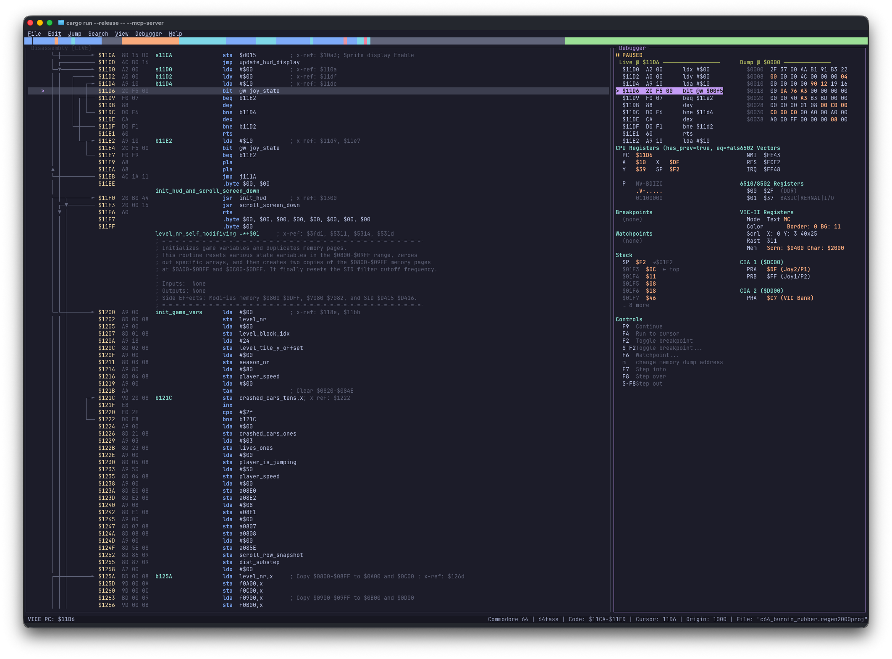
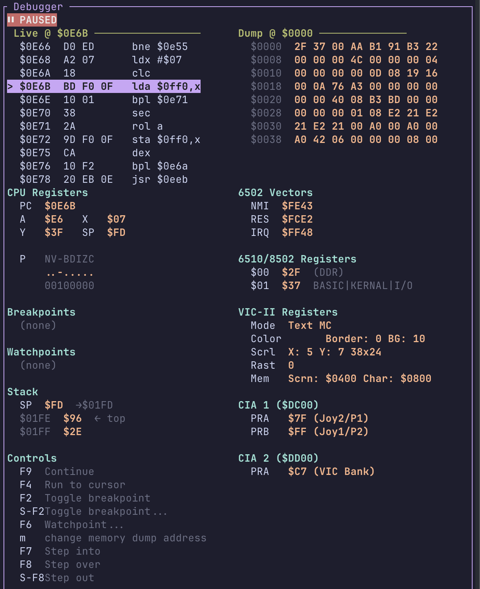

# Debugger (VICE Integration)

Connect Regenerator 2000 directly to the [VICE](https://vice-emu.sourceforge.io/) emulator over its Binary Monitor Protocol to step instructions, inspect live registers and chip state, and set breakpoints or watchpoints right from the Disassembly View.

---

## Connecting to VICE

!!! warning "Run the Exact Same Binary"

    VICE and Regenerator 2000 must run the **identical binary** so program counter (`PC`) addresses and breakpoints align.

=== "Auto-Connect via CLI"

    Launch VICE with `-binarymonitor` (default TCP port `6502`) and pass `--vice` to Regenerator 2000:

    ```bash
    # Terminal 1: Start VICE with binary monitor enabled
    x64 -binarymonitor my_program.prg

    # Terminal 2: Start Regenerator 2000 and auto-connect
    regenerator2000 --vice localhost:6502 my_program.prg
    ```

    If you changed VICE's port with `-binarymonitoraddress`, pass the matching `<HOST:PORT>` to `--vice`.

=== "Connect from the Menu"

    1. Start VICE with `-binarymonitor` (`x64 -binarymonitor my_program.prg`).
    2. In Regenerator 2000, open **Debugger → Connect to VICE...**.
    3. Confirm `localhost:6502` (or your custom host/port) and press ++enter++.
    4. Press ++alt+6++ (or ++ctrl+6++) to open the Debugger pane, then ++tab++ to focus it.



---

## Debugger Panel Contents

When connected, the main **Disassembly View** highlights the active `PC` and marks active breakpoints, while the right-hand Debugger pane shows:

**Connection & Live Disassembly**
:   Shows connection state (`RUNNING` / `PAUSED` plus stop reason such as a triggered watchpoint) and disassembly centered on the current `PC`.

**CPU Registers & Stack**
:   Displays `A`, `X`, `Y`, `SP`, and `P` status flags, plus the top 5 entries from the hardware stack (`$0100`–`$01FF`).

**Hardware Registers & Vectors**
:   Displays 6502 vectors (`NMI` `$FFFA`, `RESET` `$FFFC`, `IRQ` `$FFFE`) alongside platform chips: 6510/8502 `$00`/`$01` port, VIC-II, CIA 1 & CIA 2 (C64/C128), VIC-I `$9000–$900F` (VIC-20), and TED `$FF00–$FF3F` (Plus/4).

**Change Highlighting**
:   Highlights any register, memory byte, stack entry, or vector modified on the latest step.

**Breakpoints & Watchpoints**
:   Lists active execution breakpoints and memory read/write watchpoints registered in VICE.

**Memory Dump (64 bytes)**
:   Displays an 8×8 byte hex grid at any address when paused—focus the Debugger pane, press ++m++, and enter a hex address (such as `0400` or `D000`). Refreshes automatically on every step.

{ loading=lazy }

/// caption
Single-column Debugger View (wide terminals lay out Stack and Hardware Registers side-by-side).
///

---

## Keyboard Shortcuts

All controls are also available under the **Debugger** menu (see [Keyboard Shortcuts](keyboard_shortcuts.md#live-debugger-vice)):

| Action | Shortcut |
| :--- | :--- |
| **Toggle Breakpoint** | ++f2++ |
| **Toggle Breakpoint...** *(address)* | ++shift+f2++ |
| **Watchpoint** | ++f6++ |
| **Run to Cursor** | ++f4++ |
| **Memory Dump...** *(focus Debugger pane)* | ++m++ |
| **Step Into** | ++f7++ |
| **Step Over** | ++f8++ |
| **Step Out** | ++shift+f8++ |
| **Run / Pause (Continue)** | ++f9++ |

Select **Debugger → Disconnect from VICE** anytime to detach cleanly.
