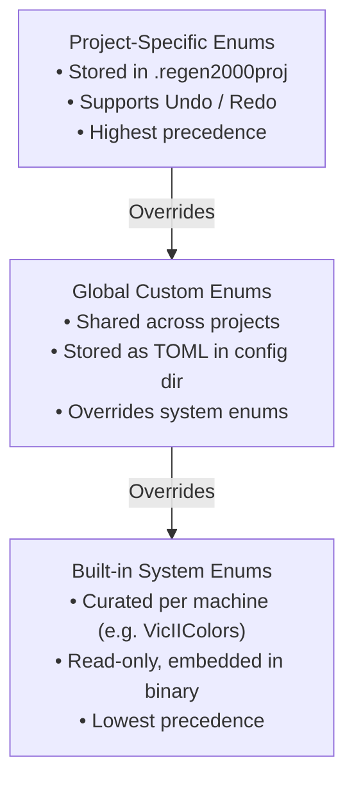

# Enums

Enums replace raw numeric literals—such as color indices, hardware flags, or game states—with readable symbolic constants across immediate operands (`lda #VicIIColors.BLACK`), `.byte` values, and `.word` tables.

---

## Enum Scopes and Precedence

Regenerator 2000 resolves enum definitions across three scopes in priority order, letting you override built-in hardware definitions without modifying global files:



| Level | Scope | Storage | Precedence | Undo / Redo |
| :--- | :--- | :--- | :--- | :---: |
| **1. Project-Specific** | Active project only | Inside `.regen2000proj` | Highest | Yes (++u++ / ++ctrl+r++) |
| **2. Global Custom** | All projects on your machine | `enum-*.toml` in config dir | Medium | — |
| **3. Built-in System** | Curated per target system | Embedded (read-only) | Lowest | — |

### Portability & Sharing

- **System & Global Enums:** Project files store only the enum name reference—not a full copy of the definition.
- **Project-Local Enums:** Serialized directly inside `.regen2000proj` so shared projects stay self-contained. If a collaborator's `.regen2000proj` references a missing global enum, clone it into the local project pool via **Manage Enums**.

---

## Using Enums in the TUI

### Applying an Enum

1. Move the cursor to an immediate operand (`lda #$00`), `.byte`, or `.word` value and press ++e++ (or **Edit → Apply Enum...**).
2. Matching enums that define the current value float to the top in **bold** with the variant preview (e.g., `VicIIColors (BLACK)`).
3. Filter by typing in the search box, switch selection with ++up++ / ++down++ (pick `<None> (Clear Enum Usage)` to clear, or press ++ctrl+n++ to create a new enum inline), and press ++enter++ to apply.

### Managing Enums

Open **Edit → Manage Enums...** (++f10++ or ++alt+t++) and switch across the **Project**, **Global**, and **System** tabs to **Add**, **Edit**, **Delete** (unused enums only), or **Clone** enums between project and global pools.

---

## Custom Global Enums

Create `enum-*.toml` files in your configuration directory to share custom constants across projects or override built-in system enums:

--8<-- "config_dir.md"

### Creating from Built-in Templates

1. Dump the built-in enum files as starting templates:

    === "macOS"

        ```bash
        regenerator2000 --dump-enum-files ~/Library/Application\ Support/regenerator2000/
        ```

    === "Linux"

        ```bash
        regenerator2000 --dump-enum-files ~/.config/regenerator2000/
        ```

    === "Windows (PowerShell)"

        ```powershell
        regenerator2000.exe --dump-enum-files $env:APPDATA\regenerator2000\config\
        ```

2. Edit an existing file or add a new `enum-<Name>.toml` file:

    ```toml title="enum-CustomColors.toml"
    name = "CustomColors" # (1)!
    description = "My custom system color definitions"

    [variants] # (2)!
    BLACK = 0
    WHITE = 1
    RED = 2
    ```

    1. Reuse a built-in enum name (like `"VicIIColors"`) to override it globally across all projects.
    2. Map each constant name to its integer value (supports decimal, or hex/binary if quoted/formatted as TOML integers).

3. Restart Regenerator 2000—the enum appears automatically under the **Global** tab in **Manage Enums** and **Apply Enum**.

---

## Assembler Syntax Support

On export, Regenerator 2000 lowers enum definitions and usages to each assembler's native namespace or scoping syntax:

=== "64tass"

    Groups variants inside `.block` / `.bend` and accesses members with `.`:

    ```ca65
    Colors .block
        BLACK = $00
        WHITE = $01
        RED = $02
    .bend

    ; Usage
    lda #Colors.BLACK
    .byte Colors.RED
    ```

=== "ca65"

    Groups variants inside `.enum` / `.endenum` and accesses members with `::`:

    ```ca65
    .enum Colors
        BLACK = $00
        WHITE = $01
        RED = $02
    .endenum

    ; Usage
    lda #Colors::BLACK
    .byte Colors::RED
    ```

=== "KickAssembler"

    Groups variants inside `.namespace` with `.label` entries and accesses members with `.`:

    ```js
    .namespace Colors {
        .label BLACK = $00
        .label WHITE = $01
        .label RED = $02
    }

    // Usage
    lda #Colors.BLACK
    .byte Colors.RED
    ```

=== "ACME"

    Because ACME has no enum or namespace blocks, Regenerator 2000 flattens variant names with `_`:

    ```ca65
    Colors_BLACK = $00
    Colors_WHITE = $01
    Colors_RED = $02

    ; Usage
    lda #Colors_BLACK
    .byte Colors_RED
    ```
