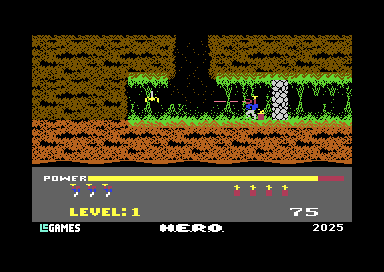

---
hide:
  - navigation
---

# Disassembly Examples

Regenerator 2000 exports every `.html` disassembly below directly from its `.regen2000proj` project with no manual edits. Open any example to inspect clickable cross-references, labels, enums, comments, and light/dark themes.

## Commodore 64

### Frogger (8K Cartridge)

-   [{ width="100%" loading=lazy }](examples/c64_frogger_8k.html)

-   Parker Brothers' 1983 cartridge port of [Frogger](https://www.c64-wiki.com/wiki/Frogger_%28Parker_Brothers%29).

    ---

    - :material-chip: **System:** Commodore 64 (8K Cartridge)
    - :material-memory: **Range:** `$8000–$9FF9` (4,375 rows)
    - :material-code-braces: **Assembler:** `64tass`
    - :material-tag-multiple-outline: **Annotations:** 568 labels · 9 enums
    - :material-link-variant: **Source:** [TOSEC Commodore C64 Collection](https://archive.org/details/tosec-20161111-commodore-c64)

    ---

    [:material-file-code-outline: Open HTML Disassembly](examples/c64_frogger_8k.html){ .md-button .md-button--primary }
    [:material-github: Project (.regen2000proj)](https://github.com/ricardoquesada/regenerator2000/blob/main/examples/c64_frogger_8k.regen2000proj){ .md-button }

### Moving Tubes

-   [{ width="100%" loading=lazy }](examples/c64_moving_tubes_lxt.html)

-   Classic C64 demoscene intro [Moving Tubes](https://csdb.dk/release/?id=259330) by Laxity.

    ---

    - :material-chip: **System:** Commodore 64 (Unpacked PRG)
    - :material-memory: **Range:** `$0800–$301B` (2,842 rows)
    - :material-code-braces: **Assembler:** `64tass`
    - :material-tag-multiple-outline: **Annotations:** 301 labels · 1 enum
    - :material-link-variant: **Source:** [CSDb — Moving Tubes](https://csdb.dk/release/?id=259330) (unpacked with [Unp64](https://csdb.dk/release/?id=260619))

    ---

    [:material-file-code-outline: Open HTML Disassembly](examples/c64_moving_tubes_lxt.html){ .md-button .md-button--primary }
    [:material-github: Project (.regen2000proj)](https://github.com/ricardoquesada/regenerator2000/blob/main/examples/c64_moving_tubes_lxt.regen2000proj){ .md-button }

### Burnin' Rubber

-   [{ width="100%" loading=lazy }](examples/c64_burnin_rubber.html)

-   1983 C64 arcade racer [Burnin' Rubber](https://www.c64-wiki.com/wiki/Burnin_Rubber).

    ---

    - :material-chip: **System:** Commodore 64 (`SYS 4752`)
    - :material-memory: **Range:** `$1000–$BFF8` (6,877 rows)
    - :material-code-braces: **Assembler:** `64tass`
    - :material-tag-multiple-outline: **Annotations:** 429 labels · 1 enum
    - :material-link-variant: **Source:** [Ultimate Tape Archive — Burnin' Rubber.tap](https://archive.org/download/Ultimate_Tape_Archive_V5/Ultimate_Tape_Archive_V5.zip/Ultimate_Tape_Archive_V5.0%2FBurnin%27_Rubber_%281983_Audiogenic_Ltd.%29_%5B5346%5D%2FBurnin%27_Rubber.tap)

    ---

    [:material-file-code-outline: Open HTML Disassembly](examples/c64_burnin_rubber.html){ .md-button .md-button--primary }
    [:material-github: Project (.regen2000proj)](https://github.com/ricardoquesada/regenerator2000/blob/main/examples/c64_burnin_rubber.regen2000proj){ .md-button }

---

## Commodore 128

### H.E.R.O. Is Back!

-   [{ width="100%" loading=lazy }](examples/c128_hero_is_back.html)

-   Commodore 128 homebrew game [H.E.R.O. Is Back!](https://lowcarb.itch.io/hero-is-back-c64) by LC Games.

    ---

    - :material-chip: **System:** Commodore 128
    - :material-memory: **Range:** `$1C01–$8C37` (11,818 rows)
    - :material-code-braces: **Assembler:** `64tass`
    - :material-tag-multiple-outline: **Annotations:** 690 labels · 3 enums
    - :material-link-variant: **Source:** [H.E.R.O. Is Back by LC Games (itch.io)](https://lowcarb.itch.io/hero-is-back-c64)

    ---

    [:material-file-code-outline: Open HTML Disassembly](examples/c128_hero_is_back.html){ .md-button .md-button--primary }
    [:material-github: Project (.regen2000proj)](https://github.com/ricardoquesada/regenerator2000/blob/main/examples/c128_hero_is_back.regen2000proj){ .md-button }

---

## Commodore PET

### Lode Runner

-   [{ width="100%" loading=lazy }](examples/pet_loderunner.html)

-   Commodore PET clone of [Lode Runner](https://jimbo.itch.io/lode-runner-clone-for-commodore-pet) by jimbo.

    ---

    - :material-chip: **System:** Commodore PET 4.0
    - :material-memory: **Range:** `$0401–$6700` (8,133 rows)
    - :material-code-braces: **Assembler:** `64tass`
    - :material-tag-multiple-outline: **Annotations:** 480 labels · 1,155 comments
    - :material-link-variant: **Source:** [Lode Runner for the PET by jimbo (itch.io)](https://jimbo.itch.io/lode-runner-clone-for-commodore-pet)

    ---

    [:material-file-code-outline: Open HTML Disassembly](examples/pet_loderunner.html){ .md-button .md-button--primary }
    [:material-github: Project (.regen2000proj)](https://github.com/ricardoquesada/regenerator2000/blob/main/examples/pet_loderunner.regen2000proj){ .md-button }

---

## Commodore VIC-20

### Omega Race

-   [{ width="100%" loading=lazy }](examples/vic20_omega_race_cart_generic_a000.html)

-   Commodore's 1982 VIC-20 cartridge port of [Omega Race](https://en.wikipedia.org/wiki/Omega_Race).

    ---

    - :material-chip: **System:** Commodore VIC-20 (8K Cartridge)
    - :material-memory: **Range:** `$A000–$BFED` (4,119 rows)
    - :material-code-braces: **Assembler:** `64tass`
    - :material-tag-multiple-outline: **Annotations:** 309 labels · 2 enums
    - :material-link-variant: **Source:** [TOSEC VIC-20 Cartridges Archive](https://archive.org/download/Commodore_VIC20_TOSEC_2012_04_23/Commodore_VIC20_TOSEC_2012_04_23.zip/Commodore%20VIC20%20%5BTOSEC%5D%2FCommodore%20VIC20%20-%20Games%20-%20%5BCRT%5D%20%28TOSEC-v2011-12-15_CM%29%2FOmega%20Race%20%281982%29%28Commodore%29%5BA000%5D.zip)

    ---

    [:material-file-code-outline: Open HTML Disassembly](examples/vic20_omega_race_cart_generic_a000.html){ .md-button .md-button--primary }
    [:material-github: Project (.regen2000proj)](https://github.com/ricardoquesada/regenerator2000/blob/main/examples/vic20_omega_race_cart_generic_a000.regen2000proj){ .md-button }

---

## Commodore Plus/4

### Kikstart

-   [{ width="100%" loading=lazy }](examples/plus4_kikstart_8192.html)

-   Commodore Plus/4 motorcycle stunt game [Kikstart](http://plus4world.powweb.com/software/Kikstart).

    ---

    - :material-chip: **System:** Commodore Plus/4 (TED)
    - :material-memory: **Range:** `$1000–$3FF8` (4,223 rows)
    - :material-code-braces: **Assembler:** `64tass`
    - :material-tag-multiple-outline: **Annotations:** 273 labels · 1 enum
    - :material-link-variant: **Source:** [Kikstart on Plus/4 World](http://plus4world.powweb.com/software/Kikstart)

    ---

    [:material-file-code-outline: Open HTML Disassembly](examples/plus4_kikstart_8192.html){ .md-button .md-button--primary }
    [:material-github: Project (.regen2000proj)](https://github.com/ricardoquesada/regenerator2000/blob/main/examples/plus4_kikstart_8192.regen2000proj){ .md-button }

---

## Export Your Own Disassembly

Export any Regenerator 2000 project as a standalone HTML file:

- **Interactive TUI:** Select **File → Export → HTML** in the menu bar.
- **Headless CLI:** Run `regenerator2000 --headless --export_html output.html your_project.regen2000proj`.
