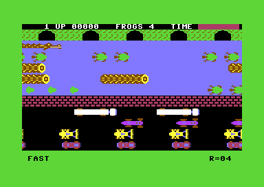
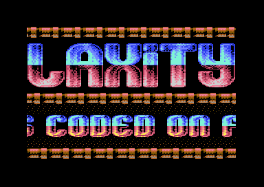
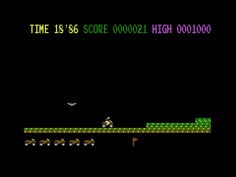

---
hide:
  - navigation
---

# Disassembly Examples

Regenerator 2000 exports every `.html` disassembly below directly from its `.regen2000proj` project (`regenerator2000 --headless --export_html`). The output needs no manual edits.

Browse the gallery, read the highlights, or select any address link to open the interactive HTML disassembly. For example, see Frogger's raster ISR at [`c64_frogger_8k.html#L8BDF`](examples/c64_frogger_8k.html#L8BDF).

## Inside a Generated HTML Disassembly

```ca65 title="c64_frogger_8k.html — Two-Phase Raster ISR ($8BCC–$8BEA)" hl_lines="7"
$8BCC  a9 a1     lda #RasterSplitLine.RASTER_SPLIT_MEDIAN ; Mid-screen split constant (1)
$8BCE  8d 12 d0  sta $d012                                ; Raster Position ($A1 = scanline 161) (2)
$8BDB  58        cli                                      ; Enable IRQ; game runs inside ISR
$8BDC  4c dc 8b  main_idle_loop  jmp main_idle_loop       ; Foreground spin loop ; x-ref: $8bdc
; =-=-=-=-=-=-=-=-=-=-=-=-=-=-=-=-=-=-=-=-=-=-=-=-=-=-=-=-=-=-=-=-=-=-=-=-=-=-=
; Two-phase VIC-II split-screen raster ISR ($0314/$0315) multiplexing $A1 and $FC
$8BDF  a9 14     raster_irq_handler  lda #$14             ; x-ref: $8bb8, $8bbd (3)
$8BE1  8d 18 d0  sta $d018                                ; VIC Memory Control Register
$8BE4  a5 2e     lda zp_raster_split_line                 ; Check active split ($A1 vs $FC)
$8BE6  c9 fc     cmp #RasterSplitLine.RASTER_SPLIT_BOTTOM
$8BE8  d0 03     bne irq_mid_raster_phase                 ; Dispatch active raster half (4)
$8BEA  4c d4 8e  jmp irq_top_raster_phase                 ; Switch to top charset & scroll lanes
```

1. **Typed Project Enums** — Regenerator 2000 renders numeric constants like `#$a1` and `#$fc` as enum names (`RasterSplitLine.RASTER_SPLIT_MEDIAN`).
2. **Hardware Register Comments** — Target definitions and user comments annotate chip registers (`$D012`, `$D018`) beside machine bytes and mnemonics.
3. **Permalinks & Cross-References** — Each row has an `#Lxxxx` anchor like [`$8BDF`](examples/c64_frogger_8k.html#L8BDF) and `; x-ref:` backlinks between callers and targets.
4. **Clickable Operand Targets** — Branches and jumps link directly to destination labels inside the HTML file, such as [`irq_mid_raster_phase`](examples/c64_frogger_8k.html#L8BE8).

<div class="grid cards" markdown>

-   :material-link-variant: **Permalink Address Anchors**

    ---

    Each instruction and data row gets an `#Lxxxx` URL fragment. Docs, issues, and notes can link straight to exact lines.

-   :material-code-braces: **Opcodes + Assembler Syntax**

    ---

    Raw hex machine bytes sit beside formatted `64tass` labels, directives, and multi-line header comments.

-   :material-tag-outline: **Typed Project Enums**

    ---

    Regenerator 2000 promotes numeric constants to readable enum members for bitmasks, raster splits, colors, and game states.

-   :material-theme-light-dark: **Built-In Light & Dark Themes**

    ---

    Every exported HTML file includes a light and dark toggle (`?theme=light` or `?theme=dark`). It keeps the selected theme across links.

</div>

## Example Gallery

<div class="grid cards" markdown>

-   { width="100%" loading=lazy }

    **Frogger (8K Cartridge)** · `Commodore 64`

    ---

    `$8000–$9FF9` · 568 labels · 9 enums

    [:octicons-arrow-down-24: Details](#frogger-8k-cartridge) · [:material-file-code-outline: Open HTML](examples/c64_frogger_8k.html)

-   { width="100%" loading=lazy }

    **Moving Tubes** · `Commodore 64`

    ---

    `$0800–$301B` · 301 labels · 1 enum

    [:octicons-arrow-down-24: Details](#moving-tubes) · [:material-file-code-outline: Open HTML](examples/c64_moving_tubes_lxt.html)

-   { width="100%" loading=lazy }

    **Burnin' Rubber** · `Commodore 64`

    ---

    `$1000–$BFF8` · 429 labels · 1 enum

    [:octicons-arrow-down-24: Details](#burnin-rubber) · [:material-file-code-outline: Open HTML](examples/c64_burnin_rubber.html)

-   { width="100%" loading=lazy }

    **H.E.R.O. Is Back!** · `Commodore 128`

    ---

    `$1C01–$8C37` · 690 labels · 3 enums

    [:octicons-arrow-down-24: Details](#hero-is-back) · [:material-file-code-outline: Open HTML](examples/c128_hero_is_back.html)

-   { width="100%" loading=lazy }

    **Lode Runner** · `Commodore PET`

    ---

    `$0401–$6700` · 480 labels · Unpacked

    [:octicons-arrow-down-24: Details](#lode-runner) · [:material-file-code-outline: Open HTML](examples/pet_loderunner.html)

-   { width="100%" loading=lazy }

    **Omega Race** · `Commodore VIC-20`

    ---

    `$A000–$BFED` · 309 labels · 2 enums

    [:octicons-arrow-down-24: Details](#omega-race) · [:material-file-code-outline: Open HTML](examples/vic20_omega_race_cart_generic_a000.html)

-   { width="100%" loading=lazy }

    **Kikstart** · `Commodore Plus/4`

    ---

    `$1000–$3FF8` · 273 labels · 1 enum

    [:octicons-arrow-down-24: Details](#kikstart) · [:material-file-code-outline: Open HTML](examples/plus4_kikstart_8192.html)

</div>

---

## Commodore 64

### Frogger (8K Cartridge)

<div class="grid cards" markdown>

-   { width="100%" loading=lazy }

-   Full disassembly of Parker Brothers' 1983 8 KB `CBM80` ROM cartridge port of **Frogger**. It includes 9 typed project enums, hardware sprite/charset annotations, and a raster-driven game loop.

    ---

    - :material-chip: **System:** Commodore 64 (8K Cartridge)
    - :material-memory: **Range:** `$8000–$9FF9` (4,375 rows)
    - :material-code-braces: **Assembler:** `64tass`
    - :material-tag-multiple-outline: **Annotations:** 568 labels · 9 enums

    ---

    [:material-file-code-outline: Open HTML Disassembly](examples/c64_frogger_8k.html){ .md-button .md-button--primary }
    [:material-github: Project (.regen2000proj)](https://github.com/ricardoquesada/regenerator2000/blob/main/examples/c64_frogger_8k.regen2000proj){ .md-button }

</div>

=== ":material-star-four-points-outline: Highlights"

    - **9 Typed Project Enums**: Nine enums model game states and bitmasks (`CharsetDescTarget`, `FrogHopDir`, `HomeBayState`, `LaneObjType`, `RasterSplitLine`, `ScreenWipeState`, `SoundStreamId`, `SpriteCollisionMask`, and `TileHorizDir`).
    - **Pre-Shifted Dual RAM Charsets**: At boot, [`cart_cold_warm_start`](examples/c64_frogger_8k.html#L8906) banks in Character ROM via `$00`/`$01` and copies 44 status glyphs. It next builds 4-phase pre-shifted charsets in VIC Bank 1 (`$4800` river, `$5000` road). This lets all 9 lanes scroll at independent directions and speeds without `$D016` splits.
    - **100% IRQ-Driven Architecture**: Foreground execution loops at [`main_idle_loop`](examples/c64_frogger_8k.html#L8BDC). Meanwhile, the two-phase VIC-II raster ISR (`$A1` and `$FC`) runs input, frog movement, collisions, scrolling, and SID playback.
    - **Compact Cartridge Packaging**: A zero-terminated RLE table at [`$801B`](examples/c64_frogger_8k.html#L801B) fills all 1,000 Color RAM cells (`$D800`–`$DBE7`). A 3-voice SID music and SFX engine starts at [`$9B73`](examples/c64_frogger_8k.html#L9B73).
    - **Original Release & Controls**: Parker Brothers published this 8 KB cartridge in 1983. Press ++f1++ to start, ++f3++ for `FAST`/`SLOW` speed, and ++f5++ for 1P/2P. See [Frogger (Parker Brothers) on C64-Wiki](<https://www.c64-wiki.com/wiki/Frogger_(Parker_Brothers)>).
    - **Source**: TOSEC archive [Commodore C64 Collection](https://archive.org/details/tosec-20161111-commodore-c64).

=== ":material-compass-outline: Jump Into .html"

    | Address | Routine / Region | What to Look For |
    | --- | --- | --- |
    | [`$8000`](examples/c64_frogger_8k.html#L8000) | `cart_cold_start_vec` | Cold/warm reset vectors and `CBM80` cartridge autostart header |
    | [`$801B`](examples/c64_frogger_8k.html#L801B) | Color RAM RLE Stream | Zero-terminated RLE data populating all 1,000 Color RAM cells |
    | [`$8906`](examples/c64_frogger_8k.html#L8906) | `cart_cold_warm_start` | Cartridge init, Character ROM copy, and 4-phase charset pre-shifter |
    | [`$8BDF`](examples/c64_frogger_8k.html#L8BDF) | `raster_irq_handler` | Two-phase `$A1` / `$FC` split-screen VIC-II raster ISR |
    | [`$933F`](examples/c64_frogger_8k.html#L933F) | 9-Lane Scroller | River/road lane speed, direction (`TileHorizDir`), and object updates |
    | [`$9B73`](examples/c64_frogger_8k.html#L9B73) | SID Stream Player | 3-voice music and arcade SFX stream interpreter |

=== ":material-code-tags: Disassembly Excerpt"

    ```ca65 title="c64_frogger_8k.html — CBM80 Autostart Cartridge Header ($8000–$8009)" hl_lines="2 6"
    ; C64 8K Cartridge CBM80 Header ($8000-$8008)
    $8000  cart_cold_start_vec  .word cart_cold_warm_start ; Cold start vector -> $8906 (1)
    $8002  cart_warm_start_vec  .word cart_cold_warm_start ; Warm start / RESTORE NMI -> $8906
                                .encode
                                .enc "none"
    $8004  cart_cbm80_sig       .text $c3, $c2, $cd, "80"  ; PETSCII "CBM80" signature (2)
                                .endencode
    ; Screen RAM ($4400) top-row pointers for the 9 scrolling lanes
           lane_screen_row_ptr_tbl
    $8009                       .word SCREEN_RAM_ROW03_COL00, SCREEN_RAM_ROW05_COL00 ; x-ref: $91cc, $91d7
    ```

    1. Both cold and warm reset vectors at [`$8000`](examples/c64_frogger_8k.html#L8000) point directly to [`cart_cold_warm_start`](examples/c64_frogger_8k.html#L8906) (`$8906`).
    2. Five-byte `CBM80` signature at `$8004` (`$C3 $C2 $CD "80"`) tells the C64 KERNAL reset routine to autostart the cartridge.

---

### Moving Tubes

<div class="grid cards" markdown>

-   { width="100%" loading=lazy }

-   Disassembly of the classic C64 demoscene intro [Moving Tubes](https://csdb.dk/release/?id=259330) by Laxity. It shows self-modifying 6502 tricks, chained raster IRQs, and a documented SID music player.

    ---

    - :material-chip: **System:** Commodore 64 (Unpacked PRG)
    - :material-memory: **Range:** `$0800–$301B` (2,842 rows)
    - :material-code-braces: **Assembler:** `64tass`
    - :material-tag-multiple-outline: **Annotations:** 301 labels · 1 enum

    ---

    [:material-file-code-outline: Open HTML Disassembly](examples/c64_moving_tubes_lxt.html){ .md-button .md-button--primary }
    [:material-github: Project (.regen2000proj)](https://github.com/ricardoquesada/regenerator2000/blob/main/examples/c64_moving_tubes_lxt.regen2000proj){ .md-button }

</div>

=== ":material-star-four-points-outline: Highlights"

    - **Clean Intermediate Demoscene 6502**: Clear assembly shows how C64 intros coordinate raster splits, custom charsets, and audio in 50 Hz PAL timing.
    - **Complete SID Music Driver**: Notes document the Laxity SID player ([`$1000`](examples/c64_moving_tubes_lxt.html#L1000)), including pattern pointers, pulse width, filter tables, and arpeggios.
    - **Classic 6502 Size & Speed Optimizations**:
      - [`logo_shimmer_enable_gate`](examples/c64_moving_tubes_lxt.html#L2272) patches `JMP` (`$4C`) to `BIT` (`$2C`) so code skips or falls through without branching.
      - [`rotate_scroller_star_1_x2`](examples/c64_moving_tubes_lxt.html#L0EEB) uses `JSR` to run the following subroutine twice in a row.
      - Background logo shimmer colors sync to SID playback while a sine table ([`$0F40`](examples/c64_moving_tubes_lxt.html#L0F40)) scrolls the tubes.
    - **Source & Release**: See CSDb [Moving Tubes (Laxity Intro #145)](https://csdb.dk/release/?id=259330). [Unp64](https://csdb.dk/release/?id=260619) unpacked this intro from the original compressed file.

=== ":material-compass-outline: Jump Into .html"

    | Address | Routine / Region | What to Look For |
    | --- | --- | --- |
    | [`$0E08`](examples/c64_moving_tubes_lxt.html#L0E08) | Tube & Scroller Update | Variable-width proportional scroller and background tube motion |
    | [`$0EEB`](examples/c64_moving_tubes_lxt.html#L0EEB) | `rotate_scroller_star_1_x2` | Double-call `JSR` fall-through trick executing the next routine twice |
    | [`$0F40`](examples/c64_moving_tubes_lxt.html#L0F40) | Sine Table | Lookup table driving horizontal tube offset oscillation |
    | [`$1000`](examples/c64_moving_tubes_lxt.html#L1000) | Laxity SID Player | Complete music driver (`$1000` init / play) |
    | [`$2219`](examples/c64_moving_tubes_lxt.html#L2219) | Raster IRQ Chain | 50 Hz PAL split handlers for logo, tubes, and scroller |
    | [`$2272`](examples/c64_moving_tubes_lxt.html#L2272) | `logo_shimmer_enable_gate` | Self-modifying `$4C` (`JMP`) → `$2C` (`BIT`) opcode gate |

=== ":material-code-tags: Disassembly Excerpt"

    ```ca65 title="c64_moving_tubes_lxt.html — Self-Modifying JMP → BIT Gate ($2272–$2282)" hl_lines="2 4"
           logo_shimmer_enable_gate
    $2272  4c 79 22  jmp j_2279                    ; Init writes $2C (BIT) over $4C (JMP) (1)
    $2275  ca        dex                           ; Step shimmer 5->4->3->2->1->0 (50 Hz)
    $2276  8e 6f 22  stx logo_shimmer_index        ; Self-modifies LDX #$xx at $226E (2)
    $2279  bd d4 23  j_2279  lda tbl_background_color_46_0,x ; x-ref: $2272
    $227C  8d a9 22          sta logo_bg0_color_upper
    $227F  bd da 23          lda tbl_background_color_46_1,x
    $2282  8d ab 22          sta logo_bg1_color_upper
    ```

    1. At rest ([`$2272`](examples/c64_moving_tubes_lxt.html#L2272)), `$4C 79 22` jumps over `DEX` and `STX`. Patching byte `$2272` to `$2C` (`BIT $2279`) consumes that operand and runs `DEX`.
    2. This code writes the decremented shimmer step straight into the `LDX` operand at [`$226F`](examples/c64_moving_tubes_lxt.html#L226F) (`logo_shimmer_index`).

---

### Burnin' Rubber

<div class="grid cards" markdown>

-   { width="100%" loading=lazy }

-   Forensic disassembly of the 1983 C64 arcade racer [Burnin' Rubber](https://www.c64-wiki.com/wiki/Burnin_Rubber). This binary comes from an encrypted TAP image, and the author wrote it in a machine code monitor.

    ---

    - :material-chip: **System:** Commodore 64 (`SYS 4752`)
    - :material-memory: **Range:** `$1000–$BFF8` (6,877 rows)
    - :material-code-braces: **Assembler:** `64tass`
    - :material-tag-multiple-outline: **Annotations:** 429 labels · 1 enum

    ---

    [:material-file-code-outline: Open HTML Disassembly](examples/c64_burnin_rubber.html){ .md-button .md-button--primary }
    [:material-github: Project (.regen2000proj)](https://github.com/ricardoquesada/regenerator2000/blob/main/examples/c64_burnin_rubber.regen2000proj){ .md-button }

</div>

=== ":material-star-four-points-outline: Highlights"

    - **Written in a [Machine Code Monitor](https://www.c64-wiki.com/wiki/Machine_Code_Monitor), Not an Assembler**:
      - Unused code and data tables stay in RAM from live monitor patches.
      - Address [`$2C00`](examples/c64_burnin_rubber.html#L2C00) keeps a `.T0400,07FF,2C00` monitor command typed on screen before copying Screen RAM (`$0400`–`$07FF`) to `$2C00`.
      - Subroutines split across memory and link with `JMP` patches. Removed debug `JSR` calls leave 3-byte `NOP` islands behind.
      - Regenerator 2000 faithfully keeps 3-byte zero-page encodings, such as `AD F2 00` instead of `A5 F2` for `LDA $00F2`.
    - **Historical Context & Source**: Early 1983 C64 games often used a monitor and [handwritten paper notes](https://github.com/ricardoquesada/c64-c128-erasoft/blob/master/scans/chardef.pdf). The binary comes from a decrypted [Burnin' Rubber.tap](https://archive.org/download/Ultimate_Tape_Archive_V5/Ultimate_Tape_Archive_V5.zip/Ultimate_Tape_Archive_V5.0%2FBurnin%27_Rubber_%281983_Audiogenic_Ltd.%29_%5B5346%5D%2FBurnin%27_Rubber.tap). Start with `SYS 4752`.

=== ":material-compass-outline: Jump Into .html"

    | Address | Routine / Region | What to Look For |
    | --- | --- | --- |
    | [`$1052`](examples/c64_burnin_rubber.html#L1052) | Screen & Sprite Fade-In | Intro palette fade and sprite initialization |
    | [`$1300`](examples/c64_burnin_rubber.html#L1300) | Road Map Scroller | Track data decoding and playfield scroll updates |
    | [`$1A3A`](examples/c64_burnin_rubber.html#L1A3A) | Jump Sprite Scaling | Player car jump arc and hardware sprite scaling |
    | [`$2C00`](examples/c64_burnin_rubber.html#L2C00) | `unused_monitor_cmd` | Leftover `.T0400,07FF,2C00` Screen RAM snapshot from development |

=== ":material-code-tags: Disassembly Excerpt"

    ```ca65 title="c64_burnin_rubber.html — Leftover Machine Code Monitor Command ($2C00)" hl_lines="3"
    $2BB8  .text "                F1 1 PLAYER  F3 2 PLAYER"
    $2BE0  .text "S                               "
    $2C00  unused_monitor_cmd  .text ".T0400,07FF,2C00                        " ; (1)!
           enter_high_score_screen_1
    $2C28  .text "                                        " ; x-ref: $1b62
    $2C50  .text "      A  B  C  D  E  F  G  H  I  J      "
    ```

    1. At [`$2C00`](examples/c64_burnin_rubber.html#L2C00), the developer dumped Screen RAM with a Monitor `.T` command. This saved the monitor prompt text inside the game binary.

---

## Commodore 128

### H.E.R.O. Is Back!

<div class="grid cards" markdown>

-   { width="100%" loading=lazy }

-   Our largest annotated disassembly (nearly 12,000 lines): LC Games' Commodore 128 port [H.E.R.O. Is Back!](https://lowcarb.itch.io/hero-is-back-c64). It features C128 RAM Bank 1 level streaming and modular collision systems.

    ---

    - :material-chip: **System:** Commodore 128
    - :material-memory: **Range:** `$1C01–$8C37` (11,818 rows)
    - :material-code-braces: **Assembler:** `64tass`
    - :material-tag-multiple-outline: **Annotations:** 690 labels · 3 enums

    ---

    [:material-file-code-outline: Open HTML Disassembly](examples/c128_hero_is_back.html){ .md-button .md-button--primary }
    [:material-github: Project (.regen2000proj)](https://github.com/ricardoquesada/regenerator2000/blob/main/examples/c128_hero_is_back.regen2000proj){ .md-button }

</div>

=== ":material-star-four-points-outline: Highlights"

    - **C128 RAM Bank 1 Level Streaming**: The game loads 20 external files (`CAVE01`–`CAVE20`) into C128 RAM Bank 1 at `$2000`. Interleaved tables at [`$1C1D`](examples/c128_hero_is_back.html#L1C1D) index start and end addresses.
    - **Rich State Machine & Annotations**: This disassembly includes 3,483 side comments, 586 header comments, and 3 enums (`GameState`, `MenuOptions`, `VicIIColors`). They govern the main loop at [`$1C10`](examples/c128_hero_is_back.html#L1C10).
    - **Modular Collision & Disk I/O**: Dedicated subroutines under [`check_hero_collisions`](examples/c128_hero_is_back.html#L1E70) check hazards, rafts, enemies, and dynamite blasts. Custom IEC disk routines sit at [`$207B`](examples/c128_hero_is_back.html#L207B).
    - **Source**: Official [H.E.R.O. Is Back page by LC Games](https://lowcarb.itch.io/hero-is-back-c64) on itch.io.

=== ":material-compass-outline: Jump Into .html"

    | Address | Routine / Region | What to Look For |
    | --- | --- | --- |
    | [`$1C10`](examples/c128_hero_is_back.html#L1C10) | Raster-Synced Main Loop | Top-level `GameState` enum dispatch loop |
    | [`$1C1D`](examples/c128_hero_is_back.html#L1C1D) | Bank 1 Cave Pointer Table | Start/end addresses for `CAVE01`–`CAVE20` levels in C128 Bank 1 |
    | [`$1CF7`](examples/c128_hero_is_back.html#L1CF7) | `convert_byte_to_two_ascii_digits` | Repeated-subtraction formatter patching dynamic `CAVExx` filenames |
    | [`$1E70`](examples/c128_hero_is_back.html#L1E70) | `check_hero_collisions` | Modular hazard, enemy, raft, and dynamite collision checks |
    | [`$207B`](examples/c128_hero_is_back.html#L207B) | IEC Disk Save Routine | High-score persistence and IEC drive error handling |

=== ":material-code-tags: Disassembly Excerpt"

    ```ca65 title="c128_hero_is_back.html — Two-Digit ASCII Filename Builder ($1CF7–$1D01)" hl_lines="2 8"
           convert_byte_to_two_ascii_digits
    $1CF7  a2 2f     ldx #$2f                 ; X = '0' - 1 ($2F) ; x-ref: $1c7a (1)
    $1CF9  38        sec                      ; Prepare for repeated subtraction
    $1CFA  e8        b_1CFA  inx              ; Increment tens digit character
    $1CFB  e9 0a             sbc #$0a         ; Subtract 10
    $1CFD  b0 fb             bcs b_1CFA       ; Loop while value >= 10
    $1CFF  69 3a     adc #$3a                 ; Convert remainder to ASCII units digit
    $1D01  8d 4c 1c  sta cave_filename_units  ; Patch dynamic "CAVExx" string (2)
    ```

    1. This routine sets `X` to `$2F` (`'0' - 1`) and subtracts `10` until carry clears. That computes the ASCII tens digit without division.
    2. It patches [`cave_filename_units`](examples/c128_hero_is_back.html#L1C4C) directly in the `CAVExx` PETSCII filename buffer before opening the Bank 1 level file.

---

## Commodore PET

### Lode Runner

<div class="grid cards" markdown>

-   { width="100%" loading=lazy }

-   Clean, unpacked disassembly of jimbo's [Lode Runner](https://jimbo.itch.io/lode-runner-clone-for-commodore-pet) clone for Commodore PET. It features 40/80-column hardware patching, VIA Timer 2 sound, and guard pathfinding.

    ---

    - :material-chip: **System:** Commodore PET 4.0
    - :material-memory: **Range:** `$0401–$6700` (8,133 rows)
    - :material-code-braces: **Assembler:** `64tass`
    - :material-tag-multiple-outline: **Annotations:** 480 labels · 1,155 comments

    ---

    [:material-file-code-outline: Open HTML Disassembly](examples/pet_loderunner.html){ .md-button .md-button--primary }
    [:material-github: Project (.regen2000proj)](https://github.com/ricardoquesada/regenerator2000/blob/main/examples/pet_loderunner.regen2000proj){ .md-button }

</div>

=== ":material-star-four-points-outline: Highlights"

    - **40/80-Column Runtime Self-Patching**: Startup code checks PET screen width and calls [`patch_80_column_compatibility`](examples/pet_loderunner.html#L0843). It patches blit row offsets so one binary runs on 40- and 80-column PETs.
    - **IRQ vs. Foreground Split**: The IRQ handler at `$90`/`$91` runs blitting, physics, input, and 6522 VIA PCR/Timer 2 (`$E84C`) sound. Foreground code handles guard AI and LFSR entropy.
    - **Unpacked Reference Binary**: Because the original `.prg` uses no compression, this project shows clean assembler-written 6502 structure with no unpacking artifacts.
    - **Source**: [Lode Runner for the PET by jimbo](https://jimbo.itch.io/lode-runner-clone-for-commodore-pet) on itch.io.

=== ":material-compass-outline: Jump Into .html"

    | Address | Routine / Region | What to Look For |
    | --- | --- | --- |
    | [`$0401`](examples/pet_loderunner.html#L0401) | PET BASIC Stub | Autostart `SYS` line at Commodore PET RAM start (`$0401`) |
    | [`$0843`](examples/pet_loderunner.html#L0843) | `patch_80_column_compatibility` | Screen-width probe and in-place 80-column blitter patching |
    | [`$0AA0`](examples/pet_loderunner.html#L0AA0) | Screen Blitter | Fast unrolled tile/playfield copy into PET screen RAM |
    | [`$0CB1`](examples/pet_loderunner.html#L0CB1) | VIA CB2 Audio Engine | 6522 VIA Timer 2 / shift-register square-wave sound generator |
    | [`$1066`](examples/pet_loderunner.html#L1066) | Player & Guard State | Player movement and guard pursuit AI state machine |

=== ":material-code-tags: Disassembly Excerpt"

    ```ca65 title="pet_loderunner.html — PET 80-Column Self-Modifying Patch ($0843–$084E)" hl_lines="3 8"
           patch_80_column_compatibility
    $0843  a5 51     lda zp_screen_width        ; x-ref: $1668
    $0845  c9 50     cmp #80                    ; Running on an 80-column PET? (1)
    $0847  f0 01     beq b_084A
    $0849  60        rts
    $084A  a0 0c     b_084A  ldy #$0c           ; x-ref: $0847
    $084C  a9 00             lda #$00
    $084E  8d 8c 08          sta smc_blit_screen_r0_lo ; Rewrite blitter row pointers (2)
    ```

    1. This routine compares `zp_screen_width` against `80` (`$50`) at [`$0845`](examples/pet_loderunner.html#L0845). A 40-column PET returns immediately at `$0849`.
    2. It patches [`smc_blit_screen_r0_lo`](examples/pet_loderunner.html#L088C) and later row operands in the blitter loop for the 80-column stride.

---

## Commodore VIC-20

### Omega Race

<div class="grid cards" markdown>

-   { width="100%" loading=lazy }

-   Disassembly of Commodore's 1982 8 KB VIC-20 cartridge port of [Omega Race](https://en.wikipedia.org/wiki/Omega_Race). It shows mid-instruction labels (`=*+$02`), inertial physics tables, and 4-channel VIC audio.

    ---

    - :material-chip: **System:** Commodore VIC-20 (8K Cartridge)
    - :material-memory: **Range:** `$A000–$BFED` (4,119 rows)
    - :material-code-braces: **Assembler:** `64tass`
    - :material-tag-multiple-outline: **Annotations:** 309 labels · 2 enums

    ---

    [:material-file-code-outline: Open HTML Disassembly](examples/vic20_omega_race_cart_generic_a000.html){ .md-button .md-button--primary }
    [:material-github: Project (.regen2000proj)](https://github.com/ricardoquesada/regenerator2000/blob/main/examples/vic20_omega_race_cart_generic_a000.regen2000proj){ .md-button }

</div>

=== ":material-star-four-points-outline: Highlights"

    - **Mid-Instruction Labels for Self-Modifying Code**: In [`update_player_physics`](examples/vic20_omega_race_cart_generic_a000.html#LA466), Regenerator 2000 emits `patch_input_dispatch_hi =*+$02` above `jsr input_dispatch`. This shows runtime patching for joystick or paddle controls.
    - **Vector-Arcade Physics on VIC-20**: The game uses 16-angle velocity tables, fire cooldown tracking, and elastic force-field bounce checks at [`$A96A`](examples/vic20_omega_race_cart_generic_a000.html#LA96A).
    - **VIC-20 Hardware & Enums**: Annotations cover the `A0CBM` autostart cartridge header, 4-channel VIC sound IRQ (`$900A`–`$900E`), and `PetsciiShifted` / `VicColors` enums.
    - **Source**: TOSEC archive [Omega Race on VIC-20 Cartridges](https://archive.org/download/Commodore_VIC20_TOSEC_2012_04_23/Commodore_VIC20_TOSEC_2012_04_23.zip/Commodore%20VIC20%20%5BTOSEC%5D%2FCommodore%20VIC20%20-%20Games%20-%20%5BCRT%5D%20%28TOSEC-v2011-12-15_CM%29%2FOmega%20Race%20%281982%29%28Commodore%29%5BA000%5D.zip).

=== ":material-compass-outline: Jump Into .html"

    | Address | Routine / Region | What to Look For |
    | --- | --- | --- |
    | [`$A000`](examples/vic20_omega_race_cart_generic_a000.html#LA000) | `A0CBM` ROM Header | VIC-20 BLK5 (`$A000`) autostart cartridge vectors and signature |
    | [`$A175`](examples/vic20_omega_race_cart_generic_a000.html#LA175) | VIC & 4-Ch IRQ Setup | Initializes `$9000`–`$900F` video geometry and sound channels |
    | [`$A377`](examples/vic20_omega_race_cart_generic_a000.html#LA377) | Wave Config Tables | Per-wave enemy counts, droid types, and speed tables |
    | [`$A466`](examples/vic20_omega_race_cart_generic_a000.html#LA466) | `update_player_physics` | Mid-instruction label (`=*+$02`), thrust, and firing cooldown checks |
    | [`$A96A`](examples/vic20_omega_race_cart_generic_a000.html#LA96A) | Force-Field Bounce | Inner/outer arena perimeter reflection physics |

=== ":material-code-tags: Disassembly Excerpt"

    ```ca65 title="vic20_omega_race_cart_generic_a000.html — Mid-Instruction Label (=*+$02) in Ship Physics ($A466)" hl_lines="4 5"
           update_player_physics
    $A466  ad a2 03  lda entity_velocity_indices ; Negative = player inactive ; x-ref: $a044
    $A469  30 7b     bmi r_A4E6
           patch_input_dispatch_hi =*+$02        ; Mid-instruction operand label ; x-ref: $b166 (1)
    $A46B  20 7d 1d  jsr input_dispatch          ; Read joystick or paddle heading
    $A46E  24 35     bit zp_fire_cooldown        ; Bit 7 = fire cooldown active
    $A470  10 07     bpl b_A479
    $A472  a5 19     lda zp_bullet_slots_free
    ```

    1. Code at [`$B166`](examples/vic20_omega_race_cart_generic_a000.html#LB166) writes to byte `$A46B + 2` (high byte of `jsr input_dispatch`) to swap control schemes in RAM. Therefore, Regenerator 2000 emits `patch_input_dispatch_hi =*+$02` inside [`update_player_physics`](examples/vic20_omega_race_cart_generic_a000.html#LA466).

---

## Commodore Plus/4

### Kikstart

<div class="grid cards" markdown>

-   { width="100%" loading=lazy }

-   Disassembly of the Commodore Plus/4 motorcycle stunt game [Kikstart](http://plus4world.powweb.com/software/Kikstart). It targets the MOS 7360/8360 TED chip with nibble-packed dual-voice music and a `GameMode` state machine.

    ---

    - :material-chip: **System:** Commodore Plus/4 (TED)
    - :material-memory: **Range:** `$1000–$3FF8` (4,223 rows)
    - :material-code-braces: **Assembler:** `64tass`
    - :material-tag-multiple-outline: **Annotations:** 273 labels · 1 enum

    ---

    [:material-file-code-outline: Open HTML Disassembly](examples/plus4_kikstart_8192.html){ .md-button .md-button--primary }
    [:material-github: Project (.regen2000proj)](https://github.com/ricardoquesada/regenerator2000/blob/main/examples/plus4_kikstart_8192.regen2000proj){ .md-button }

</div>

=== ":material-star-four-points-outline: Highlights"

    - **TED Chip Dual-Voice Audio Packing**: [`music_packed_notes`](examples/plus4_kikstart_8192.html#L1948) packs both TED voices into one byte stream (`high nibble = Voice 2`, `low nibble = Voice 1`).
    - **Enum-Driven `GameMode` Engine**: Separate states handle active riding ([`$2784`](examples/plus4_kikstart_8192.html#L2784)), crash debris rendering, velocity correction, and course-completion scoring.
    - **16-Course Table Architecture**: Compact tables (`$1C00`–`$1E80`) store obstacle spawn weights, scroll speeds, double-height bike graphics, and tile colors.
    - **Source**: [Kikstart on Plus/4 World](http://plus4world.powweb.com/software/Kikstart).

=== ":material-compass-outline: Jump Into .html"

    | Address | Routine / Region | What to Look For |
    | --- | --- | --- |
    | [`$1000`](examples/plus4_kikstart_8192.html#L1000) | Double-Height Charsets | Custom character definitions for bikes, riders, and obstacles |
    | [`$1948`](examples/plus4_kikstart_8192.html#L1948) | `music_packed_notes` | Nibble-packed dual-voice TED audio data stream |
    | [`$1DE0`](examples/plus4_kikstart_8192.html#L1DE0) | 16-Course Tables | Per-course obstacle spawn weights and track scroll speeds |
    | [`$2524`](examples/plus4_kikstart_8192.html#L2524) | Obstacle & Bike Physics | Wheelie tilt, jump height, and obstacle hitboxes |
    | [`$2784`](examples/plus4_kikstart_8192.html#L2784) | `handle_mode_active_ride` | Throttle input, speed clamping (`$F9`), and active race loop |

=== ":material-code-tags: Disassembly Excerpt"

    ```ca65 title="plus4_kikstart_8192.html — Active Ride Throttle Loop ($2784–$2792)" hl_lines="2 6"
           handle_mode_active_ride
    $2784  a5 33  lda zp_joystick_state  ; Dispatched via GameMode enum ; x-ref: $25fd (1)
    $2786  29 08  and #$08               ; Isolate throttle-up input (bit 3)
    $2788  f0 0d  beq b_2797             ; No throttle input -> skip
    $278A  a5 2a  lda zp_bike_throttle
    $278C  c9 f9  cmp #$f9               ; Already at maximum throttle ($F9)? (2)
    $278E  b0 07  bcs b_2797             ; At cap -> skip increase
    $2790  a5 2a  lda zp_bike_throttle
    $2792  18     clc
    ```

    1. Control enters [`$2784`](examples/plus4_kikstart_8192.html#L2784) from [`$25FD`](examples/plus4_kikstart_8192.html#L25FD) when the `GameMode` state machine selects active-ride mode.
    2. It caps forward bike acceleration at `$F9` before adding the current throttle step.

---

## Export Your Own Disassembly

!!! tip "Generating Shareable HTML Outputs"

    Export any Regenerator 2000 project as a standalone HTML file with clickable address anchors, enum formatting, and dark/light themes.

    - **Interactive TUI**: Open **File → Export → HTML** in the menu bar.
    - **Headless CLI**: Run `regenerator2000 --headless --export_html output.html your_project.regen2000proj`.
