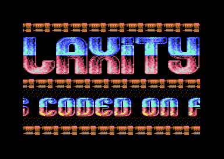
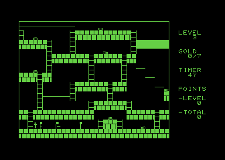
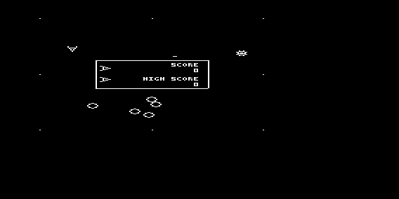
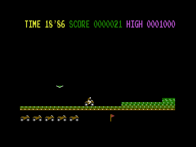
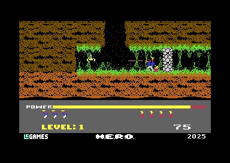
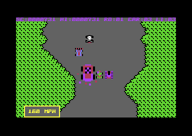

# Disassembly Examples

Regenerator 2000 generated these HTML disassemblies directly. They show the auto-analysis, layout parity, and styling features of the HTML exporter.

Review the following examples included in this project:

## Moving Tubes - Commodore 64

This example disassembles the [Moving Tubes][moving_tubes] intro by Laxity.

!!! example "Disassembly"

    * [🔗 c64_moving_tubes_lxt.html](examples/c64_moving_tubes_lxt.html)

Key highlights:

- Shows intermediate 6502 and C64 programming techniques.
- Contains well-structured assembly code.
- Documents a complete SID music player routine.
- Uses raster IRQ synchronization techniques.
- Includes specific 6502 optimizations:
    - Modifies `JMP` instructions into `BIT` opcodes through self-modifying code.
    - Uses `JSR` to call the immediately following instruction twice.
    - Synchronizes the background logo color with the SID music.
    - Uses a sine table to control scroll speed.
    - Renders variable-width characters in the text scroller.

Source details:

- CSDB: [Moving Tubes (Laxity Intro #145)][moving_tubes]
- [Unp64][unp64] unpacked the original compressed intro before disassembly.

[moving_tubes]: https://csdb.dk/release/?id=259330
[unp64]: https://csdb.dk/release/?id=260619

---

## Lode Runner - Commodore PET

This example disassembles the [Lode Runner][lode_runner_site] clone for the Commodore PET by jimbo.

!!! example "Disassembly"

    * 🔗 [pet_loderunner.html](examples/pet_loderunner.html)

Key highlights:

- Contains clean, readable 6502 assembly code.
- Shows standard Commodore PET programming patterns.

Source details:

- itch.io: [Lode Runner for the PET by jimbo][lode_runner_site]
- Because the original game binary is not packed, this example shows direct disassembly output without unpacking.

[lode_runner_site]: https://jimbo.itch.io/lode-runner-clone-for-commodore-pet

---

## Omega Race - VIC-20

This example disassembles the game [Omega Race][vic20_omega_race_info] for the VIC-20.

!!! example "Disassembly"

    * [🔗 vic20_omega_race_cart_generic_a000.html](examples/vic20_omega_race_cart_generic_a000.html)

Key highlights:

- Work in progress.

Source details:

- [Omega Race on VIC-20 Cartridges][vic20_omega_race_cart]

[vic20_omega_race_info]: https://en.wikipedia.org/wiki/Omega_Race
[vic20_omega_race_cart]: https://archive.org/download/Commodore_VIC20_TOSEC_2012_04_23/Commodore_VIC20_TOSEC_2012_04_23.zip/Commodore%20VIC20%20%5BTOSEC%5D%2FCommodore%20VIC20%20-%20Games%20-%20%5BCRT%5D%20%28TOSEC-v2011-12-15_CM%29%2FOmega%20Race%20%281982%29%28Commodore%29%5BA000%5D.zip

---

## Kikstart - Commodore Plus/4

This example disassembles the Commodore Plus/4 game [Kikstart][kikstart_info].

!!! example "Disassembly"

    * 🔗 [plus4_kikstart_8192.html](examples/plus4_kikstart_8192.html)

Key highlights:

- Work in progress.

Source details:

- [Kikstart on Plus/4 World][kikstart_info]

[kikstart_info]: http://plus4world.powweb.com/software/Kikstart

## H.E.R.O is Back! - Commodore 128

This example disassembles the Commodore 128 game [H.E.R.O is Back][hero_is_back_info] by LC Games.

!!! example "Disassembly"

    * 🔗 [c128_hero_is_back.html](examples/c128_hero_is_back.html)

Key highlights:

- Work in progress.

Source details:

- [H.E.R.O Is Back Webpage][hero_is_back_info]

[hero_is_back_info]: https://lowcarb.itch.io/hero-is-back-c64

---

## Burnin' Rubber - Commodore 64

This example disassembles the Commodore 64 game ["Burnin' Rubber"][burnin_rubber_info].

!!! example "Disassembly"

    * 🔗 [c64_burnin_rubber.html](examples/c64_burnin_rubber.html)

Key highlights:

- The developer wrote the code in a machine code [monitor][monitor] rather than an assembler:
    - The binary contains unused code and data tables, which often remain when developers edit memory directly in a [monitor].
    - Address `$2C00` contains the `.T0400,07FF,2C00` [monitor] command [in the binary][c64_burnin_rubber_monitor_cmd]. This command copies bytes `$0400`–`$07FF` (screen RAM) to `$2C00`.
    - Subroutines split across non-contiguous memory regions and connect with `JMP` instructions.
    - Several functions start with three `NOP` bytes that overwrite former `JSR` debug calls.
    - Instructions access zero-page variables with 3-byte absolute addressing (for example, `LDA $00F2` as `AD F2 00` instead of `A5 F2`).
    - The main loop splits across multiple memory locations.
- Shows how developers wrote early C64 games with a [monitor] and [paper notes][chardef_scan].

Source details:

- TAP file: [Burnin' Rubber.tap][burnin_rubber_tap]
- The binary comes from the original encrypted TAP image.
- The single disassembly file combines the decrypted main program and part of the loader code.
- Unused portions of the encrypted loader remain in the binary image.
- Start the program with `SYS 4752`.

[burnin_rubber_tap]: https://archive.org/download/Ultimate_Tape_Archive_V5/Ultimate_Tape_Archive_V5.zip/Ultimate_Tape_Archive_V5.0%2FBurnin%27_Rubber_%281983_Audiogenic_Ltd.%29_%5B5346%5D%2FBurnin%27_Rubber.tap
[burnin_rubber_info]: https://www.c64-wiki.com/wiki/Burnin_Rubber
[monitor]: https://www.c64-wiki.com/wiki/Machine_Code_Monitor
[c64_burnin_rubber_monitor_cmd]: examples/c64_burnin_rubber.html#L2BE0
[chardef_scan]: https://github.com/ricardoquesada/c64-c128-erasoft/blob/master/scans/chardef.pdf
