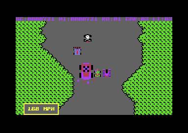
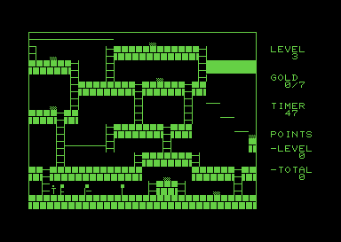
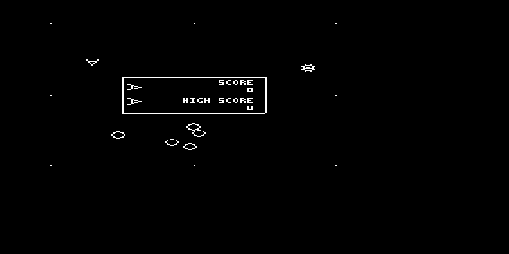

# Disassembly Examples

Every `.html` disassembly below was exported straight from a `.regen2000proj` file with zero post-editing—open any showcase to explore clickable cross-references, custom enums, comments, and theme switching in your browser.

| Title | System | Memory Range | Annotations | Export |
| :--- | :--- | :--- | :--- | :--- |
| [Frogger (8K Cartridge)](#frogger-8k-cartridge) | Commodore 64 | `$8000–$9FF9` (4,375 rows) | 568 labels · 9 enums | [HTML](examples/c64_frogger_8k.html) |
| [Moving Tubes](#moving-tubes) | Commodore 64 | `$0800–$301B` (2,842 rows) | 301 labels · 1 enum | [HTML](examples/c64_moving_tubes_lxt.html) |
| [Burnin' Rubber](#burnin-rubber) | Commodore 64 | `$1000–$BFF8` (6,877 rows) | 429 labels · 1 enum | [HTML](examples/c64_burnin_rubber.html) |
| [H.E.R.O. Is Back!](#hero-is-back) | Commodore 128 | `$1C01–$8C37` (11,818 rows) | 690 labels · 3 enums | [HTML](examples/c128_hero_is_back.html) |
| [Lode Runner](#lode-runner) | Commodore PET 4.0 | `$0401–$6700` (8,133 rows) | 480 labels · 1,155 comments | [HTML](examples/pet_loderunner.html) |
| [Omega Race](#omega-race) | Commodore VIC-20 | `$A000–$BFED` (4,119 rows) | 309 labels · 2 enums | [HTML](examples/vic20_omega_race_cart_generic_a000.html) |
| [Kikstart](#kikstart) | Commodore Plus/4 | `$1000–$3FF8` (4,223 rows) | 273 labels · 1 enum | [HTML](examples/plus4_kikstart_8192.html) |

---

## Commodore 64

### Frogger (8K Cartridge)

[{ width="520" loading=lazy }](examples/c64_frogger_8k.html)

/// caption
Parker Brothers' 1983 cartridge port of [Frogger](https://www.c64-wiki.com/wiki/Frogger_%28Parker_Brothers%29).
///

- :material-chip: **System:** Commodore 64 (8K Cartridge) · **Assembler:** `64tass`
- :material-memory: **Range:** `$8000–$9FF9` (4,375 rows) · **Annotations:** 568 labels · 9 enums
- :material-link-variant: **Source:** [TOSEC Commodore C64 Collection](https://archive.org/details/tosec-20161111-commodore-c64)

[:material-file-code-outline: Open HTML Disassembly](examples/c64_frogger_8k.html){ .md-button .md-button--primary }
[:material-github: Project (.regen2000proj)](https://github.com/ricardoquesada/regenerator2000/blob/main/examples/c64_frogger_8k.regen2000proj){ .md-button }

### Moving Tubes

[{ width="520" loading=lazy }](examples/c64_moving_tubes_lxt.html)

/// caption
Classic C64 demoscene intro [Moving Tubes](https://csdb.dk/release/?id=259330) by Laxity.
///

- :material-chip: **System:** Commodore 64 (Unpacked PRG) · **Assembler:** `64tass`
- :material-memory: **Range:** `$0800–$301B` (2,842 rows) · **Annotations:** 301 labels · 1 enum
- :material-link-variant: **Source:** [CSDb — Moving Tubes](https://csdb.dk/release/?id=259330) (unpacked with [Unp64](https://csdb.dk/release/?id=260619))

[:material-file-code-outline: Open HTML Disassembly](examples/c64_moving_tubes_lxt.html){ .md-button .md-button--primary }
[:material-github: Project (.regen2000proj)](https://github.com/ricardoquesada/regenerator2000/blob/main/examples/c64_moving_tubes_lxt.regen2000proj){ .md-button }

### Burnin' Rubber

[{ width="520" loading=lazy }](examples/c64_burnin_rubber.html)

/// caption
1983 C64 arcade racer [Burnin' Rubber](https://www.c64-wiki.com/wiki/Burnin_Rubber).
///

- :material-chip: **System:** Commodore 64 (`SYS 4752`) · **Assembler:** `64tass`
- :material-memory: **Range:** `$1000–$BFF8` (6,877 rows) · **Annotations:** 429 labels · 1 enum
- :material-link-variant: **Source:** [Ultimate Tape Archive — Burnin' Rubber.tap](https://archive.org/download/Ultimate_Tape_Archive_V5/Ultimate_Tape_Archive_V5.zip/Ultimate_Tape_Archive_V5.0%2FBurnin%27_Rubber_%281983_Audiogenic_Ltd.%29_%5B5346%5D%2FBurnin%27_Rubber.tap)

[:material-file-code-outline: Open HTML Disassembly](examples/c64_burnin_rubber.html){ .md-button .md-button--primary }
[:material-github: Project (.regen2000proj)](https://github.com/ricardoquesada/regenerator2000/blob/main/examples/c64_burnin_rubber.regen2000proj){ .md-button }

---

## Commodore 128

### H.E.R.O. Is Back!

[{ width="520" loading=lazy }](examples/c128_hero_is_back.html)

/// caption
Commodore 128 homebrew game [H.E.R.O. Is Back!](https://lowcarb.itch.io/hero-is-back-c64) by LC Games.
///

- :material-chip: **System:** Commodore 128 · **Assembler:** `64tass`
- :material-memory: **Range:** `$1C01–$8C37` (11,818 rows) · **Annotations:** 690 labels · 3 enums
- :material-link-variant: **Source:** [H.E.R.O. Is Back by LC Games (itch.io)](https://lowcarb.itch.io/hero-is-back-c64)

[:material-file-code-outline: Open HTML Disassembly](examples/c128_hero_is_back.html){ .md-button .md-button--primary }
[:material-github: Project (.regen2000proj)](https://github.com/ricardoquesada/regenerator2000/blob/main/examples/c128_hero_is_back.regen2000proj){ .md-button }

---

## Commodore PET

### Lode Runner

[{ width="520" loading=lazy }](examples/pet_loderunner.html)

/// caption
Commodore PET clone of [Lode Runner](https://jimbo.itch.io/lode-runner-clone-for-commodore-pet) by jimbo.
///

- :material-chip: **System:** Commodore PET 4.0 · **Assembler:** `64tass`
- :material-memory: **Range:** `$0401–$6700` (8,133 rows) · **Annotations:** 480 labels · 1,155 comments
- :material-link-variant: **Source:** [Lode Runner for the PET by jimbo (itch.io)](https://jimbo.itch.io/lode-runner-clone-for-commodore-pet)

[:material-file-code-outline: Open HTML Disassembly](examples/pet_loderunner.html){ .md-button .md-button--primary }
[:material-github: Project (.regen2000proj)](https://github.com/ricardoquesada/regenerator2000/blob/main/examples/pet_loderunner.regen2000proj){ .md-button }

---

## Commodore VIC-20

### Omega Race

[{ width="520" loading=lazy }](examples/vic20_omega_race_cart_generic_a000.html)

/// caption
Commodore's 1982 VIC-20 cartridge port of [Omega Race](https://en.wikipedia.org/wiki/Omega_Race).
///

- :material-chip: **System:** Commodore VIC-20 (8K Cartridge) · **Assembler:** `64tass`
- :material-memory: **Range:** `$A000–$BFED` (4,119 rows) · **Annotations:** 309 labels · 2 enums
- :material-link-variant: **Source:** [TOSEC VIC-20 Cartridges Archive](https://archive.org/download/Commodore_VIC20_TOSEC_2012_04_23/Commodore_VIC20_TOSEC_2012_04_23.zip/Commodore%20VIC20%20%5BTOSEC%5D%2FCommodore%20VIC20%20-%20Games%20-%20%5BCRT%5D%20%28TOSEC-v2011-12-15_CM%29%2FOmega%20Race%20%281982%29%28Commodore%29%5BA000%5D.zip)

[:material-file-code-outline: Open HTML Disassembly](examples/vic20_omega_race_cart_generic_a000.html){ .md-button .md-button--primary }
[:material-github: Project (.regen2000proj)](https://github.com/ricardoquesada/regenerator2000/blob/main/examples/vic20_omega_race_cart_generic_a000.regen2000proj){ .md-button }

---

## Commodore Plus/4

### Kikstart

[{ width="520" loading=lazy }](examples/plus4_kikstart_8192.html)

/// caption
Commodore Plus/4 motorcycle stunt game [Kikstart](http://plus4world.powweb.com/software/Kikstart).
///

- :material-chip: **System:** Commodore Plus/4 (TED) · **Assembler:** `64tass`
- :material-memory: **Range:** `$1000–$3FF8` (4,223 rows) · **Annotations:** 273 labels · 1 enum
- :material-link-variant: **Source:** [Kikstart on Plus/4 World](http://plus4world.powweb.com/software/Kikstart)

[:material-file-code-outline: Open HTML Disassembly](examples/plus4_kikstart_8192.html){ .md-button .md-button--primary }
[:material-github: Project (.regen2000proj)](https://github.com/ricardoquesada/regenerator2000/blob/main/examples/plus4_kikstart_8192.regen2000proj){ .md-button }

---

## Export Your Own Disassembly

Export any Regenerator 2000 project as a self-contained HTML disassembly:

**Interactive TUI**
:   Select **File → Export → HTML** in the menu bar.

**Headless CLI**
:   Run `regenerator2000 --headless --export_html output.html your_project.regen2000proj`.
