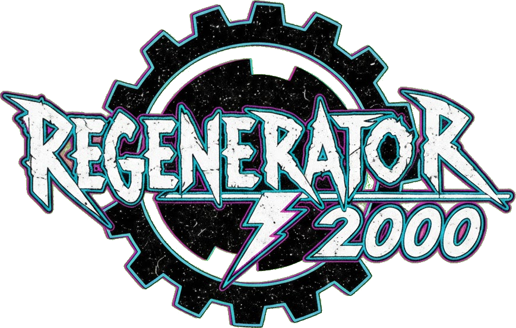
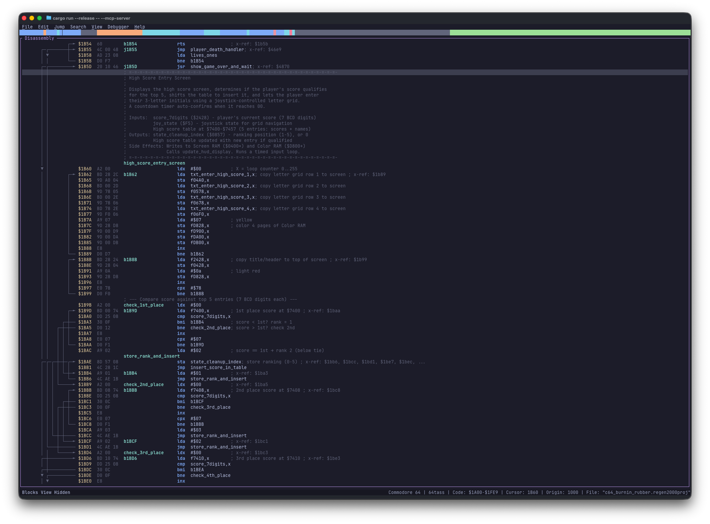
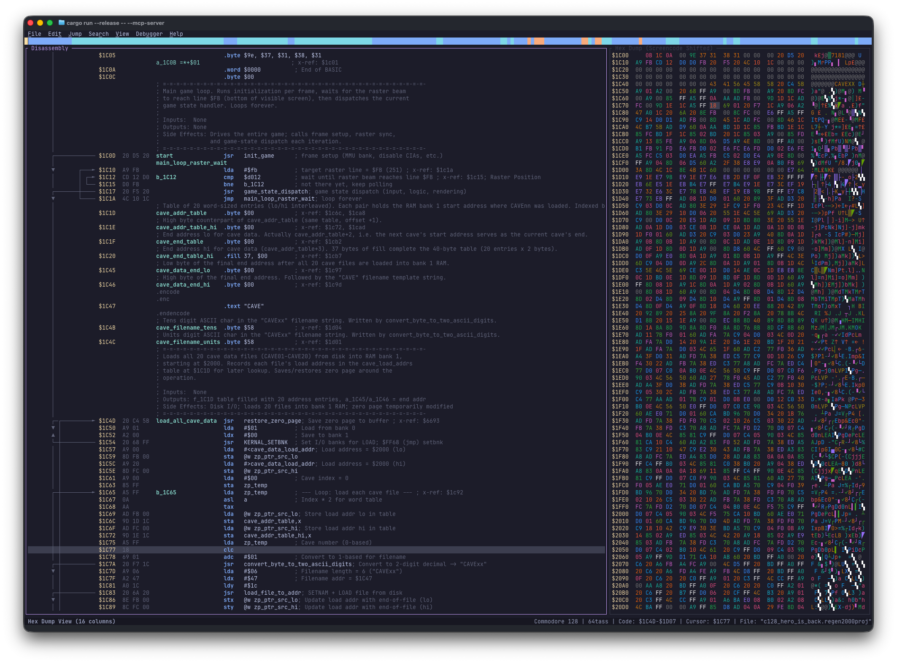
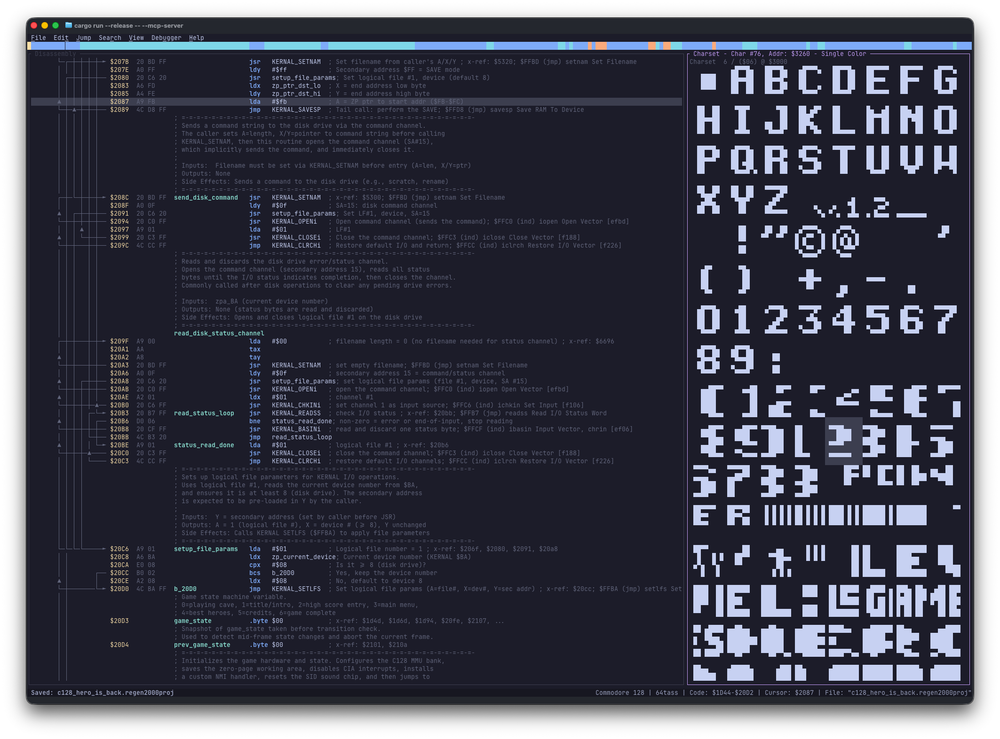
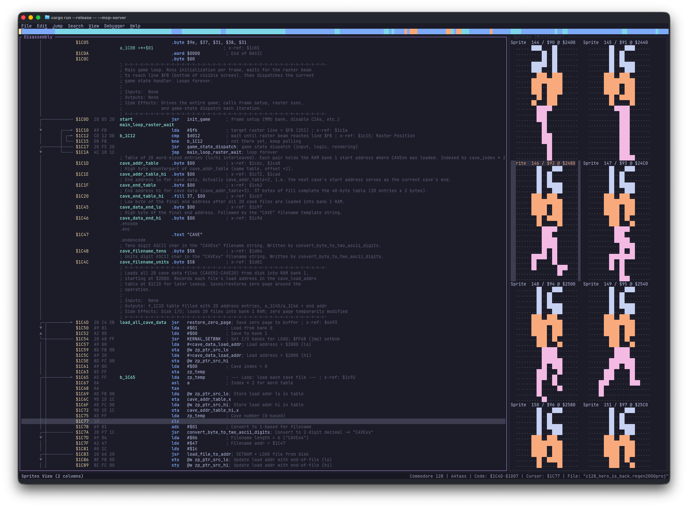
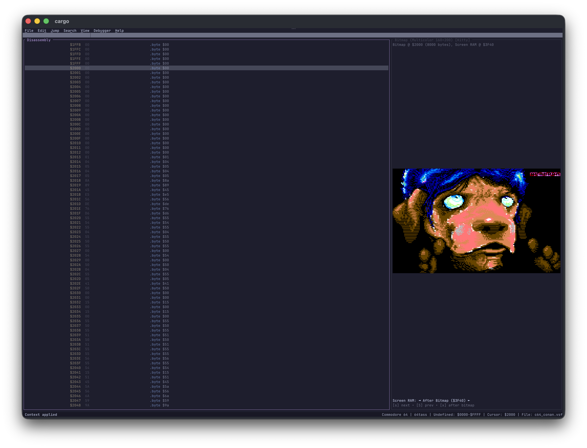
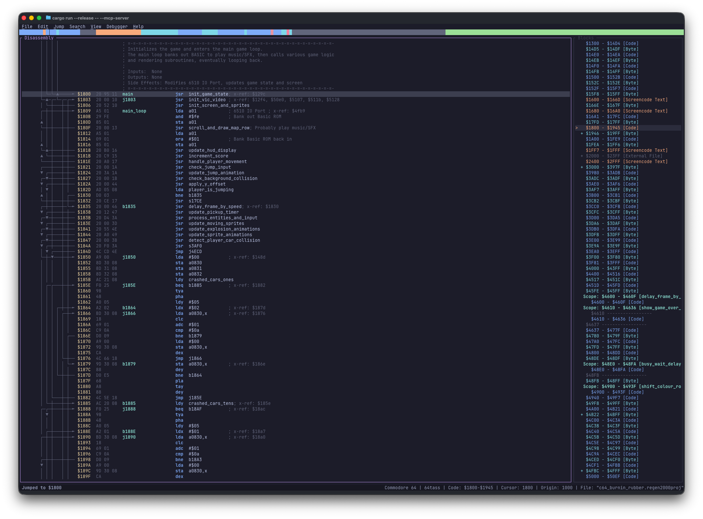
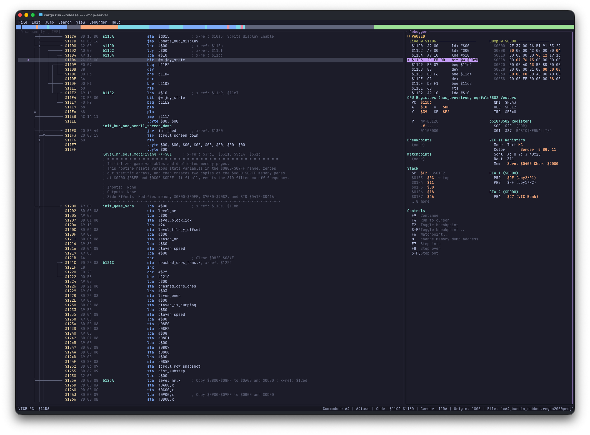
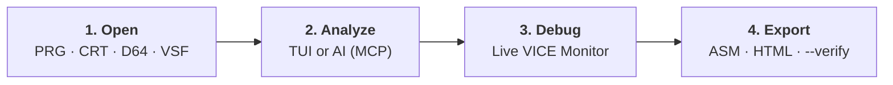

# Regenerator 2000

{ width="560" }

/// caption
Interactive 6502 disassembler for Commodore 8-bit systems — keyboard-first, non-destructive, and AI-ready.
///

[:material-download: Install & Quick Start](install.md){ .md-button .md-button--primary }
[:material-compass-outline: Guided Tutorial](tutorial.md){ .md-button }
[:material-file-code-outline: Live HTML Examples](examples.md){ .md-button }

Regenerator 2000 is built around two complementary ways to reverse engineer a binary—use either on its own, or run an AI pass first and refine the results by hand:

:material-keyboard-outline: **Manual Analysis**
:   Navigate code and data with single-key shortcuts, Vim motions, or mouse clicks. Every edit pushes to a persistent undo stack so you can reclassify blocks, rename labels, and inspect graphics safely.

:material-robot-outline: **Automated Analysis**
:   Connect Claude Code, Antigravity, or any MCP client to the built-in [MCP Server](mcp.md) and [agent skills](https://github.com/ricardoquesada/regenerator2000/tree/main/.agent/skills) to decode BASIC stubs, partition blocks, trace routines, and document variables automatically.

---

## Inside the Workspace

Inspect code, raw memory, graphics, and live execution side by side across seven views (see [Views](views.md) for every shortcut):

=== "Disassembly"

    Navigate decoded 6502 instructions, follow branch arrows, inspect inline X-Refs, and rename labels in place.

    

=== "Hexdump"

    Spot patterns, padding, and strings with a byte-value color palette and live PETSCII / Screencode decoding.

    { loading=lazy }

=== "Character Set"

    Scan memory as 8×8 character tiles in standard high-res or multicolor mode to uncover custom fonts.

    { loading=lazy }

=== "Sprites"

    Browse 64-byte chunks as 24×21 hardware sprites in single-color or multicolor mode and mark them directly.

    { loading=lazy }

=== "Bitmap"

    Preview full-screen 320×200 or 160×200 bitmaps with selectable Screen RAM overlays and terminal pixel graphics.

    { loading=lazy }

=== "Blocks"

    See the macro layout of Code, Data, Undefined regions, Scopes, and Splitters at a glance.

    { loading=lazy }

=== "Debugger"

    Attach to VICE over the binary monitor to inspect registers, stack, hardware chips, and step live code.

    { loading=lazy }

---

## At a Glance

| Capability | What It Gives You |
| :--- | :--- |
| :material-chip: **Full 6502 + Undocumented Opcodes** | Disassembles standard and illegal 6502 instructions for C64, C128, VIC-20, Plus/4, C16, PET, and 1541. |
| :material-graph-outline: **Auto-Analysis & Typed X-Refs** | Traces reachable code, names targets by addressing mode (`s_`, `j_`, `b_`), and tags every caller (`[R]`, `[W]`, `[C]`, `[J]`). |
| :material-undo-variant: **Persistent Undo / Redo** | Records every block, label, comment, scope, and enum change in `.regen2000proj` project files. |
| :material-tag-multiple-outline: **Labels, Scopes & Enums** | Isolates local labels inside lexical scopes and replaces magic numbers with system, global, or project enum constants. |
| :material-package-up: **Built-in 6502 Binary Unpacker** | Emulates 26+ packer families (and custom stubs) in a sandboxed 6502 CPU to extract packed PRG binaries automatically. |
| :material-bug-outline: **Live VICE Debugger** | Sets breakpoints and watchpoints, steps instructions, and highlights changed registers, stack entries, and chip state. |
| :material-robot-outline: **MCP Server & Skills** | Exposes 29 structured tools over HTTP/SSE or stdio so AI agents can analyze routines alongside the live TUI. |
| :material-palette-outline: **9 Built-in Themes** | Ships with Dracula, Solarized, Gruvbox, Monokai, Nord, and Catppuccin, plus TOML overrides for custom palettes. |
| :material-export-variant: **Roundtrip ASM & HTML Export** | Exports clean source for **64tass**, **ACME**, **KickAssembler**, and **ca65** (with `--verify` byte-identical checks) plus interactive HTML. |

---

## Quick Start

1. **Install** Regenerator 2000:

    === "Cargo (Crates.io)"

        ```bash
        cargo install regenerator2000
        ```

    === "Pre-compiled Binary"

        Download the archive for Linux, macOS, or Windows from the [latest GitHub Release](https://github.com/ricardoquesada/regenerator2000/releases/latest) and place `regenerator2000` in your `PATH`.

2. **Open a binary** (`.prg`, `.crt`, `.d64`, `.d71`, `.d81`, `.t64`, `.vsf`, `.dis65`, or raw `.bin`):

    ```bash
    regenerator2000 my_game.prg # (1)!
    ```

    1. For raw binaries without headers, the **Import Context** dialog opens first so you can set the target system, origin address, and entry point. If entropy or packer signatures trigger, `< Unpack >` is pre-selected.

3. **Start classifying** with five core keys:

    | Key | Action |
    | :--- | :--- |
    | ++d++ | Disassemble reachable code from the cursor |
    | ++b++ | Mark the current byte or Visual selection (++shift+v++) as data bytes |
    | ++l++ | Rename the label under the cursor |
    | ++semicolon++ | Add an inline side comment (++colon++ adds a line comment above) |
    | ++enter++ | Jump to an operand target (++backspace++ jumps back) |

---

## Typical Workflow

Reverse engineering is iterative—classify a region, follow a branch, label what you learn, and verify or export when ready:



Ready for a full hands-on walkthrough? Head to the [Guided Tutorial](tutorial.md).
