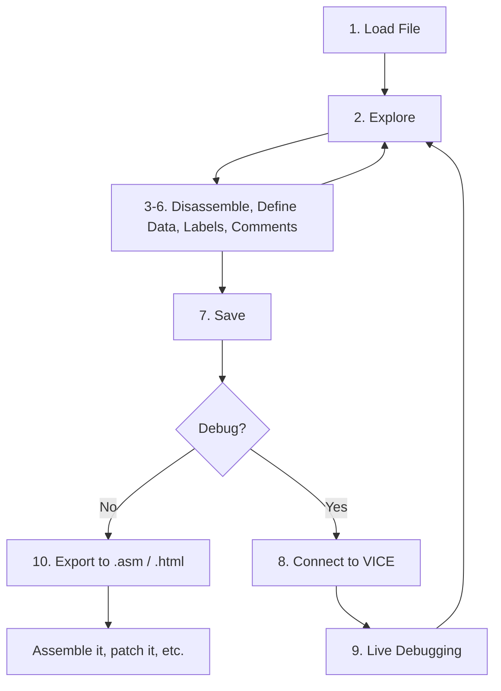

# Regenerator 2000

<p align="center">
  
</p>

# The Modern 6502 Disassembler

**Regenerator 2000** is an interactive disassembler for the Commodore 64 and other 6502-based systems. It supports two primary workflows:

- **🕹️ Manual Analysis** — Use the keyboard-centric terminal interface to navigate code, define data regions, label subroutines, add comments, and refine your disassembly.
- **🤖 Automated Analysis** — Use the built-in [MCP Server](mcp.md) and [skills](https://github.com/ricardoquesada/regenerator2000/tree/main/.agent/skills) so AI assistants classify blocks, trace routines, and name symbols automatically.

Use either workflow independently, or combine them. Run an initial pass with the AI, and then refine the results interactively.

---

## Views Overview

Inspect your binary through specialized views:

=== "Disassembly"

    **The Code View**: Navigate and disassemble code, follow jumps, and manage labels.

    

=== "Hexdump"

    **The Data View**: Inspect raw memory to identify patterns in data and tables.

    

=== "Character Set"

    **Character Graphics**: Inspect 8x8 character data directly in the terminal.

    

=== "Sprites"

    **Sprite Viewer**: Inspect 24x21 hardware sprites in single-color or multicolor mode.

    

=== "Bitmap"

    **Bitmap Mode**: Render memory as a high-resolution or multicolor bitmap.

    

=== "Blocks"

    **Structure Analysis**: Inspect how Regenerator 2000 segments the binary into code and data blocks.

    

=== "Debugger"

    **Live Debugging**: Connect to VICE to inspect registers, memory, and breakpoints, and step through code.

    

---

## Key Features

- **🚀 6502 & Undocumented Opcodes**: Supports the full 6502 instruction set and undocumented opcodes.
- **⚡ Fast TUI**: Uses Rust to deliver responsive terminal rendering.
- **🧠 Analysis**: Creates labels and cross-reference comments automatically.
- **⏪ Undo/Redo**: Reverts or reapplies any editing action.
- **🏷️ Labels & Comments**: Renames subroutines and variables to improve readability.
- **📂 Scopes**: Organizes code into lexical namespaces.
- **🔢 Enums**: Defines and applies System, Global, and Project value-to-name mappings to replace numeric literals with semantic names.
- **📦 Binary Unpacker**: Emulates a cycle-accurate 6502 sandbox to unpack compressed programs automatically.
- **🎨 Custom Themes**: Customizes interface colors with TOML theme files.
- **🐛 VICE Debugger Integration**: Connects to a running VICE emulator to step through code, inspect registers, and set breakpoints or watchpoints.
- **🤖 MCP Integration**: Connects AI assistants to the disassembler for automated analysis.
- **💾 Project Saving**: Saves project state to disk so you can resume work later.
- **📤 Export**: Generates assembly code for multiple assemblers, or exports HTML files with clickable cross-references.

## Quick Start

1. **Install**:

    ```bash
    cargo install regenerator2000
    ```

2. **Run**:

    ```bash
    regenerator2000 my_game.prg
    ```

    When you import a new binary, use the **Import Context** dialog to configure the System, Origin, and Entry Point.

3. **Explore**:

    - **Move**: Use the arrow keys, mini map, or jump commands.
    - **Disassemble**: Press ++d++ to convert bytes to code.
    - **Define Data**: Press ++b++ to convert regions to data bytes.
    - **Comment**: Press ++semicolon++ to add a side comment.
    - **Rename**: Press ++l++ to rename a label.

[Get Started Now](install.md){ .md-button .md-button--primary }

---

## Documentation

- **[Installation & Usage](install.md)**: Install and run Regenerator 2000.
- **[Views](views.md)**: Learn about each interface view.
- **[Analysis](analysis.md)**: Understand the auto-analyzer and label prefixes.
- **[Enums](enums.md)**: Replace numeric literals with named constants.
- **[Binary Unpacker](unpacker.md)**: Decompress packed binaries automatically.
- **[Keyboard Shortcuts](keyboard_shortcuts.md)**: Review all keyboard controls.
- **[Debugger (VICE)](debugger.md)**: Connect to VICE for live debugging.
- **[MCP Integration](mcp.md)**: Connect AI agents to Regenerator 2000.

## Tutorial

A standard workflow loads a file, identifies code and data regions, adds labels, and refines the disassembly iteratively.



Read the [full tutorial](tutorial.md) for a complete step-by-step walkthrough.
