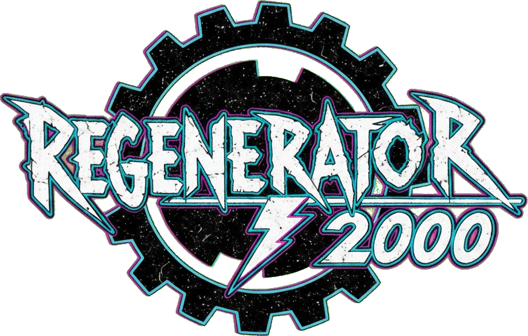
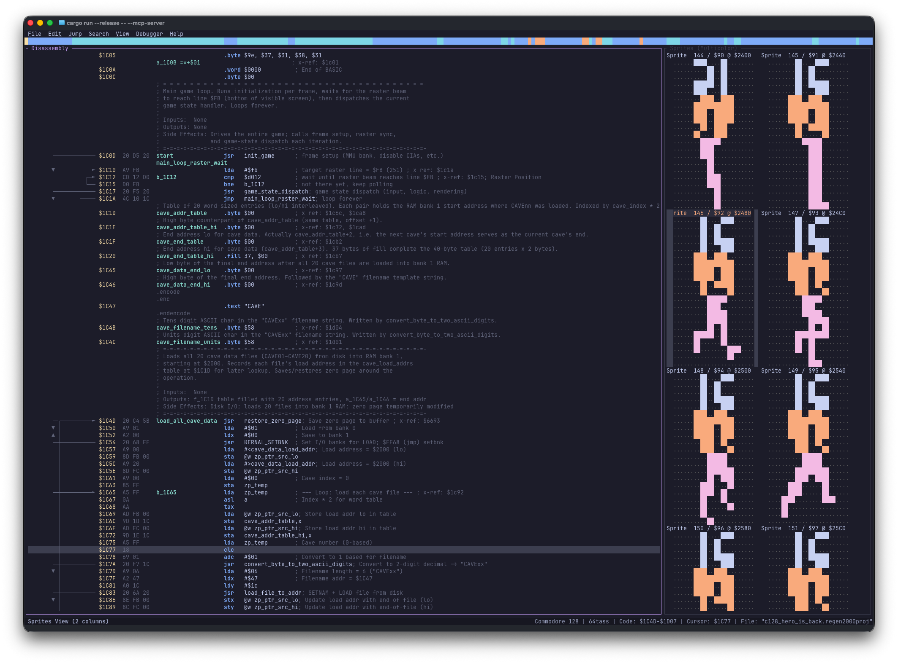
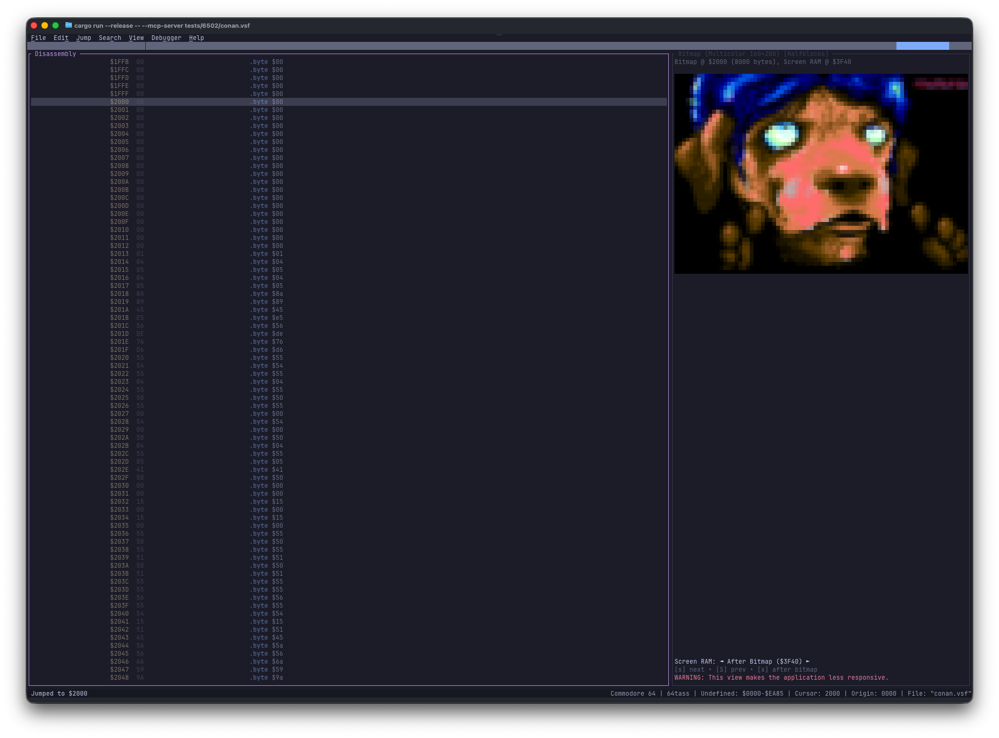
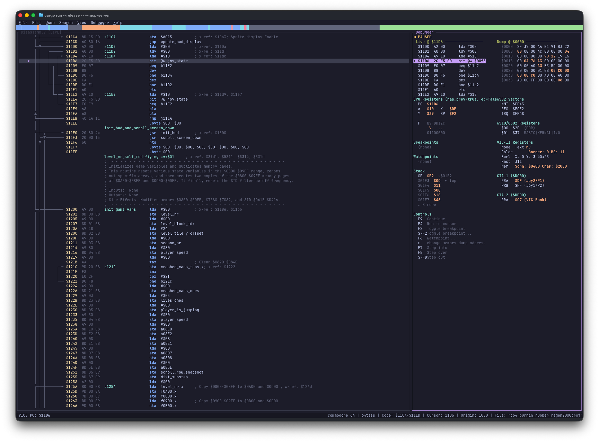

<!-- alignment: center -->



<!-- alignment: left -->

<!-- column_layout: [1, 1] -->

<!-- column: 0 -->
### Heritage & Mission
- Inspired by Tom-Cat / Nostalgia's classic **Regenerator**
- Built from scratch in **Rust** as a native, cross-platform TUI
- Full **MOS 6502** instruction set + **undocumented opcodes** (`lax`, `sax`, `dcp`, `isc`, `slo`, `rla`...)

<!-- column: 1 -->
### Commodore 8-Bit Ecosystem
- **Machines**: C64, C128, VIC-20, Plus/4, C16, PET (2.0/4.0), 1541/1571/1581
- **Formats**: `.prg`, `.d64`/`.d71`/`.d81`, `.t64`, `.crt`, `.vsf` (VICE snapshots), `.dis65` (6502bench), `.raw`

<!-- reset_layout -->

<!-- speaker_note:
Welcome everyone! Today I'm excited to show you Regenerator 2000 — an interactive 6502 disassembler built specifically for the Commodore 8-bit scene.
If you've ever used Tom-Cat's original Regenerator on Windows, you know how great interactive disassembly feels. Regenerator 2000 takes that spirit and brings it natively to Linux, macOS, and Windows terminals with modern superpowers.
I'll spend just 5 minutes on slides covering the core highlights, and then we'll jump straight into a 20-minute live reverse-engineering session.
-->

---

# Core Pillars: Blazing Speed & Keyboard Mastery

<!-- column_layout: [1, 1] -->

<!-- column: 0 -->
### ⚡ Extremely Fast
- **Instant Startup (`< 10 ms`)**
  - Native Rust binary (`ratatui` + `crossterm`)
  - Zero Electron, WebView, or JVM overhead
- **Zero-Latency Navigation**
  - Smooth 60+ fps scrolling through full 64 KB snapshots
- **Instant Flow & X-Ref Re-Analysis**
  - Real-time typed cross-references (`Call`, `Jump`, `Read`, `Write`, `RMW`)
  - Full **Undo / Redo** history (`u` / `Ctrl+R`) for every action

<!-- column: 1 -->
### ⌨️ Keyboard-First (Mouse-Friendly)
- **Single-Key Mnemonics**
  - Designed for uninterrupted reverse-engineering flow state
- **Vim-Style Ergonomics**
  - `j` / `k` cursor movement, `/` search, `Shift+V` visual selection
- **Instant Control-Flow Surfing**
  - `Enter` jumps into any target/pointer; `Backspace` pops back
- **Pragmatic Mouse Support**
  - Click the **Minimap bar** to teleport, scroll wheels, drag selections, and click menus (`F10`)

<!-- reset_layout -->

<!-- speaker_note:
Two things define the daily experience in Regenerator 2000:
First, it is *fast*. It launches instantaneously, and every time you reclassify a block or table, cross-references and flow arrows recompute in microseconds. And because every edit is a command on an undo stack, you can experiment fearlessly and press 'u' to undo.
Second, it is unapologetically keyboard-driven. Your hands never have to leave the home row—though if you want to scroll with the mouse wheel or click the minimap bar at the top, the mouse works right out of the box too.
-->

---

# The Single-Key Disassembly Workflow

<!-- column_layout: [5, 4] -->

<!-- column: 0 -->
| Key | Action |
| :--- | :--- |
| `c` / `d` | Convert to **Code** / **Disassemble** flow |
| `b` / `w` / `a` | **Byte** / **Word** / **Address** (pointer) |
| `p` / `s` | **PETSCII** / **Screencode** text |
| `<` / `>` | **Lo/Hi** or **Hi/Lo** split address tables |
| `[` / `]` | Link `#<label` / `#>label` immediate pairs |
| `l` | Set / rename **Label** (`s_`, `j_`, `b_`, `p_`) |
| `;` / `:` | Add **Side Comment** / **Line Comment** |
| `i` / `e` | Cycle **Hex/Dec/Bin** / Apply **Enum** |
| `r` / `\|` | Lexical **Scope** / Toggle **Splitter** |
| `Enter` / `Bksp` | **Follow** operand / **Jump back** in history |

<!-- column: 1 -->
```ca65
; Before: raw unanalyzed bytes
.C000  A9 00     lda #$00
.C002  8D 20 D0  sta $d020
.C005  A2 14     ldx #$14
.C007  BD 10 C0  lda $c010,x

; After pressing: l, ;, <, [ and ]
init_irq:
    lda #<raster_irq    ; [ links Lo byte
    sta $0314           ; Hardware IRQ Lo
    lda #>raster_irq    ; ] links Hi byte
    sta $0315           ; Hardware IRQ Hi
    rts

; < formats split Lo/Hi jump tables:
irq_table_lo:
    .byte <stage_top, <stage_mid, <stage_bot
irq_table_hi:
    .byte >stage_top, >stage_mid, >stage_bot
```

<!-- reset_layout -->

<!-- speaker_note:
Here is why keyboard shortcuts make such a big difference on 6502 code.
6502 demos and games constantly use split Lo/Hi address tables and immediate #< and #> pointer loads because the CPU only has 8-bit index registers.
In Regenerator 2000, you highlight a split table, press '<', and it automatically pairs the low and high byte rows into symbolic label references. Press '[' and ']' on immediate loads, and it links them directly to the target subroutine.
-->

---

# 1. Synchronized Side-by-Side Views

Inspect code alongside live-decoded Commodore assets (`Alt+1` .. `Alt+5`, `Tab` to focus, `Enter` to sync):

<!-- column_layout: [1, 1] -->

<!-- column: 0 -->


- **Sprites (`Alt+3`)**: 24×21 hi-res & multicolor (`m`)
- **Hex Dump (`Alt+2`)**: Value-colored bytes + live PETSCII & Screencode decoding (`m`)
- **Blocks (`Alt+1`)**: Structural map of Code vs. Data

<!-- column: 1 -->


- **Bitmap (`Alt+5`)**: Full 320×200 hi-res & 160×200 multicolor rendered in-terminal
- **Charset (`Alt+4`)**: 8×8 single & multicolor fonts

<!-- reset_layout -->

<!-- speaker_note:
Reverse engineering a demo or game isn't just about instructions—it's about finding where the sprites, charsets, bitmaps, and scroll texts live in memory.
With Alt+1 through Alt+5, you open synchronized side-by-side views right next to your disassembly.
When you spot a sprite or font in the right pane, press Enter and your disassembly cursor jumps straight to that address so you can see every piece of code that reads or modifies it.
-->

---

# 2. Live VICE Debugger Integration

Connect directly to **VICE** (`x64sc -binarymonitor` + `--vice localhost:6502` or `Alt+6`):

<!-- column_layout: [4, 5] -->

<!-- column: 0 -->
### Live Machine State in Your Disassembler
- **CPU & Stack**: `A`, `X`, `Y`, `SP`, `P` flags, and top of stack
- **Hardware Registers**:
  - **C64/C128**: VIC-II, CIA 1 & 2, `$00`/`$01` PLA port
  - **VIC-20 / Plus/4**: VIC-I / TED registers
  - **Vectors**: `$FFFA` (NMI), `$FFFC` (RESET), `$FFFE` (IRQ)
- **Delta Highlighting**: Modified registers & bytes light up on every step
- **Controls**:
  - `F2` Breakpoint | `F6` Watchpoint | `m` Live RAM Dump
  - `F4` Run to Cursor | `F7` Step In | `F8` Step Over | `F9` Run

<!-- column: 1 -->


<!-- reset_layout -->

<!-- speaker_note:
Static analysis takes you far, but when a demo banks out KERNAL via $01, chains raster IRQs, or runs self-modifying speedcode, you want a live debugger.
Regenerator 2000 speaks VICE's native binary monitor protocol. You can set breakpoints with F2, watchpoints with F6, step with F7/F8, and watch VIC-II registers, CIA timers, $01 banking, and hardware IRQ vectors change in real time right alongside your commented disassembly.
-->

---

# 3. Multi-Assembler Export & Roundtrip Verification

Turn any binary back into **100% re-assemblable source code** (`Ctrl+E` or `--export_asm`):

<!-- column_layout: [1, 1] -->

<!-- column: 0 -->
### 4 First-Class Assembler Backends
- **64tass** (`--assembler 64tass`)
- **ACME** (`--assembler acme`)
- **KickAssembler** (`--assembler kick`)
- **ca65** (`--assembler ca65`)
- Plus standalone **HTML** export (`--export_html`) and **VICE Labels** (`--import_lbl` / `--export_lbl`)

<!-- column: 1 -->
### Zero-Trust Roundtrip (`--verify`)
```bash
$ regenerator2000 --verify intro.regen2000proj
```
1. Exports the project to `.asm` for each assembler
2. Runs the real assembler (`64tass`, `acme`, `kickass`, `cl65`)
3. Compares the output **byte-for-byte** against the original binary!

<!-- reset_layout -->

> **Why this matters**: You never have to guess if a label offset, undocumented opcode, or split table broke your build. If `--verify` passes, your exported `.asm` produces the exact same bytes.

<!-- speaker_note:
The ultimate test of a disassembler is: can I assemble the exported source file and get the exact same binary back byte-for-byte?
Regenerator 2000 supports the big four assemblers: 64tass, ACME, KickAssembler, and ca65.
Even better, pass the --verify flag and Regenerator 2000 will export your project, invoke the actual assemblers behind the scenes, and diff the generated binary against the original. Once it's green, you can immediately start modifying effects or porting the code.
-->

---

# 4. Built-in 6502 Emulation Unpacker

Demoscene releases are almost always crunched — Regenerator 2000 unpacks them **automatically on load**:

```
┌───────────────────────────┐    ┌───────────────────────────┐    ┌───────────────────────────┐
│  Phase 1: FindDepacker    │    │  Phase 2: Decompress      │    │  Extract & Disassemble    │
│  • Resolves BASIC SYS     │───▶│  • Cycle-accurate 6502    │───▶│  • Diffs RAM & write map  │
│  • Matches PackerSpec     │    │  • Tracks RAM write map   │    │  • Trims depacker stub    │
│  • Steps to decruncher    │    │  • Traps jump to payload  │    │  • Jump to unpacked entry │
└───────────────────────────┘    └───────────────────────────┘    └───────────────────────────┘
```

- **Inspired by iAN CooG's `unp64`**: Pure-Rust 2-phase 6502 + CIA + `$01` PLA banking sandbox
- **21+ Packers Supported Out of the Box**:
  - *Exomizer, Dali, ByteBoozer, TSCrunch, PuCrunch, CruelCrunch, TimeCruncher, Action Replay, MasterCompressor, MegaByte, ABCompactor, ECA...*
- **Provenance Tracking**: Reports exact unpacked bounds (`start_addr..=end_addr`) and real `entry_point`

<!-- speaker_note:
If you grab a .prg from CSDb, 9 times out of 10 it's packed with Exomizer, Dali, ByteBoozer, TSCrunch, or an old-school cruncher.
Instead of manually dumping memory in an emulator first, Regenerator 2000 has a built-in 2-phase 6502 emulation sandbox inspired by iAN CooG's unp64.
When you open a packed binary, it detects the cruncher, emulates the decruncher in milliseconds while tracking every RAM write, strips away the depacker workspace, and drops you right at the unpacked entry point.
-->

---

# Scripting, Headless CLI & Optional MCP Server

Built as a modular library (`regenerator2000-core`) + TUI (`regenerator2000-tui`):

<!-- column_layout: [1, 1] -->

<!-- column: 0 -->
### 🛠️ Headless CLI & Makefiles
Automate exports, label sync, and verification in your build scripts:
```bash
# Headless export to 64tass + VICE labels
regenerator2000 --headless \
  --assembler 64tass \
  --export_asm build/demo.asm \
  --export_lbl build/demo.lbl \
  project.regen2000proj
```

<!-- column: 1 -->
### 🔌 Local MCP Server (Optional)
Programmatic RPC access (`--mcp-server` / `--mcp-server-stdio`):
- Exposes disassembly, search, X-Ref, and block operations over a local socket
- Useful for custom scripts or **optional** AI-assisted chores (e.g., auto-commenting KERNAL calls or BASIC stubs)
- **100% Optional**: You stay in full control of the craft

<!-- reset_layout -->

<!-- speaker_note:
Finally, under the hood, all analysis and state logic lives in a clean core crate.
That means you can run Regenerator 2000 completely headlessly from a Makefile or script to export .asm and VICE label files.
It also includes an optional MCP server interface—so if you ever want to script bulk operations or offload repetitive chores like labeling standard KERNAL routines, the hooks are there, while keeping manual reverse-engineering front and center.
-->

---

# Live Demo Time! 🕹️

Let's take a real Commodore binary from raw bytes to clean, re-assemblable source:

1. **Load & Auto-Unpack** — Open a crunched binary / disk image and inspect the **Minimap** & **Blocks View** (`Alt+1`)
2. **Asset Hunting** — Find hidden **Sprites** (`Alt+3`), **Charsets** (`Alt+4`), **Bitmaps** (`Alt+5`), and **PETSCII/Screencodes** (`Alt+2`)
3. **Keyboard-First Disassembly** — Follow control flow (`Enter` / `Backspace`), format code/data (`c`, `b`, `w`, `p`, `s`), link split Lo/Hi tables (`<`, `>`, `[`, `]`), and label routines (`l`, `;`)
4. **Live VICE Debugging** — Connect to `x64sc -binarymonitor` (`Alt+6`), hit a raster IRQ breakpoint (`F2`), and inspect VIC-II / `$01` registers live
5. **Export & Verify** — Export to **64tass / KickAssembler** (`Ctrl+E`) and run `--verify` for a byte-identical rebuild!

<!-- alignment: center -->

**`cargo install regenerator2000`**
`https://github.com/ricardoquesada/regenerator2000`

<!-- speaker_note:
Enough slides—let's see it in action!
In the terminal next door, we're going to load a binary, unpack it, hunt down its graphics assets using the side-by-side views, dissect its IRQ routines with single-key shortcuts, hook up live VICE debugging, and export a byte-exact assembly file. Let's switch to the terminal!
-->
