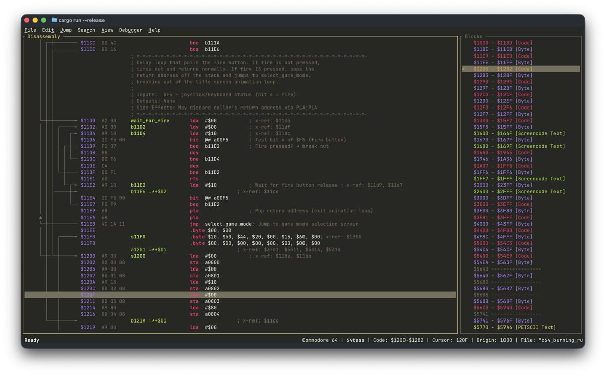
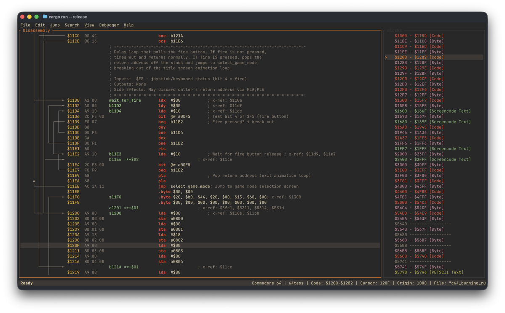
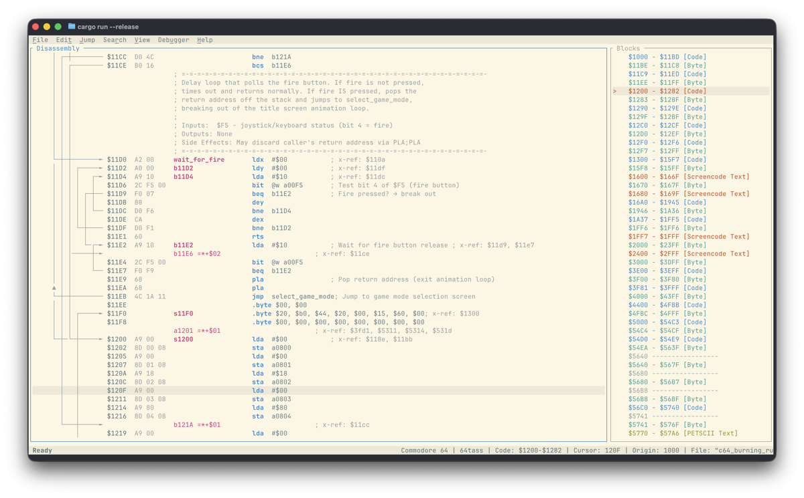
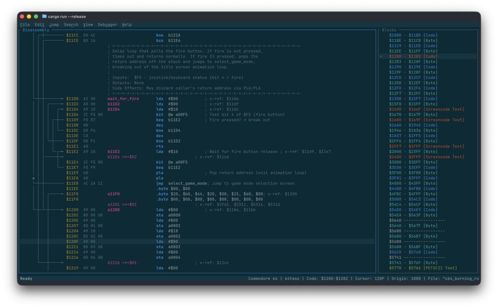
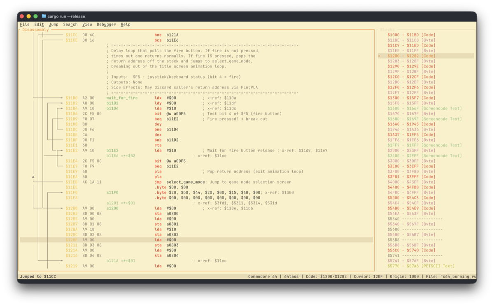
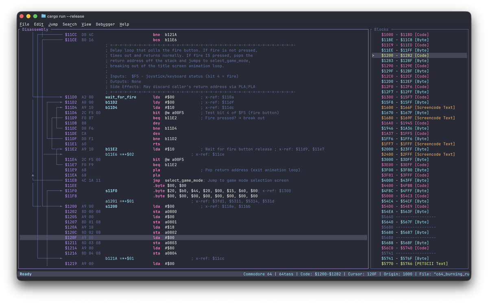
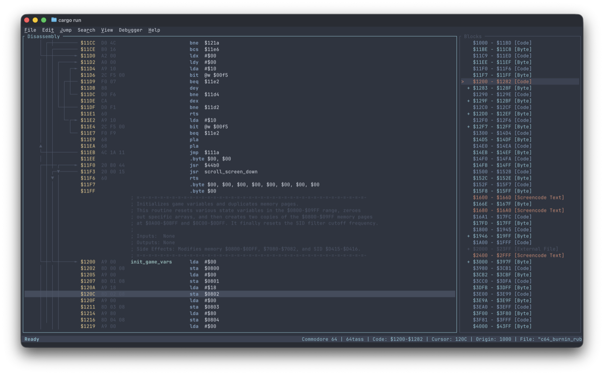
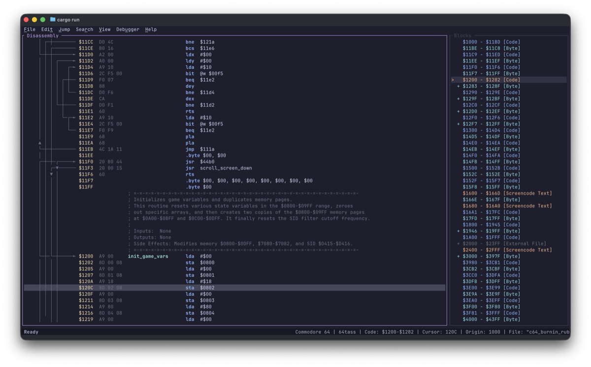
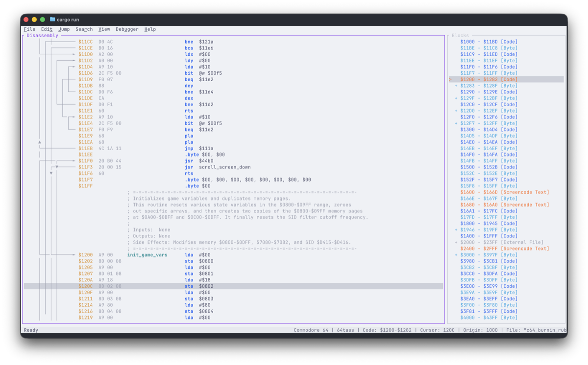

# Themes

Regenerator 2000 includes **9 built-in color themes**. Switch between them in **File → Settings** (++alt+p++ or ++ctrl+comma++) under the **Theme** option.

## Available Themes

=== "Dracula"

    **The default theme.** Uses a dark background with purple, pink, and cyan accent colors.

    

=== "Solarized Dark"

    Uses a low-contrast dark palette designed by Ethan Schoonover.

    

=== "Solarized Light"

    Uses the light variant of the Solarized palette for bright environments.

    

=== "Gruvbox Dark"

    Uses a dark palette with warm orange, yellow, and aqua tones.

    

=== "Gruvbox Light"

    Uses a warm light background with earthy accent colors.

    

=== "Monokai"

    Uses a dark background with high-contrast saturated accent colors.

    

=== "Nord"

    Uses a low-contrast dark palette with cool blue tones.

    

=== "Catppuccin Mocha"

    Uses a dark background with warm pastel accent colors.

    

=== "Catppuccin Latte"

    Uses a light background with pastel accent colors for daytime use.

    

## How to Change the Theme

1. Open **File → Settings** (++alt+p++ or ++ctrl+comma++).
2. Select the **Theme** option.
3. Change the theme with either method:
    - Press ++left++ or ++right++ to cycle through themes with a live preview.
    - Press ++enter++ to open the theme selector popup and choose from the list.
4. Select a theme and press ++enter++.

Regenerator 2000 saves the selected theme globally across sessions and projects.

!!! tip

    All themes use 24-bit RGB true color. Use a terminal with true-color support for accurate rendering. See [Recommended Terminals](install.md#recommended-terminals).

## Custom Themes

Place a `theme-*.toml` file in the application configuration directory to create a custom theme or override a built-in theme.

### Config Directory Location

| Platform    | Config directory                                          |
|:------------|:----------------------------------------------------------|
| **macOS**   | `~/Library/Application Support/regenerator2000/`          |
| **Linux**   | `~/.config/regenerator2000/`                              |
| **Windows** | `C:\Users\<User>\AppData\Roaming\regenerator2000\config\` |

### Getting Started

Start from the built-in theme files to create a custom theme:

1. **Dump** all built-in themes to the configuration directory:

    ```bash
    # macOS
    regenerator2000 --dump-theme-files ~/Library/Application\ Support/regenerator2000/

    # Linux
    regenerator2000 --dump-theme-files ~/.config/regenerator2000/

    # Windows (PowerShell)
    regenerator2000.exe --dump-theme-files $env:APPDATA\regenerator2000\config\
    ```

    This command writes every `theme-*.toml` file to the destination folder and exits.

2. **Edit** an existing file or create a new file (for example, `theme-green_screen.toml`):

    ```toml
    name = "Green Screen"
    base = "Solarized Dark"
    background = "#003300"
    foreground = "#33FF33"
    border_active = "#33FF33"
    border_inactive = "#116611"
    ```

3. **Start** Regenerator 2000. Your custom theme appears in **Settings → Theme**.

### How It Works

- Name each theme file `theme-<name>.toml` (for example, `theme-green_screen.toml`).
- Set the `name` field to the display name shown in the theme selector.
- Set the optional `base` field to inherit unspecified colors from a built-in theme (defaults to `"Solarized Dark"`).
- If a custom theme uses the **same name** as a built-in theme, it replaces the built-in theme.
- Format all colors as hexadecimal strings: `"#RRGGBB"`.

!!! tip

    Define **partial themes** that override only the colors you want to change and inherit the remaining colors from a `base` theme.

### TOML Schema Reference

Every `theme-*.toml` file supports these top-level keys:

| Field               | Type             | Description                                                                 |
|:--------------------|:-----------------|:----------------------------------------------------------------------------|
| `name`              | string           | **Required.** Unique display name in the theme selector.                    |
| `base`              | string           | Optional. Built-in theme to inherit from. Defaults to `"Solarized Dark"`.   |
| _color fields_      | string           | Optional. Hexadecimal color (`"#RRGGBB"`). See the list below.              |
| `hex_color_palette` | array of strings | Optional. 18-entry array of hexadecimal colors for the Hex Dump palette.    |

### Color Fields

All color fields accept `#RRGGBB` hexadecimal strings. Omitted fields inherit their values from the base theme.

**Base colors:** `background`, `foreground`, `border_active`, `border_inactive`, `selection_bg`,
`selection_fg`, `block_selection_bg`, `block_selection_fg`, `status_bar_bg`, `status_bar_fg`

**Code / Disassembly:** `address`, `bytes`, `mnemonic`, `operand`, `label`, `label_def`, `comment`,
`arrow`, `collapsed_block`, `collapsed_block_bg`

**Hex View:** `hex_bytes`, `hex_ascii`

**UI Elements:** `dialog_bg`, `dialog_fg`, `dialog_border`, `menu_bg`, `menu_fg`, `menu_selected_bg`,
`menu_selected_fg`, `menu_disabled_fg`, `sprite_multicolor_1`, `sprite_multicolor_2`,
`charset_multicolor_1`, `charset_multicolor_2`

**Highlights:** `highlight_fg`, `highlight_bg`, `error_fg`

**Block Types (fg/bg):** `block_code_fg`, `block_code_bg`, `block_scope_fg`, `block_scope_bg`,
`block_data_byte_fg`, `block_data_byte_bg`, `block_data_word_fg`, `block_data_word_bg`,
`block_address_fg`, `block_address_bg`, `block_petscii_text_fg`, `block_petscii_text_bg`,
`block_screencode_text_fg`, `block_screencode_text_bg`, `block_lohi_fg`, `block_lohi_bg`,
`block_hilo_fg`, `block_hilo_bg`, `block_external_file_fg`, `block_external_file_bg`,
`block_undefined_fg`, `block_undefined_bg`, `block_splitter_fg`, `block_splitter_bg`,
`minimap_cursor_fg`
