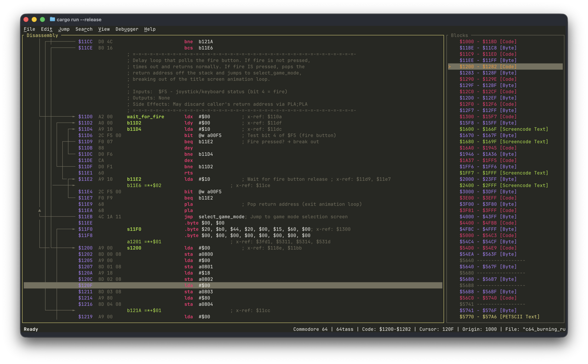
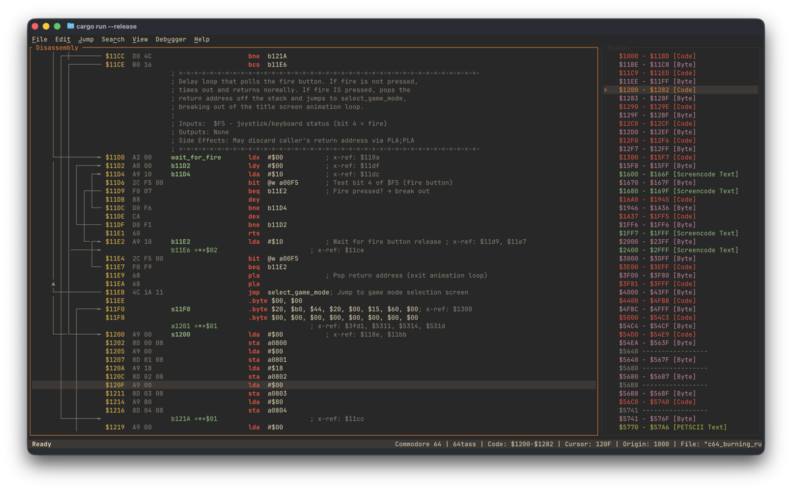
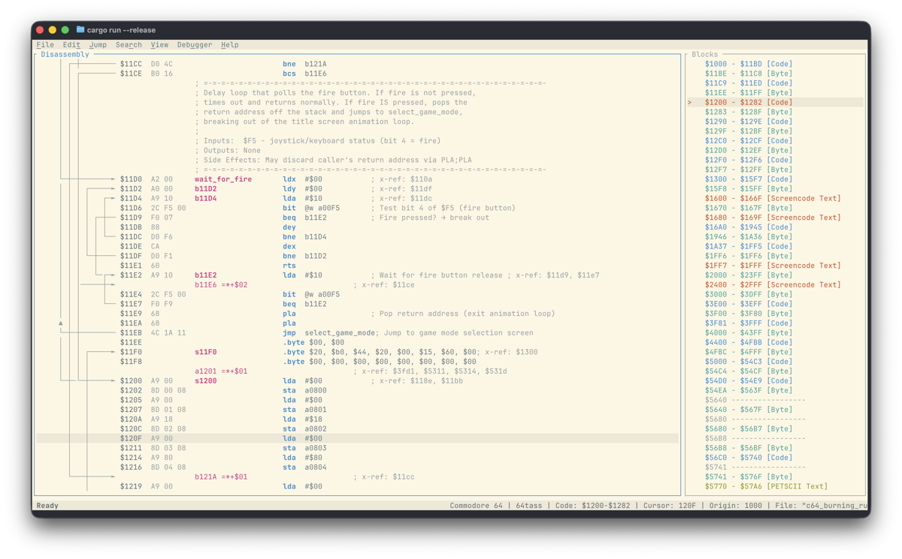
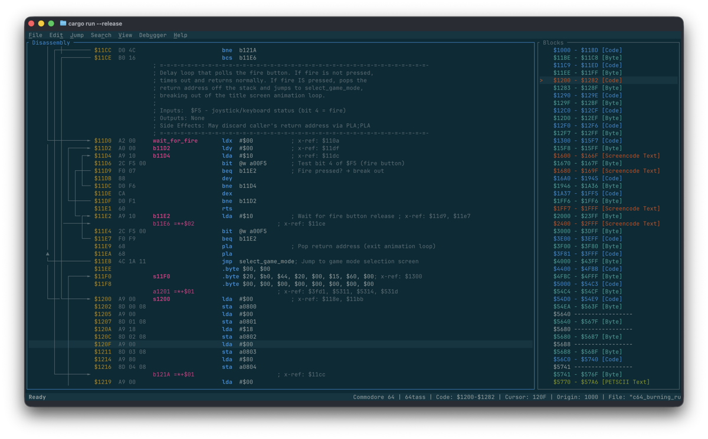
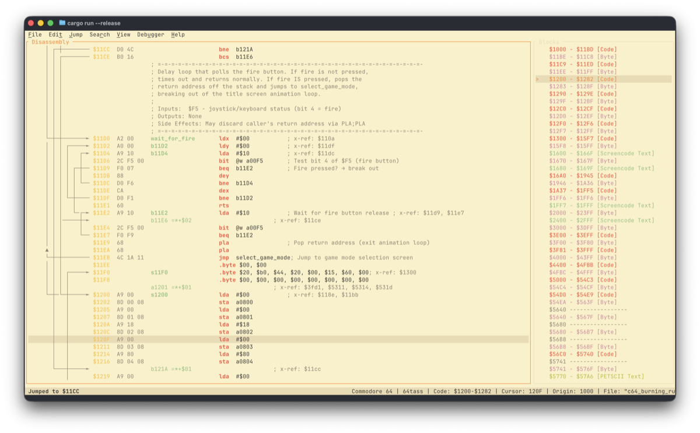
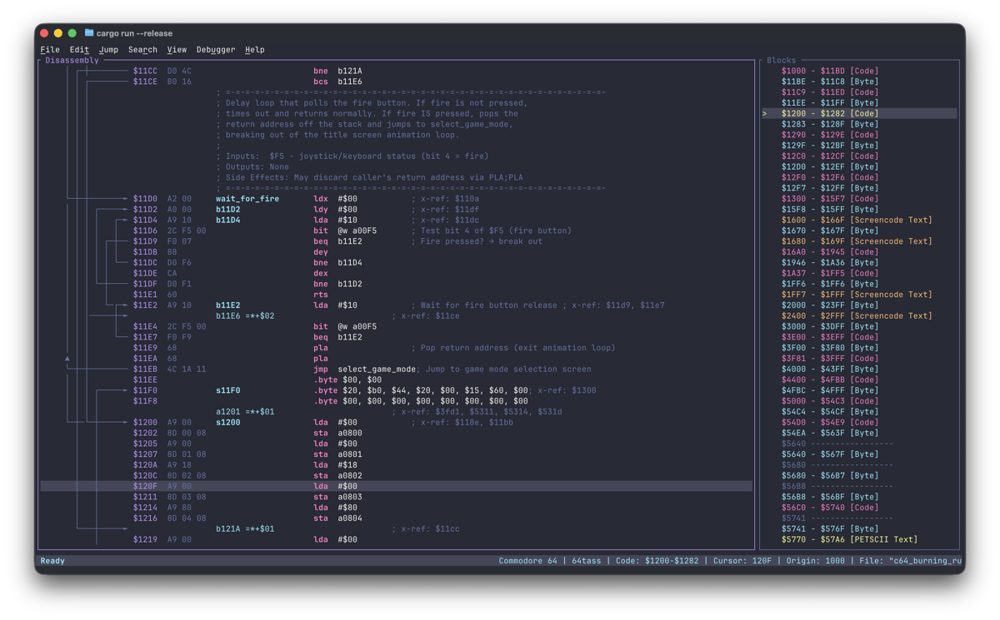
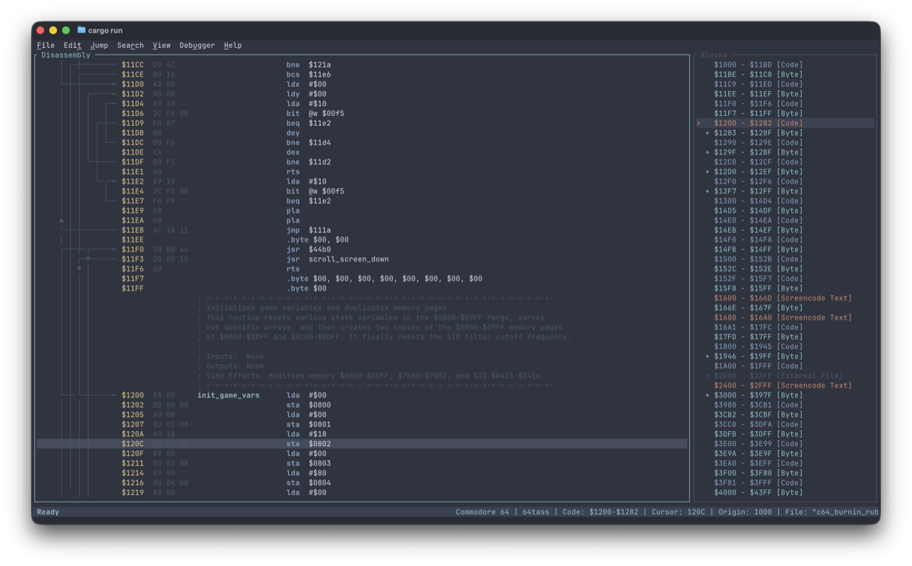
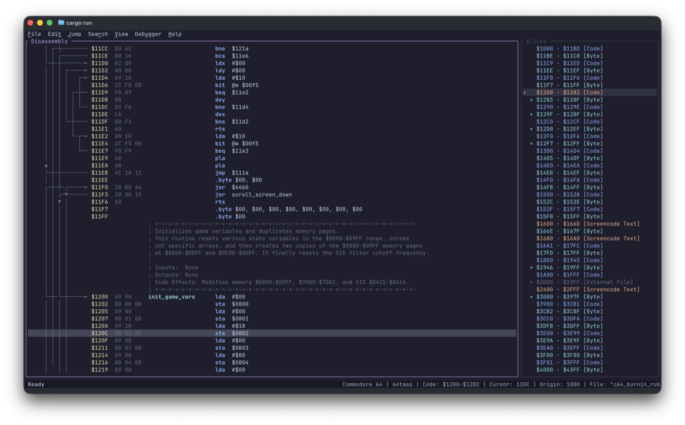
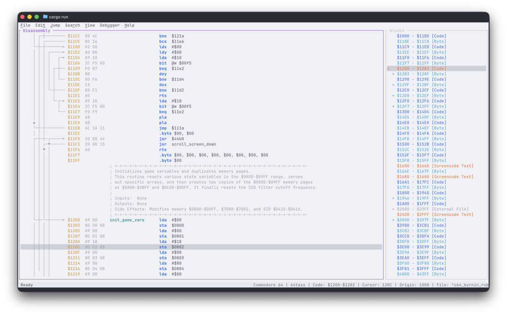

# Themes

Regenerator 2000 ships with **9 built-in 24-bit color themes**—switch anytime in **File → Settings** (++alt+p++ or ++ctrl+comma++).

## Built-in Themes

=== "Dracula (Default)"

    Dark slate canvas with purple, pink, and cyan highlights.

    

=== "Solarized Dark"

    Ethan Schoonover's calibrated low-contrast dark palette.

    { loading=lazy }

=== "Solarized Light"

    High-legibility light Solarized variant for bright rooms.

    { loading=lazy }

=== "Gruvbox Dark"

    Warm dark tones with orange, yellow, and aqua syntax contrast.

    { loading=lazy }

=== "Gruvbox Light"

    Warm paper background with earthy contrast.

    { loading=lazy }

=== "Monokai"

    Deep dark background paired with saturated, high-contrast accents.

    { loading=lazy }

=== "Nord"

    Low-contrast arctic dark palette built on cool blue tones.

    { loading=lazy }

=== "Catppuccin Mocha"

    Dark background with warm pastel accents.

    { loading=lazy }

=== "Catppuccin Latte"

    Light daytime palette with crisp pastel highlights.

    { loading=lazy }

### Switching Themes

Open **File → Settings** (++alt+p++ or ++ctrl+comma++), highlight **Theme**, and either press ++left++ / ++right++ to preview themes live or hit ++enter++ to pick from the popup list. Your selection is saved globally across projects.

!!! tip "True-Color Terminal Recommended"

    All themes use 24-bit RGB colors—see [Recommended Terminals](install.md#recommended-terminals) for best rendering.

---

## Custom Themes

Add `theme-*.toml` files to your configuration directory to create partial overrides or brand-new palettes:

--8<-- "config_dir.md"

### Creating a Custom Theme

1. Dump all built-in themes to use as starting points:

    === "macOS"

        ```bash
        regenerator2000 --dump-theme-files ~/Library/Application\ Support/regenerator2000/
        ```

    === "Linux"

        ```bash
        regenerator2000 --dump-theme-files ~/.config/regenerator2000/
        ```

    === "Windows (PowerShell)"

        ```powershell
        regenerator2000.exe --dump-theme-files $env:APPDATA\regenerator2000\config\
        ```

2. Create a partial override or full theme—any omitted color key inherits cleanly from `base`:

    ```toml title="theme-green_screen.toml"
    name = "Green Screen"          # (1)!
    base = "Solarized Dark"        # (2)!
    background = "#003300"         # (3)!
    foreground = "#33FF33"
    border_active = "#33FF33"
    border_inactive = "#116611"
    ```

    1. **Required.** Display name in **Settings → Theme**. Reuse a built-in name to override it.
    2. Optional fallback theme for unspecified keys (defaults to `"Solarized Dark"`).
    3. All color values use `"#RRGGBB"` 24-bit hex strings.

3. Restart Regenerator 2000 and pick **Green Screen** in **Settings → Theme**.

/// details | All 45 Theme Color Fields & `hex_color_palette`
    type: info

Every key below accepts a `"#RRGGBB"` hex string (except `hex_color_palette`, an optional 18-entry array of `"#RRGGBB"` strings for the Hexdump color map):

| Category | Fields |
| :--- | :--- |
| **Base & Chrome** | `background`, `foreground`, `border_active`, `border_inactive`, `selection_bg`, `selection_fg`, `block_selection_bg`, `block_selection_fg`, `status_bar_bg`, `status_bar_fg`, `minimap_cursor_fg` |
| **Disassembly** | `address`, `bytes`, `mnemonic`, `operand`, `label`, `label_def`, `comment`, `arrow`, `collapsed_block`, `collapsed_block_bg` |
| **Hex & Graphics** | `hex_bytes`, `hex_ascii`, `sprite_multicolor_1`, `sprite_multicolor_2`, `charset_multicolor_1`, `charset_multicolor_2`, `hex_color_palette` |
| **Dialogs & Menus** | `dialog_bg`, `dialog_fg`, `dialog_border`, `menu_bg`, `menu_fg`, `menu_selected_bg`, `menu_selected_fg`, `menu_disabled_fg` |
| **Highlights** | `highlight_fg`, `highlight_bg`, `error_fg` |
| **Block Types (fg/bg)** | `block_code_*`, `block_scope_*`, `block_data_byte_*`, `block_data_word_*`, `block_address_*`, `block_petscii_text_*`, `block_screencode_text_*`, `block_lohi_*`, `block_hilo_*`, `block_external_file_*`, `block_undefined_*`, `block_splitter_*` *(each has `_fg` and `_bg`)* |
///
