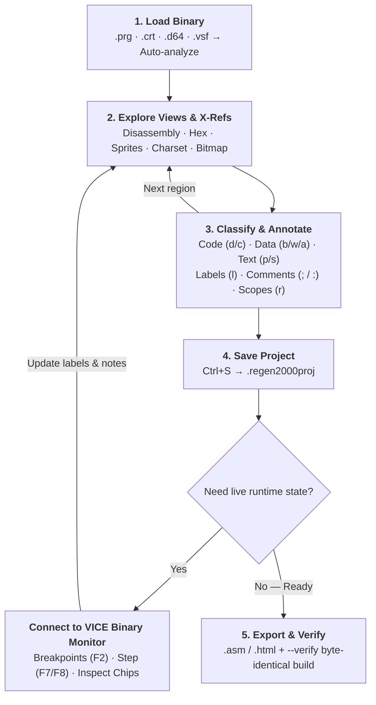
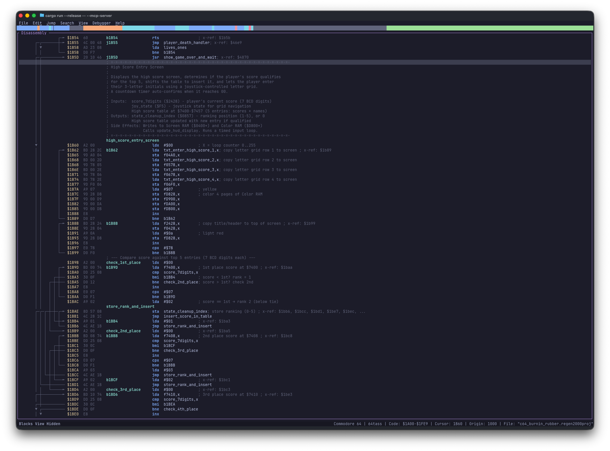
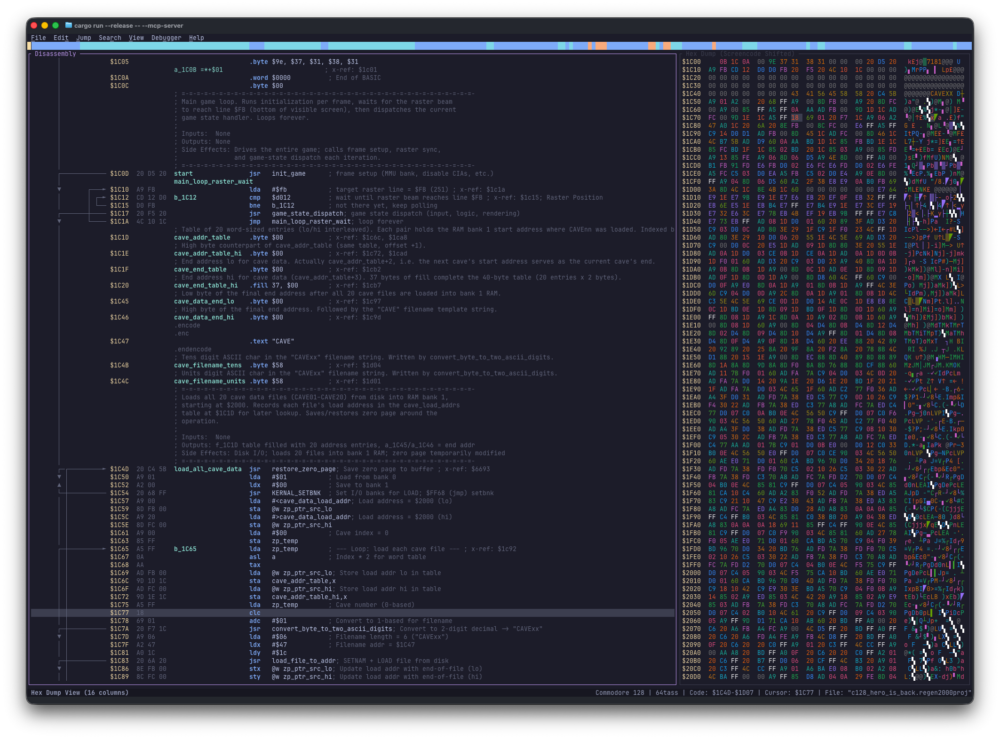
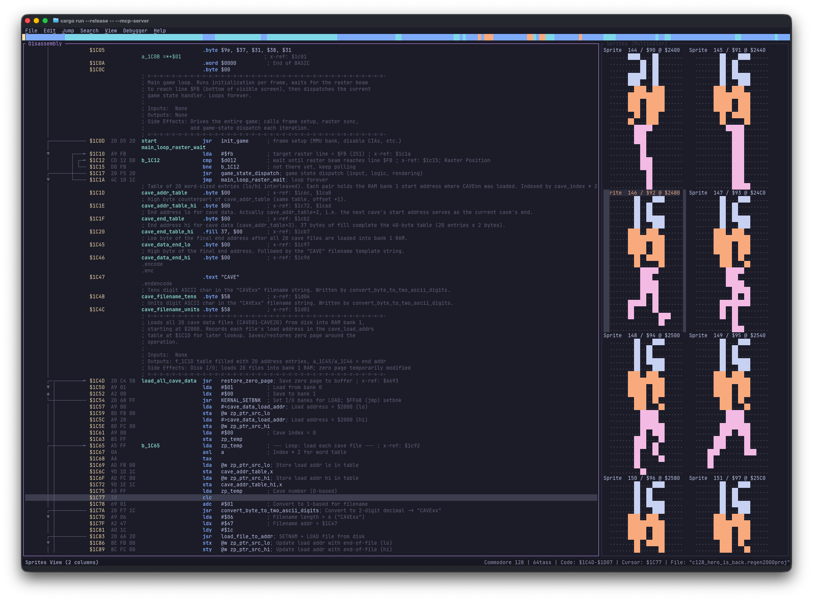
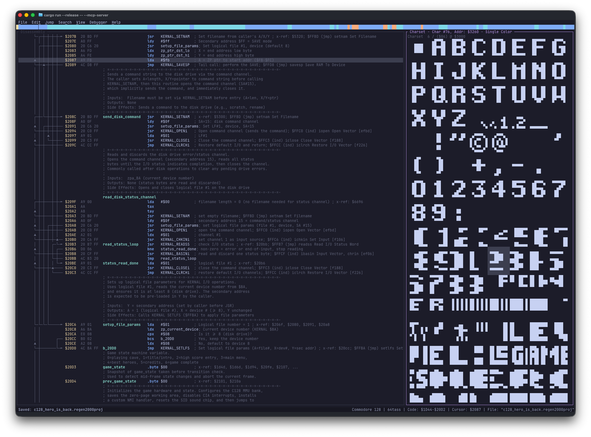
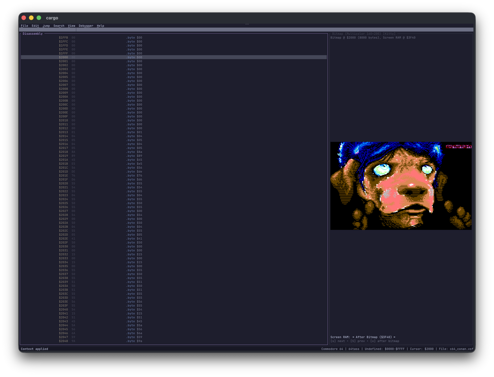
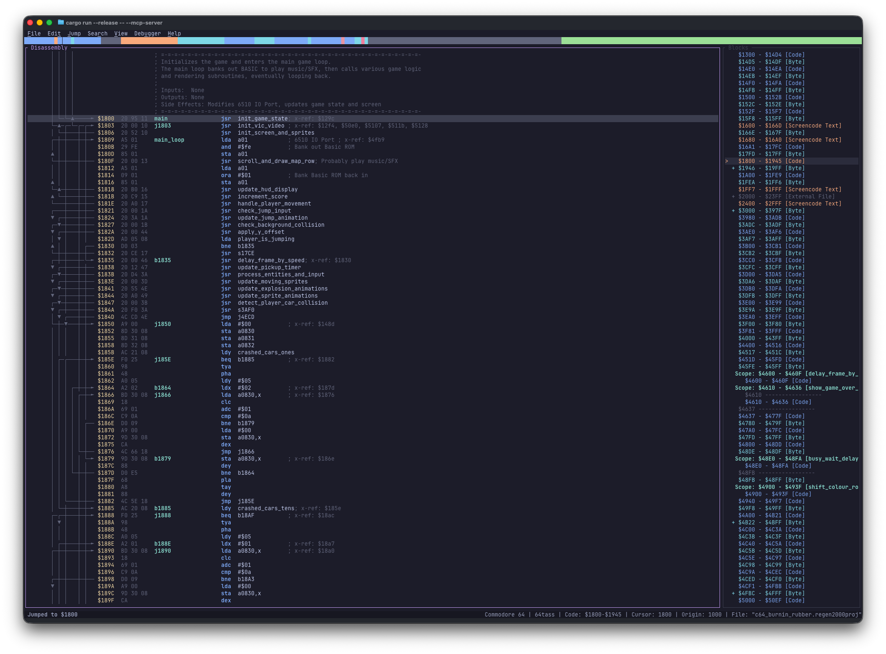
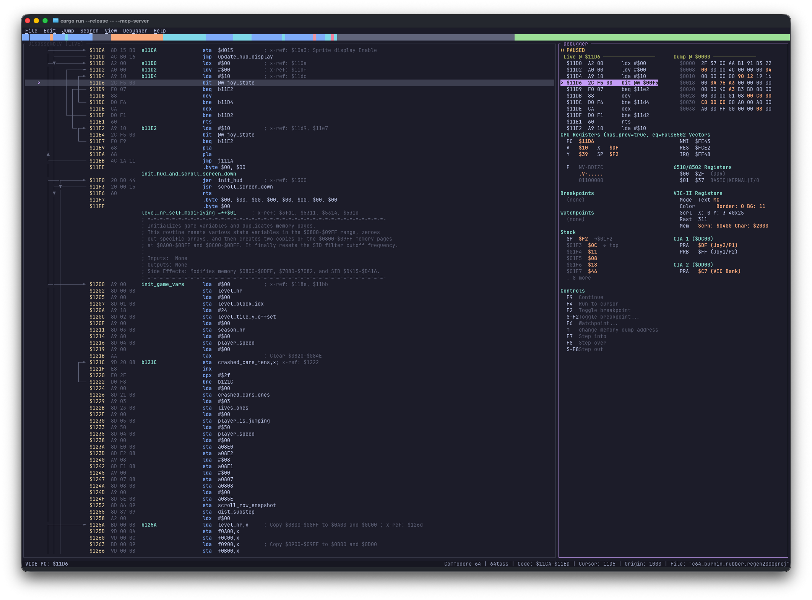

# Guided Tutorial

Walk through a complete reverse-engineering session in **Regenerator 2000**—turning a raw binary into a labeled, commented, export-ready disassembly project.

!!! tip "Prerequisites"

    Install Regenerator 2000 and keep any Commodore 8-bit `.prg` file handy.

By the end of this walkthrough, you will know how to:

- [x] Trace reachable code and partition raw data tables
- [x] Name subroutines, inspect typed X-Refs, and document behavior
- [x] Spot embedded graphics across Hexdump, Sprites, Charset, and Bitmap views
- [x] Organize routines with scopes, splitters, and collapsed blocks
- [x] Debug live in VICE, or hand off repetitive passes to an AI agent via MCP

---

## The Iterative Loop

Reverse engineering works best in short passes: explore a slice, classify code or data, document what you learn, and follow the next jump.



---

## Phase 1: First Contact & Navigation

Launch Regenerator 2000 on your binary:

```bash
regenerator2000 my_game.prg
```

For raw files without headers, the **Import Context** dialog opens first so you can confirm the target **System**, **Origin**, and **Entry Point**. Once loaded, you land in the **Disassembly View**:



/// caption
Disassembly View on the left with control-flow arrows, decoded instructions, auto-labels, and inline X-Refs.
///

- **Grey lines**: Unexplored (`Undefined`) bytes waiting to be classified.
- **Highlighted instructions**: Decoded 6502 code (unreferenced code blocks dim slightly for contrast).
- **Left margin**: Decimal line numbers, jump/branch arrows, and `$XXXX` memory addresses.

### Essential Navigation

- **Move & Page:** ++up++ / ++down++ (or ++j++ / ++k++), plus ++page-up++ / ++page-down++.
- **Jump to Address:** Hit ++ctrl+g++, enter hex like `c000`, and press ++enter++.
- **Follow Control Flow:** Put the cursor on any `JMP`, `JSR`, branch, or pointer and press ++enter++ to jump to its target (multi-target tables open a quick picker).
- **Jump Back:** Press ++backspace++ to retrace your navigation history.

### Auto-Analysis

With auto-analysis enabled in [Settings](settings.md), Regenerator 2000 automatically walks reachable flow from entry points on load—creating typed labels (`s_`, `j_`, `b_`), building cross-references, and resolving system KERNAL/register names. Press ++ctrl+a++ anytime to rerun it after structural edits. See [Analysis & Labels](analysis.md) for all prefix rules.

---

## Phase 2: Defining Code and Data

### Disassembling Code (++d++)

Unexplored regions appear as single raw byte lines (`$C000  A9 00 85 D0 ...`). Put your cursor on a suspected entry point and press ++d++—flow analysis follows branches and `JSR` calls until hitting invalid opcodes or returns (`RTS`/`RTI`), cleanly skipping data tables tucked between subroutines.

### Converting Data with Visual Mode (++shift+v++)

When raw tables or graphics were mistakenly decoded as instructions or `BRK` padding, convert them back to data:

1. Press ++shift+v++ to start **Visual Mode**, then highlight the range with ++up++ / ++down++ (or ++j++ / ++k++).
2. Press ++b++ for **Bytes** (`.byte $00, $01...`), ++w++ for **Words** (`.word $1000...`), ++a++ for **Addresses**, ++p++ for **PETSCII**, or ++s++ for **Screencode** text.
3. Press ++escape++ anytime to cancel selection without changes.

!!! tip "When to Use Visual Mode"

    - Mark sprite/charset blocks as **Bytes** (++b++).
    - Select an even byte range for **Lo/Hi** (++less-than++) or **Hi/Lo** (++greater-than++) split address tables.
    - Convert embedded menus or high-score strings to **PETSCII** (++p++) or **Screencode** (++s++).

---

## Phase 3: Labels & Cross-References

Replacing hex addresses with readable names makes every caller across the program click into place:

1. Put your cursor on `$C015` (or any label/operand) and press ++l++.
2. Type `main_loop` and press ++enter++.

Every instruction referencing `$C015` now reads `JMP main_loop`.

!!! tip "Local vs. Global Labels"

    Inside the label dialog, press ++tab++ to focus the scope checkbox and ++space++ to toggle **Local** vs. **Global**—ideal for short loop targets inside a subroutine.

### Inspecting X-Refs & Symbols

- **Inline X-Refs:** Check the trailing `; x-ref: $0820, $0850` comments on referenced lines.
- **Find References (++ctrl+x++):** Opens a list of every caller with typed badges (`[R]`, `[W]`, `[R/W]`, `[C]`, `[J]`, `[O]`)—press ++enter++ on any row to jump there.
- **Go to Symbol (++ctrl+p++):** Type any part of a label name to filter and jump straight to it.

---

## Phase 4: Comments & Bookmarks

=== "Side Comments (;)"

    Press ++semicolon++ to attach a short inline note to the right of an instruction:

    ```ca65
    inc $d020 ; Update border color flash
    ```

=== "Line Comments (:)"

    Press ++colon++ to insert a block header above an address:

    ```ca65
    ; === INIT SCREEN ===
    lda #$00
    ```

    Use ++shift+enter++ or ++ctrl+j++ for newlines, and ++alt+minus++, ++alt+equal++, or ++alt+backslash++ inside the dialog for `---`, `===`, or `-=-` divider bars.

=== "Bookmarks (Ctrl+B)"

    - Press ++ctrl+b++ to drop or remove a bookmark at the current address.
    - Press ++ctrl+shift+b++ (or ++alt+b++) to open the **Bookmarks** dialog and jump between saved spots.

    All bookmarks are saved inside `.regen2000proj`.

---

## Phase 5: Searching

=== "Vim Search (/)"

    Press ++slash++, type text, and hit ++enter++ to search across labels, mnemonics, operands, and comments. Step through hits with ++n++ (next) and ++shift+n++ (previous).

=== "Search Dialog (Ctrl+F)"

    Press ++ctrl+f++ for structured searches:

    - **Text:** Matches labels, comments, and instructions.
    - **Hex Pattern:** Searches raw bytes like `A9 00 8D` (supports `??` single-byte wildcards).
    - **PETSCII / Screencode:** Finds encoded text strings anywhere in memory.

    Step through matches afterward with ++f3++ / ++shift+f3++.

---

## Phase 6: Graphics & Data Views

Switch to any companion view in the right pane (++tab++ moves focus between panes) to visually spot non-code regions:

=== "Hexdump (Alt+2)"

    { loading=lazy }

    /// caption
    Byte-value color highlighting (`$00` dim, `$FF` bright) makes tables and strings stand out. Press ++m++ to cycle PETSCII/Screencode decoding.
    ///

=== "Sprites (Alt+3)"

    { loading=lazy }

    /// caption
    Previews 64-byte chunks as 24×21 sprites. Press ++m++ to toggle multicolor mode and ++b++ to mark confirmed sprites as Byte blocks.
    ///

=== "Charset (Alt+4)"

    { loading=lazy }

    /// caption
    Scans memory as 8×8 character tiles in high-res or multicolor mode (++m++) to locate custom fonts.
    ///

=== "Bitmap (Alt+5)"

    { loading=lazy }

    /// caption
    Renders 320×200 or 160×200 bitmaps with selectable Screen RAM overlays (++s++ / ++shift+s++ or ++x++ for `+8000`).
    ///

!!! tip "Syncing Views"

    When view synchronization is enabled in [Settings](settings.md), moving in the Disassembly View keeps the active right pane aligned to the same address.

---

## Phase 7: Scopes, Splitters & Collapsed Blocks

{ loading=lazy }

/// caption
The Blocks View (Alt+1) maps every Code, Data, Undefined, Scope, and Splitter region across your binary.
///

### Scopes

Press ++r++ (on a line or Visual selection) to wrap a routine in a lexical scope (`.block`/`.bend` in 64tass, `.proc`/`.endproc` in ca65, `{`/`}` in KickAssembler), keeping local labels isolated. Press ++delete++ at a scope boundary to remove it.

### Splitters

Regenerator 2000 auto-merges adjacent blocks of the same type. Press ++pipe++ at a boundary address to insert a **splitter** so two consecutive tables (especially **Lo/Hi** or **Hi/Lo** tables!) stay separate. Line comments (++colon++) also split adjacent Address and Word tables.

### Collapsing Blocks

Press ++ctrl+k++ to fold a large data table or finished subroutine into a single summary line in the TUI—leaving exported `.asm` output untouched.

---

## Phase 8: Saving & Exporting

- **Save Project (++ctrl+s++):** Writes your binary, blocks, labels, comments, bookmarks, and undo history to `.regen2000proj`.
- **Export ASM (++ctrl+e++):** Generates assembly for **64tass**, **ACME**, **KickAssembler**, or **ca65** (pick your target assembler and fill-run threshold in **Document Settings**, ++alt+d++).

For build scripts and CI pipelines, export or verify from the command line in headless mode:

```bash
# Export to ASM or interactive HTML
regenerator2000 --headless --export_asm output.asm my_game.regen2000proj
regenerator2000 --headless --export_html output.html my_game.regen2000proj

# Override target assembler and verify byte-identical roundtrip assembly
regenerator2000 --headless --assembler acme --export_asm output.asm my_game.regen2000proj
regenerator2000 --verify my_game.regen2000proj
```

---

## Phase 9: Live Debugging with VICE

{ loading=lazy }

/// caption
Live Debugger View (Alt+6) showing CPU registers, stack, VIC-II/CIA hardware chips, breakpoints, and live PC disassembly.
///

1. Start VICE with its binary monitor enabled and launch Regenerator 2000 on the **exact same binary**:

    ```bash
    x64 -binarymonitor my_game.prg
    regenerator2000 --vice localhost:6502 my_game.prg
    ```

    *(Or connect anytime from **Debugger → Connect to VICE...**)*

2. Open the Debugger pane with ++alt+6++ (or ++ctrl+6++).
3. Toggle execution breakpoints (++f2++ / ++shift+f2++) or memory watchpoints (++f6++), resume with ++f9++, run to cursor (++f4++), and step with ++f7++ (Into), ++f8++ (Over), or ++shift+f8++ (Out)—updating labels and comments as runtime behavior reveals itself.

!!! warning "Keep Binaries Identical"

    VICE and Regenerator 2000 must load the exact same `.prg`; mismatched binaries misalign PC addresses and breakpoints.

---

## Phase 10: AI-Assisted Analysis (MCP)

Launch Regenerator 2000 with `--mcp-server` and point Claude Code or Antigravity at `http://127.0.0.1:3000/mcp` to let an AI assistant decode BASIC headers, partition unknown blocks, trace routines, and rename variables right inside your live TUI. See [MCP Integration](mcp.md) for setup and the 5 analysis skills.

---

## Next Steps

- [Keyboard Shortcuts](keyboard_shortcuts.md) — Complete shortcut reference by pane and mode.
- [Block Types and Helpers](blocks.md) — Deep dive into every block directive and immediate helper.
- [Live Debugger (VICE)](debugger.md) — Memory dumps, chip registers, and watchpoint tips.
- [MCP Integration](mcp.md) — Pair-reverse-engineering setup with AI agents.
