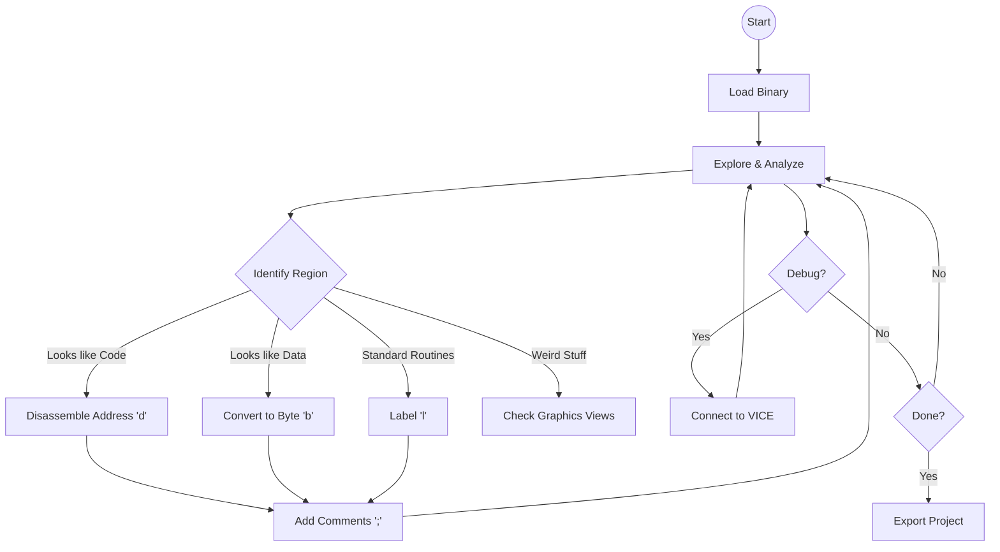

# Tutorial

This tutorial guides you through a reverse-engineering session in **Regenerator 2000**. You will convert a raw binary into a labeled and documented disassembly project.

!!! tip "Prerequisites"

    Install Regenerator 2000. Prepare a Commodore 64 program (`.prg`) for analysis.

---

## The Workflow

Reverse engineering is an iterative process. You start with raw binary bytes and classify code, graphics, and data tables until the program structure is clear.



---

## Phase 1: First Contact & Navigation

Start Regenerator 2000 with your target file:

```bash
regenerator2000 my_game.prg
```

The application opens in the **Disassembly View**.

When you load a raw binary (not a `.regen2000proj` project), the **Import Context** dialog opens. Select the target **System** (such as C64 or VIC-20), the **Origin** address, and the main **Entry Point** before analysis begins.

-   **Grey text**: Unanalyzed (`Undefined`) bytes.
-   **White text**: Decoded 6502 instructions.
-   **Addresses (Left)**: Memory address of each line.

### Basic Movement

-   **Scroll**: Press ++arrow-up++ / ++arrow-down++ or ++page-up++ / ++page-down++.
-   **Jump to Address**: Press ++ctrl+g++. Type a hexadecimal address (such as `c000`). Press ++enter++.
-   **Follow Flow**: Move the cursor to a `JMP` or `JSR` instruction. Press ++enter++ to jump to its target address.
-   **Go Back**: Press ++backspace++ to return to the previous address.

### Auto-Analysis

If you enable automatic analysis in Settings, Regenerator 2000 runs it when you load a binary:

-   Traces code execution flow from known entry points.
-   Generates labels for subroutines (`s_XXXX`), jump targets (`j_XXXX`), and branch targets (`b_XXXX`).
-   Builds cross-reference tables across the binary.
-   Resolves platform addresses (KERNAL routines and I/O registers) for the selected target system.

See [Analysis](analysis.md) for details on the analyzer and label prefixes.

If automatic analysis is disabled, press ++ctrl+a++ to run the analyzer manually.

---

## Phase 2: Defining Code and Data

Your primary task is to classify memory regions as **Code** or **Data**.

### Disassembling an Address

Unanalyzed byte regions appear as follows:

```text
$C000  A9 00 85 D0 ...
```

To trace execution from an address, move the cursor to the line. Press ++d++.

Regenerator 2000 disassembles the bytes from that address with **Flow Analysis**. It follows relative branches and absolute jumps until it encounters an invalid opcode or a return instruction. Press ++d++ at each new subroutine entry point to trace code and skip inline data tables.

### Converting to Data

Sometimes the disassembler decodes data bytes as invalid instructions or `BRK` opcodes. Convert data and graphics regions to raw bytes or words:

1.  **Select the region**:

    -   Press ++shift+v++ to enter **Visual Mode**.
    -   Press the arrow keys to highlight the target rows.

2.  **Convert the selection**:

    -   Press ++b++ to convert the selection to **Bytes** (`.byte $00, $01...`).
    -   Press ++w++ to convert the selection to **Words** (`.word $1000...`).

### Using Visual Mode

Use Visual Mode (++shift+v++) to edit ranges of memory:

-   **Extend selection**: Press ++arrow-up++ / ++arrow-down++ or ++j++ / ++k++ to expand the selection.
-   **Apply block type**: Press any block-type shortcut (++d++, ++b++, ++w++, ++a++, ++p++, ++s++) to convert the selected range.
-   **Exit**: Press ++escape++ to exit Visual Mode without changes.

!!! tip "When to Use Visual Mode"

    -   Mark large data tables as bytes or words.
    -   Select an address range for a Lo/Hi table (++less-than++ or ++greater-than++).
    -   Convert a text buffer to PETSCII (++p++) or Screencode (++s++).

---

## Phase 3: Labels & Cross-References

As you inspect the code, identify subroutines, variables, and hardware registers (such as `$D020` for Border Color).

### Creating Labels

Assign descriptive names to addresses instead of raw hexadecimal numbers:

1.  Move the cursor to `$C015`.
2.  Press ++l++.
3.  Type `main_loop`.
4.  Press ++enter++.

Every instruction that references `$C015` now displays `JMP main_loop` instead of `JMP $C015`.

!!! tip "Local vs. Global Labels"

    In the label dialog, press ++tab++ to focus the scope checkbox. Press ++space++ to toggle between **Local** and **Global**. Use local labels for loop counters and branch targets inside a subroutine.

### Using Cross-References (X-Refs)

Regenerator 2000 tracks **Cross-References (X-Refs)** for every address:

-   Inspect the `x-ref` list in the side comments (for example, `; x-ref: $0820, $0850`).
-   Press ++ctrl+x++ to open the **Find References** dialog. Use the dialog to jump to any caller.

### Go to Symbol

Press ++ctrl+p++ to open the **Go to Symbol** dialog. Type part of a label name to filter the list. Press ++enter++ to jump to the selected symbol.

---

## Phase 4: Adding Comments and Bookmarks

Use comments to document the purpose of instructions and subroutines.

### Side Comments

Use side comments for brief notes on a single instruction:

-   Press ++semicolon++.
-   Type `Update score counter`.
-   Press ++enter++.
-   Result: `INC $D020  ; Update score counter`

### Line Comments

Use line comments for subroutine headers or multi-line explanations:

-   Press ++colon++.
-   Type `--- INIT ROUTINE ---`.
-   Press ++enter++.
-   Result: The comment appears on a dedicated line above the instruction:

    ```asm
    ; --- INIT ROUTINE ---
    lda #$00
    ...
    ```

!!! tip "Multi-line and Separator Comments"

    -   Press **++shift+enter++** or **++ctrl+j++** to insert a newline inside the comment dialog.
    -   Use these shortcuts inside the comment dialog to insert separators:
        -   ++alt+minus++: Inserts a dashed line (`---`).
        -   ++alt+equals++: Inserts an equals line (`===`).
        -   ++alt+backslash++: Inserts a mixed separator (`-=-`).

### Using Bookmarks

Use bookmarks to jump between important addresses:

-   ++ctrl+b++: Toggles a bookmark at the current address.
-   ++ctrl+shift+b++ (or ++alt+b++): Opens the Bookmarks dialog.

Project files (`.regen2000proj`) save all bookmarks across sessions.

---

## Phase 5: Searching

Regenerator 2000 provides two search modes.

### Vim-Style Search

Press ++slash++. Type a search query. Press ++enter++. The search scans labels, mnemonics, operands, and comments. Press ++n++ to jump to the next match or ++shift+n++ to jump to the previous match.

### Search Dialog

Press ++ctrl+f++ to open the Search dialog:

-   **Text search**: Searches labels, comments, and mnemonics.
-   **Hex pattern search**: Searches raw byte sequences (such as `A9 00 8D`). Use `??` as a wildcard for any single byte.
-   **PETSCII / Screencode search**: Searches memory for encoded text strings.

After you close the dialog, press ++f3++ or ++shift+f3++ to jump to the next or previous match.

---

## Phase 6: Graphics & Data Views

Inspect non-code regions with the visual inspection views:

-   **Hex Dump**: Press ++alt+2++ to open the Hex Dump View. Press ++m++ to cycle text encodings (PETSCII and Screencode). Byte colors highlight data patterns (`$00` appears dim, `$FF` appears bright, and printable characters use distinct colors).
-   **Sprites**: Press ++alt+3++ to open the **Sprite View**. Locate 24x21 hardware sprites.
-   **Charset**: Press ++alt+4++ to inspect 8x8 character sets.
-   **Bitmap**: Press ++alt+5++ to open the **Bitmap View**. Inspect 320x200 or 160x200 bitmaps.

Mark confirmed graphics regions as `Byte` blocks (++b++) so the disassembler does not decode them as instructions.

!!! tip "Syncing Views"

    If you enable view synchronization in Settings, cursor movement in the Disassembly View updates the active right-hand pane to the same memory address.

---

## Phase 7: Scopes, Splitters & Collapsed Blocks

Use structural markers to organize large disassembly projects.

### Scopes

Scopes group instructions and isolate local labels (with `.proc`/`.endproc` in ca65, `.block`/`.bend` in 64tass, or `{`/`}` in KickAssembler):

-   Press ++r++ to create a scope at the current address or selection.
-   Press ++delete++ to remove a scope boundary.

### Splitters

Regenerator 2000 merges adjacent blocks of the same type automatically. To keep two adjacent blocks separate (such as two distinct data tables), press ++pipe++ to insert a **splitter** between them. Line comments (++colon++) also split adjacent address and word tables.

### Collapsing Blocks

Press ++ctrl+k++ to collapse a block into a single summary line. Collapse large data tables or completed subroutines to focus on unanalyzed areas. Collapsed blocks affect only the TUI display and do not change exported `.asm` files.

---

## Phase 8: Saving & Exporting

### Saving Your Work

Press ++ctrl+s++ to save your progress to a `.regen2000proj` file. The project file stores all labels, comments, block types, bookmarks, and settings.

### Exporting to Assembler

Export your project to an assembly source file (`.asm`):

-   Press ++ctrl+e++ to export the disassembly.
-   Select the target assembler (**64tass**, **ACME**, **KickAssembler**, or **ca65**) in **Document Settings** (++alt+d++).
-   Adjust the **Fill run threshold** (default `8`) in Document Settings to collapse identical consecutive bytes into `.fill`, `!fill`, or `.res`.

### Batch Processing (Headless Mode)

Run Regenerator 2000 in headless mode for scripts and automated builds:

```bash
# Export to ASM:
regenerator2000 --headless --export_asm output.asm my_game.regen2000proj

# Export to HTML:
regenerator2000 --headless --export_html output.html my_game.regen2000proj

# Override the assembler format (64tass, acme, ca65, kick)
regenerator2000 --headless --assembler acme --export_asm output.asm my_game.regen2000proj

# Import VICE labels and export
regenerator2000 --headless --import_lbl labels.lbl --export_asm output.asm my_game.prg
```

---

## Phase 9: Debugging with VICE

Connect Regenerator 2000 to a running VICE emulator instance for live debugging:

1.  **Start VICE**: Start the emulator with the binary monitor enabled:

    ```bash
    x64 -binarymonitor my_game.prg
    ```

2.  **Connect**: In Regenerator 2000, select **Debugger → Connect to VICE...** (`localhost:6502`).

    !!! tip "Auto-connect with `--vice`"

        Pass `--vice localhost:6502` on the command line to connect automatically at startup:

        ```bash
        regenerator2000 --vice localhost:6502 my_game.prg
        ```

3.  **View**: Press ++alt+6++ (or ++ctrl+6++) to open the **Debugger** panel. Inspect the program counter, CPU registers, and breakpoints.

!!! warning

    VICE and Regenerator 2000 must run the **exact same binary**. Mismatched binaries cause misaligned breakpoints and program counter addresses.

### Debugging Features

-   **Breakpoints**: Press ++f2++ (or ++shift+f2++) to toggle a breakpoint. Press ++f6++ to set a watchpoint at the cursor.
-   **Stepping**: Press ++f7++ (Step Instruction), ++f8++ (Step Over), or ++shift+f8++ (Step Out).
-   **Control**: Press ++f9++ to continue execution. Press ++f4++ to run to the cursor address.

### Debugging Workflow

Follow these steps to debug a routine:

1.  Set a breakpoint at the target routine (++f2++).
2.  Resume execution in VICE (++f9++).
3.  When execution stops at the breakpoint, inspect the CPU registers and stack in the Debugger panel.
4.  Step through the instructions (++f7++) to observe state changes.
5.  Update labels and comments in the Disassembly View based on the observed behavior.

!!! note "Legacy Workflow: Export VICE Labels"

    To use the standalone VICE monitor without the integrated debugger, select **File → Export VICE Labels...** to export project symbols.

---

## Phase 10: AI-Assisted Analysis (MCP)

Regenerator 2000 includes an MCP (Model Context Protocol) server for programmatic analysis with AI assistants.

### Quick Start

1.  Start Regenerator 2000 with the MCP server enabled: `regenerator2000 --mcp-server my_game.prg`
2.  Connect your MCP client to `http://localhost:3000/mcp`.
3.  Instruct the AI assistant to read the disassembly, rename labels, add comments, and classify blocks.

Use the MCP server to:

-   Batch-label known routines and hardware registers.
-   Explain complex 6502 code patterns.
-   Automate repetitive classification tasks across large binaries.

See [MCP Integration](mcp.md) for the complete list of MCP tools and resources.

---

## Summary of Key Shortcuts

| Key | Action |
| :--- | :--- |
| ++d++ | Disassemble Address |
| ++b++ | Convert to **B**yte |
| ++w++ | Convert to **W**ord |
| ++a++ | Convert to **A**ddress |
| ++r++ | Create Scope |
| ++delete++ | Exclude Address / Remove Scope |
| ++l++ | Set **L**abel |
| ++semicolon++ | Add Side Comment |
| ++colon++ | Add Line Comment |
| ++i++ / ++shift+i++ | Cycle Immediate Format (hex/dec/bin) |
| ++open-bracket++ | Pack Lo/Hi Address |
| ++close-bracket++ | Pack Hi/Lo Address |
| ++shift+v++ | Toggle Visual Mode (selection) |
| ++enter++ | Follow Jump / Jump to Operand |
| ++backspace++ | Jump Back |
| ++ctrl+g++ | Jump to Address |
| ++ctrl+p++ | Go to Symbol |
| ++ctrl+x++ | Find Cross-References |
| ++slash++ | Vim Search |
| ++ctrl+b++ | Toggle Bookmark |
| ++ctrl+k++ | Toggle Collapsed Block |
| ++pipe++ | Toggle Splitter |
| ++ctrl+s++ | Save Project |
| ++ctrl+e++ | Export to ASM |
| ++f2++ | Toggle Breakpoint |
| ++f7++ / ++f8++ | Step Instruction / Step Over |
| ++f9++ | Run / Continue |
