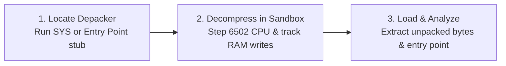

# Binary Unpacker

Many Commodore 8-bit binaries wrap code and data inside a tiny decompression stub—static analysis sees only encrypted noise until that stub runs. Regenerator 2000 emulates the depacker inside a sandboxed 6502 CPU and loads the unpacked program directly into the disassembler.

---

## Using the Unpacker

=== "On File Load (Automatic)"

    On open, Regenerator 2000 checks built-in packer signatures and computes Shannon entropy (default alert at `>= 7.4`, adjustable via **Entropy Warning Threshold** in [Settings](settings.md)).

    When packing is detected, **Import Context Setup** shows a warning and pre-selects **`< Unpack >`**—just press ++enter++ to unpack immediately.

=== "From the Menu (Manual)"

    1. Open **File → Unpack Binary...** (++alt+f++).
    2. Press ++enter++ to run auto-detection, or override any option:

        | Option | Default | Purpose |
        | :--- | :--- | :--- |
        | **Entry Point (Hex)** | Auto (`SYS` line) | Machine-code start address when no BASIC `SYS` stub exists (e.g. `0810`). |
        | **Return Address (Hex)** | System RAM start (`$0800` C64, `$1C00` C128, `$1000` VIC-20/Plus/4/C16, `$0400` PET) | Lowest address where unpacked code is expected to run. |
        | **Depacker Address (Hex)** | Auto | Explicit address of the depacker loop (e.g. `033C`). |
        | **Max Instructions** | `50000000` | Safety cap before halting emulation. |

    3. Once finished, Regenerator 2000 loads the extracted memory range, runs flow analysis from the entry point, and jumps there.

=== "Via MCP (AI Agents)"

    Call `r2000_unpack_binary` (omit any field to use auto-detection; see [MCP Integration](mcp.md#r2000_unpack_binary)):

    ```json
    {
      "name": "r2000_unpack_binary",
      "arguments": {
        "entry_point": "0810",
        "return_address": "0800",
        "depacker_address": "033C",
        "max_instructions": 100000000
      }
    }
    ```

---

## How It Works



- **Phase 1 — Locate Depacker:** Executes from the BASIC `SYS` target (or **Entry Point**) until control enters the depacker stub.
- **Phase 2 — Decompress:** Steps the stub, tracks every RAM write, and stops once execution jumps into the newly written code.
- **Hardware & ROM Traps:** Emulates C64 `$00`/`$01` PLA bank switching (exposing RAM under `$A000`, `$D000`, and `$E000`) and traps KERNAL calls so key-wait loops never hang.
- **System-Aware Memory Map:** Defaults RAM/BASIC start per platform (`$0800`/`$0801` C64, `$1C00`/`$1C01` C128, `$1000`/`$1001` VIC-20, Plus/4, C16, and `$0400`/`$0401` PET).

---

## Supported Packers

Regenerator 2000 includes signature detectors and hooks for **26 built-in packer families**:

/// details | All 26 Built-in Packer Families
    type: info

| Family (A–D) | Family (E–S) | Family (T–Z) |
| :--- | :--- | :--- |
| `1001 CardCruncher` | `ECA Compactor` | `TBC Multicompactor` |
| `6Pack/G*P` | `Exomizer` | `Time Cruncher` |
| `Action Replay` | `Fast Packer` | `TinyCrunch` |
| `ALZ64` | `Final Cartridge III` | `Triad Cruncher` |
| `Antiram Packer` | `McCracken Compressor` | `TSCrunch` |
| `ByteBoozer` | `PUCrunch` | `Turbo Cruncher` |
| `Commodore Cruncher System` | `Spark Packer` | `ZX02` |
| `Compress64k/Hermit` | `Super Cruncher` | |
| `Cruel Cruncher` | | |
| `Dali` | | |
| `Eagle Cruncher` | | |
///

!!! tip "Unlisted Packers Work Too"

    Custom or unknown packers still unpack via generic RAM-write tracking—the sandbox monitors where the stub writes bytes and captures the binary as soon as execution jumps into them.

---

## Troubleshooting

- **Timeout after 50M instructions:** Raise **Max Instructions** (e.g. `100000000`) for huge binaries or slow depackers.
- **No BASIC `SYS` stub:** Supply the machine-code entry address in **Entry Point (Hex)** (e.g. `0810`).
- **Custom loader exits early:** Provide **Depacker Address (Hex)** for the decompression loop or **Return Address (Hex)** for the unpacked start.
