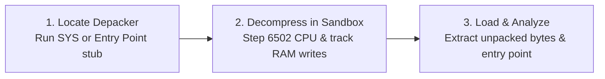

# Binary Unpacker

Regenerator 2000 includes a **Binary Unpacker** for compressed Commodore 8-bit binaries (`.prg`).

Packed programs hide code and data behind a small decompression stub. Static analysis cannot read the program until that stub runs.

Regenerator 2000 runs the stub in a 6502 sandbox and loads the unpacked program directly into the disassembler.

---

## Using the Unpacker

### 1. Unpack on File Load

When you open a binary, Regenerator 2000 computes its Shannon entropy and checks built-in packer signatures. Compressed files usually have high entropy (`>= 7.4`, configurable under **Entropy Warning Threshold** in Settings).

If entropy is high or a signature matches, **Import Context Setup** shows a warning and selects **`< Unpack >`**. Press **++enter++** to unpack immediately.

### 2. Unpack from the Menu

Run the unpacker manually from the menu bar:

1. Press **++alt+f++** (or select **File**). Select **Unpack Binary...**.
2. Press **++enter++** to run with auto-detection, or set options in **Unpack Binary Options**:

    | Option | Default | Purpose |
    | :--- | :--- | :--- |
    | **Entry Point (Hex)** | Auto (`SYS` line) | Sets the start address when no BASIC `SYS` stub exists (for example, `0810`). |
    | **Return Address (Hex)** | System RAM start (`$0800` C64, `$1C00` C128, `$1000` VIC-20/Plus/4/C16, `$0400` PET) | Sets the lowest address where unpacked code runs. |
    | **Depacker Address (Hex)** | Auto | Sets the address of the depacker loop (for example, `033C`). |
    | **Max Instructions** | `50000000` | Stops emulation after this instruction count. |

3. Wait for the status bar progress counter to finish.

Regenerator 2000 loads the unpacked binary at its start address, runs flow analysis from the entry point, and moves the cursor there.

### 3. Unpack via MCP

AI agents can run `r2000_unpack_binary` over MCP. Omit any field to use auto-detection (see [MCP Integration](mcp.md#r2000_unpack_binary)).

```json
{
  "name": "r2000_unpack_binary",
  "arguments": {
    "entry_point": "0810",
    "return_address": "0800",
    "depacker_address": "033C",
    "max_instructions": 100000000
  }
}
```

---

## How It Works



- **Phase 1 — Locate Depacker**: Starts at the BASIC `SYS` target (or **Entry Point**) and runs until execution reaches the depacker stub.
- **Phase 2 — Decompress**: Runs the stub, records every RAM write, and stops when execution jumps into unpacked code.
- **Hardware & ROM Support**: Emulates C64 `$00`/`$01` bank switching (RAM under `$A000`, `$D000`, and `$E000`). It also traps KERNAL calls so key-wait loops never hang.
- **Target Memory Map**: Uses each system's RAM and BASIC start addresses. Defaults are `$0800`/`$0801` (C64), `$1C00`/`$1C01` (C128), `$1000`/`$1001` (VIC-20, Plus/4, C16), and `$0400`/`$0401` (PET).

---

## Supported Packers

Regenerator 2000 detects **26 built-in packer families**:

`1001 CardCruncher` · `6Pack/G*P` · `Action Replay` · `ALZ64` · `Antiram Packer` · `ByteBoozer` · `Commodore Cruncher System` · `Compress64k/Hermit` · `Cruel Cruncher` · `Dali` · `Eagle Cruncher` · `ECA Compactor` · `Exomizer` · `Fast Packer` · `Final Cartridge III` · `McCracken Compressor` · `PUCrunch` · `Spark Packer` · `Super Cruncher` · `TBC Multicompactor` · `Time Cruncher` · `TinyCrunch` · `Triad Cruncher` · `TSCrunch` · `Turbo Cruncher` · `ZX02`

!!! tip "Unlisted Packers Work Too"

    You can still unpack unlisted or custom packers. Generic RAM write tracking finds where the stub writes code and stops when execution jumps into it.

---

## Troubleshooting

- **Timeout error after 50M instructions**: Increase **Max Instructions** (for example, `100000000`) for large files or slow packers.
- **File has no BASIC `SYS` stub**: Enter the machine-code start address in **Entry Point (Hex)** (for example, `0810`).
- **Custom loader stops early**: Set **Depacker Address (Hex)** to the depacker loop. Or set **Return Address (Hex)** to the unpacked code start.
