# Views

Regenerator 2000 splits the workspace into the **Disassembly View** on the left and a switchable companion view on the right (**Blocks**, **Hexdump**, **Sprites**, **Charset**, **Bitmap**, or **Debugger**). Press ++tab++ anytime to move focus between panes.

All scrollable views share standard cursor navigation:

| Action | Shortcut |
| :--- | :--- |
| **Move Cursor** | ++up++ / ++down++ / ++j++ / ++k++ |
| **Page Up / Down** | ++page-up++ / ++page-down++ or ++ctrl+u++ / ++ctrl+d++ |
| **Start / End** | ++home++ / ++end++ |
| **Jump to Item / End** | number + ++shift+g++ |
| **Switch Pane** | ++tab++ |

---

## Disassembly View

The **Disassembly View** is your primary workspace for decoding instructions, defining data blocks, adding comments, and tracing control flow:

- **Control-Flow Margin:** Draws jump and branch arrows alongside the listing and dims unreferenced code blocks for visual contrast.
- **Interactive Minimap:** Displays block classification across the entire address space just below the menu bar—click anywhere on it to jump directly.

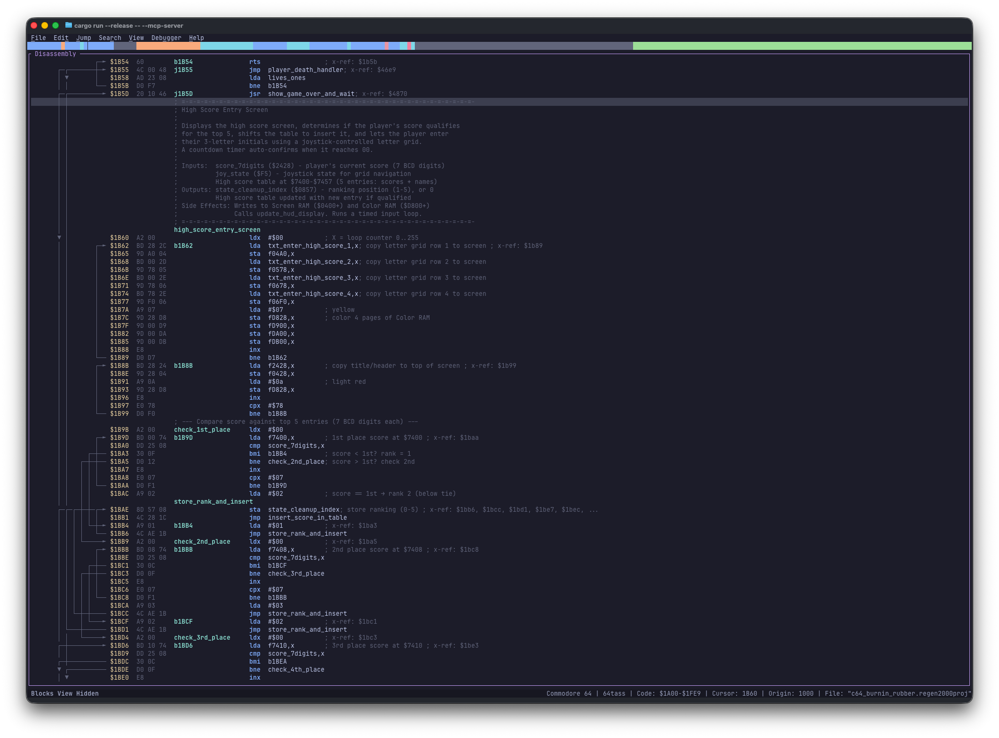

/// caption
Split workspace with the Disassembly View on the left and the Hexdump companion pane on the right.
///

### Column Anatomy

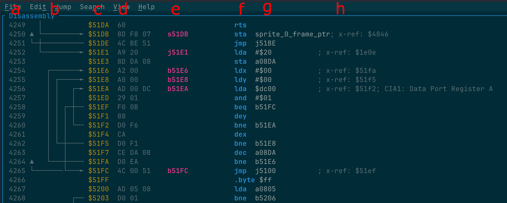{ loading=lazy }

/// caption
Column breakdown (`a`–`h`) in the Disassembly View.
///

`a` — **Line number**
:   Decimal row index used for line-number jumps.

`b` — **Flow arrows**
:   Jump and branch paths rendered along the left margin.

`c` — **Address**
:   Hexadecimal memory address (`$XXXX`).

`d` — **Raw bytes**
:   Hexadecimal machine bytes for the instruction or data row.

`e` — **Label**
:   Optional symbol with auto-prefix (`s_`, `j_`, `a_`, etc.; see [Analysis — Label Prefixes](analysis.md#label-prefixes)).

`f` — **Mnemonic**
:   Decoded 6502 instruction or assembler directive.

`g` — **Operand**
:   Target address, immediate constant, enum constant, or data values.

`h` — **Side comment**
:   Inline user comment, system register note, or `; x-ref:` callers.

/// details | Disassembly View Keyboard Shortcuts
    type: tip

| Action | Shortcut |
| :--- | :--- |
| **Disassemble Address (flow analysis)** | ++d++ |
| **Convert to Code** | ++c++ |
| **Convert to Byte** | ++b++ |
| **Convert to Word** | ++w++ |
| **Convert to Address** | ++a++ |
| **Convert to PETSCII Text** | ++p++ |
| **Convert to Screencode Text** | ++s++ |
| **Convert to External File** | ++shift+e++ |
| **Convert to Undefined** | ++question-mark++ |
| **Set Lo/Hi Address Table** | ++less-than++ |
| **Set Hi/Lo Address Table** | ++greater-than++ |
| **Set Lo/Hi Word Table** | ++comma++ |
| **Set Hi/Lo Word Table** | ++period++ |
| **Create Scope** | ++r++ |
| **Remove Scope / Exclude External Address** | ++delete++ |
| **Nudge Scope Boundary** | ++alt+up++ / ++alt+down++ |
| **Set Label** | ++l++ |
| **Set Symbolic Offset** | ++o++ |
| **Increment/Decrement Symbolic Offset** | ++plus++ / ++minus++ |
| **Add Side Comment** | ++semicolon++ |
| **Add Line Comment** | ++colon++ |
| **Next/Prev Immediate Format** | ++i++ / ++shift+i++ |
| **Apply Enum** | ++e++ |
| **Pack Lo/Hi Address** | ++open-bracket++ |
| **Pack Hi/Lo Address** | ++close-bracket++ |
| **Toggle Visual Mode** | ++shift+v++ |
| **Select Text** | ++shift+up++ / ++shift+down++ |
| **Clear Selection** | ++escape++ |
| **Toggle Splitter** | ++pipe++ |
| **Toggle Collapsed Block** | ++ctrl+k++ |
| **Toggle Bookmark** | ++ctrl+b++ |
| **List Bookmarks** | ++ctrl+shift+b++ or ++alt+b++ |
| **Analyze** | ++ctrl+a++ |
| **Jump to Address** | ++ctrl+g++ or ++alt+g++ |
| **Jump to Line** | ++ctrl+shift+g++ or ++alt+shift+g++ |
| **Jump to Line / End of File** | number + ++shift+g++ |
| **Jump to Operand** | ++enter++ |
| **Jump Back (History)** | ++backspace++ |
| **Next Unexplored Block** | ++ctrl+n++ |
| **Prev Unexplored Block** | ++ctrl+shift+n++ |
| **Vim Search** | ++slash++ |
| **Search Dialog** | ++ctrl+f++ |
| **Find Next** | ++n++ or ++f3++ |
| **Find Previous** | ++shift+n++ or ++shift+f3++ |
| **Go to Symbol** | ++ctrl+p++ |
| **Find Cross References** | ++ctrl+x++ |

///

### Jump to Operand

Press ++enter++ (or **Jump → Jump to Operand**) in the Disassembly View to follow an operand:

- **Single target (`1`):** Jumps immediately and saves history (++backspace++ returns). Works on instructions with an address, branch, or `#<`/`#>` label operand, redirected external equates, and single-target `Address` / split-table rows.
- **Multiple distinct targets (`2+`):** Opens the **Jump to Operand** picker (`Jump to Operand from $XXXX`) for multi-entry **Address** rows and split address tables (`.byte <...` / `.byte >...`), listed left to right and deduplicated by resolved address.
- **No navigable target (`0`):** Displays `"No valid operand to jump to"` in the status bar.

*(For incoming `; x-ref:` callers instead of outgoing operands, press ++ctrl+x++ for **Find Cross References**.)*

/// details | Picker Dialog Controls
    type: info

The modal shows `Jump to Operand from $XXXX` (with `[current/total]` if scrollable), `[1]`–`[9]` hotkey badges, `$XXXX` target addresses, operand text, and disassembly previews (or `(out of range)` for external targets):

- **Move Selection:** ++up++ / ++k++, ++down++ / ++j++ (wraps at ends), ++page-up++ / ++page-down++, ++home++ / ++end++, or mouse wheel.
- **Jump:** Press `1`–`9` for targets 1–9, press ++enter++ on the active row, or left-click any row.
- **Cancel:** Press ++escape++, click `[x]`, or click outside the modal.
///

---

## Blocks View

Toggle with ++alt+1++ (or ++ctrl+1++). Displays your project's macro layout—**Code** (Blue), **Data** (Green/Yellow), **Undefined** (Grey), **Scopes** (`Scope: $XXXX - $XXXX [name]`), **Splitters**, and **Collapsed blocks** (`+`). Click any entry or press ++enter++ to jump there in the Disassembly View.

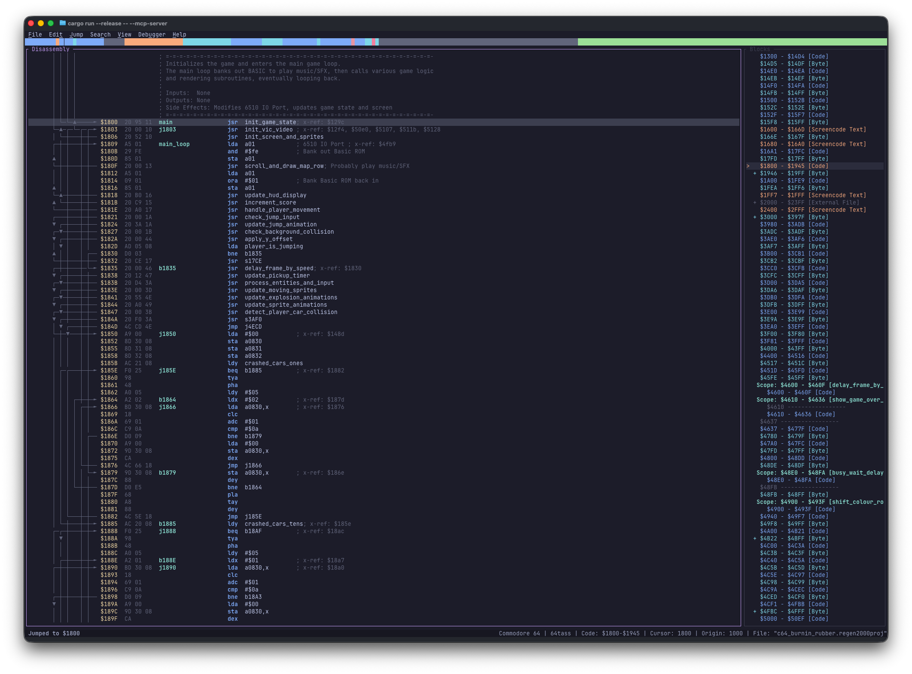{ loading=lazy }

| Action | Shortcut |
| :--- | :--- |
| **Toggle view** | ++alt+1++ or ++ctrl+1++ |
| **Toggle Collapsed Block** | ++ctrl+k++ |
| **Jump to Disassembly** | ++enter++ |

---

## Hexdump View

Press ++alt+2++ (or ++ctrl+2++) to cycle **16-byte wide → 8-byte narrow → hidden**. Bytes use a value-based color palette (inspired by [Color-code your bytes](https://simonomi.dev/blog/color-code-your-bytes/)) alongside live PETSCII or Screencode text decoding (++m++ / ++shift+m++).

=== "16-byte hexdump"

    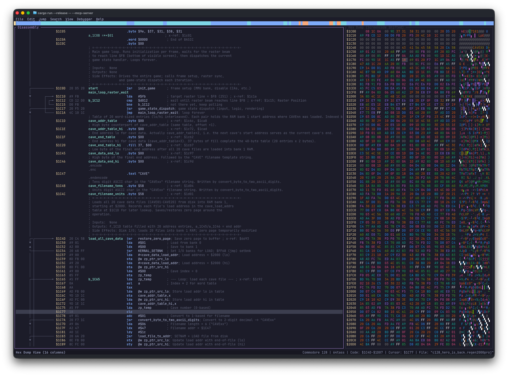{ loading=lazy }

=== "8-byte hexdump"

    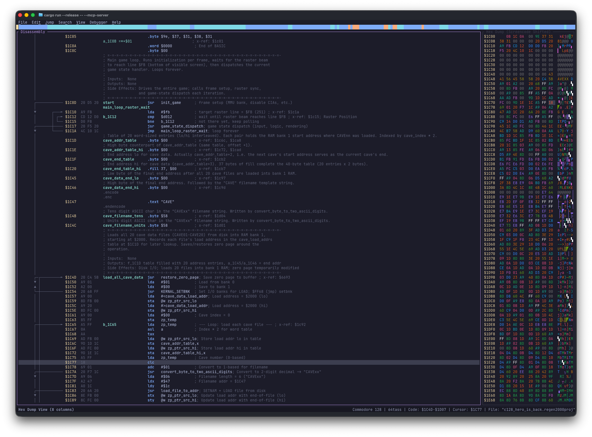{ loading=lazy }

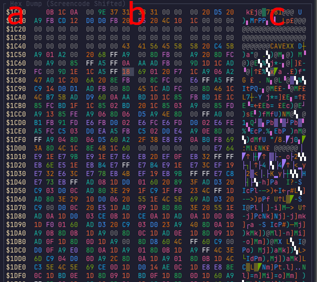{ loading=lazy }

/// caption
Hexdump columns: `a` row address · `b` 8/16 raw hex bytes · `c` Screencode/PETSCII text preview.
///

| Action | Shortcut |
| :--- | :--- |
| **Cycle view** *(16-byte, 8-byte, hidden)* | ++alt+2++ or ++ctrl+2++ |
| **Column Navigation** | ++left++ / ++right++ / ++h++ / ++l++ |
| **Toggle Visual Mode** | ++shift+v++ |
| **Select Bytes** | ++shift+up++ / ++shift+down++ / ++shift+left++ / ++shift+right++ |
| **Clear Selection** | ++escape++ |
| **Convert to Byte** | ++b++ |
| **Next / Prev Text Mode** *(Screencode / PETSCII)* | ++m++ / ++shift+m++ |
| **Jump to Disassembly** | ++enter++ |

---

## Sprites View

Press ++alt+3++ (or ++ctrl+3++) to cycle **2-sprites wide → 1-sprite narrow → hidden**. Renders 64-byte chunks as 24×21 hardware sprites in single-color or multicolor mode (++m++).

=== "2-sprites view"

    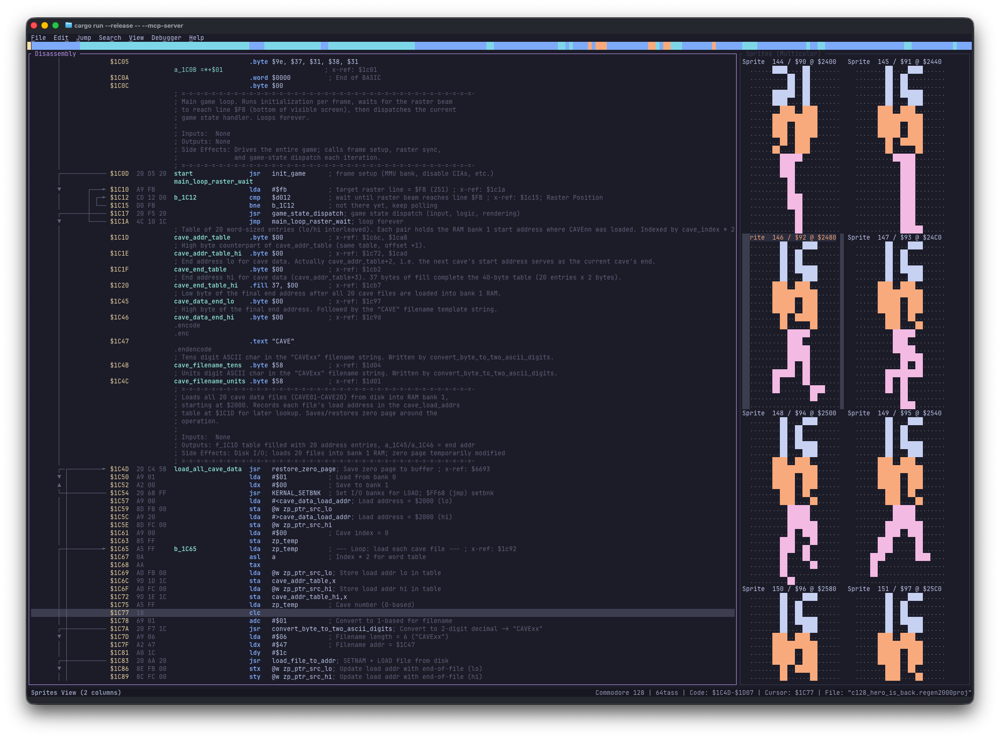{ loading=lazy }

=== "1-sprite view"

    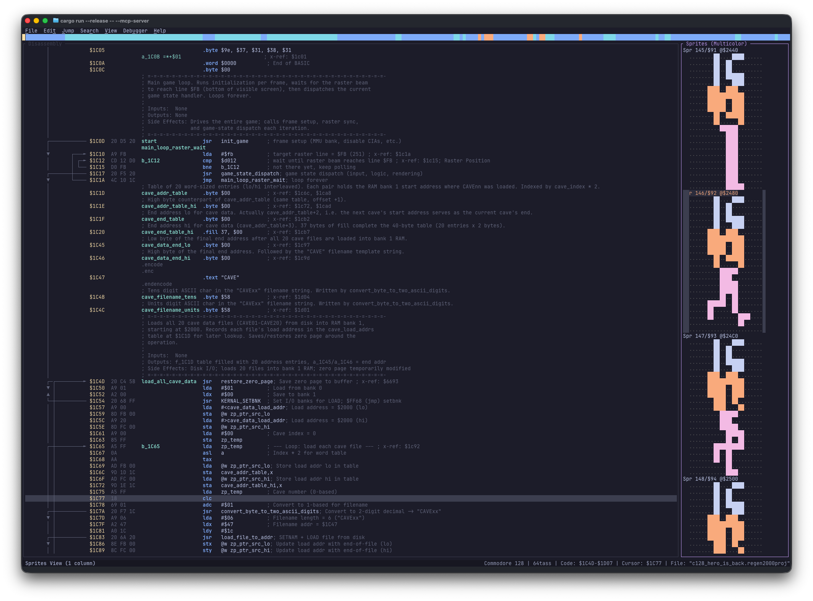{ loading=lazy }

| Action | Shortcut |
| :--- | :--- |
| **Cycle view** *(2-sprites, 1-sprite, hidden)* | ++alt+3++ or ++ctrl+3++ |
| **Column Navigation** *(2-sprites mode)* | ++left++ / ++right++ / ++h++ / ++l++ |
| **Toggle Visual Mode** | ++shift+v++ |
| **Select Sprites** | ++shift+up++ / ++shift+down++ / ++shift+left++ / ++shift+right++ |
| **Clear Selection** | ++escape++ |
| **Convert to Byte** | ++b++ |
| **Toggle Multicolor** | ++m++ |
| **Jump to Disassembly** | ++enter++ |

---

## Charset View

Press ++alt+4++ (or ++ctrl+4++) to cycle **8-chars wide → 4-chars narrow → hidden**. Renders memory as 8×8 character tiles in high-resolution or multicolor mode (++m++) to spot custom fonts.

=== "8-chars view"

    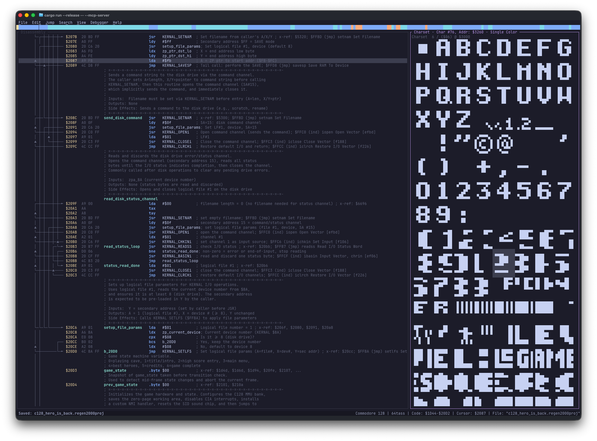{ loading=lazy }

=== "4-chars view"

    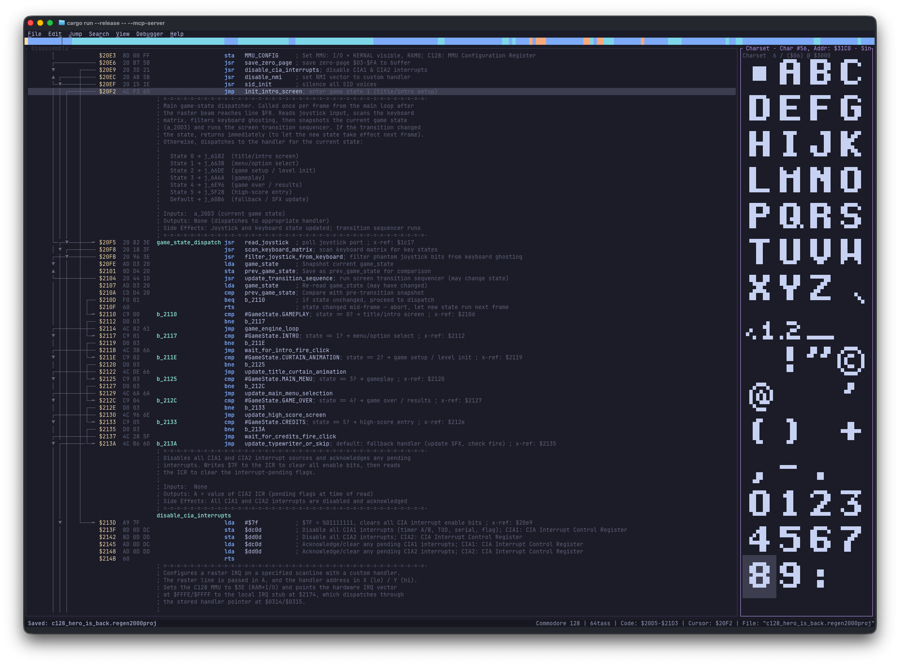{ loading=lazy }

| Action | Shortcut |
| :--- | :--- |
| **Cycle view** *(8-chars, 4-chars, hidden)* | ++alt+4++ or ++ctrl+4++ |
| **Column Navigation** | ++left++ / ++right++ / ++h++ / ++l++ |
| **Toggle Visual Mode** | ++shift+v++ |
| **Select Characters** | ++shift+up++ / ++shift+down++ / ++shift+left++ / ++shift+right++ |
| **Clear Selection** | ++escape++ |
| **Convert to Byte** | ++b++ |
| **Toggle Multicolor** | ++m++ |
| **Jump to Disassembly** | ++enter++ |

---

## Bitmap View

Press ++alt+5++ (or ++ctrl+5++) to toggle full-screen 320×200 / 160×200 bitmap rendering.

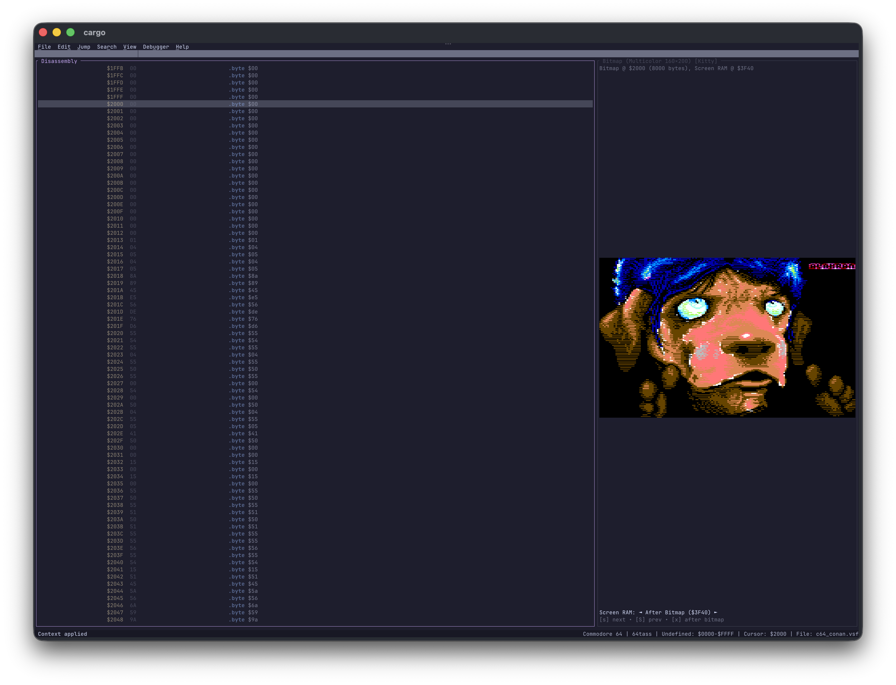{ loading=lazy }

!!! note "Automatic Pixel Graphics Detection"

    Regenerator 2000 detects **Kitty**, **iTerm2**, and **Sixel** terminal protocols at startup and falls back cleanly to Unicode halfblocks when unsupported.

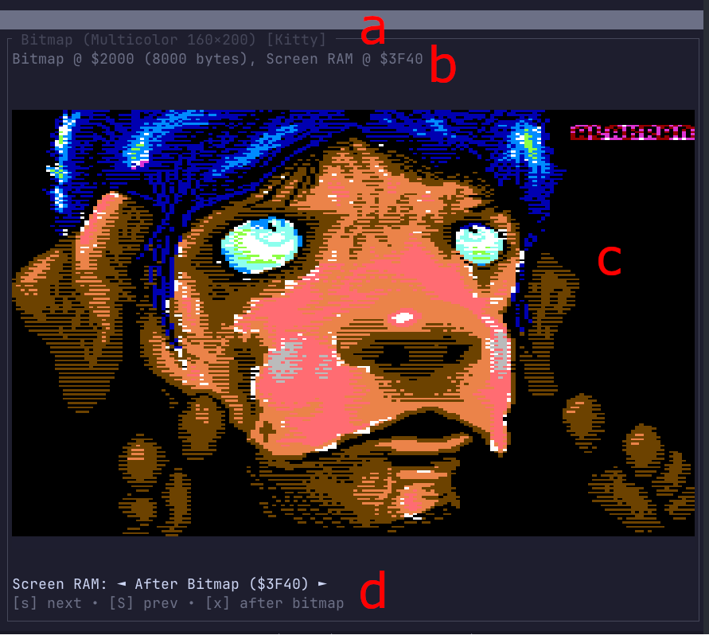{ loading=lazy }

/// caption
Bitmap View elements: `a` mode & terminal renderer · `b` bitmap & Screen RAM addresses · `c` rendered canvas · `d` Screen RAM selector.
///

| Action | Shortcut |
| :--- | :--- |
| **Toggle view** | ++alt+5++ or ++ctrl+5++ |
| **Toggle Visual Mode** | ++shift+v++ |
| **Select Bitmaps** | ++shift+up++ / ++shift+down++ |
| **Clear Selection** | ++escape++ |
| **Convert to Byte** | ++b++ |
| **Toggle Multicolor** | ++m++ |
| **Next / Previous Screen RAM** | ++s++ / ++shift+s++ |
| **Screen RAM after Bitmap (`+8000`)** | ++x++ |
| **Jump to Disassembly** | ++enter++ |

---

## Debugger View

Press ++alt+6++ (or ++ctrl+6++) to toggle the live [VICE](https://vice-emu.sourceforge.io/) debugger panel—showing connection state, stop reason, live disassembly around `PC`, configurable 64-byte Memory Dump (++m++), CPU registers (`A`, `X`, `Y`, `SP`, `P`), stack top (`$0100`–`$01FF`), active breakpoints/watchpoints, hardware vectors (`NMI`/`RES`/`IRQ`), and platform chip registers with change highlighting after every step.

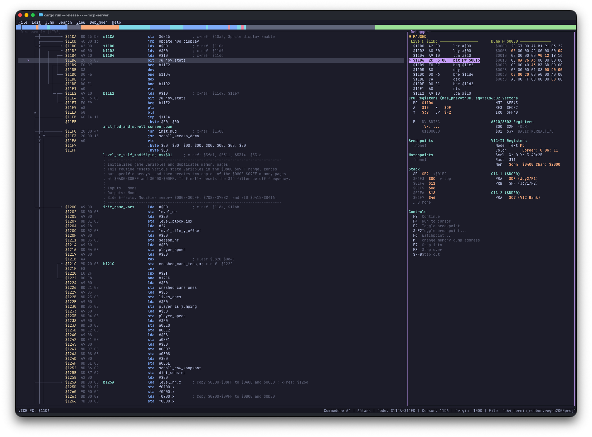{ loading=lazy }

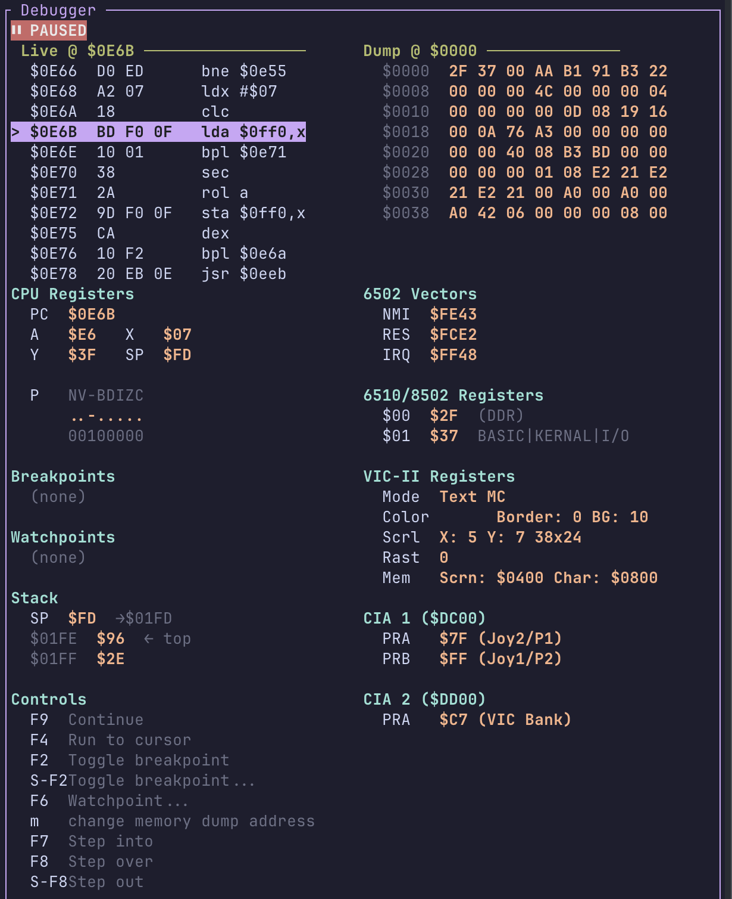{ loading=lazy }

/// caption
Single-column Debugger View (wide terminals arrange Stack and Hardware Registers side-by-side).
///

See [Live Debugger (VICE)](debugger.md) for connection instructions and full details.

| Action | Shortcut |
| :--- | :--- |
| **Toggle view** | ++alt+6++ or ++ctrl+6++ |
| **Toggle Breakpoint** | ++f2++ |
| **Toggle Breakpoint...** | ++shift+f2++ |
| **Run to Cursor** | ++f4++ |
| **Watchpoint** | ++f6++ |
| **Memory Dump...** | ++m++ |
| **Step Instruction** | ++f7++ |
| **Step Over** | ++f8++ |
| **Step Out** | ++shift+f8++ |
| **Run / Continue** | ++f9++ |
