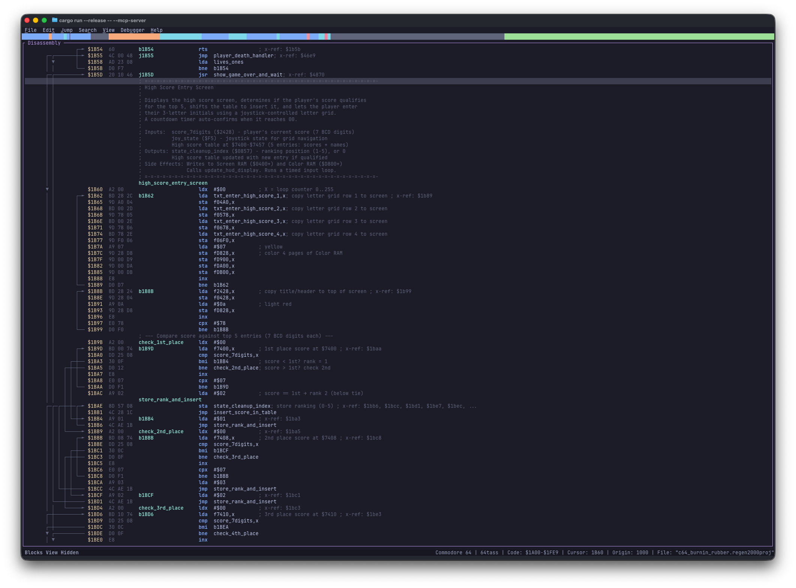
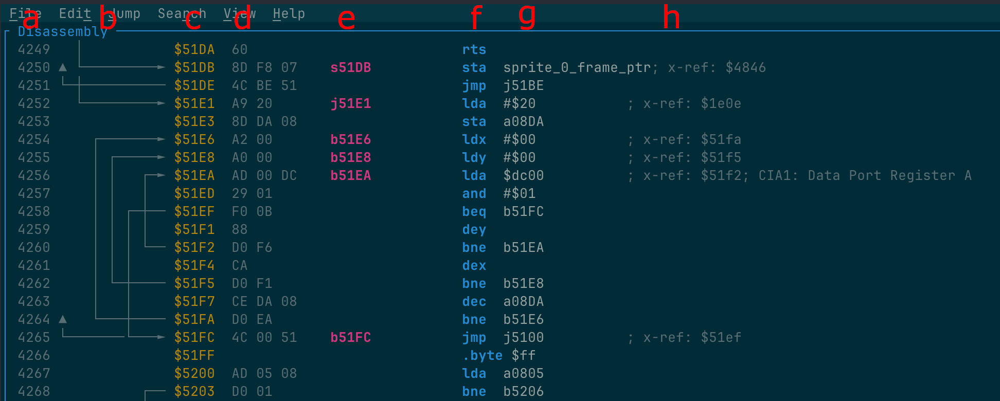
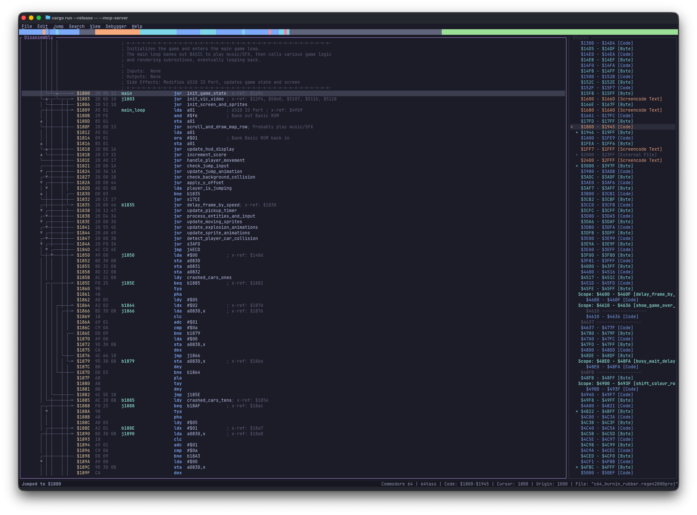
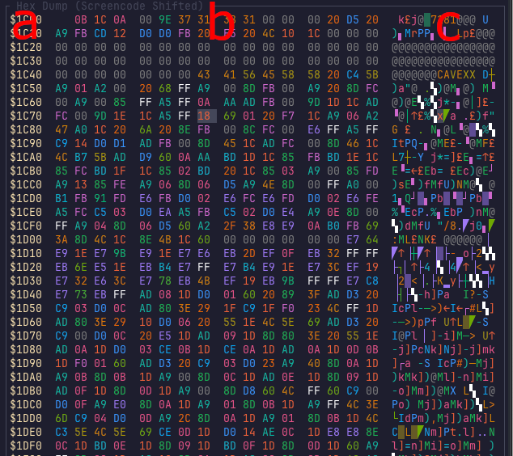
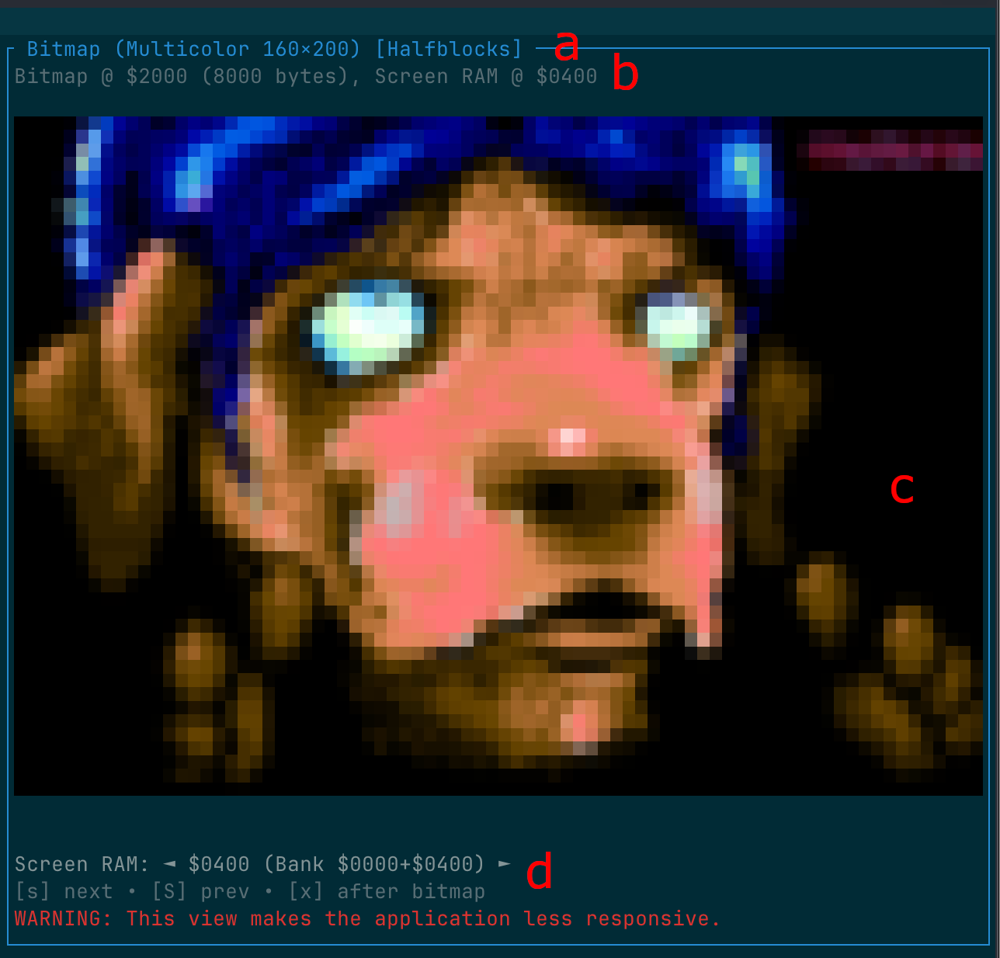

# Views

Regenerator 2000 provides specialized views to analyze Commodore 8-bit binaries.

## Disassembly View

The Disassembly View is the primary workspace in Regenerator 2000. It displays disassembled code, data blocks, and text.

Use this view to perform the following tasks:

- **Navigate Memory**: Move through the address space, jump to addresses or labels, and follow execution paths.
- **Define Block Types**: Convert memory regions into Code, Byte, Word, Address, or Text blocks.
- **Annotate**: Add side or line comments and rename labels.
- **Analyze Flow**: Follow jump and branch arrows in the left margin. Regenerator 2000 dims unreferenced code blocks for visual contrast.
- **Minimap Bar**: Inspect the horizontal minimap bar below the menu bar to see block types across the entire address space. Click the minimap to jump to any location.

The Disassembly View contains these columns:

- **a**: Decimal line number.
- **b**: Control-flow arrows for jumps and branches.
- **c**: Hexadecimal memory address.
- **d**: Hexadecimal instruction or data bytes.
- **e**: Optional label with a type prefix.
- **f**: Instruction mnemonic (for example, `lda`).
- **g**: Instruction operand (for example, `#$05`).
- **h**: Optional side comment (for example, `; this is a comment`).

Auto-generated labels start with a prefix. The prefix shows how the code references the address (such as `s_` for subroutines, `j_` for jumps, and `a_` for absolute addresses). See [Analysis — Label Prefixes](analysis.md#label-prefixes) for the complete list of prefixes.

### Keyboard Shortcuts

| Action                         | Shortcut                      |
|:-------------------------------|:------------------------------|
| **Disassemble address**        | ++d++                         |
| **Convert to Code**            | ++c++                         |
| **Convert to Byte**            | ++b++                         |
| **Convert to Word**            | ++w++                         |
| **Convert to Address**         | ++a++                         |
| **Convert to PETSCII Text**    | ++p++                         |
| **Convert to Screencode Text** | ++s++                         |
| **Convert to External File**   | ++e++                         |
| **Convert to Undefined**       | ++question-mark++             |
| **Set Lo/Hi Address Table**    | ++less-than++                 |
| **Set Hi/Lo Address Table**    | ++greater-than++              |
| **Set Lo/Hi Word Table**       | ++comma++                     |
| **Set Hi/Lo Word Table**       | ++period++                    |
| **Create Scope**               | ++r++                         |
| **Remove Scope**               | ++delete++                    |
| **Nudge Scope Boundary**       | ++alt+up++ / ++alt+down++     |
| **Set Label**                  | ++l++                         |
| **Add Side Comment**           | ++semicolon++                 |
| **Add Line Comment**           | ++colon++                     |
| **Next/Prev Immediate Format** | ++i++ / ++shift+i++           |
| **Pack Lo/Hi Address**         | ++open-bracket++              |
| **Pack Hi/Lo Address**         | ++close-bracket++             |
| **Toggle Visual Mode**         | ++shift+v++                   |
| **Toggle Splitter**            | ++pipe++                      |
| **Toggle Collapsed Block**     | ++ctrl+k++                    |
| **Toggle Bookmark**            | ++ctrl+b++                    |
| **List Bookmarks**             | ++ctrl+shift+b++ or ++alt+b++ |
| **Analyze**                    | ++ctrl+a++                    |
| **Jump to Address**            | ++ctrl+g++ or ++alt+g++       |
| **Jump to Operand**            | ++enter++                     |
| **Jump Back (History)**        | ++backspace++                 |
| **Search**                     | ++slash++                     |
| **Find Next**                  | ++n++                         |
| **Find Previous**              | ++shift+n++                   |

## Blocks View

The Blocks View displays the memory layout of your project as a list of contiguous blocks:

- **Code regions** (Blue)
- **Data regions** (Green/Yellow)
- **Undefined/Unknown regions** (Grey)

Use this view to inspect the structure of the binary and locate unanalyzed data blocks. Click any block (or press ++enter++) to jump to that address in the Disassembly View.

### Keyboard Shortcuts

| Action                     | Shortcut   |
|:---------------------------|:-----------|
| **Toggle view**            | ++alt+1++  |
| **Toggle Collapsed Block** | ++ctrl+k++ |
| **Jump to Disassembly**    | ++enter++  |

## Hexdump View

The Hexdump View displays raw hexadecimal bytes alongside their decoded text characters. Use it to inspect unformatted data and verify byte values.

Press ++alt+2++ (or ++ctrl+2++) to cycle through three layout modes: **wide (16-byte)**, **narrow (8-byte)**, and **disabled** (hidden).

Press ++m++ or ++shift+m++ to switch between PETSCII and Screencode character decoding modes. Regenerator 2000 colors each byte with a **byte-value color palette** (based on [Color-code your bytes](https://simonomi.dev/blog/color-code-your-bytes/)). This palette helps you find repeated values and data structures.

=== "16-byte hexdump"

    

=== "8-byte hexdump"

    

The Hexdump View contains these columns:

- **a**: Hexadecimal row address.
- **b**: 16 bytes or 8 bytes of hexadecimal data.
- **c**: Decoded text ("Screencode shifted", "Screencode unshifted", "PETSCII shifted", or "PETSCII unshifted").

### Keyboard Shortcuts

| Action                                   | Shortcut    |
|:-----------------------------------------|:------------|
| **Cycle view** (16-byte, 8-byte, hidden) | ++alt+2++   |
| **Convert to Byte**                      | ++b++       |
| **Next Text Mode** (Screencode/PETSCII)  | ++m++       |
| **Previous Text Mode**                   | ++shift+m++ |
| **Jump to Disassembly**                  | ++enter++   |

## Sprites View

The Sprites View renders memory as hardware sprites. Press ++alt+3++ (or ++ctrl+3++) to cycle through three layouts: **wide (2-sprites)**, **narrow (1-sprite)**, and **disabled** (hidden).

- **64-byte Chunks**: Renders each 64-byte block as a 24x21 sprite.
- **Multicolor Support**: Press ++m++ to toggle between single-color and multicolor sprite modes.
- **Asset Discovery**: Locate player sprites, enemies, and graphic objects in the binary.

=== "2-sprites view"

    

=== "1-sprite view"

    

### Keyboard Shortcuts

| Action                                       | Shortcut  |
|:---------------------------------------------|:----------|
| **Cycle view** (2-sprites, 1-sprite, hidden) | ++alt+3++ |
| **Convert to Byte**                          | ++b++     |
| **Toggle Multicolor**                        | ++m++     |
| **Jump to Disassembly**                      | ++enter++ |

## Charset View

The Charset View renders memory as 8x8 character tiles to help you locate custom fonts and tile sets.

Press ++alt+4++ (or ++ctrl+4++) to cycle through three layouts: **wide (8-chars)**, **narrow (4-chars)**, and **disabled** (hidden).

- **Standard & Multicolor**: Press ++m++ to toggle between high-resolution and multicolor character modes.
- **Pattern Recognition**: Identify character graphics stored in raw byte regions.

=== "8-chars view"

    

=== "4-chars view"

    

### Keyboard Shortcuts

| Action                                    | Shortcut  |
|:------------------------------------------|:----------|
| **Cycle view** (8-chars, 4-chars, hidden) | ++alt+4++ |
| **Convert to Byte**                       | ++b++     |
| **Toggle Multicolor**                     | ++m++     |
| **Jump to Disassembly**                   | ++enter++ |

## Bitmap View

The Bitmap View renders memory as a full-screen bitmap image:

- **Asset Discovery**: Locate title screens, background graphics, and loading screens.
- **Format Identification**: Identify the layout of large binary data blocks visually.
- **Screen RAM Overlay**: Press ++s++ or ++shift+s++ to cycle through Screen RAM addresses and preview bitmap color attributes.

!!! warning

    The Bitmap View uses significant CPU resources. Hide the Bitmap View (++alt+5++) after you inspect the bitmaps.

The Bitmap View contains these elements:

- **a**: Bitmap mode (Multicolor or High-Res) and terminal renderer (HalfBlocks or iTerm2).
- **b**: Bitmap address and Screen RAM address.
- **c**: Rendered bitmap canvas.
- **d**: Screen RAM position indicator.

### Keyboard Shortcuts

| Action                      | Shortcut    |
|:----------------------------|:------------|
| **Toggle view**             | ++alt+5++   |
| **Convert to Byte**         | ++b++       |
| **Toggle Multicolor**       | ++m++       |
| **Next Screen RAM**         | ++s++       |
| **Previous Screen RAM**     | ++shift+s++ |
| **Screen RAM after Bitmap** | ++x++       |
| **Jump to Disassembly**     | ++enter++   |

## Debugger View

The Debugger View connects to the [VICE](https://vice-emu.sourceforge.io/) emulator for live debugging inside Regenerator 2000.

Press ++alt+6++ (or ++ctrl+6++) to toggle the Debugger View. When the connection to VICE is active, the panel displays:

- **Connection status**: Shows the VICE connection state and whether the emulator runs or pauses.
- **Live disassembly**: Shows disassembly around the current PC and highlights the active instruction when the emulator pauses.
- **Registers**: Displays CPU registers A, X, Y, SP, and P (status).
- **Breakpoints**: Lists active execution breakpoints in VICE.
- **Watchpoints**: Lists active memory watchpoints in VICE.

When the connection to VICE is active, the main **Disassembly** view also highlights the current PC and marks active breakpoints.

See [Debugger (VICE Integration)](debugger.md) for connection instructions and debugger features.

### Keyboard Shortcuts

| Action                   | Shortcut     |
|:-------------------------|:-------------|
| **Toggle view**          | ++alt+6++    |
| **Toggle Breakpoint**    | ++f2++       |
| **Toggle Breakpoint...** | ++shift+f2++ |
| **Run to Cursor**        | ++f4++       |
| **Watchpoint**           | ++f6++       |
| **Memory Dump...**       | ++m++        |
| **Step Instruction**     | ++f7++       |
| **Step Over**            | ++f8++       |
| **Step Out**             | ++shift+f8++ |
| **Run / Continue**       | ++f9++       |
